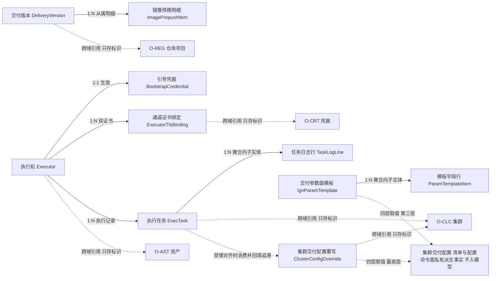
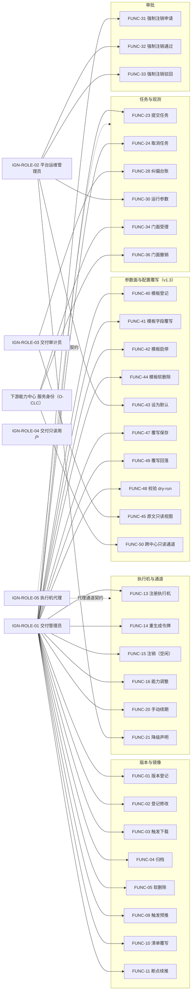
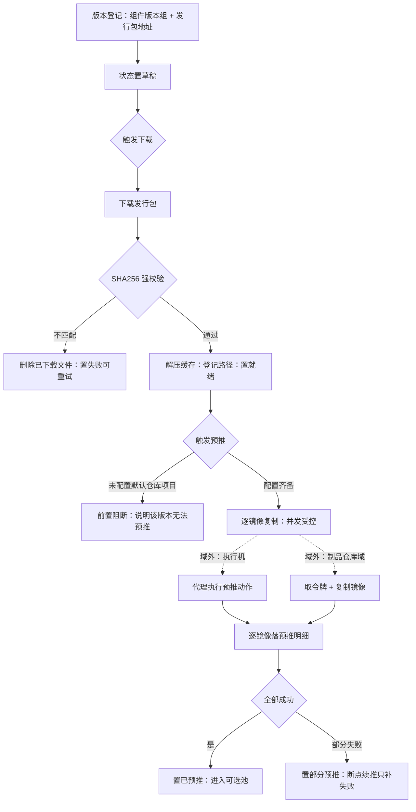
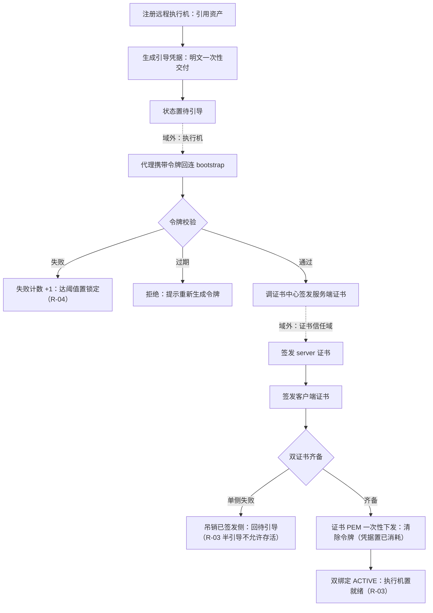
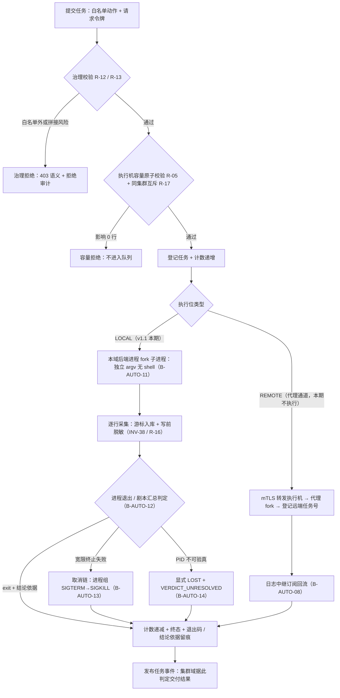
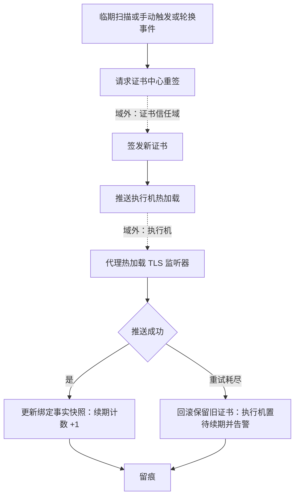
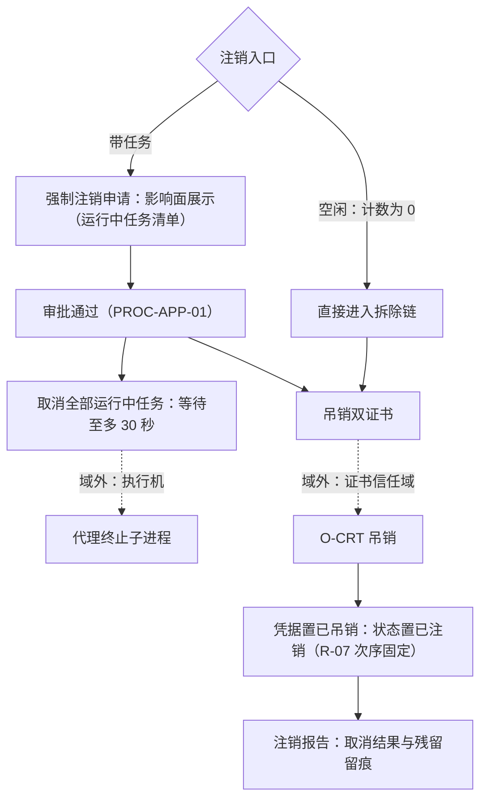
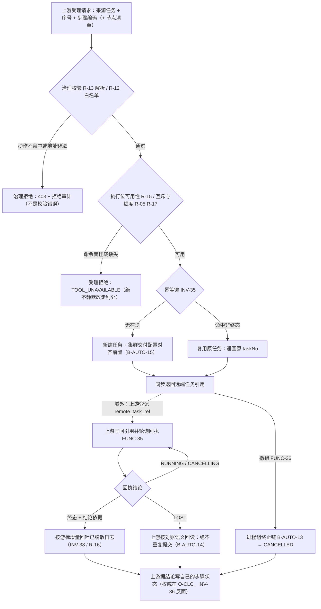
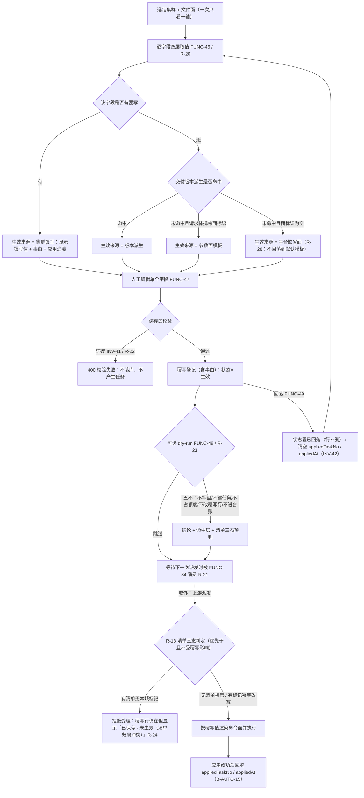
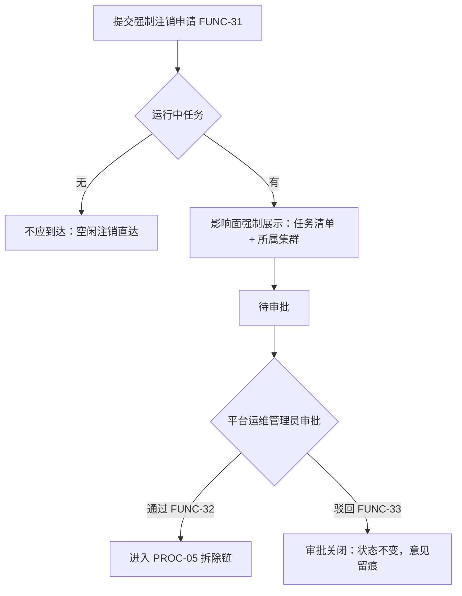

# OPIC-交付执行域 需求规格说明书

| 项目 | 内容 |
|---|---|
| 文档名称 | OPIC-交付执行域需求规格说明书 |
| 规范版本 | 软件需求编写规范 V10.0 |
| 编制日期 | 2026-09-24 |
| 文档状态 | **v1.3 完整（可进入本体建模阶段）**｜v1.0 定稿（2026-09-24）+ **v1.1 交付链路增补（2026-10-05）**：由 Q-68~Q-71 四条裁定驱动（本机执行位 / 步骤参数域 / 交付门面 / 生命周期一次切全）+ 其派生决策 Q-72，Q-1~Q-62 与 Q-68~Q-72 **全部确认**（**Q-63~Q-67 空档是跨文档编号避让，登记见《编制说明》E.1**）+ **v1.1.1 交付配置对齐增补（2026-10-06）**：由阶段三实现推进暴露的边界事实驱动（`REF-17`~`REF-25` 交付参数缺省面、`R-18` 对齐三态、`B-AUTO-15` 改述、`FUNC-34` 请求体按族别口径）；**本批登记的 1 项待确认 `Q-73`（集群内 DNS 后缀与上游访问端点域名是否同源）已于 2026-10-07 真实例交付验收按 AI 建议裁定：判「不同源」⇒ `FUNC-34` 请求体不扩该列**（实测依据见 3.3.1 `REF-19` 取值说明与《编制说明》E.1），至此**待澄清清单无未决条目**、v1.1 定稿结论不因本批撤销 + **v1.2 交付版本可用性门槛增补（2026-10-07）**：来源不是访谈，而是 P3 真实例交付验收暴露的登记事实（观测项 `OBS-P3-01` —— 被交付引用的版本当时仍为草稿态），新增 `R-19` 并联动 `R-13` / `FUNC-34` 入参口径；**规模仅 R 18→19，其余 12 项指标不变**、**本批不新增待澄清项** + **v1.3 交付参数面与配置覆写增补（2026-10-07）**：来源是**第九轮八阶段访谈（`Q-74`~`Q-114`，逐条登记见《编制说明》E.1，全部按 AI 建议确认）**，主题是管理员易用性 —— 新增 **2 个聚合根**（`IgnParamTemplate` 交付参数面模板含「模板字段行」子实体 / `ClusterConfigOverride` 集群交付配置覆写）、**13 个功能点**（`FUNC-38`~`50`）、**7 条 R**（`R-20`~`R-26`）、**3 条 INV**（`INV-41`~`43`）、**1 条 REF**（`REF-26`）、**1 条协同流程**（`PROC-07`）、**4 份报表**（`REP-15`~`18`）、**5 类字典 / 13 个值**、**2 个二级菜单 / 2 个屏幕**；`B-AUTO-15` 由"缺省面 + 版本派生"两层改述为**四层取值并回填应用追溯**（不新增自动行为）；**审批流仍 1 条、角色仍 5 个、本批不新增待澄清项**｜**阶段三（跨对象联动识别）为《编制说明》§D.5 的独立强制阶段**｜E.2 自检 **54 / 54**（v1.1 增补项已复跑；v1.1.1 批按 C/D/H/I 四组、v1.2 批按 C/D/I 三组、**v1.3 批因同时触及对象 / 功能与规则 / 流程 / 报表 / 字典 / 界面各层 ⇒ 九组全量重跑**（判据同 E.2.1），见 E.2.2 / E.2.3 / **E.2.4**）、第九部分 13 项自检全过、独立审核无 FAIL｜交付件：v1.0 已转**单文件自包含 HTML**（在库），v1.1 两份交付件 HTML **已按同一事实源重导**（单文件自包含 + 内联 Mermaid，生成器见《编制说明》E.4；**v1.1.1 两份已随 `Q-73` 收口批于 2026-10-07 重导**、**v1.2 两份已随 `R-19` 批于 2026-10-07 再次重导**、**v1.3 两份已随本批于 2026-10-07 第三次重导**，**Mermaid 10 / 10 渲染为 SVG**（受控浏览器**渲染后 DOM** 实测：Mermaid 容器节点 10、带处理完成标记的 10、角色描述为 flowchart-v2 的 `<svg>` 10；v1.3 批新增 `图 4-8` = `PROC-07`；原无头 Chrome `--dump-dom` 口径在 4 MB 级内联库上挂起不返回，本批弃用。**用于计数的类名 / 属性名 / 文案串一律不写出字面量**（写出即在本件自己的 DOM 里多算一次，判据口径与复算入口见《编制说明》E.4 + J.3 ⑫）、无渲染降级占位提示（四类降级判据串 —— Mermaid 报错标题两种、库内部异常文案一种、生成器降级占位文案一种 —— **一律不写出字面量**：串一旦写进交付文档，就会在文档自己的渲染 DOM 里被计数命中，使"0 次"的断言自我矛盾（本句原稿即实例，已按《编制说明》J.3 ⑫ 收尾改写）；实测四类串在本文档件与编制说明件里各 **0** 次、DOM 报错节点 **0** 个）、无双重转义（"实体前再叠一层和号前缀"的叠加形态 0 处；行内码里尖括号的单层实体属正常转义，不计入残留）、库源码未泄漏进可见文本、**206 锚点 / 171 标题**（v1.2 件 182 / 147），校验记录见 E.4） |

> 状态标记口径：`[AI自动补全]` 系统按行业通用做法补全、用户未修改；`[已确认]` 经用户确认或修改；`[待确认]` 尚未得到用户回复，已登记入《编制说明》待澄清清单。
> 本文档按 V10.0 固定结构（九部分 + 附录 A）组织：**没有适用内容的章节不得删除**，写明「不适用」及经确认的理由，不编内容填空。
> **八阶段的问题（Q-1~Q-62，含定稿确认 Q-62；v1.1 增补裁定 Q-68~Q-71 与其派生决策 Q-72）已全部按 AI 建议确认**，故全部九部分与附录 A 的状态标记统一为 `[已确认]`；**v1.1.1 批新增 `REF-17`~`REF-25` / `R-18` 与其登记的 1 项待确认 `Q-73`，已于 2026-10-07 真实例交付验收按 AI 建议裁定（不同源 ⇒ `FUNC-34` 请求体不扩该列）**，裁定与实测依据见《编制说明》E.1 与本域 3.3.1 `REF-19` 取值说明 —— 待澄清清单**已无未决条目**。**v1.3 易用性增补批（2026-10-07）**：由第九轮八阶段访谈 `Q-74`~`Q-114`（逐条登记见《编制说明》E.1）驱动，把**参数面模板、集群交付配置的查看 / 覆写 / 校验、清单原文只读视图**四项管理员易用性能力登记入正文，**全部按 AI 建议确认**、**本批不新增待澄清项** —— 待澄清清单继续无未决条目。 [已确认]（v1.1.1 增补 · `Q-73` 收口 · v1.3 增补）

---

# 第一部分 项目概述与范围

> 本部分对应《AI 需求探索与确认提示词 V10.0》**阶段零：原始需求接收与总体理解确认**。
> **八阶段的问题（Q-1~Q-62，含定稿确认 Q-62；v1.1 增补裁定 Q-68~Q-71 与其派生决策 Q-72）已全部按 AI 建议确认**，故全部九部分与附录 A 的状态标记统一为 `[已确认]`；**v1.1.1 批新增 `REF-17`~`REF-25` / `R-18` 与其登记的 1 项待确认 `Q-73`，已于 2026-10-07 真实例交付验收按 AI 建议裁定（不同源 ⇒ `FUNC-34` 请求体不扩该列）**，裁定与实测依据见《编制说明》E.1 与本域 3.3.1 `REF-19` 取值说明 —— 待澄清清单**已无未决条目**。**v1.3 易用性增补批（2026-10-07）**：由第九轮八阶段访谈 `Q-74`~`Q-114`（逐条登记见《编制说明》E.1）驱动，把**参数面模板、集群交付配置的查看 / 覆写 / 校验、清单原文只读视图**四项管理员易用性能力登记入正文，**全部按 AI 建议确认**、**本批不新增待澄清项** —— 待澄清清单继续无未决条目。 [已确认]（v1.1.1 增补 · `Q-73` 收口 · v1.3 增补）

## 1.1 系统定位

本域（交付执行域，`O-IGN`；原能力中心 `ignition-center`，前缀 `IGN`）是 23 个本体论域中的**交付版本目录的编目者、执行机的登记者与调度者、以及执行动作的桥接者**：它把「把一套集群装到一组机器上」这件事拆成三个可治理的问题 —— **用哪个版本装**（kubeasz 版本目录与组件版本组，反向闭合 `O-REG` 的「托管 ≠ 编目」）、**在哪台机器执行**（执行机登记与选择）、**怎么把动作安全地送过去并拿回结果**（任务桥接：白名单动作、防重放、日志中继、状态对账），使集群域只需「选版本、选执行机、提交动作」，而不必知道执行细节。（v3.2 更正，109 号 F-70） [已确认]

本域管理的是**版本元数据与发行包缓存、镜像清单与预推、执行机台账与引导握手、执行机的信任凭据与通道安全、执行任务的分发与取消、任务日志与状态对账**；它**不实现交付内容**（kubeasz 与各脚本的可执行逻辑归第 3 层发行包）、**不判定交付结果**（退出码是事实，集群是否装好由集群域判断）、**不替代目标机器的主人**（执行机上的动作全部经由其常驻代理执行；**v1.1：本机执行位上的"代理职责"由本域后端进程承担 —— 同一套纪律（白名单固定枚举、参数独立 argv 无 shell、并发计数与心跳照常），不是另开一条口子**）。一句话：本域回答的是「**用哪个版本、在哪台机器、把动作安全地送过去**」，而不是「**装得好不好、对不对**」。 [已确认]

本域与其余 18 个域的耦合形态有四点特殊之处：① 它是**唯一「运行第三方交付二进制」的域** —— 动作白名单、参数无 shell 解释、防重放令牌是**安全边界**而非功能列表（见定性四）；② 它是**第二次出现「被治理对象自身在运行期与本域交互」的域** —— 执行机上的常驻代理主动回连本域（引导、心跳、日志流），与 `O-VPN` 的节点侧身份同类而通道不同（`O-VPN` 是覆盖网、本域是 mTLS 双向通道）；③ 它与 `O-AST` 构成**两种远程执行范式的对照** —— `O-AST` 是**拉起式**（平台拿凭据主动 SSH 登录、机器上无代理），本域是**常驻式**（机器上有代理、代理回连平台），两者判据都是「执行者需要什么通道」；④ 它的版本目录**一旦被集群引用就成为「别人配置里的事实」** —— 组件版本组创建后不可修改（见定性二）。 [已确认]

### 1.1.1 四条域级定性

> 以下四条是本域在阶段零确立的定性，后续所有阶段不得违背；若确需变更，须作为需求变更显式提出（与已完成八域的定性同级）。

**定性一：本域是「交付的编目者与调度者」，不是「交付内容的实现者」，也不是「执行结果的裁判」。** 版本目录回答「**用哪个版本装**」（每个版本一行、组件版本组齐备、被选进集群配置后不可改）；执行机台账回答「**在哪台机器执行**」（登记、引导、健康、并发额度）；任务桥接回答「**怎么送过去、怎么拿回日志与退出码**」。三条硬性含义：① **本域不实现交付内容** —— kubeasz 的能力归第 3 层发行包，本域只做下载、校验、缓存与编目；**镜像预推**调用的也是制品仓库域的取用通道，制品内容与存储归 `O-REG`（「通道 ≠ 内容」在本域的复述）；② **本域不判定交付结果** —— 任务结束的产物是**退出码与日志**这两个事实，「集群是否可用」的判定归集群域；③ **本域不解释业务失败** —— `ezctl.setup` 失败的集群侧原因归集群域分析，本域只保证「执行了什么、何时、在哪、结果码几、日志在哪」**可追溯**。**后果与补偿**：本域只能观测进程级事实 ⇒ 补偿手段是**全量留痕 + 日志中继 + 状态对账**，让「看不到的」显式变成「任务丢失」而不是静默。 [已确认]
>
> **（v1.1 增补）本机执行位不改变本条定性**：① 执行位是** LOCAL 执行机**（`B-AUTO-03` 系统注册的那一行、`REF-10` 并发上限固定），命令族 / 剧本 / 参数拼装的可执行逻辑仍归第 3 层发行包，本域只按白名单动作 + 独立 argv 直调；② 本域产出的结论仍是**进程级事实**（退出码、剧本汇总行），不是业务判定；③ 交付结果判定仍归集群域 —— v1.1 只是把「阶段三未接入」的下发与回流桩收口成真实链路，**没有把本域变成实现者或裁判**。 [已确认]（v1.1 增补）

**定性二：版本目录是一阶资源 —— 每个版本一行、状态单向推进、失败不分裂对象；且它是「会被别人选进配置的契约」。** 一个版本的组件版本组（K8s / 运行时 / etcd / CNI / CoreDNS）一旦被集群引用，就成了那个集群的**出生事实** —— 这与 `O-REG` 的「地址创建后不可修改」同一判据（**产出物会进入别人的配置 ⇒ 创建后不可改**）。四条硬性含义：① **组件版本组创建后不可修改** —— 改口径 = 新建版本 + 归档旧版本，让引用关系自己决定何时迁移；② **状态单向推进**（草稿 → 下载中 → 就绪 → 预推中 → 已预推 / 部分预推 → 已归档），失败态可从任意阶段进入且**可重试不分裂对象**；③ **删除判据 = 引用** —— 被任何集群引用的版本不可删除（与 `O-ARC` 草稿态、`O-REG` 引用判据同源：**判据是有没有引用，不是重不重要**）；④ **归档不是删除** —— 归档后不再出现在新建集群的选项里，但发行包缓存与已推送镜像**保留**给存量集群运维使用。 [已确认]

**定性三：执行机凭据「明文一次交付、验证后销毁」；通道安全是双向 mTLS、两把钥匙各归其主。** 三个涉及凭据与通道的域构成**对照谱系**：`O-AST` 凭据**可还原密文**（平台要主动登录）、`O-REG` **什么都不存**（验证方在引擎）、**本域的引导令牌明文只在创建响应出现一次、库内存密文、引导成功即清除** —— 判据仍是「使用方在谁手上」：令牌只服务于**引导这一瞬间**，此后通道身份由证书承担。四条硬性含义：① **双向 mTLS、两把钥匙** —— 执行机持服务端 + 客户端证书（本域签发时一次性下发），平台持**自己的**平台客户端证书（不复用执行机的），谁是调用方、谁出示哪把，分得清清楚楚；② **双证书原子性** —— 服务端证书签发成功而客户端失败时，**吊销已签发的服务端证书**、执行机回到待引导态（不允许「半引导」状态存活）；③ **实验环境可显式降级为明文通道** —— 但必须显式声明 + 留痕 + 界面红色标识（降级是**登记在案的决定**，不是悄悄的默认）；④ **执行机的可用性分两个正交维度** —— 治理状态（就绪 / 锁定 / 已注销 / 已降级，谁决定）与心跳健康（可达与否，何时观测），与 `O-AST` 定性四同源，不得互相推导。 [已确认]

**定性四：本域是唯一在执行机侧运行第三方二进制的域 —— 白名单、防重放、无 shell 是安全边界，不是功能列表。** 执行机代理只执行**固定枚举内**的动作（部署 / 启停 / 加减节点 / 升级 / 备份恢复 / 证书续期 / 脚本类），参数以**独立 argv** 传递（无 shell 解释、拼接即拒绝），每次提交带**一次性请求令牌**（执行机侧 24 小时防重放窗口）。四条硬性含义：① **白名单外一律 403 并审计** —— 「能不能执行」是本域的治理结论，「执行得对不对」不是；② **无 shell 解释** —— 杜绝借参数实现命令拼接这一整类注入；③ **任务可取消、会超时** —— 取消转执行机（SIGTERM → 30 秒后 SIGKILL），超时由执行机强制；**取消运行中任务影响的是上游域的工作，故强制注销带任务的执行机须经审批**；④ **执行机重启会丢失内存态** —— 平台侧的**状态对账**（本地与执行机状态不一致时**以执行机为准**）与**崩溃恢复**（重启后重建日志中继、对不上的任务显式置败）是本域对「分布式执行必然有裂缝」的正面回答。**与 `O-AST` 的范式对照**：`O-AST` 是**拉起式**（无代理、平台拿凭据主动登录）、本域是**常驻式**（有代理、代理回连）—— 范式不同，但「对目标机器的真实写入必须幂等可重入」的纪律相同（发行包缓存可重下、预推可断点续推、任务令牌可幂等重放）。 [已确认]
>
> **（v1.1 增补）执行位收口本机不放松本条**：动作白名单仍是固定枚举（`ezctl.*` 部署族 + `scripts.*` 脚本族），命令面由**本域私有映射**从「动作码 + 步骤编码 + 集群标识 + 节点地址」渲染成 argv 逐项校验后直调（`R-13`）；新增的**交付门面**（`FUNC-34`~`FUNC-36`）**只受理登记标识与动作码，上游中心不得提交命令面、参数数组或工作目录** —— 否则白名单就从"本域的治理边界"退化成"上游的透传面"（`INV-34`~`INV-37`、`R-13`~`R-15`）。 [已确认]（v1.1 增补）

> **层位说明**：本域位于三层架构的**第 2 层（平台能力层）**，属 **Tier 1**（原能力中心清单为平台层第 7 顺位；本体论域登记为第 9 号，见 `O-SEC.SEC_DOMAIN_CODES`）。MVP 最短依赖路径为 `O-SEC → O-ARC → O-SYS → O-DBS → O-CRT → O-VPN → O-REG → O-AST → O-IGN …`。 [已确认]
> **本域为什么排在资产域之后**：本域的执行机**登记时引用资产域的资产标识**（执行机必须是一台已收编进台账的机器）；版本预推**消费制品仓库域的取用通道**；执行机与平台的双向通道**消费证书信任域的签发能力**（server / client 两个 profile）与网络连通域的可达性。四条供给线齐备后，本域才能把「版本、机器、动作」接成一条交付线。 [已确认]
> **本域落地的紧迫性**：本域是**集群域（`O-CLC`）的硬前置** —— 集群创建要选版本、选执行机、提交 `ezctl` 动作，全部走本域；同时它反向闭合了 `O-REG` 挂起的「托管 ≠ 编目」接口（版本编目归本域）。 [已确认]
>
> **域边界一句话（九域对照）**：`O-SEC` 管「**能不能过**」｜`O-ARC` 管「**错是什么**」｜`O-SYS` 管「**平台怎么运转**」｜`O-DBS` 管「**数据放在哪、谁能连、丢了怎么回来**」｜`O-CRT` 管「**谁可以被信任**」｜`O-VPN` 管「**节点之间能不能连上**」｜`O-REG` 管「**制品放在哪、谁能拉、怎么取到**」｜`O-AST` 管「**机器是谁、它准备好了吗**」｜`O-IGN` 管「**用哪个版本、在哪台机器、把动作安全送过去**」。 [已确认]

## 1.2 业务范围

### 1.2.1 范围内

- **版本目录（kubeasz 版本编目）**：创建版本元数据（组件版本组：K8s / 运行时 / etcd / CNI / CoreDNS；发行包地址与摘要）；**组件版本组创建后不可修改**；版本状态机（草稿 → 下载中 → 就绪 → 预推中 → 已预推 / 部分预推 → 已归档；失败可从任意阶段进入并可重试）；**归档与删除保护**（被集群引用不可删；归档保留发行包与镜像供存量运维）；**默认版本**快捷入口（平台配置指定）。 [已确认]
- **发行包与镜像预推**：从发行包地址下载 kubeasz 发行包（**SHA256 校验失败即删除重来**）；解压缓存并登记缓存路径；**镜像清单管理**（从发行包的下载清单自动解析、支持人工覆写）；**镜像预推**（通过制品仓库域取用通道逐镜像复制到默认仓库项目；并发受控；**断点续推** —— 跳过已成功镜像、只重试失败镜像）；仓库不可达时**不污染本地缓存**并允许稍后重试。 [已确认]
- **执行机登记与引导**：本地执行机**由系统自动注册**（全平台唯一、不可手工创建）；远程执行机注册（**必须引用资产域的资产标识**；生成引导令牌并**一次性返回明文**）；**引导握手**（令牌校验 → 调证书中心签发服务端与客户端双证书 → 证书内容一次性下发 → 清除令牌）；**令牌过期与重新生成**；**连续失败锁定**（连续五次引导失败置锁定态、须管理员重置）。 [已确认]
- **执行机的信任凭据与通道安全**：证书来源固定为证书信任域（server / client 两个 profile）；**双证书原子性**（半引导不允许存活）；**自动续期**（订阅轮换事件、推送执行机热加载、失败回滚保留旧证书并标记待续期）；**吊销响应**（服务端证书被吊销 ⇒ 执行机置降级态：拒新任务、运行中任务保护）；**平台客户端证书**独立管理（被吊销时立即重新申请并热替换）；**显式 TLS 降级**仅限实验环境（声明 + 留痕 + 红色标识）。 [已确认]
- **任务桥接（执行动作分发）**：向执行机提交动作（**动作白名单固定枚举**；参数独立 argv 无 shell 解释）；**请求令牌幂等与防重放**（24 小时窗口）；**并发额度原子控制**（分发递增 / 结束递减、不超上限不下溢）；**取消与超时**（转发执行机、SIGTERM → SIGKILL）；**执行机心跳载荷与本地计数偏差超限时以执行机为准强制纠正**（留痕）。**（v1.1）分发不再停在登记**：目标执行机为 LOCAL 时，本域进程即以独立 argv fork 发行包命令族、逐行采集输出、按剧本汇总与退出码出结论、超时与取消按进程组终止（`B-AUTO-11`~`B-AUTO-15`）。 [已确认]（v1.1 增补）
- **（v1.1 新增）交付门面（面向上游中心的单步交付）**：上游集群域把**一次交付动作**（动作码 + 步骤编码 + 集群标识 [+ 节点地址]）提交给本域门面，本域**受理即返回远端任务引用**、执行按上述任务桥接链路推进；上游以**回执对账**取得状态 / 退出码 / 结论依据 / **按游标增量的日志行**，并可在运行中请求撤销。门面**不接收命令面、不接收参数数组、不接收工作目录**（命令面映射是本域白名单的私有事实）；同一「来源任务 + 来源步骤」重复提交返回原任务（幂等，`INV-35`）。 [已确认]（v1.1 增补）
- **（v1.3 新增）交付参数面模板**：把 `REF-17`~`REF-25` 的**参数面**（不是命令面）抽成可复用的**模板资产** —— 一张模板 = 一个文件面（主机清单面 / 集群配置面）+ 一组「字段键 / 字段值 / 形态」行；状态为草稿 / 启用 / 停用，**默认模板在同一文件面内全局唯一**；**不做版本历史**（要保留旧口径就克隆新建一张）；**被引用不可删除**（引用判据 = 上游模板登记的面标识 + 生效中的覆写指向）。模板**只登记字段键与字段值**，不登记清单文件本身、不登记命令与剧本 —— `R-13` 的命令面私有边界不因"易用性"而松动（`R-24`）。 [已确认]（v1.3 新增）
- **（v1.3 新增）集群交付配置的查看、覆写与校验**：按「集群 + 文件面」呈现**字段级配置视图**，逐字段标注**生效来源**（取值四层优先级：集群覆写 > 交付版本派生 > 参数面模板 > 平台缺省面，`R-20`）；允许**字段级覆写**与**一键回落**（列表型字段整体替换、不做元素级增删，`R-22`）—— 覆写行是**人工治理事实**（必填事由），只在**下一次受理对齐**时参与渲染并回填应用追溯（`R-21`）；提供**校验（dry-run）**入口：复用受理侧同一套校验器与对齐判定，**不写盘 / 不建任务 / 不占容量 / 不改覆写行**，结论必须与真实受理一致（`R-23`）；另有**清单原文只读视图**（带行号、可复制、无编辑态，走独立权限码且每次读取写审计，`R-26`）。**本域是这份配置的写口与权威**，上游 `O-CLC` 经只读通道代理读取、界面只给跳转引导（写口不双开）。 [已确认]（v1.3 新增）
- **日志中继与状态对账**：订阅执行机的日志流并中继到平台统一任务日志通道（前端无感）；**断线重连**（重试耗尽显式置败）；**状态对账**（本地与执行机不一致时以执行机为准、留痕）；**崩溃恢复**（平台重启后重建运行中任务的中继、执行机侧任务丢失则显式置败不静默）。**（v1.1）日志行是本域的数据行**：本机执行位的逐行输出按任务内单调游标入库（`INV-38`），**不可逆脱敏先于落库**（`R-16`），上游门面按游标增量取走 —— 「中继」的实现形态从"订阅对端流"变为"读自己的行"，口径不变（`REP-11` / `FUNC-27`）。 [已确认]（v1.1 增补）
- **运行观测与跨中心暴露**：执行机心跳健康（超时置不可达、恢复自动回归）；**跨中心精简查询**（按用途筛选可用版本与执行机、过滤不健康与超载、默认项快捷入口）；**统计总览**（版本分布、预推状态、执行机健康、任务成败）；事件发布（版本、执行机、任务、证书全生命周期事件）。 [已确认]
- **与平台底座的对接**：能力登记、调用审计（任务桥接与凭据操作全留痕）、运行参数登记与下发（并发、超时、心跳阈值、令牌有效期、TLS 降级开关等）、事件总线。 [已确认]

### 1.2.2 范围外

| 范围外内容 | 排除理由 |
|---|---|
| **交付内容的实现**（kubeasz 能力、部署脚本逻辑、playbook 编写） | 交付能力在第 3 层发行包内；本域只做下载校验缓存编目与执行（定性一）。 [已确认] |
| **交付结果的业务判定**（集群是否健康、组件是否可用） | 本域产物是退出码与日志；「装好了没」由集群域订阅任务结束事件后自行判定（定性一 ②）。 [已确认] |
| **制品的存储与分发通道实现**（镜像仓库引擎、存储后端） | 归制品仓库域；本域预推是其**消费方**（通道 ≠ 内容）。 [已确认] |
| **执行机作为机器的台账与巡检** | 执行机**必须引用**资产域的资产标识；机器本体的事实（规格、健康、巡检）归 `O-AST`（本域只管「执行能力」这一层）。 [已确认] |
| **执行机证书的签发、信任链与吊销裁决** | 归证书信任域；本域是消费方（签发请求、续期推送、吊销响应），不建 CA（定性三）。 [已确认] |
| **集群的创建、编排与节点管理** | 归集群域（B3 后续探索）；集群域是本域任务桥接的**上游调用方**与**版本 / 执行机的引用方**。 [已确认] |
| **任意 shell 命令执行** | 白名单外一律拒绝（定性四）；「能执行任意命令」会让执行机变成平台最大的攻击面。 [已确认] |
| **清单 / 配置文件的整文件文本编辑态**（v1.3 新增） | 原文是**命令面私有的派生产物**（`Q-69` 裁定 ②）；在界面上改文件等于绕过字段级校验与三态归属判定（`R-18`），还会让"落盘事实"与"台账事实"各说一套。要改的是**字段**、不是**文件** ⇒ 本域的编辑口径 = 字段级覆写（`FUNC-47` / `FUNC-49`）+ 只读原文（`FUNC-45` / `R-26`）。 [已确认]（v1.3 新增） |
| **浏览器内终端（WebSSH）**（v1.3 新增） | 本域不向浏览器暴露目标机终端：凭据值零出口（定性三），需要人工排查时由运维用自有终端登录；真要开放交互式终端属安全域裁定（`O-SEC`），不在本批易用性范围。 [已确认]（v1.3 新增） |
| **任务的财务计量与成本分摊** | 归运营成本域（`O-OPR`）；本域的任务台账只含执行事实。 [已确认] |

### 1.2.3 外部边界

| 边界对象 | 交互方向 | 交互内容 | 边界口径 |
|---|---|---|---|
| 制品仓库域（`O-REG`） | 本域 → 调用 | 预推时取机器人令牌、逐镜像复制到默认仓库项目 | **通道 ≠ 内容**：本域是 `O-REG` 的消费方；**⭐ 反向闭合 `O-REG` 挂起的「托管 ≠ 编目」接口** —— 版本编目（「有哪几个版本、该用哪个」）归本域，制品托管与分发通道归 `O-REG`。仓库不可达时本域**不污染本地缓存**并允许重试。 [已确认] |
| 资产域（`O-AST`） | 本域 → 引用 | 远程执行机注册时**必须引用**已登记的资产标识 | **机器事实归 `O-AST`、执行能力归本域**：同一台机器在本域是一行「执行机」、在 `O-AST` 是一台「资产」，两域以引用相接；`O-AST` 的免密通道与本域的常驻代理是**两种执行范式**，互不替代。 [已确认] |
| 证书信任域（`O-CRT`） | 双向 | bootstrap 时签发 server / client 双证书；订阅轮换与吊销事件；平台侧客户端证书独立申请 | 本域不建 CA、不判断信任链；**半引导不允许存活**（双证书原子性）；平台客户端证书是**本域的对外身份**、被吊销时立即替换。 [已确认] |
| 集群域（`O-CLC`，B3 第 3 域） | `O-CLC` → 调用本域；本域 → 引用声明 | 创建集群时查可用版本与执行机、提交执行动作；版本与执行机的「被引用」由集群域声明 | **⭐ 集群域是本域的上游调用方**：本域不持有集群概念；「交付结果」的判定归集群域；被引用版本与执行机的删除保护依赖集群域的**引用声明**（不直查他域表）。**（v1.1 增补）集群域的 K8S 全生命周期动作（安装 / 续跑 / 启停 / 升级 / 备份恢复 / 证书续期 / 加减节点 / 销毁）一律经本域交付门面单步下发，本域是唯一的执行位提供者**；**步骤状态的权威在 `O-CLC`（其步骤子实体与安装步骤字典），本域只认 `ezctl.setup` 的参数合法域 01~07 并逐步骤出结论**（`INV-36`）—— 与本域「不判定交付结果」（定性一 ②）是同一纪律的两侧。 [已确认]（v1.1 增补） |
| 执行机代理（机器身份） | 代理 → 回连本域 | 引导握手、心跳上报、日志流推送、证书热加载接收 | **第二次出现「被治理对象自身在运行期与本域交互」**（继 `O-VPN` 节点侧身份之后）：通道是 mTLS 双向、身份是本域签发的证书对。**（v1.1 增补）REMOTE 执行机的代理对端实现不在本期交付范围** —— 登记、引导、双证书、心跳、注销的语义与接口契约全部保留（是"对端还没建"，不是"取消这条边界"）；本期执行位只有系统注册的 **LOCAL 执行机**，其代理职责由本域后端进程承担。 [已确认]（v1.1 增补） |
| 平台底座域（`O-SYS`） | 双向 | 能力登记、审计、配置项、事件总线、任务日志通道复用 | 本域不自建用户权限、不自建事件通道；**主密钥属部署期约定**（与 `O-AST` 同口径：从平台密钥设施加载）。 [已确认] |
| 零信任安全域（`O-SEC`） | 本域 → 遵从 | 管理面与跨中心调用的统一认证授权；任务桥接调用方须同时持有上游域权限与本域执行权限 | 双重鉴权（上游业务权限 + 本域执行权限）都在 `O-SEC` 口径内表达。 [已确认] |
| 网络连通域（`O-VPN`） | 本域 → 依赖 | 平台与执行机之间、执行机与仓库之间的网络可达 | 可达性是 `O-VPN` 的产出与本域的运行前置；本域不建覆盖网。 [已确认] |
| 数据服务域（`O-DBS`） | 本域 → 依赖 | 业务库供给（`ign` schema） | 禁 AutoMigrate、跨中心不建外键（全局规则）。 [已确认] |

## 1.3 业务域划分

本域划分为 **8 个子域**（v1.3 由 7 → 8；与第八部分菜单的对应关系见 8.1.1 —— **除子域 8 对应两个二级菜单外，其余子域与菜单一一对应**）：

| 子域编号 | 子域名称 | 职责概述 | 对应菜单 |
|---|---|---|---|
| 1 | 版本目录 | kubeasz 版本编目、组件版本组、状态机、归档与删除保护 | 版本目录 |
| 2 | 发行包与镜像 | 发行包下载校验缓存、镜像清单、预推与断点续推 | 发行包与镜像 |
| 3 | 执行机登记 | 本地 / 远程执行机、引导握手、凭据、并发额度 | 执行机 |
| 4 | 通道安全 | 双证书、自动续期、吊销响应、平台侧身份、显式降级 | 通道安全 |
| 5 | 任务桥接 | 动作白名单、任务分发、幂等防重放、取消与超时 | 任务桥接 |
| 6 | 日志与对账 | 日志中继、状态对账、崩溃恢复、门面受理台账 | 日志与对账 |
| 7 | 运行观测 | 心跳健康、统计总览、跨中心暴露、运行参数 | 运行观测 |
| 8 | **交付参数面与配置覆写**（v1.3 新增） | 参数面模板治理、按集群的字段级覆写与回落、取值四层与来源标注、配置校验（dry-run）、清单原文只读视图 | 参数面模板 / 集群交付配置（**一域两屏**） |

> **子域划分的判据**：按「**交付线的四段 + 两层保障 + 一个出口 + 一块参数面**」划分 —— 版本（子域 1 / 2 是「用什么」的前后两步）、机器（子域 3 / 4 是「在哪执行」与其安全保障）、动作（子域 5 / 6 是「怎么执行」与其可靠性保障）、观测出口（子域 7）、**参数面（子域 8 —— 「用什么参数装」的治理面，v1.3 新增）**。**通道安全独立成子域**因为它有自己的对象（证书绑定）与独立失败模式（半引导、续期失败、吊销）；**日志与对账独立成子域**因为「执行」与「确认执行结果被完整记录」是两类可靠性承诺；**（v1.3）参数面独立成子域**因为它有自己的对象（模板与覆写）、自己的失败模式（覆写了却不生效、回落了却仍显示生效、面外键），而且它回答的是 `REF-17`~`REF-25` 那一层「**参数从哪来、谁能改、改了什么时候生效**」—— 与子域 1「用哪个版本」是两根不同的轴（版本面由 `R-19` 门槛把关，参数面由 `R-20` 优先级决定）。**（v1.3）子域 8 对应两个二级菜单是本域唯一的一域两屏**：模板是**跨集群复用的治理资产**（可增可删、删除要过引用校验），覆写是**按集群的治理事实**（只覆写与回落、不提供删除），两者的写入生命周期与权限档位都不同 —— 硬塞进一屏会让"删模板"和"回落覆写"共用一个操作位。 [已确认]（v1.3 新增）

## 1.4 核心清单索引

> 编号在各部分内独立；跨域引用冠域码。清单数字为阶段零预判，以实际产出为准（偏差登记入《编制说明》C.2）。

| 清单 | 数量（预判） | 实际（v1.3） | 所在部分 | 说明 |
|---|---|---|---|---|
| 业务对象 | 6 | **9** | 第二部分 | 版本 / 预推明细 / 执行机 / 引导凭据 / 证书绑定 / 任务 / 任务日志行（v1.1 子实体）/ **交付参数面模板（v1.3 新增聚合根，含「模板字段行」子实体）** / **集群交付配置覆写（v1.3 新增聚合根）**；属性 **115**、INV **43** |
| 功能点 | 待阶段二定 | **50** | 第三部分 | 人工 27 + 审批 3 + 查询 20（v1.1 +门面四件套；**v1.3 +`FUNC-38`~`50` 十三项：模板五维护 + 模板默认 + 覆写保存 / 回落 + 校验 + 三查询 + 一服务接口**） |
| 系统自动行为 | 待阶段二定 | **15** | 第三部分 | v1.0 为 10；v1.1 +`B-AUTO-11`~`15`；**v1.3 不新增**，`B-AUTO-15` 由两层取值改述为**四层取值 + 应用追溯回填** |
| 业务规则 | 待阶段一、二定 | **INV 43 / R 26 / REF 26** | 第二、三部分 | 预分流 13 条 → 合并 2 组、新增 12 条（逐批对账见第三部分「预分流对账」四条；v1.1.1 批 +9 REF、v1.2 批 +1 R、**v1.3 批 +3 INV / +7 R / +1 REF**） |
| 协同流程 | 5 | **7** | 第四部分 | 版本上架（含预推）、执行机引导、任务分发、证书续期、执行机注销 + 交付门面受理与回执对账（v1.1）+ **集群交付配置的查看、覆写与校验（v1.3 `PROC-07`）** |
| 审批流程 | 1 | **1** | 第四部分 | 执行机强制注销（取消他人运行中任务），v1.1 / v1.3 均无新增 —— **覆写与回落不进审批**（治理留痕足够，装机现场等不起一次审批） |
| 报表 | 待阶段五定 | **18** | 第五部分 | 与查询功能点一一对应（无展示面者显式登记）；`FUNC-35`（v1.1）与 **`FUNC-50`（v1.3 跨中心只读通道）** 显式登记为无展示面的服务接口读 |
| 数据字典 | 待阶段六定 | **20 类 / 95 项** | 第七部分 | v1.0 为 12 类 64 项；v1.1 +3 类；v1.3 +**5 类 / 13 项**（文件面、模板状态、覆写状态、取值来源、值形态） |

> **收敛说明**：上表"实际"列为各批落定后的复核值（v1.0 为 6 / 33 / 10 / 33+12+12 / 5+1 / 13 / 12 类 64 项；v1.1 为 7 / 37 / 15 / 40+17+16 / 6+1 / 14 / 15 类 82 项；v1.1.1 批只增 9 条 REF、v1.2 批只增 1 条 R，其余指标不变）。**v1.3 的增量全部来自"参数面与配置覆写"这一条易用性主线**，界面侧同步 **7 二级 / 7 屏幕 → 9 二级 / 9 屏幕**（新增「参数面模板」「集群交付配置」，登记在第八部分而非本清单）；**聚合根 7→9 是本域首次突破阶段零预判的对象数**（判据见 §1.6.3：新增对象都是"人工治理事实"而不是新的被治理域），**角色数（5）与审批流数（1）均未变化**。偏差登记见《编制说明》C.2。

## 1.5 角色总览

> 角色为局部编号（`IGN-ROLE-xx`），全局映射在 `O-SYS` 登记。

| 局部角色 | 角色名称 | 类型 | 职责概述 |
|---|---|---|---|
| `IGN-ROLE-01` | 交付管理员 | 人工 | 版本编目与上架、预推、执行机登记与引导、任务提交与取消、日志排查；**（v1.3 增补）参数面模板的登记 / 字段行维护 / 启停 / 软删除，集群交付配置的覆写保存与回落、校验（dry-run）** |
| `IGN-ROLE-02` | 平台运维管理员 | 人工 | 运行参数、TLS 降级决策、执行机锁定重置与注销审批、默认项配置；**（v1.3 增补）默认项配置在本批的具体形态即"参数面模板设为默认"（`FUNC-43`），仍只有本角色可执行** |
| `IGN-ROLE-03` | 交付审计员 | 人工 | 只读 + 审计台账（任务留痕、凭据操作留痕、白名单拒绝记录）；**零写动作**；**（v1.3 增补）新增一项只读能力：清单原文视图（`FUNC-45`，独立权限码 + 逐次审计）—— 是读、不是写，零写动作结论不变** |
| `IGN-ROLE-04` | 交付只读用户 | 人工 | 版本列表、任务台账、统计总览查询；**（v1.3 增补）参数面模板的列表与详情查询对其开放，「集群交付配置」屏幕（`frmIgnConfig`）对其关闭**（覆写记录含"这个集群被改过什么"，属运维事实而非公开台账） |
| `IGN-ROLE-05` | 执行机代理 | 机器身份 | 常驻在执行机上的代理：引导回连、心跳上报、日志流推送、证书热加载接收；**只经 mTLS 通道、无管理界面** |

> **角色设计的两点说明**：① `IGN-ROLE-05` 是**第二次出现「被治理对象自身在运行期与本域交互」**（继 `O-VPN.VPN-ROLE-05` 之后）—— 执行机代理是本域治理的机器上的常驻身份，主动回连；② `O-REG.REG-ROLE-05` 是**下游消费方**、本域的第五身份是**被治理对象自身**，两者性质不同，登记时须区分（服务身份 vs 机器身份）。 [已确认]
> **（v1.3 增补）角色总数仍为 5 个、不新增第 6 角色**：本批四项易用性能力（模板治理、配置覆写与校验、原文只读、跨中心只读通道）都能落在既有角色的职责边界内 —— 模板治理与覆写归"做交付的人"（`IGN-ROLE-01`），唯一的跨切治理动作（设为默认）归"定平台缺省的人"（`IGN-ROLE-02`），原文视图归"看留痕的人"（`IGN-ROLE-03`）。**没有一项需要新身份来承载，所以不新开角色**；上表职责概述列的增述即本批的角色侧全部改动（逐功能点分配见第八部分矩阵二）。 [已确认]（v1.3 增补）

## 1.6 技术底座与运行前置

### 1.6.1 情形一：技术底座已就绪

- **运行载体**：MCC 独立中心，`/api/v1/ignition/...`；跨中心调用走平台网关并透传审计头。 [已确认]
- **（v1.1 新增）执行位与命令面**：本机执行位 = **本域后端容器自身**（即系统注册的 LOCAL 执行机）；发行包命令族的可执行文件与其工作根目录**只以部署配置值存在**（配置项，不进代码常量、不进字典、不可运行期改），容器以**只读挂载**取得该目录；命令族需要的集群清单与配置由本域在受理时按登记事实落盘到该集群的工作目录（幂等、可重入）。**镜像内不预装第三方交付工具** —— 挂载缺失即"本机执行位不可用"，走降级口径而非静默改走别处。 [已确认]（v1.1 增补）
- **数据落点**：业务表落 `opicdb` 的 `ign` schema 前缀；禁 AutoMigrate、走 `migrations/`；跨中心不建外键。 [已确认]
- **认证与授权**：管理面接入统一认证；**跨中心双重鉴权** —— 调用方须同时持有上游业务权限（如集群写）与本域执行权限；执行机代理通道走 **mTLS**（机器身份）。 [已确认]
- **事件与日志通道**：事件发布走平台事件总线；任务日志**复用平台统一任务日志通道**（中继写入后前端无感）。**（v1.1 增补）** 本机执行位的逐行输出即该通道的写入源（游标单调、写前不可逆脱敏，`INV-38` / `R-16`）；对上游门面按游标增量吐回，不在两域间复制第二份日志存储。 [已确认]（v1.1 增补）
- **加密设施**：引导令牌 AES-256-GCM 加密；主密钥从平台密钥设施加载（部署期约定）；主密钥不可用时**按能力降级**（只读可用、创建远程执行机与引导前置阻断）。 [已确认]
- **发行包缓存**：本域自持**本地文件缓存区**（发行包解压目录），它是本域的**内部技术组件**；缓存可重下重建、不是需要备份的数据（判据：可由源头重建的不算要保护的事实）。 [已确认]

### 1.6.2 情形二：未指定技术底座时的降级实现

> 平台底座已确定，本节**不适用**。保留本节并记录本域自身兜底口径：事件总线短时不可用时本地暂存重放；`O-CRT` / `O-REG` 短时不可用时**不阻塞版本目录与任务台账**，只前置阻断需要签发或取令牌的动作（与全部已完成域的按能力降级同一手法）。 [已确认]

### 1.6.3 与本文其余部分的关系

本节确立的四条定性、**8 个子域（v1.3 批由 7 扩至 8，见 1.3）**、5 类角色与范围边界是后续所有阶段的上位约束：第二部分**不建集群对象、不建 kubeasz 能力对象、不建财务字段**；第三部分的规则不得违背白名单与防重放口径；第四部分的流程必须体现「引导 → 可用 → 注销」的执行机生命周期与「上架 → 可选」的版本生命周期；第五部分的报表**不得出现令牌明文与证书内容**；第六部分以「**版本与执行机的治理属性归本域、机器事实归 `O-AST`、集群归 `O-CLC`**」为准；第八、九部分以 1.5 角色表为依据。突破须走需求变更并回改本节。 [已确认]
>
> **（v1.1 增补）三条上位约束的落点调整**：① 「不建 kubeasz 能力对象」继续保持 —— v1.1 建的是**本域的执行事实与日志行**（对象仍是 7 个：+ 任务日志行子实体），命令语义 / playbook 结构 / 步骤内部实现**一律不入模型**，入模型的只有「动作码 + 步骤参数合法域（01~07）」这一层白名单目录；② 白名单与防重放口径**加强不削弱**（门面提交同样过 `R-12` 治理拒绝 + `R-13` 命令面私有映射）；③ 「执行事实真相在执行机侧」不变 —— 本机执行位下"执行机"就是 LOCAL 那一行，崩溃恢复与失联判定（`B-AUTO-14`）仍按「痕迹不可存活 ⇒ 显式 `LOST`，不静默、不猜测成功」执行。 [已确认]（v1.1 增补）

> **（v1.3 增补）参数面两个对象不突破本节约束**：① 新增的 `IgnParamTemplate`（交付参数面模板）与 `ClusterConfigOverride`（集群交付配置覆写）**既不是集群对象、也不是 kubeasz 能力对象** —— 入模型的只有「**人工决定要改哪个字段、改成什么、为什么改、这次覆写被哪一次受理用掉了**」这一层治理事实；清单文件与配置文件本身仍是命令面私有的**派生产物**、继续不入模型（`R-24`，与 `Q-69` 裁定 ② 同一条线）；② 「不建财务字段」不适用本批（本批无计量语义）；③ 第五部分报表仍**不得出现令牌明文与证书内容**，且本批额外把**清单原文只读视图**独立成权限码（`FUNC-45` / `R-26`）—— 判据是原文含内网网段、仓库地址与证书备用名，比台账明细敏感一档；④ 「集群归 `O-CLC`」不变：覆写行存的是**集群标识**（跨域只存标识），本域依旧不持有集群概念、不校验集群是否存在。 [已确认]（v1.3 增补）

### 1.6.4 与第 3 层开源实现的对应关系（本域特有）

> 按 C1 铁律，本节是正文中唯一允许出现具体开源产品名的位置；产品名同时登记入《编制说明》C 区。本域与第 3 层的耦合形态是「**消费一个发行包 + 编排一个自研代理**」—— 发行包是**被缓存的制品**，代理是**本域自己的边缘组件**。

| 本域能力 | 对应的开源实现 / 协议 | 耦合形态 |
|---|---|---|
| 集群交付能力 | **kubeasz** 发行包（`ezctl` 命令族 + playbooks） | **发行包级耦合**：本域缓存并调用其命令族，动作白名单按其命令面固定；发行包可整体替换为其他交付工具（版本目录的元数据结构不变）。**（v1.1 增补）本域是命令族的真实调用方**：`ezctl setup <集群> <01..07>` 逐步骤直调（独立 argv）、逐行采集、按剧本汇总行与退出码出结论；`start` / `stop` / `upgrade` / `backup` / `restore` / `destroy` / `add-node` / `del-node` / `ca-renew` 为单步动作；**受理安装族每一步都要把该集群的交付配置按登记事实对齐**（清单与配置两件，接管 / 幂等 / 冲突三态，首步必须落定）—— 参数面取自本域平台配置的缺省面（`REF-17`~`REF-25`）再按交付版本派生覆盖组件版本面；具体手段（用命令族的建骨架动作后覆写，或直接写工作目录文件）**属本域命令面私有事实、不进模型**（`B-AUTO-15` / `R-18`）。替换发行包时只需替换命令面映射与挂载路径，**白名单动作码与结论口径不变**。 [已确认]（v1.1 增补） |
| 镜像预推 | **skopeo**（镜像复制） | **工具级耦合**：预推动作经执行机代理调用，属白名单内的 `scripts.*` 类动作。 [已确认] |
| 双向通道 | **mTLS**（HTTP + WebSocket over TLS） | **协议级耦合**：证书由 `O-CRT` 签发，本域不自带 PKI。 [已确认] |
| 引导令牌加密 | **AES-256-GCM**（平台密钥设施） | **算法级耦合**，与 `O-DBS` / `O-CRT` / `O-AST` 口径一致。 [已确认] |
| 执行机代理 | **自研常驻代理**（平台边缘组件） | **自持组件**：代理是本域的实现对端（引导 / 心跳 / 日志 / 热加载四个接口），其版本随心跳上报。**（v1.1 增补）本期只落地本机执行位**：LOCAL 执行机的代理职责（fork / 逐行采集 / 取消终止 / 崩溃后痕迹判定）由本域后端进程承担；REMOTE 代理的对端实现留待后续（接口契约与登记引导链路不动）。 [已确认]（v1.1 增补） |
| SHA256 校验 | 标准摘要算法 | **算法级耦合**。 [已确认] |

> **与 `O-REG` 的对照**：`O-REG` 编排一个**可部署引擎的实例**；本域**没有引擎实例** —— 发行包是**缓存的制品**（可重下）、执行机代理是**分布在对端机器上的自持组件**。与 `O-AST` 的对照：`O-AST` 的观测命令集在**每次执行时拼接**（无对端组件）、本域的代理是**常驻的**（有心跳、有版本）。 [已确认]

---

**第一部分（阶段零）小结**：四条域级定性（编目与调度者而非实现者与裁判、版本目录是一阶资源且是被选进配置的契约、凭据明文一次交付验证后销毁与双向 mTLS 两把钥匙、白名单防重放无 shell 是安全边界）、**8 个子域（v1.3 批 +1）**、5 类角色（**第二次出现被治理对象自身回连**）、**10 条范围外边界（v1.3 批 +2：整文件文本编辑态、浏览器内终端）**、9 条外部边界（含 **⭐ 反向闭合 `O-REG`「托管 ≠ 编目」**）；登记上游八域既有约束 12 条与原 SPEC 口径矛盾 10 处（见《编制说明》C.1.1 / C.1.2）。唯一审批流预判 = **执行机强制注销**（判据：取消他人运行中任务 —— 中断的是上游域的工作）。 [已确认]

---

# 第二部分 业务对象

> 本部分对应**阶段一：业务对象识别与数据建模确认**。全部条目已按 AI 建议确认，状态标记统一为 `[已确认]`。
> **本域 7 个对象**：交付版本 `DeliveryVersion` / 镜像预推明细 `ImagePrepushItem`（从属明细） / 执行机 `Executor` / 引导凭据 `BootstrapCredential` / 通道证书绑定 `ExecutorTlsBinding` / 执行任务 `ExecTask` / **任务日志行 `TaskLogLine`（v1.1 新增，执行任务聚合内子实体）**。
> **阶段零预判 6 对象，实际产出 6 对象**（差异仅在把「镜像预推结果」从版本对象的 JSON 字段升格为**从属明细对象** —— 逐镜像结果是断点续推的判定依据，必须可独立查询与统计，塞进 JSON 会让「预推了 200 个、失败 3 个」无处安放；已在《编制说明》C.2 登记）。

## 2.1 交付版本（DeliveryVersion）

**业务定义。** 一套交付工具发行包的**编目记录**：组件版本组（会被集群选进配置的契约，`Q-1` 收口「托管 ≠ 编目」）、发行包地址与摘要、镜像清单、默认仓库项目引用与生命周期状态。它是集群域创建集群时的**版本信源**。 [已确认]

**对象分类。** 主数据（本域权威源）。业务编号 `VER` 前缀 + 4 位流水。

| 属性 | 属性英文名 | 类型 | 必填 | 唯一 | 说明 / 约束 |
|---|---|---|---|---|---|
| 版本编号 | versionNo | 字符串 | 是 | 是 | 业务编号，创建时生成、不可修改 |
| 版本名 | name | 字符串 | 是 | 是 | **未归档范围内唯一**（归档后同名可复用，`INV-01`） |
| 显示名 | displayName | 字符串 | 否 | 否 | 下拉展示用 |
| 交付工具版本 | toolVersion | 字符串 | 是 | 否 | 语义化版本格式（`INV-02`）；**组件版本组成员** |
| 编排引擎版本 | orchestratorVersion | 字符串 | 是 | 否 | `v1.x.y` 格式；**组件版本组成员** |
| 容器运行时版本 | runtimeVersion | 字符串 | 是 | 否 | **组件版本组成员** |
| etcd 版本 | etcdVersion | 字符串 | 是 | 否 | **组件版本组成员** |
| CNI 插件 | cniPlugin | 数据字典 | 是 | 否 | `IGN_CNI_PLUGIN`：CALICO / CILIUM / FLANNEL |
| CNI 版本 | cniVersion | 字符串 | 是 | 否 | **组件版本组成员** |
| CoreDNS 版本 | corednsVersion | 字符串 | 是 | 否 | **组件版本组成员** |
| 发行包地址 | tarballUrl | 字符串 | 是 | 否 | 合法 URL |
| 发行包摘要 | tarballSha256 | 字符串 | 否 | 否 | 提供时下载后强校验（`R-02` 同源） |
| 缓存解压路径 | cachePath | 字符串 | 条件 | 否 | 状态进入「就绪」及之后非空（`INV-06`） |
| 镜像清单 | imageManifest | JSON | 是 | 否 | 数组 `[{repo, tag, digest?, size?}]`；**逐镜像预推结果在预推明细对象**（2.2） |
| 默认仓库项目 | defaultRegistryRef | 引用 | 否 | 否 | **跨域引用** `O-REG` 仓库项目（只存标识）；为空时该版本不可预推（`REF-04` 前置） |
| 版本状态 | status | 数据字典 | 是 | 否 | `IGN_VERSION_STATUS`：DRAFT / DOWNLOADING / READY / PREPUSHING / PREPUSHED / PARTIALLY_PREPUSHED / ARCHIVED / FAILED |
| 归档时间 | archivedAt | 日期时间 | 条件 | 否 | 进入「已归档」时必填 |
| 登记时间 | createdAt | 日期时间 | 是 | 否 | |

**刻意不建的属性（三条）。** ① **逐镜像预推结果不落本对象**（升格为从属明细 2.2）；② **引用集群清单不落本对象** —— 引用关系由集群域声明（`R-01`），本域不复制（引用要在对方域收口）；③ **下载进度百分比不落字段** —— 过程性读数由任务通道承载，落字段必然过时。 [已确认]

**对象级不变量**

| 不变量编号 | 业务条件 |
|---|---|
| INV-01 | 版本名在**未归档范围内**唯一（保存即校验） |
| INV-02 | 交付工具版本为语义化版本、编排引擎版本为 `v1.x.y` 格式、发行包地址为合法 URL（保存即校验） |
| INV-03 | CNI 插件取值必须命中 `IGN_CNI_PLUGIN` 字典（保存即校验） |
| INV-04 | **组件版本组（交付工具 / 编排引擎 / 运行时 / etcd / CNI 插件与版本 / CoreDNS 六项）创建后不可修改**（定性二：会被选进集群配置的契约；仅提交时强制校验） |
| INV-05 | 已归档版本的登记字段冻结（终态冻结；仅提交时强制校验） |
| INV-06 | 缓存解压路径仅当状态处于「就绪 / 预推中 / 已预推 / 部分预推」时非空；离开这些状态（失败重置）时允许清空待重建（保存即校验） |
| INV-07 | 版本状态迁移路径固定单向；FAILED 可从任意非终态进入且重试后回归对应阶段（仅提交时强制校验） |

**跨对象约束预分流（2 条，归属 R）**：① 「被集群引用的版本不可删除」—— 读集群域引用声明，归属 R；② 「预推前置 = 默认仓库项目已引用且 `O-REG` 通道可用」—— 读引用对象与外部通道，归属 R。 [已确认]

## 2.2 镜像预推明细（ImagePrepushItem）

**业务定义。** 一个版本的一次预推动作中**每个镜像的执行结果**（从属明细，属版本聚合）：镜像坐标、摘要、体积、预推状态、失败原因与时间。它是**断点续推的判定依据**（跳过已成功、只重试失败）。 [已确认]

**对象分类。** 从属明细（属版本聚合，不可独立存在；不单独编号，采用「所属版本编号 + 镜像坐标」定位）。

| 属性 | 属性英文名 | 类型 | 必填 | 唯一 | 说明 / 约束 |
|---|---|---|---|---|---|
| 所属版本 | versionRef | 引用 | 是 | 是 | 引用本域版本；与镜像坐标联合唯一 |
| 镜像仓库 | repo | 字符串 | 是 | 是 | 非空 |
| 镜像标签 | tag | 字符串 | 是 | 是 | 非空 |
| 内容摘要 | digest | 字符串 | 否 | 否 | 预推成功后由仓库侧回填 |
| 体积（字节） | sizeBytes | 整数 | 否 | 否 | |
| 预推状态 | prepushStatus | 数据字典 | 是 | 否 | `IGN_PREPUSH_STATUS`：PENDING / SUCCESS / FAILED / SKIPPED |
| 失败原因 | failReason | 字符串 | 条件 | 否 | FAILED 时必填（`INV-09`） |
| 最近预推时间 | prepushedAt | 日期时间 | 条件 | 否 | SUCCESS / SKIPPED 时必填 |
| 登记时间 | createdAt | 日期时间 | 是 | 否 | |

**对象级不变量**

| 不变量编号 | 业务条件 |
|---|---|
| INV-08 | 同一版本内「仓库 + 标签」联合唯一；预推明细由镜像清单派生生成、清单覆写时同步对齐（保存即校验） |
| INV-09 | 预推状态为 FAILED 时失败原因必填；SUCCESS 时摘要必填（仅提交时强制校验） |
| INV-10 | SKIPPED 必须携带跳过依据（仓库侧摘要已存在）；PENDING 不得出现在预推动作结束之后（终态收口核对，仅提交时强制校验） |

**跨对象约束预分流（1 条，归属 R）**：③ 「断点续推跳过 SUCCESS / SKIPPED 行、只重试 FAILED 行」—— 由预推动作驱动的对本聚合的批量写入，归属 R（与 2.1 预分流 ② 同一动作的两侧）。 [已确认]

## 2.3 执行机（Executor）

**业务定义。** 一台承载交付执行能力的机器在本域的**能力登记**：类型（本地 / 远程）、资产引用、服务地址、能力标签、并发额度、治理状态与最近心跳。**治理状态（谁决定）与心跳健康（何时观测）正交**（定性三 ④）——「不可达」是最近心跳超时的**派生结论 + 事件**，不落治理状态。 [已确认]

**对象分类。** 主数据（本域权威源 —— 执行能力层；机器事实层归 `O-AST`）。业务编号 `EXE` 前缀 + 4 位流水。

| 属性 | 属性英文名 | 类型 | 必填 | 唯一 | 说明 / 约束 |
|---|---|---|---|---|---|
| 执行机编号 | executorNo | 字符串 | 是 | 是 | 业务编号，创建时生成、不可修改 |
| 名称 | name | 字符串 | 是 | 是 | 全平台唯一（未注销范围内） |
| 显示名 | displayName | 字符串 | 否 | 否 | |
| 类型 | executorType | 数据字典 | 是 | 否 | `IGN_EXECUTOR_TYPE`：LOCAL / REMOTE；**LOCAL 由系统自动注册、全平台至多一行**（`INV-12`） |
| 资产标识 | assetRef | 引用 | 条件 | 否 | **跨域引用** `O-AST` 资产；REMOTE 必填（`INV-13`） |
| 服务地址 | host | 字符串 | 是 | 否 | 合法 IP / FQDN；LOCAL 固定为本机回环 |
| 服务端口 | port | 整数 | 是 | 否 | 1024~65535（`INV-14`） |
| 能力标签 | capabilityFlags | JSON | 是 | 否 | 数组；取值命中 `IGN_CAPABILITY` 字典 |
| 治理状态 | status | 数据字典 | 是 | 否 | `IGN_EXECUTOR_STATUS`：ENROLLING / READY / LOCKED / DEGRADED / RENEWAL_PENDING / REMOVED（**「不可达」不在其中** —— 派生结论，见刻意不建） |
| 并发上限 | concurrentTasksMax | 整数 | 是 | 否 | REMOTE 登记时声明；LOCAL 由系统固定（`INV-16`） |
| 当前任务数 | currentTasksCount | 整数 | 是 | 否 | 原子增减（`R-05`）；**不下溢、不超上限**（`INV-15`） |
| 最近心跳时间 | lastHeartbeatAt | 日期时间 | 条件 | 否 | REMOTE 引导成功后由心跳更新；**不可达 = 它超时的派生结论** |
| 最近心跳载荷 | lastHeartbeatPayload | JSON | 条件 | 否 | 覆写式（最新值）；含负载、磁盘、代理版本 |
| 引导完成时间 | bootstrappedAt | 日期时间 | 条件 | 否 | 进入「就绪」时必填（`R-03` 判定的事实落点） |
| 登记时间 | createdAt | 日期时间 | 是 | 否 | |

**刻意不建的属性（三条）。** ① **「不可达」不落治理状态**（派生结论 + 事件；正交口径，定性三 ④）—— 与 `O-AST`「健康结论不落字段」同判据；② **集群引用清单不落本对象**（引用由集群域声明）；③ **心跳历史不落本对象**（心跳是时序数据、只保留最新载荷；历史归运行观测台账）。 [已确认]

**对象级不变量**

| 不变量编号 | 业务条件 |
|---|---|
| INV-11 | 名称在未注销范围内唯一；服务地址 + 端口组合在未注销范围内唯一（保存即校验） |
| INV-12 | LOCAL 类型全平台至多一行、由系统自动注册；人工创建 LOCAL 一律拒绝（仅提交时强制校验） |
| INV-13 | REMOTE 必须引用 `O-AST` 资产标识；LOCAL 不得有引导凭据与证书绑定（保存即校验） |
| INV-14 | 服务端口为 1024~65535 的整数（保存即校验） |
| INV-15 | 当前任务数不得为负、不得超过并发上限（原子口径；**对账纠偏是唯一例外路径且必须留痕**，`R-06`；仅提交时强制校验） |
| INV-16 | LOCAL 的并发上限由系统固定（缺省 4），不提供修改（保存即校验） |
| INV-17 | 已注销（REMOVED）为终态：不再分发任务、登记字段冻结（仅提交时强制校验） |
| INV-18 | 能力标签每个取值必须命中 `IGN_CAPABILITY` 字典（保存即校验） |

**跨对象约束预分流（3 条，归属 R）**：④ 「注销触发双证书吊销」—— 由治理动作驱动的对证书绑定的写入（并联动 `O-CRT`），归属 R；⑤ 「任务分发与结束驱动执行机计数原子增减」—— 由任务生命周期驱动的写入，归属 R；⑥ 「心跳计数偏差超限时以执行机上报强制纠正」—— 由观测结论驱动的写入（例外路径、留痕），归属 R。 [已确认]

## 2.4 引导凭据（BootstrapCredential）

**业务定义。** 远程执行机的一次引导授权：一次性明文交付的引导令牌（库内 AES-256-GCM 密文）、有效期、失败计数与消耗状态。**行保留供审计**（消耗后不物理删除 —— 与 `O-AST` 凭据行保留同判据），但**消耗 / 过期后不可再用于引导**。 [已确认]

**对象分类。** 主数据（本域权威源），与远程执行机 1:1（同一时刻至多一条生效引导凭据）。业务编号 4 位流水。

| 属性 | 属性英文名 | 类型 | 必填 | 唯一 | 说明 / 约束 |
|---|---|---|---|---|---|
| 凭据编号 | credentialNo | 字符串 | 是 | 是 | 业务编号 |
| 所属执行机 | executorRef | 引用 | 是 | 是 | 引用本域执行机（REMOTE） |
| 令牌密文 | tokenEnc | 字符串 | 条件 | 否 | AES-256-GCM；**消耗后置空**（行保留） |
| 令牌 nonce | tokenNonce | 字符串 | 条件 | 否 | 与密文成对（`INV-20`） |
| 生成时间 | issuedAt | 日期时间 | 是 | 否 | |
| 过期时间 | expiresAt | 日期时间 | 是 | 否 | 生成时间 + 平台 TTL（`REF-01`） |
| 失败计数 | failCount | 整数 | 是 | 否 | 引导失败累计；**达到阈值触发锁定是跨对象规则**（`R-04`） |
| 凭据状态 | credStatus | 数据字典 | 是 | 否 | `IGN_CRED_STATUS`：ACTIVE / CONSUMED / EXPIRED / REVOKED |
| 登记时间 | createdAt | 日期时间 | 是 | 否 | |

**对象级不变量**

| 不变量编号 | 业务条件 |
|---|---|
| INV-19 | 同一执行机至多一条 ACTIVE 引导凭据；重新生成使旧凭据置 REVOKED（保存即校验） |
| INV-20 | 令牌密文与 nonce 成对出现或同时为空（消耗后两者同时置空；保存即校验） |
| INV-21 | 仅 ACTIVE 且未过期的凭据可用于引导；CONSUMED / EXPIRED / REVOKED 一律拒绝（仅提交时强制校验） |
| INV-22 | 令牌密文、nonce 与令牌本体不得出现在任何查询响应、事件载荷、报表、导出与审计记录中（输出面约束；`Q-2` 两处明文路径之外的全面禁止） |

**跨对象约束预分流（1 条，归属 R）**：⑦ 「引导失败计数达到阈值 ⇒ 执行机置锁定」—— 由本对象字段驱动的对执行机的写入，归属 R。 [已确认]

## 2.5 通道证书绑定（ExecutorTlsBinding）

**业务定义。** 一台远程执行机与其通道证书之间的**绑定事实**（服务端 / 客户端两个用途）：证书标识（跨域引用 `O-CRT` 凭据）、通用名称、生效区间与续期计数。**双证书原子性**由规则承载（`R-03`）—— 半引导状态不允许存活。 [已确认]

**对象分类。** 主数据（绑定事实权威源在本域；凭据本体权威源在 `O-CRT` —— 与 `O-AST` 绑定对象同构的「双权威」划法）。业务编号 4 位流水。

| 属性 | 属性英文名 | 类型 | 必填 | 唯一 | 说明 / 约束 |
|---|---|---|---|---|---|
| 绑定编号 | bindingNo | 字符串 | 是 | 是 | 业务编号 |
| 所属执行机 | executorRef | 引用 | 是 | 否 | 引用本域执行机（REMOTE） |
| 证书用途 | certRole | 数据字典 | 是 | 否 | `IGN_CERT_ROLE`：SERVER / CLIENT |
| 凭据标识 | certRef | 引用 | 是 | 否 | **跨域引用** `O-CRT` 凭据（只存标识）；续期时更新 |
| 通用名称 | commonName | 字符串 | 是 | 是 | 由固定规则生成、不人工指定（`REF-05`） |
| 生效起 | notBefore | 日期时间 | 是 | 否 | 签发结果**事实快照**、不可改 |
| 生效止 | notAfter | 日期时间 | 是 | 否 | 同上；剩余天数派生不落库（`REF-06`） |
| 续期次数 | renewalCount | 整数 | 是 | 否 | 只增不减 |
| 最近续期时间 | lastRenewedAt | 日期时间 | 否 | 否 | |
| 绑定状态 | bindStatus | 数据字典 | 是 | 否 | `IGN_TLS_BIND_STATUS`：PENDING / ACTIVE / RENEWING / REVOKED / FAILED |
| 登记时间 | createdAt | 日期时间 | 是 | 否 | |

**对象级不变量**

| 不变量编号 | 业务条件 |
|---|---|
| INV-23 | 同一执行机的同一用途至多一条生效绑定（PENDING / ACTIVE / RENEWING）；重复签发走续期路径（仅提交时强制校验） |
| INV-24 | 生效止必须晚于生效起（保存即校验） |
| INV-25 | REVOKED 为终态；重新启用 = 新建绑定（仅提交时强制校验） |
| INV-26 | 续期次数只增不减；凭据标识更新仅发生在续期路径且伴随续期计数递增与留痕（仅提交时强制校验） |
| INV-27 | 显式降级（TLS 跳过）的执行机不得存在任何绑定；存在绑定的执行机不得声明降级（互斥口径，`Q-5`；保存即校验） |

**跨对象约束预分流（1 条，归属 R）**：⑧ 「引导完成判定 = 双证书 ACTIVE + 引导凭据 CONSUMED」—— 跨三个对象的状态聚合判定（绑定 ×2 与凭据分属不同记录），归属 R。 [已确认]

## 2.6 执行任务（ExecTask）

**业务定义。** 一次经白名单动作分发的**执行记录**：动作、参数、目标执行机、关联集群、请求令牌摘要（防重放）、远端任务标识、状态与退出码。**执行事实的真相在执行机侧** —— 本地记录是登记与中转，状态对账以执行机为准（`Q-3`）。任务记录**只增不改**（对账修正是事实快照回填、不是业务改写）。 [已确认]
>
> **（v1.1 增补）** 任务同时是**上游中心一次交付步骤的执行载体**：由交付门面受理时登记「来源任务标识 + 来源步骤序号」（跨域只存标识、`INV-34`），安装类动作另登记**步骤编码 01~07**（本域只认参数合法域、不拥有步骤状态机，`INV-36`）；终态必须带**结论依据**（退出码 / 剧本汇总 / 代理回执三选一，报表口径 7 的对象层落点，`INV-37`）。同一「来源任务 + 来源步骤」的重复提交返回原任务（幂等，`INV-35`）。 [已确认]（v1.1 增补）

**对象分类。** 记录型数据（只增不改；对账修正除外且必须留痕）。业务编号 `TSK` 前缀 + 4 位流水。

| 属性 | 属性英文名 | 类型 | 必填 | 唯一 | 说明 / 约束 |
|---|---|---|---|---|---|
| 任务编号 | taskNo | 字符串 | 是 | 是 | 业务编号 |
| 所属执行机 | executorRef | 引用 | 是 | 否 | 引用本域执行机 |
| 执行动作 | action | 数据字典 | 是 | 否 | `IGN_ACTION`（**白名单固定枚举**：`ezctl.*` 部署族 + `scripts.*` 脚本族） |
| 步骤编码 | stepCode | 数据字典 | 条件 | 否 | **（v1.1）** `IGN_INSTALL_STEP`（01~07）；**仅 `ezctl.setup` 必填，其余动作必须为空**（`INV-36`）—— 本域只认参数合法域，步骤状态机权威在 `O-CLC` |
| 动作参数 | args | JSON | 是 | 否 | 字符串数组；**独立 argv、无 shell 解释**（设计约束） |
| 环境变量 | env | JSON | 否 | 否 | 键值对 |
| 工作目录 | workingDir | 字符串 | 否 | 否 | 缺省取发行包缓存路径 |
| 关联集群 | clusterRef | 引用 | 是 | 否 | **跨域引用** `O-CLC` 集群（只存标识）；任务必须归属一个集群上下文 |
| 来源任务标识 | sourceTaskNo | 字符串 | 条件 | 否 | **（v1.1）** 上游中心（`O-CLC`）的任务编号，门面受理必填、人工提交为空；跨域只存标识（`INV-34`） |
| 来源步骤序号 | sourceStepIndex | 整数 | 条件 | 否 | **（v1.1）** 上游任务的步骤序号（≥1），门面受理必填、人工提交为空；与来源任务标识共同构成幂等键（`INV-35`） |
| 请求令牌摘要 | requestTokenDigest | 字符串 | 条件 | 是 | 令牌**摘要**（原文不经本域存储）；防重放窗口内（执行机 + 摘要）唯一（`INV-31`）。**（v1.1）人工提交必填；门面受理以「来源任务标识 + 来源步骤序号」幂等键替代令牌**（`INV-34` / `INV-35`），该列为空 —— 摘要唯一索引只对非空值生效 |
| 远端任务标识 | remoteTaskId | 字符串 | 条件 | 否 | 执行机返回的任务号；中继与对账的对接键 |
| 任务状态 | taskStatus | 数据字典 | 是 | 否 | `IGN_TASK_STATUS`：RUNNING / CANCELLING / COMPLETED / FAILED / CANCELLED / **LOST（v1.1 新增 —— 执行痕迹不可存活，与失败、取消分列）** |
| 退出码 | exitCode | 整数 | 条件 | 否 | 终态时执行机回报 |
| 结论依据 | verdictSource | 数据字典 | 条件 | 否 | **（v1.1）** `IGN_VERDICT_SOURCE`：EXIT_CODE（退出码判定）/ PLAY_RECAP（剧本汇总判定）/ AGENT_RECEIPT（代理回执）/ **TRACE_LOST（痕迹不可验真，`LOST` 专用）**；终态必填、`LOST` 无退出码（`INV-37`；报表口径 7 的对象层落点） |
| 失败原因 | failReason | 数据字典 | 条件 | 否 | `IGN_TASK_FAIL_REASON`：TIMEOUT / RELAY_LOST / EXECUTOR_RESTARTED / ACTION_DENIED / EXECUTOR_ERROR 等（**恢复路径分列**）；**（v1.1）新增 `TOOL_UNAVAILABLE`（执行位命令面挂载缺失，受理即拒绝）与 `VERDICT_UNRESOLVED`（执行痕迹不可存活 ⇒ `LOST` 的唯一原因）** |
| 超时秒数 | timeoutSeconds | 整数 | 是 | 否 | 缺省取平台配置（`REF-02`） |
| 开始时间 | startedAt | 日期时间 | 条件 | 否 | 进入 RUNNING 时必填 |
| 结束时间 | endedAt | 日期时间 | 条件 | 否 | 终态时必填 |
| 耗时（毫秒） | durationMs | 整数 | 条件 | 否 | 由起止时间派生（展示列即时计算亦可，存档为事实快照） |
| 提交人 | submittedBy | 字符串 | 是 | 否 | 人工提交时为用户、上游中心提交时为服务身份 |
| 创建时间 | createdAt | 日期时间 | 是 | 否 | |

**对象级不变量**

| 不变量编号 | 业务条件 |
|---|---|
| INV-28 | 执行动作必须命中 `IGN_ACTION` 白名单（保存即校验；白名单外不是校验失败而是治理拒绝，见 3.4） |
| INV-29 | RUNNING / CANCELLING 必须有开始时间且无结束时间；四个终态（COMPLETED / FAILED / CANCELLED / **LOST**）必须有结束时间与退出码或失败原因之一（仅提交时强制校验）[v1.1：终态由三改四] |
| INV-30 | FAILED / CANCELLED / **LOST** 三态分列 —— 失败（执行位或平台判定异常）、取消（人为中止）与**痕迹不可存活**（无法知道结论）恢复路径各不同（仅提交时强制校验）[v1.1：LOST 加入分列] |
| INV-31 | 同一执行机上、防重放窗口内的请求令牌摘要至多对应一个任务（重复提交返回原任务；窗口由执行机侧维护 24 小时，本域以摘要唯一性兜底；**（v1.1）摘要为空时本条不适用，改由 `INV-35` 幂等键兜底**；仅提交时强制校验） |
| INV-32 | 任务记录创建后不可改写（状态对账与崩溃恢复的回填除外、必须留痕）；重试 = 新任务（仅提交时强制校验） |
| INV-33 | 任务必须归属一个关联集群（跨域引用只存标识；不直查集群域表，仅提交时强制校验） |
| INV-34 | **（v1.1）** 经交付门面受理的任务必须同时具备来源任务标识与来源步骤序号（≥1）；人工提交的任务两者必须为空 —— 来源与去处不可混淆，仅提交时强制校验 |
| INV-35 | **（v1.1）** 同一「来源任务标识 + 来源步骤序号」在本域至多存在一个非终态任务：重复受理返回原任务（幂等，与 `INV-31` 令牌摘要兜底同族；仅提交时强制校验） |
| INV-36 | **（v1.1）** 步骤编码与执行动作必须匹配：`ezctl.setup` 必填且命中 `IGN_INSTALL_STEP`（01~07），其余动作该列必须为空（保存即校验） |
| INV-37 | **（v1.1）** 终态任务必须有结论依据；结论为 `LOST`（执行痕迹不可存活）的任务必须有失败原因且不得有退出码 —— **不可存活的痕迹不能被伪装成"退出码非零"这类具体结论**（仅提交时强制校验） |

**跨对象约束预分流（2 条，归属 R）**：⑨ 「任务结束（含异常）驱动执行机计数递减、状态对账以执行机为准回填任务」—— 由执行事实驱动的双向修正，归属 R。 [已确认]
>
> **（v1.1 新增）⑩** 「交付门面按来源标识受理 ⇒ 命中幂等键则复用原任务、否则新建；执行位进程退出（或痕迹不可存活）⇒ 结论依据与终态回填、并驱动该任务的日志右界收口」—— 跨任务与日志行两个对象、且由外部请求与进程事件驱动，归属 R（`R-13` / `R-14`）。 [已确认]（v1.1 新增）

## 2.7 任务日志行（TaskLogLine）【v1.1 新增 · 聚合内子实体】

**业务定义。** 一条执行任务在**执行位**产生的输出行：逐行采集、按任务内单调游标入库、按游标增量回吐给上游门面。 [已确认]
>
> **（v1.1 增补，本对象的建对象理由）** v1.0 只把日志当作「中继回流视图」（REP-11 / FUNC-27 的展示面），行本身不建对象 —— 因为那时本域不产生日志、只搬运执行机代理回流的行。v1.1 本机执行位落地后，**日志行是本域自己写入的数据行**：逐行入库（`INV-38`）→ 不可逆脱敏先于落库（`R-16` / `INV-40`）→ 门面按游标增量吐回（`FUNC-35`）。三件事都必须有对象级的落点与约束，否则「游标单调」「脱敏先于落库」无处安放；上游中心**不留副本、按游标回读**，两域之间不复制第二份日志存储。 [已确认]（v1.1 增补）

**对象分类。** 聚合内子实体（属执行任务聚合，不可独立存在；**不独立编号**，以「所属任务 + 行游标」定位；任务删除时级联删除）。高频时序数据、不是台账；受日志保留期约束（`REF-11`）。

| 属性 | 属性英文名 | 类型 | 必填 | 唯一 | 说明 / 约束 |
|---|---|---|---|---|---|
| 所属任务 | taskRef | 引用 | 是 | 是 | 引用本域任务；与行游标联合唯一 |
| 行游标 | seq | 整数 | 是 | 是 | 任务内**单调递增、只增不改**；断线续传与门面增量回吐的起点（`INV-38`） |
| 流向 | direction | 数据字典 | 是 | 否 | `IGN_LOG_DIRECTION`：RELAY（中继回流）/ PLATFORM（平台注记）/ AGENT（代理回报）/ **TOOL（交付工具输出，v1.1 新增 —— 执行位子进程逐行输出）** |
| 日志行 | logLine | 字符串 | 是 | 否 | 落库前完成不可逆脱敏（`INV-40`）；超长截断并标注（`REF-12`） |
| 产生时间 | loggedAt | 日期时间 | 是 | 否 | 执行位侧采集时刻 |
| 已脱敏 | masked | 布尔 | 是 | 否 | **（v1.1）** 该行是否命中掩码规则后被改写 —— 审计需要「日志被动过」可见，而非静默替换 |
| 登记时间 | createdAt | 日期时间 | 是 | 否 | |

**对象级不变量**

| 不变量编号 | 业务条件 |
|---|---|
| INV-38 | **（v1.1）** 同一任务内行游标唯一且严格单调递增、只增不改；乱序或重复到达的行直接丢弃不入库（不产生空洞、也不回拨已吐出的游标 —— 上游据此判断"少了几行"而非"顺序错乱"；保存即校验） |
| INV-39 | **（v1.1）** 日志行必须归属一个已存在的任务、不可独立存在；任务进入终态后不再写入新行，例外只有对账与失联判定的平台注记（必须留痕，与 `INV-32` 同族；仅提交时强制校验） |
| INV-40 | **（v1.1）** 任何持久化与回吐路径都不得出现未脱敏的凭据串 —— 脱敏发生在落库之前（写前不可逆），门面回吐与界面视图读的都是同一份已脱敏数据，不存在"第二条未脱敏通道"（保存即校验） |

**跨对象约束预分流（1 条，归属 R）**：⑪ 「任务的执行位进程输出、结论判定与失联处置驱动日志行批量写入，并让终态任务的游标右界对上游可见」—— 由进程事件驱动、跨任务与日志行两个对象，归属 R（`R-14`）。 [已确认]（v1.1 新增）

## 2.8 交付参数面模板（IgnParamTemplate）【v1.3 新增 · 聚合根】

**业务定义。** 一份可复用的**参数面取值集合**：绑定一个**文件面**（主机清单面 / 集群配置面），内含若干「字段键 + 字段值 + 值形态」行，字段键只能取 `REF-17`~`REF-25` 定义的参数面内的键。它是「**这类集群该用什么参数**」的人工表达 —— 介于"平台缺省面"（所有集群一刀切）与"集群覆写"（一次只改一个集群）之间的那一层。 [已确认]（v1.3 新增）
>
> **建对象理由（以及为什么它不违反 1.6.3）**：v1.1.1 批把参数面登记成 `REF-17`~`REF-25` 九条**平台配置**之后，运维要区分「实验集群用 flannel + 在线取源 / 生产集群用 calico + 离线取源」只能**逐次手工覆写**或**改平台缺省面**（后者影响所有集群）。这两条路都把"一类集群的参数口径"这个真实存在的管理决定挤到了界面之外 —— 挤出去不等于不存在，只会让它长在口头和便签上。**入模型的仍然是治理事实**（谁定了这套口径、包含哪些字段），**清单与配置文件的文本本身继续不入模型**（`R-24`，`Q-69` 裁定 ②），也不新增任何命令语义。 [已确认]（v1.3 新增）

**对象分类。** 主数据型（配置资产，可增可改可软删）。业务编号 `TMP` 前缀 + 4 位流水。子实体：**模板字段行**（聚合内，随模板整体覆写，不独立编号）。

| 属性 | 属性英文名 | 类型 | 必填 | 唯一 | 说明 / 约束 |
|---|---|---|---|---|---|
| 模板编号 | templateNo | 字符串 | 是 | 是 | 业务编号 `TMP-YYYYMMDD-NNNN` |
| 模板名称 | templateName | 字符串 | 是 | 是 | 人工命名，重名即拒绝（唯一性口径与版本名同族） |
| 文件面 | fileFace | 数据字典 | 是 | 否 | `IGN_CONFIG_FILE_FACE`：HOSTS（主机清单 `hosts`）/ CONFIG（集群配置 `config.yaml`）—— 码值以 7.2 字典明细为唯一口径 —— **一张模板只属一个文件面**（跨面混装会让"整体替换"失去边界） |
| 模板状态 | templateStatus | 数据字典 | 是 | 否 | `IGN_PARAM_TEMPLATE_STATE`：DRAFT（草稿）/ ENABLED（启用）/ DISABLED（停用）；**只有启用态可被取值四层引用** |
| 默认标记 | isDefault | 布尔 | 是 | 否 | 同一文件面内至多一个默认（`INV-43`）；默认只作用于"新建时缺省挂哪张"，**不改变已覆写字段的优先级** |
| 用途说明 | description | 字符串 | 否 | 否 | 自由文本；不给"看起来一样"的两张模板做区分就只有靠编号猜 |
| 启用时间 | enabledAt | 日期时间 | 条件 | 否 | 首次进入启用态时回填；可空（草稿态） |
| 创建时间 | createdAt | 日期时间 | 是 | 否 | |

**模板字段行（聚合内子实体，不独立编号，以「所属模板 + 字段键」定位）**

| 属性 | 属性英文名 | 类型 | 必填 | 唯一 | 说明 / 约束 |
|---|---|---|---|---|---|
| 所属模板 | templateRef | 引用 | 是 | 是 | 引用本域模板；与字段键联合唯一 |
| 字段键 | fieldKey | 字符串（合法域 = `REF-17`~`REF-25` 面定义，**刻意不建字典**，见 7.3 第三处） | 是 | 是 | **限 `REF-17`~`REF-25` 参数面内的键**（`INV-41`）；面外键是治理拒绝，不是表单错误 |
| 字段值 | fieldValue | 字符串 | 是 | 否 | **按受理侧同一套形态校验器判定**（枚举、CIDR、端口区间…），与 `FUNC-48` 校验、真实受理三处口径必须一致（`R-23`） |
| 值形态 | valueShape | 数据字典 | 是 | 否 | `IGN_VALUE_SHAPE`：SCALAR（标量替换）/ LIST（列表整体替换，`R-22`） |

**对象级不变量**

| 不变量编号 | 业务条件 |
|---|---|
| INV-41 | **（v1.3）** 参数面模板字段行与集群交付配置覆写行的字段键**必须落在 `REF-17`~`REF-25` 定义的参数面内**；面外键一律拒绝（保存即校验）。**判据**：面外键一旦入库，本域就有了"台账里管着一批没人校验的命令面参数"的死角 —— 命令面私有（`R-13`）会从这儿漏。（本条同时约束 §2.9，两侧共用一套面定义，不重复建 INV） |
| INV-43 | **（v1.3）** 同一文件面内 `isDefault = 真` 的模板至多一条，且默认模板必须处于启用态；停用 / 删除默认模板必须先取消默认或改指（保存即校验） |

> **INV-42 归属说明**：INV-42 登记在 §2.9（覆写行的唯一坐标与追溯对清空），按编号次序归入该对象。 [已确认]（v1.3 新增）

**跨对象约束预分流（1 条，归属 R）**：⑫ 「模板取值进入集群交付配置的渲染」—— 跨模板与落盘事实、且由受理对齐驱动，归属 R（`R-20`）。 [已确认]（v1.3 新增）

## 2.9 集群交付配置覆写（ClusterConfigOverride）【v1.3 新增 · 聚合根】

**业务定义。** 一条「**某个集群的某个字段，人工决定不用派生值而用这个值**」的登记：定位坐标是「集群标识 + 文件面 + 字段键」，内容是覆写值、值形态、事由，以及**这次覆写被哪一次受理用掉了**（应用追溯）。它是四层取值里最高的那一层的**事实台账**。 [已确认]（v1.3 新增）
>
> **建对象理由（红线：入的是覆写记录，不是文件）**：本域此前**完全没有**"按集群的参数决定"这一层 —— 参数只有平台缺省面（`REF-17`~`REF-25`）与交付版本派生两处来源，任何"这个集群要特殊对待"都只能改缺省面（影响全体）或改发行包（不可追溯）。而**清单 / 配置文件本身继续不入模型**（`Q-69` 裁定 ②、`R-24`）：入模型的只有"人工覆写"这个**治理动作的留存事实**，与「版本软删除是治理事实、发行包缓存不是」是同一判据。**"运维能看见自己改过什么、并且一键改回去"是本次增补的目的；"把配置文件搬进数据库"不是。** [已确认]（v1.3 新增）

**对象分类。** 记录 + 状态混合型（治理事实台账，**不独立编号** —— 以「集群标识 + 文件面 + 字段键」为天然坐标，逐行取号会让"查一个集群改过哪些字段"变成两次查询）。

| 属性 | 属性英文名 | 类型 | 必填 | 唯一 | 说明 / 约束 |
|---|---|---|---|---|---|
| 集群标识 | clusterRef | 引用 | 是 | 是 | **跨域引用** `O-CLC` 集群（只存标识、不直查他域表，与 `INV-33` 同族）；与文件面 + 字段键联合唯一（`INV-42`） |
| 文件面 | fileFace | 数据字典 | 是 | 是 | `IGN_CONFIG_FILE_FACE`，同 §2.8 |
| 字段键 | fieldKey | 字符串（合法域 = 面定义，**刻意不建字典**，同 §2.8） | 是 | 是 | 限参数面内（`INV-41`） |
| 覆写值 | overrideValue | 字符串 | 是 | 否 | 过受理侧同一套校验器（`R-23` 三处口径一致）；列表型为**整体替换**后的全量值（`R-22`） |
| 值形态 | valueShape | 数据字典 | 是 | 否 | `IGN_VALUE_SHAPE`：SCALAR / LIST |
| 覆写状态 | overrideStatus | 数据字典 | 是 | 否 | `IGN_OVERRIDE_STATE`：EFFECTIVE（生效）/ ROLLED_BACK（已回落）；**生效 ⇄ 已回落可往复**（回落不是删除、是"这一次人工决定不再作数"） |
| 覆写事由 | reason | 字符串 | 是 | 否 | **必填**：治理事实必须说为什么改（与「显式降级要留痕」同纪律，定性三 ③） |
| 已应用任务号 | appliedTaskNo | 字符串 | 条件 | 否 | 由 `B-AUTO-15` 在下一次受理对齐时回填（该覆写**真实参与渲染**的那次任务）；状态为已回落时必须为空（`INV-42`） |
| 已应用时间 | appliedAt | 日期时间 | 条件 | 否 | 与上一列成对出现；**回答"我改的到底生效了没"** —— 这是本次增补要解决的核心困惑 |
| 操作人 | overriddenBy | 字符串 | 是 | 否 | 最后一次覆写 / 回落的人工身份 |
| 操作时间 | overriddenAt | 日期时间 | 是 | 否 | 最后一次写入时刻 |
| 回落时间 | rolledBackAt | 日期时间 | 条件 | 否 | 进入已回落态时回填；与已应用两列的清空同时发生（不留"已失效的追溯对"误导为仍生效） |

**对象级不变量**

| 不变量编号 | 业务条件 |
|---|---|
| INV-42 | **（v1.3）** 同一「集群标识 + 文件面 + 字段键」在本域至多一条覆写记录（天然坐标唯一，保存即校验）；`overrideStatus = 已回落` 时 `appliedTaskNo` / `appliedAt` 必须为空 —— **回落即清空追溯对**（仅提交时强制校验）。**判据**：留着旧的"已应用"pair，界面上就分不清"曾经生效过"与"现在正生效"，而运维看的是后者 |

**跨对象约束预分流（1 条，归属 R）**：⑬ 「覆写行由人工写入、由受理对齐消费并回填追溯」—— 跨覆写对象与落盘事实、由两类主体（人工 + 系统）写入，归属 R（`R-21`）。 [已确认]（v1.3 新增）

## 2.10 对象关系总览



<p class="fig-cap">图 2-1　交付执行域对象关系总览（实线 = 域内归属；虚线 = 跨域引用或"参与取值"；`TaskLogLine` 为 v1.1 新增聚合内子实体；`IgnParamTemplate` / `ClusterConfigOverride` 与「集群交付配置」节点为 v1.3 新增 —— 后者画在图里正是为了说明它**不是对象**）</p>

- **两条治理主线**：版本线（版本 → 预推明细）与执行线（执行机 → 凭据 / 绑定 / 任务 / 日志行）；两线在「任务引用版本缓存路径」处交汇但**不建外键**（任务的工作目录是登记值，不引用版本对象 —— 版本归档重建不影响历史任务的可追溯）。 [已确认]
- **跨域引用四条**（全部只存标识、不复制内容）：版本 → `O-REG` 仓库项目、执行机 → `O-AST` 资产、任务 → `O-CLC` 集群、绑定 → `O-CRT` 凭据。**集群域当时未定稿**，`clusterRef` 暂以标识占位（范围外声明，待其探索时收口，`Q-1` 家族同源）。 [已确认]
- **刻意不入图：平台客户端证书** —— 它是**本域的对外身份**（部署期 + 平台配置承载），不是「执行机的绑定」；建对象就要回答「谁轮换它」（答案：平台自身 + `O-CRT` 事件），落在配置与自动行为里而非对象模型。 [已确认]
- **（v1.1）日志行只挂在任务之下、不跨域**：图中**没有**「任务日志行 → `O-CLC`」虚线 —— 上游按游标回读、不留副本，跨域的只有任务标识与步骤序号两个字符串；日志本体在两域之间**永远只有一份存储**。 [已确认]（v1.1 新增）

- **（v1.3）参数面两个对象只挂在"取值"上、不挂在"执行"上**：图中**没有**「模板 → 任务」「覆写 → 任务」的实线 —— 覆写与模板都不是执行事实的参与者，它们只在 `B-AUTO-15` 的对齐一次性消费中**改变渲染取值**，消费完成后写在覆写行上的只是"被哪次任务用掉了"这一追溯标识（`R-21`）。**任务不引用模板、也不引用覆写行**：引用关系反过来（模板被上游引用、覆写被受理回填），否则会造出"改模板要重跑历史任务"的假联动。 [已确认]（v1.3 新增）
- **（v1.3）"集群交付配置"在图中是**派生事实节点**、不是对象**：它没有属性表、没有不变量、没有编号 —— 清单与配置文件仍是工作目录里由本域渲染的私有派生产物（`Q-69` 裁定 ② / `R-24`）。把它画进图，是为了让"四层取值落到哪里"在图上有个终点，同时明确它**不入对象模型**。 [已确认]（v1.3 新增）

**第二部分小结**：**9 个对象 / 115 个属性 / 43 条对象级不变量**（版本 18+7 / 预推明细 9+3 / 执行机 15+8 / 引导凭据 9+4 / 证书绑定 11+5 / 任务 22+10 / 任务日志行 7+3（v1.1）/ **交付参数面模板 8+4 行属性 + 2 条 INV（v1.3，含「模板字段行」子实体）** / **集群交付配置覆写 12+1（v1.3）**）；跨对象约束**预分流 13 条**（全部归 R，v1.1 新增 ⑩⑪、**v1.3 新增 ⑫⑬**）；**七处刻意不建**（逐镜像结果不落版本 / 引用清单不落 / 下载进度不落 / 不可达不落治理状态 / 心跳历史不落 / 平台客户端证书不建对象 / **清单与配置文件文本不建对象 —— v1.3 建的是覆写记录，不是文件（`R-24`）**）；**四条跨域引用**（全部只存标识，v1.3 的 `clusterRef` 复用任务已有的集群标识引用、**不新增第五条跨域线**）。v1.0 小结为 6 对象 / 80 属性 / 33 条 INV；v1.1 因本机执行位落地新增 1 个聚合内子实体（对象数 6→7，聚合根数不变）；**v1.3 因参数面治理落地新增 2 个聚合根**（7→9，属性 91→115，INV 40→43）—— 两个新对象都是"人工治理事实"，不违背 1.6.3「不建集群对象、不建 kubeasz 能力对象」。 [已确认]（v1.3 增补）

---

# 第三部分 业务功能与规则

> 本部分对应**阶段二：功能与规则识别**。全部条目已按 AI 建议确认，状态标记统一为 `[已确认]`。

## 3.1 功能点清单

### 3.1.1 功能点清单

| 编号 | 功能点名称 | 类别 | 所属菜单 | 角色摘要 | 触发联动 |
|---|---|---|---|---|---|
| FUNC-01 | 版本登记 | 人工维护 | 版本目录 | 交付管理员 | 无 |
| FUNC-02 | 版本登记信息修改 | 人工维护 | 版本目录 | 交付管理员 | 无 |
| FUNC-03 | 触发发行包下载 | 人工维护 | 版本目录 | 交付管理员 | 无 |
| FUNC-04 | 版本归档 | 人工维护 | 版本目录 | 交付管理员 | 无 |
| FUNC-05 | 版本软删除 | 人工维护 | 版本目录 | 交付管理员 | 无 |
| FUNC-06 | 版本列表查询 | 查询 | 版本目录 | 全部角色（按权限） | 无 |
| FUNC-07 | 版本详情查询（含镜像清单与预推状态） | 查询 | 版本目录 | 全部角色（按权限） | 无 |
| FUNC-08 | 跨中心版本查询（集群创建视图） | 查询 | —（服务接口） | 下游能力中心 | 无 |
| FUNC-09 | 触发镜像预推 | 人工维护 | 发行包与镜像 | 交付管理员 | 无 |
| FUNC-10 | 镜像清单人工覆写 | 人工维护 | 发行包与镜像 | 交付管理员 | 无 |
| FUNC-11 | 预推失败重试（断点续推） | 人工维护 | 发行包与镜像 | 交付管理员 | 无 |
| FUNC-12 | 预推明细查询 | 查询 | 发行包与镜像 | 全部角色（按权限） | 无 |
| FUNC-13 | 注册远程执行机 | 人工维护 | 执行机 | 交付管理员 | 无 |
| FUNC-14 | 重新生成引导令牌（含锁定解锁） | 人工维护 | 执行机 | 交付管理员 | 无 |
| FUNC-15 | 执行机注销（空闲） | 人工维护 | 执行机 | 交付管理员 | 无 |
| FUNC-16 | 执行机能力标签调整 | 人工维护 | 执行机 | 交付管理员 | 无 |
| FUNC-17 | 执行机列表查询（含健康视图） | 查询 | 执行机 | 全部角色（按权限） | 无 |
| FUNC-18 | 执行机详情查询 | 查询 | 执行机 | 全部角色（按权限） | 无 |
| FUNC-19 | 跨中心执行机查询（集群创建视图） | 查询 | —（服务接口） | 下游能力中心 | 无 |
| FUNC-20 | 手动触发证书续期 | 人工维护 | 通道安全 | 交付管理员 | 无 |
| FUNC-21 | TLS 显式降级声明（实验环境） | 人工维护 | 通道安全 | 平台运维管理员 | 无 |
| FUNC-22 | 证书绑定清单查询（含临期视图） | 查询 | 通道安全 | 全部角色（按权限） | 无 |
| FUNC-23 | 提交执行任务 | 人工维护 | 任务桥接 | 交付管理员 / 下游中心 | 无 |
| FUNC-24 | 取消执行任务 | 人工维护 | 任务桥接 | 交付管理员 | 无 |
| FUNC-25 | 任务台账查询 | 查询 | 日志与对账 | 全部角色（按权限） | 无 |
| FUNC-26 | 任务详情查询 | 查询 | 日志与对账 | 全部角色（按权限） | 无 |
| FUNC-27 | 任务日志查询（中继回流视图） | 查询 | 日志与对账 | 全部角色（按权限） | 无 |
| FUNC-28 | 对账与纠偏台账查询 | 查询 | 日志与对账 | 审计员 / 平台运维管理员 | 无 |
| FUNC-29 | 统计总览查询 | 查询 | 运行观测 | 全部角色（按权限） | 无 |
| FUNC-30 | 运行参数维护 | 人工维护 | 运行观测 | 平台运维管理员 | 无 |
| FUNC-31 | 强制注销 · 提交申请 | 审批 | 执行机 | 交付管理员 | 无 |
| FUNC-32 | 强制注销 · 通过 | 审批 | 执行机 | 平台运维管理员 | 无 |
| FUNC-33 | 强制注销 · 驳回 | 审批 | 执行机 | 平台运维管理员 | 无 |
| FUNC-34 | 交付门面 · 任务受理（v1.1） | 人工维护 | —（服务接口） | 下游能力中心 | 无 |
| FUNC-35 | 交付门面 · 回执与增量日志（v1.1） | 查询 | —（服务接口） | 下游能力中心 | 无 |
| FUNC-36 | 交付门面 · 任务撤销（v1.1） | 人工维护 | —（服务接口） | 下游能力中心 | 无 |
| FUNC-37 | 门面受理台账查询（v1.1） | 查询 | 日志与对账 | 全部角色（按权限） | 无 |
| FUNC-38 | 参数面模板列表查询（v1.3） | 查询 | 参数面模板 | 全部角色（按权限） | 无 |
| FUNC-39 | 参数面模板详情查询（含字段行）（v1.3） | 查询 | 参数面模板 | 全部角色（按权限） | 无 |
| FUNC-40 | 参数面模板登记（v1.3） | 人工维护 | 参数面模板 | 交付管理员 | 无 |
| FUNC-41 | 参数面模板字段行整体覆写（v1.3） | 人工维护 | 参数面模板 | 交付管理员 | 无 |
| FUNC-42 | 参数面模板启用 / 停用（v1.3） | 人工维护 | 参数面模板 | 交付管理员 | 无 |
| FUNC-43 | 参数面模板设为默认（v1.3） | 人工维护 | 参数面模板 | 平台运维管理员 | 无 |
| FUNC-44 | 参数面模板软删除（v1.3） | 人工维护 | 参数面模板 | 交付管理员 | 无 |
| FUNC-45 | 清单原文只读视图（v1.3） | 查询 | 集群交付配置 | 交付管理员 / 平台运维管理员 / 交付审计员 | 无 |
| FUNC-46 | 集群交付配置查看（字段级 + 逐字段来源标注）（v1.3） | 查询 | 集群交付配置 | 交付管理员 / 平台运维管理员 / 交付审计员 | 无 |
| FUNC-47 | 集群交付配置覆写保存（v1.3） | 人工维护 | 集群交付配置 | 交付管理员 | 无 |
| FUNC-48 | 集群交付配置校验（dry-run 预检）（v1.3） | 人工维护 | 集群交付配置 | 交付管理员 | 无 |
| FUNC-49 | 集群交付配置覆写回落（v1.3） | 人工维护 | 集群交付配置 | 交付管理员 | 无 |
| FUNC-50 | 跨中心交付配置只读通道（v1.3） | 查询 | —（服务接口） | 下游能力中心 | 无 |

**功能点结构**：**50 个功能点 = 人工维护 27 + 审批 3（唯一审批流的三个环节）+ 查询 20**（v1.0 为 33 = 17 + 3 + 13；v1.1 为 37 = 19 + 3 + 15；**v1.3 新增 13 个：人工维护 8（模板登记 / 字段覆写 / 启停 / 设默认 / 软删 + 覆写保存 / 校验 / 回落）+ 查询 5（模板列表 / 模板详情 / 配置查看 / 原文视图 / 跨中心只读通道）**）。**「触发联动」列 50 行全为「无」** —— 跨对象写入全部由规则承载（`R-01`~`R-26`），本批新增的取值四层与应用追溯也一律走规则与自动行为（`R-20` / `R-21` + `B-AUTO-15`），**不存在「A 的变更直接驱动写 B」的因果链**（阶段三逐条核对，见 §D.5）。 [已确认]（v1.3 增补）

### 3.1.2 功能点编号口径

- 功能点编号 `FUNC-nn` 在本部分内连续；三类混排按子域次序编号。**跨中心精简查询（`FUNC-08` / `FUNC-19`）无菜单归属** —— 服务接口纳入权限矩阵与审计口径。 [已确认]
- **执行机代理的四个对端接口**（引导 / 心跳 / 日志流 / 证书热加载）**不登记为功能点** —— 它们是 `IGN-ROLE-05` 机器身份的通道契约，不是管理界面功能；其鉴权与留痕口径在 3.3.3 `R-09` 与第八部分矩阵中表达。 [已确认]
- **系统自动行为不是功能点**，单列 `B-AUTO-nn`（见 3.2.2(4)）。 [已确认]
- **（v1.1）新增功能点沿用尾部编号**（`FUNC-34`~`FUNC-37`），**不重排既有编号** —— v1.0 的功能点编号已被流程、报表、权限矩阵与《编制说明》大量引用，重排的代价大于"编号连续=分类连续"的可读性收益。 [已确认]（v1.1 新增）
- **（v1.1）交付门面的三个接口登记为功能点（`FUNC-34`~`36`），与「代理四接口不占功能点」并不矛盾** —— 判据是**调用方身份是否是被治理对象本身**：执行机代理是机器身份、其接口是运行期通道契约（无业务动作语义）；门面调用方是**下游中心的业务身份**、每次调用都对应上游的一次交付步骤，需要进权限矩阵与审计口径（`R-13` 治理拒绝同样作用于门面）。受理台账（`FUNC-37`）是本域界面上"哪些任务由门面受理、来源是谁"的唯一人工可见入口。 [已确认]（v1.1 新增）
- **（v1.3）`FUNC-48`（配置校验 / dry-run）登记为"人工维护"类，但显式声明无任何持久化副作用** —— 三分类（人工维护 / 查询 / 审批）下它不是台账读取（有前置校验、有结论反馈、由人工按钮发起），也不是自动行为（不由系统调度）；归人工维护是为了让权限矩阵能把它与"保存覆写"发在同一角色档位。**它的口径由 `R-23` 单独钉住**：不写盘 / 不建任务 / 不占并发额度 / 不改覆写行 / 不进受理台账，且**结论必须与真实受理一致**（预检说通过、受理却失败 = 该功能点没有存在意义）。 [已确认]（v1.3 新增）
- **（v1.3）`FUNC-45`（清单原文只读视图）归查询类、但走独立权限码** —— 敏感度比台账明细高一档（原文含内网网段、内网仓库地址、证书备用名），矩阵二必须能单独关闭它而不牵连整个「集群交付配置」屏幕（`R-26`）。这也是"查询类功能点"与"可查权限"并非一对一的显式案例。 [已确认]（v1.3 新增）
- **（v1.3）`FUNC-50`（跨中心交付配置只读通道）不新增角色、与门面三接口同列** —— 复用 `IGN-ROLE-05` 之外的**下游中心服务身份**（同 `FUNC-08` / `19` / `35` 那一列、同一套鉴权），只加权限码；判据沿用 8.6 第 17 项：门面调用与人工提交在治理上等价，差异只在身份与幂等键来源，**不该产生新的角色或菜单**。 [已确认]（v1.3 新增）
- **（v1.3）新增功能点继续走尾部编号（`FUNC-38`~`50`），不重排既有编号** —— 与 v1.1 同一条纪律（`Q-74`~`Q-114` 登记见《编制说明》E.1）。 [已确认]（v1.3 新增）

### 3.1.3 角色-功能业务用例图



> **（v1.3）用例图增补说明**：`S5` 是本批唯一新增的分组；**`FUNC-43`（设为默认）归 `IGN-ROLE-02`** 而不是模板维护人 —— 「默认项配置」自 v1.0 就登记在平台运维管理员名下（与默认版本、默认仓库同一档位），"谁决定这类集群出厂挂哪张模板"是平台级决定、不是资产级决定。**`FUNC-45`（原文只读视图）在图上显式挂在审计员、且不挂 `IGN-ROLE-04`** —— 它虽是查询类，却是本域**唯一按权限码单独发牌的查询**（`R-26`），画进用例图是为了让"只读用户看不到原文"这条结论不依赖矩阵逐行核对。**`FUNC-48`（dry-run）与 `FUNC-47`（覆写保存）同人同档**：预检是给保存动作当陪衬的，拆开发牌只会让人"有按钮却按不动"。 [已确认]（v1.3 新增）

<p class="fig-cap">图 3-1　角色-功能业务用例图（查询类为公共交集不逐一连线；执行机代理以虚线标注其通道契约、不占功能点；v1.1 新增下游中心服务身份的门面受理与撤销两条连线）</p>

### 3.1.4 用例图覆盖说明

- **用例图覆盖 50 / 50**：显式连线 33 条（= 人工维护 27 + 审批 3 + 特殊查询 3〔纠偏台账 `FUNC-28`、原文视图 `FUNC-45`、跨中心只读通道 `FUNC-50`〕）+ 未逐一连线的查询 17 个（以 3.1.1 表与第八部分矩阵二为准；v1.1 新增连线 2 条 = `FUNC-34` / `FUNC-36`；**v1.3 新增连线 10 条 = `FUNC-40` / `41` / `42` / `44` / `47` / `48` / `49`（交付管理员）+ `FUNC-43`（平台运维管理员）+ `FUNC-45`（审计员，独立权限码故显式连线）+ `FUNC-50`（服务身份）**）。 [已确认]（v1.3 增补）
- **角色差异化**：`IGN-ROLE-02` 只出现在降级声明、运行参数与审批；`IGN-ROLE-03` 只出现在纠偏台账（零写动作）；**（v1.3）`IGN-ROLE-02` 新增一项「模板设为默认」（`FUNC-43`）、`IGN-ROLE-03` 新增一项「清单原文只读视图」（`FUNC-45`）—— 两者都不是写动作，审计员零写动作的结论不变**；`IGN-ROLE-05` 不占功能点（通道契约以虚线标注）；**（v1.1）下游中心服务身份是第二个非人工角色，但它是业务身份（服务身份）而非机器身份** —— 与 `IGN-ROLE-05` 的区别即「门面调用对应上游一次有业务语义的交付步骤，代理调用只是运行期通道心跳」。**（v1.3）本批不新增第 6 个角色**：模板与覆写是交付管理员的日常治理对象、默认标记是平台运维管理员的平台级决定、原文视图是审计员的取证面 —— 三档都能落在既有 5 角色上，加角色只会让"谁改了这个参数"更难回答。 [已确认]（v1.3 增补）

## 3.2 功能点详述

### 3.2.1 业务单据类功能点（一个功能点一张表）

**FUNC-01　版本登记**

| 界面字段 | 控件 | 必填 | 校验 / 规则 |
|---|---|---|---|
| 版本名 / 显示名 | 文本框 | 名称是 | `INV-01`（未归档范围内唯一） |
| 组件版本组（六项） | 文本 / 下拉 | 是 | `INV-02` / `INV-03`；**创建后不可修改**（`INV-04`） |
| 发行包地址 / 摘要 | 文本框 | 地址是 | 合法 URL；摘要选填、提供即强校验（`R-02`） |
| 镜像清单 | 结构化编辑 | 是 | 逐行仓库 + 标签；也可留空由下载后自动解析 |
| 默认仓库项目 | 跳选框 | 否 | 跨域引用 `O-REG` 项目；为空则该版本不可预推 |

> 登记后状态置「草稿」并发布事件；**登记不触发下载** —— 下载是显式动作（`FUNC-03`）。 [已确认]

**FUNC-03 / FUNC-09　触发发行包下载 / 触发镜像预推**

| 规则 | 说明 |
|---|---|
| 下载前置 | 状态为「草稿」或「失败」；发行包地址合法 |
| 下载执行 | `B-AUTO-01`：下载 → SHA256 强校验（提供即校验、失败删文件重来）→ 解压缓存 → 登记缓存路径 → 置「就绪」 |
| 预推前置 | 状态「就绪」+ 默认仓库项目非空 + `O-REG` 通道可用（`R-01` 家族前置校验）；不满足直接不渲染并给出原因 |
| 预推执行 | `B-AUTO-02`：逐镜像复制（并发受控 `REF-04`）；结束置「已预推 / 部分预推」并逐镜像落预推明细 |
| 断点续推 | `FUNC-11`：跳过 SUCCESS / SKIPPED 行、只重试 FAILED 行（`R-01` 家族同动作） |
| 失败容错 | 仓库不可达 ⇒ 置失败、**不污染本地缓存**、允许稍后重试 |

**FUNC-13　注册远程执行机**

| 界面字段 | 控件 | 必填 | 校验 / 规则 |
|---|---|---|---|
| 名称 / 显示名 | 文本框 | 名称是 | `INV-11`（未注销范围唯一） |
| 类型 | 下拉框 | 是 | 仅可选 REMOTE；**LOCAL 由系统自动注册**（`INV-12`，界面直接不提供该选项） |
| 资产标识 | 跳选框 | 是 | **跨域引用 `O-AST` 资产**（`INV-13`）；只可选已登记资产 |
| 服务地址 / 端口 | 文本 / 数字 | 是 | `INV-14`（端口 1024~65535） |
| 能力标签 | 多选框 | 是 | 字典 `IGN_CAPABILITY`（`INV-18`） |
| 并发上限 | 数字输入 | 是 | 正整数 |
| TLS 声明 | 单选 | 是 | 默认「证书中心签发」；「显式降级」仅平台配置允许时可见（`R-11` / `Q-5`） |

> 注册成功后生成引导凭据并**一次性返回明文**（`Q-2` 两处明文路径之一）；此后任何接口只出布尔；状态置「待引导」。 [已确认]

**FUNC-15 / FUNC-31~33　执行机注销（空闲）/ 强制注销（审批）**

| 规则 | 说明 |
|---|---|
| 空闲注销 | 当前任务数为 0：直接注销（`R-07`：吊销双证书 → 凭据置已吊销 → 状态置已注销；次序固定） |
| 带任务注销 | 当前任务数 > 0：**空闲注销入口不渲染**、仅提供「强制注销申请」（`FUNC-31`） |
| 强制注销申请 | 影响面强制展示：运行中任务清单（含所属集群）；**取消他人运行中任务 = 中断上游域的工作**（审批判据） |
| 审批通过 | 创建强制注销动作：取消全部运行中任务（转发执行机、等待至多 30 秒）→ `R-07` 拆除链；**取消结果入拆除报告** |
| 驳回 | 审批关闭、状态不变、意见留痕 |
| 提交与审批互斥 | 提交 = 交付管理员（`01`）；裁决 = 平台运维管理员（`02`） |

**FUNC-23　提交执行任务**

| 界面字段 | 控件 | 必填 | 校验 / 规则 |
|---|---|---|---|
| 执行机 | 跳选框 | 是 | 仅「就绪」且未超载的执行机可选（容量拒绝由 `R-05` 原子保证）；超载 / 不健康的行不渲染 |
| 执行动作 | 下拉框 | 是 | **白名单固定枚举**（字典 `IGN_ACTION`）；白名单外是治理拒绝（`R-12`），不是校验错误 |
| 动作参数 | 结构化编辑 | 是 | 字符串数组；**独立 argv、无 shell 解释**（设计约束） |
| 关联集群 | 跳选框 | 是 | 跨域引用 `O-CLC`（`INV-33`） |
| 超时秒数 | 数字输入 | 是 | 缺省取平台配置（`REF-02`） |

> 提交带一次性请求令牌（本域只存摘要，`Q-13`）；转发执行机后登记远端任务号；**提交幂等** —— 同令牌重发返回原任务（`INV-31`）。 [已确认]

**FUNC-24　取消执行任务**

| 规则 | 说明 |
|---|---|
| 可取消范围 | RUNNING / CANCELLING；终态任务入口不渲染（`INV-30` 同源） |
| 执行方式 | 转发执行机（SIGTERM → 30 秒后 SIGKILL）；本地状态置「取消中」；**最终状态由执行机回报决定**（`R-09`） |
| 留痕 | 取消人、时间、转发结果全留痕 |

**FUNC-34　交付门面 · 任务受理（v1.1 新增 · 服务接口）**

| 入参字段 | 控件 | 必填 | 校验 / 规则 |
|---|---|---|---|
| 来源任务标识 | 请求体 | 是 | 上游中心任务编号；跨域只存标识（`INV-34`） |
| 来源步骤序号 | 请求体 | 是 | ≥1；与来源任务标识共同构成幂等键（`INV-35`） |
| 执行动作码 | 请求体 | 是 | 白名单固定枚举（`IGN_ACTION`）；白名单外 = **治理拒绝**（`R-12`），不是校验错误 |
| 步骤编码 | 请求体 | 条件 | 仅 `ezctl.setup` 必填且须命中 `IGN_INSTALL_STEP`（01~07，`INV-36`） |
| 关联集群标识 | 请求体 | 是 | 跨域只存标识（`INV-33`） |
| 节点清单 | 请求体 | 条件 | **按动作族取用**：安装族（`ezctl.setup`）用它派生该集群的交付配置（`B-AUTO-15` / `R-18`）、节点增删类用它核对在册事实并把地址进命令面（`R-13`），**其余动作必须为空**。条目是**结构化登记事实**（地址 + 角色 + 节点名；地址必填，角色与节点名可缺省）—— **这是登记事实的传递、不是命令面下发**；地址 / 角色 / 节点名形态在两侧各校验一次（上游 `O-CLC` 提交前 + 本域 `R-13` 解析时），非法地址、词汇外角色、不符合 kubernetes 命名的节点名 ⇒ 治理拒绝（`R-12` 同族）。角色词汇由**本域归一**（上游 `CLC_NODE_ROLE` 的 `MASTER` / `WORKER` / `INFRA` → 本域控制面 / 工作负载 / 专责组）；**安装族还要求至少一个控制面、专责组成员数为奇数**（法定数不增益的偶数集群是交付事故而非数据问题，`R-13`）；节点名缺省时由本域按发行包默认命名，不改写上游台账 |
| 交付版本引用 | 请求体 | 否 | **仅安装族取用**：命中版本目录（版本号或名称）⇒ 编排引擎版本与组件版本面（CNI 插件及其版本、DNS 组件版本、基础镜像坐标）**以版本登记为准**（取值优先级见 `REF-17`~`REF-25` 的登记说明；**v1.3 批起为四层，权威口径见 `R-20`**）；引用非空而目录内不可解析 ⇒ **治理拒绝**（`INV-33`：跨域标识必须可解析）；引用非空而版本**不可交付**（草稿 / 下载中 / 失败 / 已归档）⇒ **同样治理拒绝**（`R-19`：须未归档且就绪及之后，与上游 `O-CLC` 的 `REF-05` 同口径）；引用为空 ⇒ 沿用发行包自身版本（**本域不猜版本号**）。节点增删与运维类动作携带该字段不产生任何效果（版本面只在安装族落盘） |
| 幂等与防重放 | 请求体 | — | **门面路径不携带业务请求令牌**（`INV-34` / `INV-35`）：防重放由「来源任务标识 + 来源步骤序号」幂等键承担，`requestTokenDigest` 落空、`INV-31` 该情形不适用；人工提交路径才要求一次性令牌（`INV-31` / `Q-13`）。两条路径**互斥不混用**，通道层鉴权见下表「鉴权」行 |

> **契约登记（v1.1）**：门面的三个端点（受理 / 回执 / 撤销）与其请求体、响应体字段是**本域对外的接口契约**，登记在此表；**回执的状态取值域 = `IGN_TASK_STATUS` 的字典码**（含 `LOST`）—— 契约词汇由**被调用方**定义，上游适配器按本域字典码解析（`COMPLETED` 即成功结论），本域不在门面层做同义翻译。 [已确认]（v1.1 新增）

| 规则 | 说明 |
|---|---|
| 受理即返回 | **同步返回远端任务引用**（本域 `taskNo`，上游据此写 `remote_task_ref` —— `O-CLC` 的 `INV-46` 的对端侧）；执行本身异步（`B-AUTO-11`） |
| 命令面私有 | 入参**不含命令、参数数组、playbook、工作目录** —— 动作码到 argv 的映射是本域私有事实（`R-13`），上游无法也不得下发命令面；**节点清单与版本引用是登记事实**（上游台账 / 版本目录的取值），不属命令面，随请求体下发（`Q-72` 裁定） |
| 交付配置对齐 | 受理安装族步骤时按登记事实把该集群的**清单与配置**两件落盘对齐（接管 / 幂等 / 冲突三态，`B-AUTO-15` / `R-18`）；对齐不通过 ⇒ **受理即刻拒绝**并留痕，绝不落半成品任务 |
| 幂等 | 命中「来源任务标识 + 来源步骤序号」的非终态任务 ⇒ 返回原任务、不新建（`INV-35`）；终态后的重新提交 = **新任务**（`INV-32` 重试语义） |
| 前置阻断 | 执行位不可用（工具挂载缺失）⇒ 受理即拒绝并给出原因，**不静默改走别处**（`R-15` 降级口径）；同一集群在途任务互斥（`R-17`）；交付版本引用命中不可交付状态 ⇒ 治理拒绝（`R-19`，v1.2 批）|
| 鉴权 | 双重鉴权（上游业务权限 + 本域执行权限）；服务身份留痕为提交人（`submittedBy`） |

**FUNC-35　交付门面 · 回执与增量日志（v1.1 新增 · 服务接口）**

| 规则 | 说明 |
|---|---|
| 回执内容 | 任务状态（含 `LOST`）+ 退出码 + **结论依据**（`IGN_VERDICT_SOURCE`）+ 结论摘要 |
| 增量日志 | 按 `sinceSeq` 游标返回任务日志行（`INV-38`）；单页上限与截断标记由平台配置（`REF-14`）；**回吐的是已脱敏的同一份存储**（`INV-40`，不存在第二条未脱敏通道） |
| 只读 | 本功能点不改任何对象；反复轮询无副作用（幂等读） |
| 引用不存在 | 返回明确的"任务不存在"而非空回执 —— 上游据此判定登记值与真实位置不符（`INV-37` 家族的对面） |

**FUNC-36　交付门面 · 任务撤销（v1.1 新增 · 服务接口）**

| 规则 | 说明 |
|---|---|
| 可撤销范围 | RUNNING / CANCELLING；终态直接返回当前终态（幂等，不报错） |
| 执行方式 | 与 `FUNC-24` 同一条链：进程组终止（SIGTERM → 宽限 → SIGKILL，`R-14`）；置「取消中」，**最终状态由执行事实决定**（`R-09`） |
| 取消 ≠ 回滚 | 只终止执行，不撤销已产生的副作用（上游域自己的判断，定性一 ②） |

**FUNC-37　门面受理台账查询（v1.1 新增）**

| 界面字段 | 控件 | 必填 | 校验 / 规则 |
|---|---|---|---|
| 来源任务标识 / 来源步骤序号 | 文本框（过滤） | 否 | 反查上游任务在本域的全部执行记录（含幂等复用） |
| 结论依据 | 下拉框（过滤） | 否 | 字典 `IGN_VERDICT_SOURCE`；**口径 7「状态必须同现可信来源」的界面落点** |

> 与 `FUNC-25` 任务台账的差异只在**过滤维度与列**：本视图固定过滤「来源任务标识非空」，用于人工回答"这次安装的第 3 步到底由谁受理、结论凭什么"。 [已确认]

**FUNC-40 / 41 / 42 / 44　参数面模板登记 · 字段行整体覆写 · 启用停用 · 软删除（v1.3 新增）**

| 界面字段 | 控件 | 必填 | 校验 / 规则 |
|---|---|---|---|
| 模板名称 | 文本框 | 是 | 全局唯一（重名即拒绝） |
| 文件面 | 下拉框 | 是 | 字典 `IGN_CONFIG_FILE_FACE`；**登记后不可改**（改面 = 换一批合法字段键，等同换一张模板） |
| 用途说明 | 文本框 | 否 | 区分"看起来一样"的两张模板 |
| 字段行（键 / 值 / 形态） | 结构化编辑（从表） | 是 | 键限 `REF-17`~`REF-25` 面内（`INV-41`）；值过受理侧同一套校验器（`R-23` 三处口径一致）；形态字典 `IGN_VALUE_SHAPE` |
| 状态 | 只读列 + 按钮 | — | `FUNC-42`：草稿 → 启用（须字段行非空且全部合法）、启用 ⇄ 停用可往复；**停用不回收已生效的覆写**（覆写是另一层事实，`R-20`） |

| 规则 | 说明 |
|---|---|
| 整体覆写口径 | 字段行以**模板为单位整体替换**（不做单行的增删改三条入口）—— 与集群侧列表型覆写「整体替换 + 一键回落」（`R-22`）同一条纪律，避免"半张模板"这种没人能解释的中间态 |
| 启用前置 | 至少一行、且逐行形态合法；不满足则按钮不渲染并给出原因（与预推前置同口径） |
| 软删除 | **被引用不可删**（`R-25`）：上游 `O-CLC` 集群模板登记的参数面模板标识指向它、或存在指向该面键且状态为生效的覆写行 ⇒ 拒绝并列出引用出处；删除为软删除，保留期后归档 |
| 不做版本历史 | 要保留旧口径 = **克隆新建一张**（`Q-74`~`Q-114` 定案）—— 模板是"当前该用哪套参数"的答案，两套答案并存比"一张模板的历史版本"更符合运维的心智；历史由审计承载 |

**FUNC-43　参数面模板设为默认（v1.3 新增）**

| 规则 | 说明 |
|---|---|
| 唯一性 | 同一文件面内至多一条默认，且默认必须处于启用态（`INV-43`）；设置新默认 = 原子地取消旧默认（同事务，不出现"两个默认"或"零个默认"的窗口） |
| 作用范围 | 默认只决定"新建时缺省挂哪张模板"（第三层取值的入口），**不改变四层优先级** —— 已存在的集群覆写仍然是最高层（`R-20`） |
| 角色 | 仅 `IGN-ROLE-02` 平台运维管理员（与默认版本 / 默认仓库同档位，属平台级决定） |

**FUNC-46　集群交付配置查看（v1.3 新增）**

| 界面字段 | 控件 | 必填 | 校验 / 规则 |
|---|---|---|---|
| 集群标识 | 跳选框 / 下拉 | 是 | **跨域只存标识**（`O-CLC` 集群，本域不校验其存在性、不直查他域表，与 `INV-33` 同族）；可由门面任务反查带入 |
| 文件面 | 下拉框 | 是 | `IGN_CONFIG_FILE_FACE`（主机清单面 / 集群配置面二轴，**一次只看一轴**） |
| 字段键 / 当前取值 | 只读列 | — | 逐字段展示**四层取值的最终结果**（`R-20`） |
| 生效来源 | 只读列（徽章） | — | 字典 `IGN_PARAM_SOURCE`：覆写 / 版本派生 / 模板 / 缺省面 —— **"这个值是哪来的"必须逐字段可见，不允许只给最终值**（本屏幕的存在理由） |
| 覆写状态 / 事由 | 只读列 | — | 生效 / 已回落 + 事由原文 + `appliedTaskNo` / `appliedAt`（`INV-42`：回落行追溯对为空，界面显示"未应用"） |
| 已应用任务号（反查） | 链接 | — | 由 `appliedTaskNo` 跳「任务桥接 / 日志与对账」屏看那次受理 —— 跨屏跳转、不在本屏内嵌任务表 |
| 参数面模板 | 链接 | — | 跳「参数面模板」屏看来源模板 —— **模板的写口只在那一屏**（本屏只读模板、可覆写集群字段） |

**FUNC-47 / FUNC-49　集群交付配置覆写保存 · 回落（v1.3 新增）**

| 规则 | 说明 |
|---|---|
| 保存前置 | 字段键限面内（`INV-41`）、值过受理侧校验器（不合法即拒绝，中文提示 + 期望形态）；**事由必填**（治理事实必须说为什么，`INV-42` 家族） |
| 生效时机 | **保存不等于生效**：覆写只在下一次受理对齐（`B-AUTO-15`）时参与渲染，并回填 `appliedTaskNo` / `appliedAt`（`R-21`）；界面必须显式区分"已保存待生效"与"已被第 N 次受理采用"—— 这是本批要消灭的第一大困惑 |
| 不追溯已生成文件 | 已落盘的清单 / 配置**不因保存覆写而重写**（改的是下一次渲染，不是上一次产物）；要立即体现，走既有链路重新受理那一步 |
| 回落 | 一键回落 = 置「已回落」+ 清空追溯对（`INV-42`）；**回落同样不追溯已生成文件**，且下次渲染自动落回模板 / 派生 / 缺省值 |
| 列表型字段 | 整体替换 + 一键回落，**不做元素级增删**（`R-22`）—— 元素级编辑要么得把清单结构入模型（破 `Q-69` 裁定 ②），要么得维护一份"影子列表"，两者都比分录整值贵 |
| 不进审批 | 覆写与回落留痕即放行，**不走审批流**（`Q-74`~`Q-114` 定案）—— 装机现场等不起一次审批；破坏性终局仍只有执行机注销与销毁两处审批 |

**FUNC-48　集群交付配置校验（dry-run 预检，v1.3 新增）**

| 规则 | 说明 |
|---|---|
| 实现口径 | **复用受理侧同一套校验器与三态对齐判定**（不另写一套"预检专用"逻辑 —— 两套逻辑必然漂移，漂移后预检就是误导） |
| 五不 | 不写盘 / 不建任务 / 不占并发额度 / 不改覆写行 / 不进受理台账（`R-23`） |
| 结论一致性 | 输出「通过 / 不通过 + 逐字段原因」，且**必须与真实受理的结论一致**；不一致视为缺陷而非差异（同 `R-19` / `R-13` 的判定次序复用） |
| 覆盖内容 | 参数面逐字段形态、拓扑硬校验（控制面非空 + 专责组成员数为奇数 + 地址形态，`R-13` 的既有判据）、三态归属预判（该集群工作目录当前属"无清单 / 有本域标记 / 有清单无标记"哪一态） |
| 上游侧配套 | 上游 `O-CLC` 的向导在派发前调本接口做**登记完备性预检**，但**预检不跨中心反查本域之外的数据**；本域不因预检产生任何任务痕迹 |

**FUNC-45　清单原文只读视图（v1.3 新增 · 独立权限码）**

| 规则 | 说明 |
|---|---|
| 形态 | 只读、**带行号**、可整段复制；**不提供编辑态、不提供文件下载导出**（导出即把敏感原文批量带出界面，与"不提供日志导出"同口径） |
| 敏感度判据 | 原文含内网网段、内网仓库地址、节点地址与证书备用名 —— 比台账明细敏感一档，故**走独立权限码**（`FUNC-45` 单独发牌，`R-26`） |
| 留痕 | **每次读取写一条审计**（谁、看哪个集群哪个文件面、何时）—— 与「审计员零写动作」不矛盾：这是读，但敏感读要可见 |
| 脱敏边界 | 原文是**磁盘上的派生文件**、不是日志存储，本批**不为它另建一套脱敏管线**；渲染前过与 `R-16` 同一套凭据形态识别，命中即**整行掩码并告警**（清单与配置里出现凭据串本身就是缺陷，掩码是暴露缺陷、不是掩盖） |
| 与覆写的关系 | 原文是**当前落盘事实**（派生产物）、字段级视图是**台账四层结果**；两者可能不同（覆写保存后尚未被受理采用）—— 界面必须并列显示"当前落盘"与"下次将生效"，**不得只显示其中一个** |

**FUNC-50　跨中心交付配置只读通道（v1.3 新增 · 服务接口）**

| 规则 | 说明 |
|---|---|
| 用途 | 供上游 `O-CLC` 后端**代理**读取「字段级配置视图 / 四层来源 / 覆写台账 / 原文」，使其集群详情页能内嵌显示，不做前端直连、不用跳转替代 |
| 鉴权 | 复用既有服务身份与门面令牌（同 `FUNC-08` / `19` / `35` 那一列），**只加权限码**（`FUNC-50`），不新增角色、不新增令牌体系 |
| 只读 | 本通道**不提供任何写入口** —— 配置写口只在本域界面（`FUNC-47` / `FUNC-49`）；上游要改必须跳回本域，这是"写口不双开"的落点 |
| 幂等 | 反复调用无副作用；引用不存在返回明确"未对齐过该集群"而非空对象（与 `FUNC-35` 同口径） |

### 3.2.2 主数据 · 字典 · 查询 · 审批 · 自动行为（矩阵化详述）

**(1) 查询类功能点（20 个，v1.1 为 15、v1.3 新增 5）**

| 编号 | 名称 | 核心过滤 / 展示 | 关键口径 |
|---|---|---|---|
| FUNC-06 | 版本列表查询 | 状态 / 编排引擎版本 / CNI / 关键字 | **已归档默认可见（可筛除）**；组件版本组整组展示 |
| FUNC-07 | 版本详情查询 | 登记信息 + 缓存状态 + 镜像清单 + 预推汇总 | 引用集群清单**跳集群域**、不复制 |
| FUNC-08 | 跨中心版本查询 | 按用途筛选可用版本（未归档 + 就绪及之后） | 服务接口；默认版本快捷入口；编排引擎版本倒序 |
| FUNC-12 | 预推明细查询 | 版本 / 预推状态 | 逐镜像结果 + 失败原因；断点续推入口 |
| FUNC-17 | 执行机列表查询 | 治理状态 / 类型 / 能力标签 / 健康视图 | **健康列 = 派生结论 + 观测时间**（口径 7 同源） |
| FUNC-18 | 执行机详情查询 | 登记 + 引导 + 证书绑定摘要 + 并发额度 | 令牌只出布尔；证书摘要跳转 `O-CRT` |
| FUNC-19 | 跨中心执行机查询 | 按用途 + 能力筛选（就绪、未超载、健康） | 服务接口；本地执行机排首位 |
| FUNC-22 | 证书绑定清单查询 | 执行机 / 用途 / 状态 / 临期 | 剩余天数即时计算；降级执行机红标 |
| FUNC-25 | 任务台账查询 | 执行机 / 动作 / 集群 / 状态 / 时间 | 失败与取消分列；重试 = 新任务 |
| FUNC-26 | 任务详情查询 | 动作参数（脱敏）+ 状态 + 退出码 + 对账注记 | 环境变量值**一律脱敏**（可能含密钥引用） |
| FUNC-27 | 任务日志查询 | 按任务回流日志流 | 中继断线的任务显示「日志不完整」及原因 |
| FUNC-28 | 对账与纠偏台账查询 | 类型 / 时间 / 对象 | **计数纠偏与状态修正逐条可见**（例外路径必须可审计） |
| FUNC-29 | 统计总览查询 | 版本分布 / 预推状态 / 执行机健康 / 任务成败 | 计数类与观测类视觉可分 |
| FUNC-35 | 交付门面回执与增量日志（**v1.1**） | 远端任务引用 + `sinceSeq` 游标 | 服务接口；状态 + 退出码 + **结论依据** + 已脱敏增量日志（`INV-40`）；反复轮询无副作用 |
| FUNC-37 | 门面受理台账查询（**v1.1**） | 来源任务标识 / 来源步骤序号 / 结论依据 | 固定过滤「来源任务标识非空」；口径 7「状态必须同现可信来源」的界面落点 |
| FUNC-38 | 参数面模板列表查询（**v1.3**） | 文件面 / 状态 / 默认标记 / 关键字 | 停用态默认筛除、可切换（停用不是终态，不违口径 3；已软删行默认可见）；**默认徽标只在启用态出现**（`INV-43` 的界面侧） |
| FUNC-39 | 参数面模板详情查询（**v1.3**） | 模板字段行整组 + 被引用出处 | 删除被拒时给**引用出处**（哪个上游模板标识指向它），与版本删除保护同口径 |
| FUNC-45 | 清单原文只读视图（**v1.3**） | 集群标识 + 文件面 | **独立权限码**（`R-26`）；带行号、可复制、不导出；每次读取写审计；命中凭据形态整行掩码并告警 |
| FUNC-46 | 集群交付配置查看（**v1.3**） | 集群标识 + 文件面（**一次只看一轴**） | **逐字段显示四层取值结果 + 生效来源徽章**（`R-20`）+ 覆写状态与事由 + 应用追溯（`appliedTaskNo` / `appliedAt`，回落行为"未应用"） |
| FUNC-50 | 跨中心交付配置只读通道（**v1.3**） | 集群标识 + 文件面 | 服务接口；供上游后端**代理**内嵌显示；**不提供写入口**（写口只在本域界面）；反复调用无副作用 |

**（查询类补充说明 · v1.1）** 门面三接口的形态登记：`FUNC-34`（受理）/ `FUNC-36`（撤销）是**服务接口的写动作**、无界面控件 —— 其"界面字段"表读作请求体字段；`FUNC-35` 与 `FUNC-08` / `FUNC-19` 同属服务接口查询。人工提交路径仍走 `FUNC-23`。门面的治理口径与人工路径完全一致（同一套 `INV` / `R`），差别只在**幂等键来源**与**提交人身份**。 [已确认]（v1.1 新增）

**（查询类补充说明 · v1.3）** ① `FUNC-45` 是**本域唯一一个"查询类但要单独发牌"的功能点** —— 分类归属（查询）与权限档位（独立码）解耦，判据是内容敏感度而非交互形态（`R-26`）。② `FUNC-50` 与 `FUNC-08` / `19` / `35` 同属服务接口查询、同列同一鉴权，**无展示面**（第五部分据此不为其建报表）。③ `FUNC-38` / `39` 拆两个功能点而不合一：模板列表要按文件面与状态筛（跨模板）、详情要整组字段行 + 引用出处（单模板），两者的过滤维度与权限档位不同 —— 与「版本列表 / 版本详情」的既有拆法同构。 [已确认]（v1.3 新增）

**(2) 审批类（已详述，见 3.2.1）**

`FUNC-31` / `FUNC-32` / `FUNC-33` 构成本域唯一审批流（单级）—— **执行机强制注销**。 [已确认]

**(3) 跨对象规则承载（**26 条 `R-01`~`R-26`**：v1.0 为 12、v1.1 新增 5、v1.1.1 追加 `R-18`、v1.2 追加 `R-19`、**v1.3 新增 7（`R-20`~`R-26`）**）**

见 3.3.3。 [已确认]

**(4) 系统自动行为（15 条，v1.1 新增 5 条；v1.3 不新增、仅改述 `B-AUTO-15`）**

| 编号 | 名称 | 触发 | 说明 |
|---|---|---|---|
| B-AUTO-01 | 发行包下载执行 | 动作触发 | 下载 → 强校验 → 解压缓存 → 置就绪；失败删文件重来（`R-02`） |
| B-AUTO-02 | 预推调度与执行 | 动作触发 | 逐镜像复制（并发 `REF-04`）、逐镜像落明细、断点续推（`R-01` 家族） |
| B-AUTO-03 | 本地执行机自动注册 | 平台启动 | 幂等 upsert 唯一 LOCAL 行；重启只刷新心跳、不发事件 |
| B-AUTO-04 | 心跳超时检测 | 定时扫描 | 超过阈值（`REF-03`）⇒ 发布「不可达」结论事件（**不改治理状态**，`Q-10`） |
| B-AUTO-05 | 证书临期自动续期 | 定时扫描 | 剩余天数 ≤ 提前天数（`REF-07`）触发轮换；失败保留旧证书并标记待续期 |
| B-AUTO-06 | 订阅轮换事件推送 | 事件（`O-CRT`） | 新证书推送执行机热加载；失败重试后回滚保留旧证书 |
| B-AUTO-07 | 订阅吊销事件处置 | 事件（`O-CRT`） | 服务端证书被吊销 ⇒ 执行机置降级态（`R-10`）；平台客户端证书被吊销 ⇒ 立即重新申请热替换 |
| B-AUTO-08 | 日志中继与断线重连 | 任务分发后 | 订阅执行机日志流写入平台统一通道；重试耗尽显式置败（`R-09` 家族） |
| B-AUTO-09 | 状态对账 | 定时（`REF-12`） | 本地与执行机状态不一致时**以执行机为准**回填并留痕（`R-09`） |
| B-AUTO-10 | 崩溃恢复 | 平台启动 | 重建运行中任务的中继、先对账再续拉；执行机侧任务丢失显式置败（`R-09`）。**（v1.1）** 该链属 REMOTE 代理通道、本期不执行；本机执行位的对应物见 `B-AUTO-14` |
| B-AUTO-11 | **（v1.1）** 本机执行位任务执行 | 门面受理 / 人工提交（后台） | 受理事务提交后异步派发：在 LOCAL 执行位以**独立 argv** 直调命令族（无 shell，`INV-28` / `R-12`）→ 逐行采集 stdout / stderr 按游标入库（`INV-38`）→ 计数增减（`R-05`）；**同步返回的远端任务引用不依赖执行结果** |
| B-AUTO-12 | **（v1.1）** 结论判定网关 | 进程退出 | **剧本汇总（recap）行优先于退出码**：汇总存在失败主机 ⇒ FAILED；无汇总行 ⇒ 以退出码为准（`R-14`）。结论依据落 `verdictSource`（PLAY_RECAP / EXIT_CODE），报表口径 7 的执行侧落点 |
| B-AUTO-13 | **（v1.1）** 取消与超时处置 | 撤销请求 / 超时到点 | 进程组终止：SIGTERM → `REF-15` 宽限 → SIGKILL（`R-14`）；置「取消中」，最终状态仍由执行事实决定（`R-09`）；**取消不等于回滚**（定性一 ②） |
| B-AUTO-14 | **（v1.1）** 执行痕迹失联判定与崩溃恢复 | 平台启动 / 对账周期 | 后端重启后 PID 无法验真、或日志与状态均不可续 ⇒ 显式置 `LOST` + 原因 `VERDICT_UNRESOLVED`（`INV-37`）；**不猜测成功、不静默重跑**；上游按 `Reconcile` 语义回读，绝不重复提交（幂等键 `INV-35` 兜底） |
| B-AUTO-15 | **（v1.1）** 集群交付配置对齐前置 | 安装族步骤受理时（每一步都核对；首步必须落定） | 按登记事实把该集群的**清单与配置**两件对齐到台账 + 参数缺省面（`REF-17`~`REF-25`）+ 版本目录派生的取值上，**三态**：工作目录无清单 ⇒ 生成并留派生标记（接管）；有本域派生标记 ⇒ 逐字段跟随台账与参数变化改写（幂等可重入）；有清单而无标记 ⇒ **拒绝改写**（冲突：人工或非本域产物的既有事实不可被静默覆盖）。节点增删类只核对在册事实、不改写清单。**幂等、可重入、不对外暴露为步骤**（`Q-69` 裁定 ②：步骤权威在上游，本域只有参数域）；对齐不通过 ⇒ 受理拒绝并记因（形态不合法 = `R-13` 治理拒绝；落盘不可写 = `R-15`）。**（v1.3 改述）取值来源由两层升为四层**：`REF-17`~`REF-25` 缺省面 → 交付版本派生 → **参数面模板（`IgnParamTemplate`，默认模板只在新建时参与）** → **集群交付配置覆写（`ClusterConfigOverride`，最高层）**，逐字段取最高优先级的那个值（`R-20`）；对齐成功后**把本次真实参与渲染的覆写行回填 `appliedTaskNo` / `appliedAt`**（`R-21`），已被后续覆写取代的旧追溯行不动。**除新增两处取值输入与一次追溯回填外，本自动行为的三态判定、幂等口径、不对外暴露为步骤这三点均未变化** —— 参数面加层不改变"清单归谁"的结论 |

## 3.3 业务规则

### 3.3.1 属性级规则（REF）

| 编号 | 规则内容 | 关联属性 |
|---|---|---|
| REF-01 | 引导令牌有效期取平台配置（缺省 24 小时） | `BootstrapCredential.expiresAt` |
| REF-02 | 任务默认超时取平台配置（缺省 7200 秒） | `ExecTask.timeoutSeconds` |
| REF-03 | 心跳超时阈值取平台配置（缺省 120 秒） | `Executor.lastHeartbeatAt` 比对基准 |
| REF-04 | 预推并发上限取平台配置（缺省 4，热生效） | `B-AUTO-02` 调度基准 |
| REF-05 | 证书通用名称由固定模板生成（服务端 `<名>.exec.local` / 客户端 `executor-<id>-client`），不人工指定 | `ExecutorTlsBinding.commonName` |
| REF-06 | 证书剩余天数由生效止即时计算、不落库（派生口径） | `ExecutorTlsBinding.notAfter` |
| REF-07 | 证书续期提前天数取平台配置（缺省 14 天） | `B-AUTO-05` 触发基准 |
| REF-08 | 版本软删除须已归档且超过平台配置天数（缺省 30 天） | `DeliveryVersion.archivedAt` |
| REF-09 | 请求令牌防重放窗口取平台配置（缺省 24 小时） | `ExecTask.requestTokenDigest` 兜底口径 |
| REF-10 | LOCAL 执行机并发上限为系统常量（缺省 4），不提供修改 | `Executor.concurrentTasksMax` |
| REF-11 | 下载与预推的重试次数与间隔取平台配置 | `B-AUTO-01` / `B-AUTO-02` |
| REF-12 | 状态对账周期取平台配置（缺省 60 秒） | `B-AUTO-09` 调度基准 |
| REF-13 | **（v1.1）** 安装类动作的步骤参数合法域由字典 `IGN_INSTALL_STEP`（01~07）给出，本域不接受域外步骤编码；步骤状态机权威在上游（`INV-36`） | `ExecTask.stepCode` |
| REF-14 | **（v1.1）** 门面单次回吐的日志行数上限取平台配置（缺省 500 行 / 次），超出携带续传游标 | `TaskLogLine.seq` 增量回吐基准（`FUNC-35`） |
| REF-15 | **（v1.1）** 取消与超时的终止宽限取平台配置（缺省 30 秒，SIGTERM 后再 SIGKILL） | `B-AUTO-13` 进程组终止基准 |
| REF-16 | **（v1.1）** 任务日志保留天数取平台配置（缺省 14 天）；超期行由平台侧清理，属数据生命周期而非业务改写 | `TaskLogLine.loggedAt` 比对基准 |
| REF-17 | **（v1.1.1 批）** Service 网段取平台配置（缺省 `10.68.0.0/16`）；只校验 CIDR 形态 —— 与节点网络是否重叠属部署侧事实，本域不校验（同 §3.4「三类刻意不校验」） | 集群交付配置的 `SERVICE_CIDR`（派生落盘，`B-AUTO-15`） |
| REF-18 | **（v1.1.1 批）** Pod 网段取平台配置（缺省 `10.200.0.0/16`）；只校验 CIDR 形态 | 集群交付配置的 `CLUSTER_CIDR`（派生落盘） |
| REF-19 | **（v1.1.1 批）** 集群 DNS 后缀取平台配置（缺省 `cluster.local`）；它同时决定访问端点与访问证书的域名形态，故改写它必须重签访问凭据 | 集群交付配置的 `CLUSTER_DNS_DOMAIN`（派生落盘） |
| REF-20 | **（v1.1.1 批）** 容器网络插件取平台配置（缺省 `flannel`）；**交付版本登记了插件时以版本登记为准**（版本派生覆盖缺省面） | 集群交付配置的 `CLUSTER_NETWORK`（派生落盘） |
| REF-21 | **（v1.1.1 批）** 容器运行时取平台配置（缺省 `containerd`，枚举 `containerd` / `docker`）；枚举外值 ⇒ 受理拒绝 | 集群交付配置的 `CONTAINER_RUNTIME`（派生落盘） |
| REF-22 | **（v1.1.1 批）** 服务代理模式取平台配置（缺省 `iptables`，枚举 `iptables` / `ipvs` / `nftables`）；枚举外值 ⇒ 受理拒绝 | 集群交付配置的 `PROXY_MODE`（派生落盘） |
| REF-23 | **（v1.1.1 批）** 节点端口区间取平台配置（缺省 `30000-32767`，「起始-结束」形态） | 集群交付配置的 `NODE_PORT_RANGE`（派生落盘） |
| REF-24 | **（v1.1.1 批）** 取源方式取平台配置（缺省 `online`，枚举 `online` / `offline`）；`offline` 即只用预推与缓存、不出网 | 集群交付配置的 `INSTALL_SOURCE`（派生落盘） |
| REF-25 | **（v1.1.1 批）** 内网镜像仓库地址取平台配置（缺省空）；**空即不改写仓库相关键**（写空串等于把发行包默认仓库覆盖成非法值） | 集群交付配置的仓库键（派生落盘） |
| REF-26 | **（v1.3 批）** 界面日志「自动跟随」的增量读取间隔取平台配置（缺省 2 秒，允许区间 2~3 秒）；**只影响界面刷新节奏，不影响游标语义与数据完整性**（游标增量读取本身由 `REF-14` 的行数上限约束） | 「任务桥接 / 日志与对账」屏的自动跟随基准（`FUNC-27` / `REP-11`） |

> **（v1.3 批）`REF-17`~`REF-25` 同时是"参数面"的取值域定义**：本批新增的参数面模板与集群交付配置覆写**只能使用这九条已定义的字段键**（`INV-41`）—— 面定义本身**不新建字典**、以 `REF` 清单为准（判据：它们是"有默认值 + 有形态校验的配置单值"，不是"可筛选可分组的取值域"；字典化会造成 `REF` 与字典两处各说一套）。**新增面内字段 = 先加一条 `REF`、模板与覆写随后自动可选**，这条次序是刻意的：面扩展必须先过取值与校验口径，不能从界面倒推。`REF-26` 是**界面节奏参数**、不属参数面（不进 `INV-41` 的合法键集合）。 [已确认]（v1.3 新增）

> **（v1.1.1 批）交付参数缺省面的取值两层与校验时机**：`REF-17`~`REF-25` 是**本域平台配置**（`FUNC-30` 可维护、重启不覆盖运维改过的值），构成集群交付配置的参数面；**受理安装族步骤时**按「缺省面 → 交付版本派生（请求体版本引用命中目录即覆盖组件版本面）」取值，**形态不合法即受理拒绝**（`ErrConfig` 语义、与 `R-15` 同族：配置写错要说出来，不静默回落缺省值 —— "参数不生效"与"参数生效但值不对"在交付链路上的后果完全不同）。**（v1.3 批增述）取值层数由两层扩为四层**：`集群覆写 > 交付版本派生 > 参数面模板 > 平台缺省面（本组 `REF-17`~`REF-25`）`，逐字段取最高优先命中并显示来源 —— **本节的"缺省面是参数面的地板"这一结论不变**，只是地板之上多了两块；权威口径与判据见 `R-20`，界面侧的可见性要求见 `FUNC-46`。**拓扑面（成员与角色）与参数面不同轴**：拓扑面只来自请求体节点清单（`Q-72`），参数面**不接受上游下发模板**（否则 `R-13` 的命令面私有就名存实亡）。**（v1.3 批对本句的精确化，不是撤销）**：本批起上游可以递交**参数面模板的标识**（"用哪张"），**仍然不接受模板的内容**（"这张里有哪些键值"）—— 边界从"不接受模板"收紧表述为"不接受模板内容"，`R-13` 的私有性判据不破：命令面映射、清单文件结构、字段合法域三类事实继续只在本域。 [已确认]（v1.3 增补）**已知边界（`Q-73` 已裁定，2026-10-07 真实例交付验收）：不同源。** `REF-19` 只管**本域落盘的集群内后缀**；上游 `O-CLC` 另有一个「访问端点域名」登记值（`api.<后缀>` 一类，由该域按其自身登记字段派生主控入口），**两者不在同一轴上、本域不向其下发也不要求其一致**。真实例实测依据：本域落盘 `dns_domain=cluster.local` 且 Pod 内 `kubernetes.default.svc.cluster.local` 解析到 Service 网段 IP（后缀在集群内实际生效）；同批生成的 kubeconfig `server:` 取**主控节点地址**，不经任何域名；上游台账端点 `https://api.p3-lab.local:6443` 由 `O-CLC` 按其**自身**登记字段派生（与 `REF-19` 无关），该值在节点上不可解析是**该登记值自身的可达性**（需外部 DNS / VIP），把本域后缀传过去既不改变它、也不修复它 ⇒ 判据所设的再审触发条件（"因后缀不一致而端点不可解析"）**不成立**。据此 **`FUNC-34` 请求体不扩该列**，参数面继续只由 `REF-19` 决定（`Q-72`「请求体只传登记事实」与 `R-13`「命令面私有」的边界保持原样）。 [已确认]（v1.1.1 批 · `Q-73` 于 2026-10-07 裁定）

### 3.3.2 对象级不变量（INV）

第二部分已逐对象登记 **43 条（`INV-01`~`INV-43`，其中 v1.1 新增 `INV-34`~`INV-40`、v1.3 新增 `INV-41`~`INV-43`）**，此处不重复；**校验时机分组**见 3.4。 [已确认]（v1.3 增补）

### 3.3.3 跨对象规则（R）

| 编号 | 规则内容 | 读 / 写对象 | 校验时机 |
|---|---|---|---|
| R-01 | 版本与执行机的删除保护：引用存在性由集群域声明、本域不直查他域表；被引用版本不可删、被引用执行机注销走强制审批；删除提示仓库侧镜像清理清单 | 读集群域引用声明 | 仅提交时强制 |
| R-02 | 发行包下载完成判定：摘要提供即强校验、不匹配删除已下载文件重下；校验通过才写缓存路径并置就绪 | 写 `DeliveryVersion.cachePath` / `status` | 仅提交时强制 |
| R-03 | 引导完成判定 = 服务端与客户端两条绑定同时 ACTIVE + 引导凭据 CONSUMED ⇒ 执行机置就绪；**单侧签发失败即吊销已签发侧**（半引导不允许存活） | 写 `Executor.status` / `BootstrapCredential` / `ExecutorTlsBinding` | 仅提交时强制 |
| R-04 | 引导失败计数达到阈值 ⇒ 执行机置锁定（解锁 = 重新生成令牌，一个动作） | 读凭据 `failCount`；写 `Executor.status` | 仅提交时强制 |
| R-05 | 任务分发与结束驱动执行机计数**原子增减**：超上限影响 0 行 = 容量拒绝（503 语义）；任务异常结束也保证不下溢 | 写 `Executor.currentTasksCount` | 仅提交时强制 |
| R-06 | 心跳计数偏差超过 1 且持续 3 个心跳周期 ⇒ 以执行机上报值强制覆写本地计数（**例外路径、必须留痕**；纠偏记录入台账） | 写 `Executor.currentTasksCount` | 例外触发 |
| R-07 | 注销拆除链次序固定：吊销双证书（调 `O-CRT`）→ 凭据置已吊销 → 状态置已注销；步骤失败告警不阻塞（残留入注销报告） | 写 `ExecutorTlsBinding` / `BootstrapCredential` / `Executor.status` | 仅提交时强制 |
| R-08 | 强制注销的前置 = 审批通过结论（取消他人运行中任务 = 中断上游域工作）；取消结果与等待超时入注销报告 | 读审批对象；写 `ExecTask` / `Executor` | 仅提交时强制 |
| R-09 | 状态对账与崩溃恢复**以执行机为准**回填任务状态（事实快照修正、必须留痕）；执行机侧任务丢失显式置败（原因分列），**不静默** | 写 `ExecTask.taskStatus` / `failReason` | 例外触发 |
| R-10 | 服务端证书被吊销 ⇒ 执行机置降级态：**拒绝新任务分发、运行中任务保护**（不强制中断） | 写 `Executor.status` | 事件触发 |
| R-11 | TLS 显式降级互斥：降级声明 ⇔ 无任何证书绑定（双写禁止）；降级必须登记在案（声明 + 审计 + 界面红标） | 写 `Executor` / `ExecutorTlsBinding` | 仅提交时强制 |
| R-12 | 白名单与无 shell 治理拒绝：白名单外动作、含拼接风险的提交一律**治理拒绝并审计**（不是表单校验错误；拒绝记录可查） | 治理结论（不写业务对象） | 提交即强制 |
| R-13 | **（v1.1）门面受理解析与命令面私有映射**：请求只携带登记标识（来源任务 / 来源步骤序号 / 集群标识 / 步骤编码 / **节点清单**（v1.1.1 批：按动作族三档取用，条目是「地址 + 角色 + 节点名」的登记事实）/ **交付版本引用**（仅安装族）/ **参数面模板标识**（**v1.3 批**，可空；登记标识而非参数内容 —— 本批增补口径：**不接受参数内容，接受参数面标识**，模板字段行仍在本域解析，`R-20`））—— 步骤编码命中 01~07 ⇒ 动作固定为安装族单步；命中上游动作类别名 ⇒ 由**本域私有映射表**取单步动作码；两者都不命中 ⇒ 治理拒绝（与 `R-12` 同一族）。**动作码虽在白名单内、但不属交付动作层**（内部前置 `ezctl.new` / 平台运维 `scripts.*`，可达面见 7.3）⇒ 同样治理拒绝。**清单与版本引用在解析时一并校验**：角色词汇由本域归一（上游字典原文 → 本域控制面 / 工作负载 / 专责组）、地址与节点名形态合法、拓扑满足「至少一个控制面 + 专责组成员数为奇数」，版本引用须可在目录内解析**且可交付**（`R-19`） —— 不合法即治理拒绝，**不接受任何形态的命令面 / 参数数组 / 工作目录 / 参数模板**。**映射表内容与命令语义不入模型、不出域**（`Q-69` 裁定 ② + `Q-70` 裁定 ③） | 写 `ExecTask.action` / `stepCode` / `args`（派生） | 提交即强制 |
| R-14 | **（v1.1）执行位进程事件驱动执行事实回填**：逐行输出 ⇒ 日志行批量入库（游标单调、写前脱敏，`INV-38` / `INV-40`）；进程退出 ⇒ **判定网关**（剧本汇总行优先于退出码，无汇总时才以退出码为准）写终态与结论依据；取消 / 超时 ⇒ 进程组终止（SIGTERM → `REF-15` 宽限 → SIGKILL）后置「取消中」，最终状态仍以事实为准（`R-09`） | 写 `TaskLogLine` / `ExecTask`（终态、`verdictSource`、`exitCode`） | 例外触发 |
| R-15 | **（v1.1）本机执行位不可用的降级**：命令面挂载缺失或不可执行 ⇒ 受理**即刻拒绝**并记因（`TOOL_UNAVAILABLE`），LOCAL 执行机健康列置不可用派生结论；**绝不静默改走别的执行位、也不静默降级为空任务**（与 1.6.1「只读挂载」配套） | 读 `Executor`（LOCAL 行）；写治理结论 + 对账留痕 | 例外触发 |
| R-16 | **（v1.1）日志写前不可逆脱敏**：凭据 / 令牌 / 私钥 / 密码形态在**落库之前**完成掩码改写并置 `masked`；门面回吐与界面视图读的是同一份已脱敏数据 —— 不存在第二条未脱敏通道 | 写 `TaskLogLine.logLine` / `masked` | 落库前强制 |
| R-17 | **（v1.1）同集群在途互斥与额度排队**：同一关联集群至多一个非终态任务（跨域标识比对、不读集群域表）；集群间并发受 LOCAL 执行机额度约束（`R-05` 原子计数复用）；互斥不满足时**任务照常受理并置 RUNNING（语义为排队中）**，由上游轮询自然消化 —— 不引入新状态、也不把排队说成失败 | 读 `ExecTask`（同源集群非终态计数）；写 `Executor.currentTasksCount` | 提交即强制 |
| R-18 | **（v1.1.1 批）集群交付配置对齐的三态**：受理安装族步骤时把「台账拓扑（请求体节点清单，`Q-72`）+ 参数缺省面（`REF-17`~`REF-25`）+ 交付版本派生」渲染成该集群的清单与配置并落盘 —— ① 工作目录**无清单** ⇒ 生成并写本域派生标记（**接管**）；② **有本域标记** ⇒ 逐字段跟随事实变化改写（**幂等可重入**：同一步重复受理结论不变，台账加了节点则清单跟进）；③ **有清单而无本域标记** ⇒ **拒绝改写**（**冲突**：人工或其他工具的既有事实不可被静默覆盖）。标记同时快照当次落盘的网段 / 后缀 / 仓库 / 成员，供执行位取用（**单一事实源，不另设第二套清单**）。节点增删类只核对在册事实、不改写清单；安装族首步未对齐 ⇒ 受理即刻拒绝（`R-15`），其余步骤沿用已对齐事实（权威步骤序列在上游，`INV-36`） | 写集群工作目录的清单与配置 + 派生标记（命令面私有事实、不入对象模型，`Q-69` 裁定 ②）；读 `ExecTask`（来源两列） | 提交即强制 |
| R-19 | **（v1.2 批 · 由真实例交付验收暴露的登记事实回写）交付版本引用的可用性门槛**：安装族受理携带的交付版本引用，除「目录内可解析」（`INV-33`）之外**还须命中可交付状态** —— **未归档且就绪及之后**（就绪 / 预推中 / 已预推 / 部分预推）；**草稿 / 下载中 / 失败 / 已归档 ⇒ 治理拒绝**（与 `R-12` / `R-13` 同族，拒绝记录可在「日志与对账」台账查询）。**判据**：版本状态是「组件版本面与镜像清单登记完成」的结论（就绪由发行包下载执行 `B-AUTO-01` 达成），未完成的版本据以派生的交付参数会**带着空版本号进装机现场**。**与上游 `O-CLC` 的 `REF-05` 同口径**（该域早已声明"引用必须命中 `O-IGN` 未归档且就绪及之后的版本"，本域此前只校验可解析、未校验可用）；跨中心可选池（`FUNC-08` / `REP-03` 只给已预推与部分预推）比本门槛**更窄**，属择优展示而非口径冲突。**引用为空不受本规则约束**（沿用发行包自身版本，`Q-72` 口径不变） | 读 `DeliveryVersion.versionStatus`；写治理结论（**不建任务行、不占容量**） | 提交即强制 |

| R-20 | **（v1.3 批）参数面四层取值优先级与逐字段来源标注**：某集群某字段的最终取值 = 按「**集群交付配置覆写（生效态）> 交付版本派生（请求体版本引用命中目录）> 参数面模板（请求体携带的面标识命中本域启用态模板）> 平台缺省面（`REF-17`~`REF-25`）**」四层**逐字段**取最高优先命中。**面标识是登记标识、不是参数内容** —— 上游只递交"用哪张模板"（`R-13` 的本批增补口径：**不接受参数内容，接受参数面标识**），模板行仍在本域解析；**面标识为空 ⇒ 该层整体跳过**（不回落到默认模板：默认标记只服务上游选择器的缺省值，不参与渲染，否则"改一次默认模板"会让所有未指定模板的存量集群下次装机参数静默漂移）。**上层缺该键即自然落到下层**（不是"整层替换"，也不做层间合并 —— 列表型字段是整体替换，`R-22`）。**每一次渲染必须能逐字段给出"生效来源"**（`IGN_PARAM_SOURCE` 四值之一）—— 只有最终值、没有来源的配置视图不解决问题：运维要判断的是"我该改哪一层"。**优先级次序固定、不可配置、不随文件面变化**（可配次序会让两块屏对同一集群给出不同解释） | 读 `ClusterConfigOverride` / `IgnParamTemplate` / `DeliveryVersion` / 平台配置；写集群交付配置的渲染结果 | 提交即强制（`B-AUTO-15`）+ 查看即时计算（`FUNC-46`） |
| R-21 | **（v1.3 批）覆写生效时机与应用追溯回填**：覆写保存**不重写已落盘文件**，只在下一次受理对齐参与渲染（`B-AUTO-15`）；对齐成功 ⇒ 把真实参与渲染的覆写行回填 `appliedTaskNo` / `appliedAt`；回落 ⇒ 置已回落并**同时清空这两列**（`INV-42`）。**"保存了但还没生效"是常态而不是异常**，界面必须把它显示成常态（否则用户会以为改动已落地）—— 本规则与该显示口径是同一件事 | 写 `ClusterConfigOverride.appliedTaskNo` / `appliedAt` / `overrideStatus` / `rolledBackAt` | 例外触发（由受理对齐驱动写入） |
| R-22 | **（v1.3 批）覆写与模板字段行的形态口径**：标量 = 单值替换；**列表型 = 整体替换 + 一键回落，界面不提供元素级增删**（`FUNC-47`）；模板字段行同样以"整组替换"为单位保存（`FUNC-41`）。**判据**：元素级编辑要把清单结构搬进对象模型（破 `Q-69` 裁定 ②）或维护影子列表（两套事实）；整体替换的代价是多敲几个字符，收益是"台账里的一行 = 落盘后的一项取值"这一条对应关系不破。替换后的值仍须过受理侧形态校验器（`R-23`） | 写 `ClusterConfigOverride.overrideValue` / `IgnParamTemplate` 字段行 | 保存即校验 |
| R-23 | **（v1.3 批）配置校验（dry-run）的"五不"与结论一致性**：`FUNC-48` 复用受理侧**同一套**校验器与三态对齐判定，**不写盘 / 不建任务 / 不占并发额度 / 不改覆写行 / 不进受理台账**；输出「通过 / 不通过 + 逐字段原因」，且**结论必须与真实受理一致**（判定次序：先请求形态 `R-13`、再版本可用 `R-19`、再参数面形态、最后三态归属 `R-18`）。**判据**：预检与受理各写一套逻辑必然漂移，漂移之后"预检通过却受理失败"会把预检变成误导源——宁可不提供预检 | 读参数面 + 覆写 + 模板 + 版本目录（不写任何业务对象） | 调用即校验（无副作用） |
| R-24 | **（v1.3 批）覆写不改变命令面私有与清单归属判定**：入库的是**覆写治理事实**，清单 / 配置文件本身仍是命令面私有派生产物、**不入对象模型**（`Q-69` 裁定 ②）；`R-18` 的三态判定（无清单接管 / 有本域标记幂等改写 / 有清单无标记冲突拒绝）**优先于且不受覆写影响** —— 覆写只改变"接管与幂等改写时用什么取值"，**不改变"这份文件归谁"**。冲突态下覆写照常登记但**不参与渲染**（受理即刻拒绝），界面须显示「已保存 · 未生效（清单归属冲突）」而不是假装生效 | 读 `ClusterConfigOverride` / 工作目录派生标记；写渲染结果与拒绝留痕 | 提交即强制 |
| R-25 | **（v1.3 批）参数面模板的引用判据与删除保护**：被引用不可删 —— 引用来源两类：① 上游 `O-CLC` 集群模板登记的**参数面模板标识**（跨域只存标识、由上游声明，本域不直查他域表，与 `R-01` 同族同手法）；② 本域内**生效态覆写所依据的模板行**（同域可直接查）。删除为软删除、拒绝时**必须列出引用出处**；停用不回收覆写（停用是"不再被新集群选中"，不是"已生效的取值作废"） | 读上游引用声明 + `ClusterConfigOverride`；写 `IgnParamTemplate.templateStatus` / 删除标记 | 仅提交时强制 |
| R-26 | **（v1.3 批）清单原文只读视图的独立权限与逐次留痕**：`FUNC-45` 走**独立权限码**（不与「集群交付配置查看」共用），**每次读取写一条审计**（操作人 / 集群 / 文件面 / 时刻）；形态为只读 + 行号 + 可复制，**不提供编辑态、不提供下载导出**；渲染前过 `R-16` 同一套凭据形态识别，命中即整行掩码并告警。**判据**：原文含内网网段、仓库地址与节点地址，敏感度比台账明细高一档 —— 台账"可查"不该顺带把"整份配置文件可读"送出去 | 读工作目录派生文件；写审计（不写业务对象） | 调用即强制 |

### 3.3.4 规则归属口径

- **归属判据**（与上游八域一致）：读另一个对象 → `R`；单属性（含配置单值）→ `REF`；同对象内部 → `INV`。**同一判断不跨层重复建模**。 [已确认]
- **预分流对账**：v1.0 阶段一预分流 9 条 → `R-01`（①+删除保护合并）、`R-03`（⑧）、`R-04`（⑦）、`R-05`（⑤）、`R-06`（⑥）、`R-07`（④）、`R-08`（⑨ 前置）+ `R-09`（⑨ 对账侧）、`R-10`（新增 —— 吊销事件驱动的治理写入，上游 `O-CRT` 边界要求）；**合并 1 组**（⑨ 拆为 `R-08` 前置与 `R-09` 回填两侧），无遗漏无重复。 [已确认]
- **（v1.1）预分流对账增补**：新增 ⑩（§2.6 门面受理幂等 + 终态回填）→ 拆为 `R-13`（受理解析与幂等）与 `R-14`（执行事实回填）两侧；⑪（§2.7 进程输出批量写入 + 右界可见）→ 并入 `R-14`（同一驱动源，不重复建规则）；另**新增 3 条**非预分流来源：`R-15`（执行位不可用的降级，来自 1.6.1 部署前置）、`R-16`（写前脱敏，来自 `INV-40` 的跨对象侧）、`R-17`（同集群互斥，来自 `Q-71` 全生命周期切换后"排队"必须在执行侧也成立）。**合计 11 条预分流 → 17 条 R**（合并 2 组、新增 5 条），逐条核对无遗漏无重复。 [已确认]（v1.1 增补）
- **（v1.1.1 批）R-18 的来源**：不是阶段一预分流条目，而是**实现推进中暴露的边界事实** —— 集群交付配置（清单与配置）必须由唯一权威派生并可判定归属，否则「静默覆盖人工配置」与「重复受理产生两套事实」两类事故都不可防（对应 `Q-72` 清单进请求体 + `B-AUTO-15` 前置落盘）。它与 `R-13`（受理解析）、`R-15`（执行位不可用）分列：`R-13` 管**请求形态能不能受理**，`R-18` 管**受理时要落盘的事实归谁**，`R-15` 管**落盘与执行位是否可用**。**同批新增 9 条 REF**（`REF-17`~`REF-25`，交付参数缺省面）—— 按归属判据「单属性（含配置单值）→ `REF`」逐条登记，不与 `R-18` 混写（`R-18` 管归属与改写权限，`REF` 管取值与形态）。 [已确认]（v1.1 新增）
- **（v1.2 批）R-19 的来源**：也不是阶段一预分流条目，而是**真实例交付验收暴露的登记事实**（观测项 `OBS-P3-01`：一次真实装机所引用的交付版本当时仍为草稿态，组件版本面与镜像清单都还没登记完成）。按归属判据它读的是**另一个对象**（版本）的状态结论 ⇒ 归 `R` 而非 `INV`。**它不是本域自创的判据**：上游 `O-CLC` 的 `REF-05` 早已声明「交付版本引用必须命中本域未归档且就绪及之后的版本」，而本域正文原先只写了「目录内可解析」（`INV-33`）⇒ **上游承诺的门槛在本域没有对应判据**，本批是把这条口径缺口补齐（属 C.1.2 意义上的矛盾收口，不是新增需求）。与相邻规则的分界：`INV-33` 管**引用能不能解析**（跨域标识必须存在）、`R-13` 管**请求形态能不能受理**、`R-18` 管**落盘事实归谁**、`R-19` 管**被引用的版本够不够格被交付** —— 四者互不替代。**宽窄关系登记**：跨中心可选池（`FUNC-08` / `REP-03` 只出已预推与部分预推）比本门槛**更窄** ⇒ 池 ⊂ 门槛，上游能选到的必然被本域放行，方向安全，属**择优展示而非口径冲突**，本域不改该池口径。 [已确认]（v1.2 新增）
- **（v1.3 批）预分流对账增补**：新增 ⑫（§2.8 模板取值进入渲染）→ 归 `R-20`（跨模板 / 覆写 / 版本 / 配置四层，判据"读另一个对象 → R"）；⑬（§2.9 覆写由人工写、由受理消费并回填）→ 归 `R-21`（跨覆写对象与命令面派生事实、双主体写入）。**其余 5 条非预分流来源**：`R-22`（形态口径，来自"整体替换 vs 元素级编辑"的裁定）、`R-23`（dry-run，来自"预检必须与受理一致"的裁定 —— 若不复用同一套校验器就不该提供预检）、`R-24`（覆写不破命令面私有，来自 `Q-69` 裁定 ② 的守界条目）、`R-25`（模板删除保护，与 `R-01` 同族同手法）、`R-26`（原文视图治理，来自"敏感度比台账高一档"的独立发牌裁定）。**合计 13 条预分流 → 26 条 R**（合并 2 组、新增 12 条），逐条核对无遗漏无重复。 [已确认]（v1.3 增补）
- **（v1.3 批）分层对账：什么进 INV、什么进 R、什么只进 REF** —— 面内键合法域是**同一对象内部 + 配置定义**⇒ `INV-41`（同时约束模板行与覆写行，只建一条、不重复建模）；默认唯一是**同对象跨行**⇒ `INV-43`；覆写坐标唯一与追溯对清空是**同对象内部**⇒ `INV-42`；而"模板值进不进渲染""覆写什么时候算生效""被引用能不能删"都读别的对象 ⇒ `R-20` / `R-21` / `R-25`。**四层优先级本身不建第 27 条 R** —— 它就是 `R-20`，`REF-17`~`REF-25` 继续只管单键取值与形态（与 v1.1.1 批 `R-18` / `REF` 的分界同一手法）。**（v1.3 批）`REF-26` 是界面节奏参数**、不参与参数面（不进 `INV-41` 的合法键集合）。 [已确认]（v1.3 新增）
- **「治理拒绝」与「校验失败」的分界**（本域特有声明）：白名单外动作（`R-12`）与格式错误（`INV-28`）表面相近 —— 前者是**安全边界的治理结论**（403 语义、进拒绝审计），后者是**数据质量问题**（400 语义、进表单提示）；两者不混用、不互相替代。**（v1.1.1 批）第三类：配置事实错误**（`REF-17`~`REF-25` 形态不合法、`R-18` 冲突态）走**受理即刻拒绝并留痕**（既不是 403 治理、也不是表单校验 —— 是本域自己的配置的可用性结论，与 `R-15` 同族）。**（v1.2 批）`R-19` 归第一类（治理拒绝，403 语义）**：它否的是「引用了一个本域自己登记为未完成的版本」这一**业务事实**，不是配置形态，也不是请求格式 ⇒ 与 `R-12` / `R-13` 同族同错误口径，不落第三类。**（v1.3 批）第四处的分界落点**：① 覆写值 / 模板字段值形态不合法（`INV-41` / `R-22`）走**第二类（表单校验失败，400 语义）**—— 保存时它是人工录入的一条数据；**同一非法值若出现在真实受理的渲染链上仍属第三类**（那时它是"要落盘的配置事实"），两侧不互换错误族。② `FUNC-48`（dry-run）"不通过"**既不是错误也不是拒绝，是结论**（正常返回 + 逐字段原因）—— 预检的失败如果按错误码返回，界面就无法逐字段陈列，用户也拿不到"改哪一层"的信息。③ `R-24` 的"覆写已登记但因清单归属冲突不参与渲染"**沿用第三类**（`R-18` 冲突态既有口径），本批**不新建第四类错误族**。 [已确认]（v1.1 增补 · v1.2 追加 · v1.3 追加）

## 3.4 校验时机：保存松、提交严

- **保存即校验**：格式与字典类（`INV-02` / `03` / `06` / `11` / `13` / `14` / `16` / `18` / `19` / `20` / `24` / `27` / `28`）与唯一性（`INV-01` / `23`）；**（v1.1）** 加上步骤编码匹配（`INV-36`）、日志游标单调唯一（`INV-38`）、写前脱敏（`INV-40`）；**（v1.3）** 加上**参数面键域（`INV-41`）、默认模板唯一（`INV-43`）、覆写坐标唯一（`INV-42` 前半）与形态口径（`R-22`）**。 [已确认]（v1.1 增补 · v1.3 增补）
- **仅提交时强制**：终态冻结与迁移（`INV-05` / `07` / `12` / `17` / `25` / `30` / `32`、**v1.1 追加 `INV-34` / `35` / `37` / `39`**）、聚合判定（`INV-04` / `08` / `09` / `10` / `15` / `21` / `22` / `26` / `29` / `31` / `33`）与 `R-01`~`R-11`；**（v1.3）** 加上回落侧追溯对清空（`INV-42` 后半）与**模板删除保护**（`R-25`，与 `R-01` 同一时机同一手法）。 [已确认]（v1.1 增补 · v1.3 增补）
- **（v1.3 新增）调用即校验（无副作用）**：`R-23`（配置校验 dry-run —— 复用受理侧判定次序，但**不产生任何写入**）、`R-26`（清单原文只读视图 —— 权限码判定 + 每次读取写审计）。**这两条与"提交即强制"的区别只在副作用**：判定用的是同一批规则，落不落数据才是分界。 [已确认]（v1.3 新增）
- **（v1.1）提交即强制（治理拒绝族，非表单校验）**：`R-12`（白名单外动作）、`R-13`（门面受理解析）、`R-17`（同集群互斥）、**`R-18`（交付配置对齐三态，v1.1.1 批）**、**`R-19`（交付版本引用的可用性门槛，v1.2 批 —— 与 `R-13` 同在受理安装族步骤时判定，先解析后判可用）**。**例外触发**：`R-14`（执行事实回填）、`R-15`（执行位不可用降级）；**（v1.3）** 提交即强制追加 `R-13` 的**面标识解析**（可空、非内容）与 `R-20`（四层取值）、`R-24`（覆写不破三态归属，冲突态沿用 `R-18` 的拒绝口径）；例外触发追加 `R-21`（应用追溯由对齐动作回填）。**落库前强制**：`R-16`（不可逆脱敏）。 [已确认]（v1.1 增补 · v1.2 追加 · v1.3 追加）
- **设计约束（非校验）**：参数独立 argv 无 shell（执行机代理强制 + **v1.1 本机执行位由本域自己履行同一纪律**）、防重放窗口（执行机侧维护 / 门面侧由 `INV-35` 幂等键替代）；**（v1.1）** 命令面挂载路径与可执行文件只以部署配置值存在（不可运行期改）、日志保留期清理属数据生命周期而非业务改写（`REF-16`）。 [已确认]（v1.1 增补）
- **两处刻意放宽**：① 引导凭据登记允许「待引导」长存（引导是显式动作、令牌过期可重新生成）；② 版本允许「草稿」长期存在（编目先行、下载后行 —— 上架节奏由交付管理员掌握）。**（v1.2 批）与 `R-19` 的关系澄清**：放宽的是**存在性**（草稿版本可以长期挂在目录里，本域不强制其推进、也不因长期草稿而治理拒绝），`R-19` 管的是**被交付引用的资格**（草稿态可以被编辑、被下载、被预推，就是不能被拿来当装机依据）—— 两者不冲突，也不构成"放宽被收回"。 [已确认]（v1.2 追加）
- **三类刻意不校验**：① 「集群是否真的在用这个版本 / 执行机」—— 使用强度不可观测（义务边界：引用声明由集群域负责）；② 「交付结果对不对」—— 退出码之外的业务判定归集群域（定性一 ②）；**③（v1.1）「步骤序列是否被上游按序走完」** —— 01~07 的顺序、跳过与续跑权威全部在上游 `O-CLC`，本域只校验"单个步骤编码合法 + 与动作匹配"（`INV-36`），**绝不校验自己没拥有的状态机**。 [已确认]（v1.1 增补）

## 3.5 统一编号生成规则

### 3.5.1 规则明细

| 对象 | 属性（英文名） | 对象英文名 | 三位缩写 | 编号格式 | 示例 |
|---|---|---|---|---|---|
| 交付版本 | `DeliveryVersion.versionNo` | DeliveryVersion | `VER` | `VER-YYYYMMDD-NNNN` | `VER-20260924-0001` |
| 执行机 | `Executor.executorNo` | Executor | `EXE` | `EXE-YYYYMMDD-NNNN` | `EXE-20260924-0001` |
| 引导凭据 | `BootstrapCredential.credentialNo` | BootstrapCredential | `BCT` | `BCT-YYYYMMDD-NNNN` | `BCT-20260924-0001` |
| 通道证书绑定 | `ExecutorTlsBinding.bindingNo` | ExecutorTlsBinding | `TLB` | `TLB-YYYYMMDD-NNNN` | `TLB-20260924-0001` |
| 执行任务 | `ExecTask.taskNo` | ExecTask | `TSK` | `TSK-YYYYMMDD-NNNN` | `TSK-20260924-0001` |
| 交付参数面模板 | `IgnParamTemplate.templateNo` | IgnParamTemplate | `TMP` | `TMP-YYYYMMDD-NNNN` | `TMP-20261007-0001` |

1. **流水号按日重置**；**保存时分配、生成后只读**；统一取号不并发冲突。 [已确认]
2. **六类统一 4 位流水**（数量由治理结构决定：几个版本、几台执行机、任务量最大但 4 位 / 日足够；**v1.3 加入模板 —— 模板是低频治理资产，4 位 / 日绰绰有余**）。 [已确认]
3. **镜像预推明细不独立编号**（从属明细，以「版本 + 仓库 + 标签」定位）。 [已确认]
4. 跨域引用冠域码（`O-IGN.VER-20260924-0001`）。 [已确认]
5. **（v1.1）任务日志行不独立编号**（聚合内子实体，以「所属任务 + 行游标」定位）—— 逐行取号会把「一次安装几千行输出」变成取号中心的负担，而游标本身就是行在任务内的唯一身份；**上游回读用的也是这个游标**，两侧同一套坐标（`INV-38` / `FUNC-35`）。 [已确认]（v1.1 新增）
6. **（v1.3）模板字段行与集群交付配置覆写都不独立编号** —— 前者是聚合内子实体（「所属模板 + 字段键」定位，与任务日志行同手法）；后者**是聚合根却不取号**：它的天然坐标「集群标识 + 文件面 + 字段键」已经唯一（`INV-42`），而且**"这个集群改过哪些字段"是本屏唯一的主查询**，逐行取号会让主查询变成"先查号再查行"两步、并把"回落后再覆写"变成新号旧号并存的两条台账 —— 覆写要的是**一个坐标一条当前态**。业务编号只给模板（`TMP`），因为模板会被上游集群模板**按标识引用**，跨域必须有一个可粘贴的稳定名。 [已确认]（v1.3 新增）

**第三部分（阶段二）小结**：**50 个功能点**（人工 27 + 审批 3 + 查询 20；v1.0 为 33、v1.1 为 37，**v1.3 批 +13**：`FUNC-38`~`FUNC-50` 参数面模板与集群交付配置）+ **15 条系统自动行为**（v1.0 为 10；**条数不变，`B-AUTO-15` 由"两层取值"改述为"四层取值 + 追溯回填"**）+ **26 条 REF**（v1.0 为 12，v1.1 为 16，v1.1.1 批 +9 至 25，**v1.3 批 +1**：`REF-26` 自动跟随间隔）+ **43 条 INV**（v1.0 为 33，**v1.3 批 +3**：`INV-41`~`INV-43`）+ **26 条 R**（v1.0 为 12；预分流 13 条 → 合并 2 组、新增 6 条，含 v1.1.1 批 `R-18`、v1.2 批 `R-19`、**v1.3 批 `R-20`~`R-26`**）；**「触发联动」列 50 行全为「无」**；菜单骨架 **2 一级 / 9 二级**（版本目录 / 发行包与镜像 / 执行机 / 通道安全 / 任务桥接 / 日志与对账 / 运行观测 / **参数面模板** / **集群交付配置** —— 任务台账归日志与对账、统计与参数归运行观测；v1.1 不新增菜单，门面受理台账并入日志与对账；**v1.3 新增两个二级菜单，且是全域唯一"一个子域两个菜单两个屏幕"处**，理由见 1.3）；**「治理拒绝」与「校验失败」的分界**为本域特有声明（v1.1 追加 `R-13` / `R-15` 同族；**v1.3 追加第四处落点：表单校验 400 与 dry-run"结论"的分界**）；执行机代理的四个对端接口**不占功能点**（通道契约），而交付门面的三个接口**占用功能点**（`FUNC-34`~`36`，业务身份的服务接口）—— 分野判据见 3.1.2；**v1.3 批同判据**：`FUNC-50`（跨中心只读通道）占用功能点、但不建展示面。 [已确认]（v1.1 增补 · v1.3 增补）

---

# 第四部分 流程定义

> 本部分对应**阶段四：流程与审批识别**。全部条目已按 AI 建议确认，状态标记统一为 `[已确认]`。
> **流程清单**：**7 条协同流程**（`PROC-01` 版本上架 / `PROC-02` 执行机注册与引导 / `PROC-03` 任务分发与结果回流 / `PROC-04` 通道证书续期 / `PROC-05` 执行机注销与拆除 / `PROC-06` 交付门面受理与回执对账（v1.1）/ **`PROC-07` 集群交付配置的查看、覆写与校验（v1.3）**）+ 1 条审批流程（`PROC-APP-01` 执行机强制注销，单级；**v1.3 不新增审批流程**）。**域外环节以虚线标注** —— **7 条协同流程全部含域外环节**（执行机侧、证书信任域、制品仓库域、上游中心）；其中 `PROC-07` 只有"派发消费"一处越域，其余动作（查看 / 覆写 / 校验 / 回落）都在域内闭环。

## 4.1 端到端协同流程定义

### 4.1.1 PROC-01 版本上架

| 项 | 内容 |
|---|---|
| 流程目标 | 把一套交付工具版本从编目推到「可被集群选择」 |
| 触发 | 交付管理员（登记 → 下载 → 预推） |
| 涉及对象 | `DeliveryVersion` / `ImagePrepushItem` |
| 参与角色 | `IGN-ROLE-01`；域外 = 执行机（预推动作）、制品仓库域（通道） |



<p class="fig-cap">图 4-1　PROC-01 版本上架（虚线 = 域外环节）</p>

> **结束触发规则：`[]`** —— 版本状态与预推明细的写入由 `R-02` 与 `B-AUTO-02` 承载；「进入可选池」是下游读时聚合的筛选结果（C-14）。 [已确认]

### 4.1.2 PROC-02 执行机注册与引导

| 项 | 内容 |
|---|---|
| 流程目标 | 把一台远程机器变成可分派任务的执行机 |
| 触发 | 交付管理员注册；执行机代理发起引导 |
| 涉及对象 | `Executor` / `BootstrapCredential` / `ExecutorTlsBinding` |
| 参与角色 | `IGN-ROLE-01`；`IGN-ROLE-05`（代理）；域外 = 证书信任域、执行机 |



<p class="fig-cap">图 4-2　PROC-02 执行机注册与引导（虚线 = 域外环节）</p>

> **结束触发规则：`[]`** —— 三连写入由 `R-03` 承载（半引导原子性）；引导令牌明文只流经两处（`Q-2`）。 [已确认]

### 4.1.3 PROC-03 任务分发与结果回流

| 项 | 内容 |
|---|---|
| 流程目标 | 把一个白名单动作安全送到执行位并拿回完整结果 |
| 触发 | 交付管理员提交（`FUNC-23`）或上游中心经门面受理（`FUNC-34`，见 PROC-06） |
| 涉及对象 | `ExecTask` / `Executor` / **`TaskLogLine`（v1.1）** |
| 参与角色 | `IGN-ROLE-01` / 下游中心；域外 = 执行机（仅 REMOTE 分支） |



<p class="fig-cap">图 4-3　PROC-03 任务分发与结果回流（v1.1：LOCAL 为本期执行位、REMOTE 分支保留登记语义但不在本期执行；执行事实真相在执行位侧）</p>

> **结束触发规则：`[]`** —— 计数与状态由 `R-05` / `R-09` / `R-14` 承载；**本域不判定交付结果**（定性一 ②），任务事件供集群域消费。 [已确认]（v1.1 增补）

### 4.1.4 PROC-04 通道证书续期

| 项 | 内容 |
|---|---|
| 流程目标 | 执行机通道证书在临期或轮换时无感续期 |
| 触发 | 临期扫描（`B-AUTO-05`）/ 手动（`FUNC-20`）/ `O-CRT` 轮换事件 |
| 涉及对象 | `ExecutorTlsBinding` / `Executor` |
| 参与角色 | `IGN-ROLE-01`；域外 = 证书信任域、执行机（热加载） |



<p class="fig-cap">图 4-4　PROC-04 通道证书续期（虚线 = 域外环节；失败保留旧证书继续可用）</p>

> **结束触发规则：`[]`** —— 绑定更新由 `B-AUTO-06` 承载；**平台客户端证书**的续期在内存热替换、不经此流程（C.1.1 第 5 条）。 [已确认]

### 4.1.5 PROC-05 执行机注销与拆除

| 项 | 内容 |
|---|---|
| 流程目标 | 把一台执行机退出可用池并清理其通道身份 |
| 触发 | 空闲注销（直接）或强制注销审批通过（`R-08`） |
| 涉及对象 | `Executor` / `ExecutorTlsBinding` / `BootstrapCredential` / `ExecTask` |
| 参与角色 | `IGN-ROLE-01` / `02`；域外 = 证书信任域、执行机（取消任务） |



<p class="fig-cap">图 4-5　PROC-05 执行机注销与拆除（虚线 = 域外环节）</p>

> **结束触发规则：`[]`** —— 拆除链由 `R-07` / `R-08` 承载；已注销为终态（`INV-17`），机器重新参与 = 重新注册。 [已确认]

### 4.1.6 PROC-06 交付门面受理与回执对账（v1.1 新增）

| 项 | 内容 |
|---|---|
| 流程目标 | 让上游中心把**一次交付步骤**交给本域执行，并在断线 / 重启之后仍能拿到**权威结论**（而不是"没消息"） |
| 触发 | 上游 `O-CLC` 的交付任务步骤推进（`FUNC-34`） |
| 涉及对象 | `ExecTask` / `TaskLogLine` / `Executor`（LOCAL 行） |
| 参与角色 | 下游中心服务身份（`FUNC-34`~`36`）；域外 = 上游 `O-CLC`（步骤状态权威） |



<p class="fig-cap">图 4-7　PROC-06 交付门面受理与回执对账（虚线 = 域外环节；门面对上游只暴露登记标识与结论，命令面私有）</p>

> **结束触发规则：`[]`** —— 受理、执行事实回填与幂等由 `R-13` / `R-14` / `R-17` 承载；**本流程不写上游任何对象**（步骤状态权威在 `O-CLC`），也不回滚已产生的副作用（`FUNC-36` 撤销 ≠ 回滚）。 [已确认]（v1.1 新增）

### 4.1.7 PROC-07 集群交付配置的查看、覆写与校验（v1.3 新增）

| 项 | 内容 |
|---|---|
| 流程目标 | 让管理员看得见"这个集群下次装机到底会用哪些值"、改得动其中某一个字段、并且在真正下发前拿到**与受理完全一致的结论** |
| 触发 | 集群运维管理员 / 交付管理员进入「集群交付配置」屏（`FUNC-46`） |
| 涉及对象 | `ClusterConfigOverride` / `IgnParamTemplate` / `DeliveryVersion`（派生引用）/ `ExecTask`（追溯回填） |
| 参与角色 | `IGN-ROLE-01` / `IGN-ROLE-02`；域外 = 上游 `O-CLC`（只经 `FUNC-50` 只读通道代理显示） |



<p class="fig-cap">图 4-8　PROC-07 集群交付配置的查看、覆写与校验（虚线 = 域外环节；取值层的判定次序固定不可配）</p>

> **结束触发规则：`[]`** —— 取值优先级与来源显示由 `R-20` 承载，生效时机与追溯回填/回落清空由 `R-21` / `INV-42` 承载，dry-run 的"五不"与结论一致性由 `R-23` 承载；**本流程不产生任务、不派发命令、不改上游任何对象**，覆写与回落**均不进审批**（判据为本轮访谈裁定：改的是本域参数、影响面在下次派发的单集群单字段、且可回落，可由操作人追责；核对项见 4.3 第 17 项）。 [已确认]（v1.3 新增）

## 4.2 审批流程定义

### 4.2.1 PROC-APP-01 执行机强制注销审批（单级）

| 项 | 内容 |
|---|---|
| 审批对象 | 带运行中任务的执行机强制注销（`FUNC-31` 提交） |
| 审批角色 | 平台运维管理员（`IGN-ROLE-02`），与提交角色互斥 |
| 判据 | **取消他人运行中任务 = 中断上游域的工作** —— 修复（重跑任务）必须由他人完成 |
| 情形 | ① 计数为 0：不进入审批（空闲注销直达）；② 有运行中任务：进入审批，影响面（任务清单与所属集群）强制展示 |



<p class="fig-cap">图 4-6　PROC-APP-01 执行机强制注销审批（单级）</p>

> **结束触发规则：`[]`** —— 拆除链由 `R-08` 承载。 [已确认]

## 4.3 流程一致性核对（十八项）

1. **流程覆盖全部写类动作**：版本线（`PROC-01`）、执行线（`PROC-02` / `03` / `05`）、通道线（`PROC-04`）、**门面线（`PROC-06`，v1.1）**、**参数面线（`PROC-07`，v1.3）**；查询与审批环节不独立成流程。**（v1.3）`PROC-07` 覆盖的写动作只有 `ClusterConfigOverride` 一行**（覆写保存 / 回落）与 `IgnParamTemplate` 的治理动作，**模板维护本身不另立流程** —— 它是低频资产登记，与 `PROC-01` 的版本登记同档，动作级约束由 `INV-41`~`INV-43` / `R-22` / `R-25` 承载即可。 [已确认]（v1.1 增补 · v1.3 增补）
2. **状态机与流程一致**：版本八态、执行机七态与**任务六态（v1.1 含 `LOST`）**的全部迁移都能在流程中找到承载动作（`R-02` / `R-03` / `R-07` / `R-14`）。**（v1.3）新增两态同样有落点**：模板三态（草稿 / 启用 / 停用，软删除是标记不是态，`FUNC-42` / `44`）与覆写两态（生效 ⇄ 已回落**可往复**，回落不删行、再覆写即回到生效，`R-21` / `INV-42`）分别在 `PROC-07` 的 L→Q 链与 U 分支呈现；`R-24` 的「已保存 · 未生效（清单归属冲突）」是给"生效"行附加的**显示标注**、不是状态机第三个成员。 [已确认]（v1.1 增补 · v1.3 增补）
3. **`R-03` 半引导原子性在 `PROC-02` 落点**：单侧签发失败即吊销已签发侧 —— 流程分支 K 显式呈现。 [已确认]
4. **`R-05` 原子计数在 `PROC-03` 落点**：容量校验与登记在同一事务（影响 0 行即拒绝）；结束（含异常）必递减。**（v1.1）** `R-17` 同集群互斥与 `R-05` 在同一事务判定，互斥不满足 ⇒ 受理但排队（RUNNING 语义），**不新增状态**。 [已确认]（v1.1 增补）
5. **审批与 `R-08`**：强制注销拆除链的唯一入口是审批通过结论；空闲注销不经审批。 [已确认]
6. **域外环节标注完整**：**7 条流程共 10 处域外环节**（执行机 4 + 证书信任域 3 + 制品仓库域 1 + **上游 `O-CLC` 2**）；v1.1 因 LOCAL 执行位入域，`PROC-03` 的"执行机 fork"由域外改记域内（执行机 5→4）；**v1.3 `PROC-07` 只增加 1 处（上游派发消费覆写）—— 查看、覆写、dry-run、回落四个动作全在域内**，这正是本批"管理员体验"的落点：不必离开本域界面即可闭环。 [已确认]（v1.1 增补 · v1.3 增补）
7. **结束触发规则全为 `[]`**：**7 条协同 + 审批共 8 处**；后果由 `R-01`~`R-26`、`B-AUTO` 与事件通告承载（该区间随规则序列滚动 —— v1.1 写 `R-17`，v1.1.1 追加 `R-18` 时本条漏改，v1.2 批按 `R-19` 一并更正，v1.3 批按 `R-26` 再滚动，属**活事实的区间引用**而非史实条目）。 [已确认]（v1.1 增补 · v1.2 更正区间 · v1.3 增补）
8. **幂等与重入落点**：下载可重下（失败删文件重来）、预推可断点续推、引导令牌可重新生成、任务令牌可幂等重放、**（v1.1）门面受理按「来源任务 + 序号」幂等复用（`INV-35`）、回执反复轮询无副作用** —— 与 `R-12` / `REF-09` 一致。 [已确认]（v1.1 增补）
9. **对账与丢失的显式化**：`PROC-03` 分支 M 与 `PROC-06` 分支 K 显式呈现「显式 `LOST`」与「以对端为准回填」—— **不静默、不猜测成功**是流程层的硬分支（`R-09` / `B-AUTO-14`）。 [已确认]（v1.1 增补）
10. **两处明文路径核对**：引导令牌明文只出现在 `PROC-02` 的创建响应与校验瞬间；证书 PEM 只出现在 bootstrap 一次性下发与续期推送 —— **不进任何响应、事件、报表、导出与审计**。**（v1.1）第三处不增**：门面回吐的日志已在落库前脱敏（`R-16`），流程里不存在任何未脱敏出口。 [已确认]（v1.1 增补）
11. **审批判据一致性**：强制注销 =「取消他人运行中任务」—— 与 `O-REG` 实例卸载、`O-AST` 资产下架同一判据家族（修复必须由他人完成）。 [已确认]
12. **对后续阶段规模预判**：报表预判 **13 张、与查询功能点一一对应**；主数据预判 **3~4 权威源**（版本 / 执行机 / 凭据 / 绑定）+ 记录型 1（任务）；字典预判 **10~13 类**。（v1.1 实际：报表 14 张 ↔ 查询功能点 15 个中的界面 + 服务接口类，详见第五部分；字典 14 类 —— 预判口径已被 v1.1 增补超越，登记于《编制说明》A 区。**v1.3 实际**：报表 **18 张** ↔ 查询功能点 20 个（`FUNC-35` / `FUNC-50` 两个服务接口出报表例外，见第五部分）；主数据权威源 **5**（+ 参数面模板，第 9 个对象即第 5 个主数据源）；字典 **20 类 95 项** —— 二次超出预判，同一登记口径。） [已确认]（v1.1 注记 · v1.3 注记）
13. **（v1.1）权威归属在流程层不越界**：`PROC-06` 的**唯一回写对象是本域的 `ExecTask` / `TaskLogLine`**，步骤是否跳过、续跑、整体成功与否**一律由上游判定**（`Q-69` 裁定 ②）；本域流程图中不出现"第 3 步失败 ⇒ 整个任务失败"这类聚合分支。 [已确认]（v1.1 新增）
14. **（v1.1）命令面私有的流程落点**：`R-13` 的解析分支在 `PROC-06` 起点显式呈现，且**受理失败与执行失败分列**（治理拒绝 `Z1` / 执行位不可用 `Z2` / 执行结论 `I`）—— 三者语义不同、恢复路径不同，不允许合并成一个"失败"节点。 [已确认]（v1.1 新增）
15. **（v1.3 新增）取值层的判定次序在流程层唯一呈现**：`PROC-07` 分支 C→E 固定为「覆写 > 版本派生 > 参数面模板 > 平台缺省面」，且**"面标识为空 ⇒ 整层跳过、不回落默认模板"有独立分支 H** —— 这条分支是"改一次默认模板不会让存量集群下次装机参数静默漂移"的流程级保证；次序**不可配**（`R-20`），故不在 REF 里出现。 [已确认]（v1.3 新增）
16. **（v1.3 新增）dry-run 的零副作用核对**：`PROC-07` 的 M 分支显式标注"五不"（**不写盘 / 不建任务 / 不占并发额度 / 不改覆写行 / 不进受理台账**，与 `R-23` 逐字一致），流程中 dry-run **不产生 `ExecTask` 也不产生 `TaskLogLine`**；其结论节点 N 与 `PROC-06` 的治理判定必须同源（`R-23`：判定次序 `R-13`→`R-19`→参数面形态→`R-18`，与受理完全一致）—— **同一个判断不在两处各写一套**。 [已确认]（v1.3 新增）
17. **（v1.3 新增）覆写与回落不进审批的判据核对**：`PROC-07` 无审批节点。审批判据家族（4.2.1 的「取消他人运行中任务 = 中断上游域的工作」）成立的条件是"修复必须由他人完成"；覆写改的是**本域参数**、影响面在**下次派发的单集群单字段**、且**可回落**（`INV-42` 回落即清空追溯对）—— 操作人可自证、可自纠，故不构成审批对象。**若日后覆写能改到跨集群公共参数，本条判据需重审**；本轮访谈裁定登记于《编制说明》E.1。 [已确认]（v1.3 新增）
18. **（v1.3 新增）`PROC-07` 与 `PROC-06` 的接缝唯一**：覆写**只在** `PROC-06` 的受理分支被消费（`B-AUTO-15` 四层取值 + `appliedTaskNo` / `appliedAt` 回填）；`PROC-07` 自身**绝不写 `ExecTask` 状态**、也不触发派发。回填的唯一来源是"该次派发应用成功"，回落必须清空该对（否则界面显示的"已应用"是过期事实）。两流程之间**没有第二条写入通道**。 [已确认]（v1.3 新增）

**第四部分（阶段四）小结**：**7 条协同流程 + 1 条审批流程（单级）**，**8 张 Mermaid 图**（v1.0 为 5 + 1 与 6 张图，v1.1 为 6 + 1 与 7 张图，**v1.3 批 +1 条流程 +1 张图**：`PROC-07`）；**图号分配规则**：`图 4-1`~`4-5` = `PROC-01`~`05`、`图 4-6` = 唯一的审批流、`图 4-7` / `4-8` = `PROC-06` / `07`（编号随流程号递增、审批图固定占 `4-6`，故正文出现次序为 4-5 → 4-7 → 4-8 → 4-6 —— 审批小节排在流程小节之后但图号固定，**不是漏号**）；协同流程全部含域外环节，合计 **10 处**（执行机 4 + 证书信任域 3 + 制品仓库域 1 + 上游中心 2）；`PROC-03` 属**后果型**（执行事实真相在执行位侧 ⇒ 对账 + 显式 `LOST` + 义务边界），`PROC-06` 属 v1.1 新增的**门面型**（受理即返回引用、结论靠轮询、断线靠对账），**`PROC-07` 属 v1.3 新增的治理型**（取值层可视、覆写可回退、结论可预检 —— 全程无任务、无派发）；**审批流程仍只有 1 条**（`PROC-APP-01`）—— 覆写 / 回落 / 模板治理均不进审批，判据核对见 4.3 第 17 项；结束触发规则全为 `[]`（共 8 处）；4.3 核对**十八项**全一致（v1.3 新增第 15~18 项）；**两处明文路径收敛核对通过**（v1.1 / v1.3 均未新增出口：`FUNC-45` 原文视图是**已掩码 + 独立权限码 + 逐次审计**的读出口，不构成凭据明文路径，`R-26`）。 [已确认]（v1.1 增补 · v1.3 增补）

---

# 第五部分 查询统计与报表

> 本部分对应**阶段五：查询统计与报表**。全部条目已按 AI 建议确认，状态标记统一为 `[已确认]`。

## 5.1 总览

| 报表 | 名称 | 类型 | 绑定查询功能点 |
|---|---|---|---|
| REP-01 | 版本列表 | 列表 | `FUNC-06` |
| REP-02 | 版本详情 | 明细 | `FUNC-07` |
| REP-03 | 跨中心版本视图 | 精简列表（服务接口） | `FUNC-08` |
| REP-04 | 预推明细 | 列表 | `FUNC-12` |
| REP-05 | 执行机列表（含健康视图） | 列表 | `FUNC-17` |
| REP-06 | 执行机详情 | 明细 | `FUNC-18` |
| REP-07 | 跨中心执行机视图 | 精简列表（服务接口） | `FUNC-19` |
| REP-08 | 证书绑定清单（含临期视图） | 列表 | `FUNC-22` |
| REP-09 | 任务台账 | 列表 | `FUNC-25` |
| REP-10 | 任务详情 | 明细 | `FUNC-26` |
| REP-11 | 任务日志视图 | 流式明细 | `FUNC-27` |
| REP-12 | 对账与纠偏台账 | 列表 | `FUNC-28` |
| REP-13 | 统计总览 | 固定统计 | `FUNC-29` |
| REP-14 | **门面受理台账（v1.1）** | 列表 | `FUNC-37` |
| REP-15 | **参数面模板列表（v1.3）** | 列表 | `FUNC-38` |
| REP-16 | **参数面模板详情（v1.3）** | 明细 | `FUNC-39` |
| REP-17 | **集群交付配置视图（v1.3）** | 明细（逐字段 + 来源徽章） | `FUNC-46` |
| REP-18 | **清单原文只读视图（v1.3）** | 只读文本视图 | `FUNC-45` |

**18 张报表与 20 个查询功能点的对应关系**（v1.0 为 13 ↔ 15 中的 13，v1.1 为 14 ↔ 15，**v1.3 批 +4 张**）：界面 + 服务接口类查询逐一对应 18 张，**两个查询功能点不出报表** —— `FUNC-35`（门面回执与增量日志）与 `FUNC-50`（跨中心交付配置只读通道）都是机器对机器的读接口、**没有展示面**（均登记为「无报表的查询功能点」，见 5.20 ⑤）；其余一一对应、无共用。**八条报表级口径**（第七、八条本域特有）：

1. **任何报表与导出不含令牌明文、证书 PEM、密文与 nonce** —— 接口只出布尔与摘要；环境变量**值**一律脱敏（可能含密钥引用，掩码片段也不出）；版本 / 预推明细从对象层就无凭据字段，属**结构性豁免**。 [已确认]
2. **观测失败显示「不可用」并给原因** —— 心跳缺失、对账未达、中继断线都显式，不以旧值或 `0` 代替。 [已确认]
3. **默认不排除终态对象** —— 已归档版本、已注销执行机、终态任务默认可见（可筛除）。 [已确认]
4. **临期与剩余天数即时计算，不落状态**（`REF-06`）。 [已确认]
5. **导出 = 查询权限子集**、按角色分权、不设条数上限、一律留痕；**任务日志不提供导出**（流式动态数据，台账类才可导出）。 [已确认]
6. **不设趋势类报表**（趋势须先落库；执行明细归可观测域）。 [已确认]
7. **（本域特有）凡展示任务状态的列，必须同时展示「该状态的可信来源」** —— 执行机回报 / 对账修正 / 本地推断三选一显式标注（对账域的报表层落点：**状态与它的可信度不可分**；与 `O-AST`「观测结论同现观测时间」同判据家族）。**（v1.1 增补）「可信来源」落成两列同现**：① **结论依据**（`IGN_VERDICT_SOURCE`：退出码判定 / 剧本汇总判定 / 代理回执 / 痕迹不可验真）—— 回答"这个结论凭什么"；② **是否经对账修正**（对账注记）—— 回答"这个结论被动过没有"。`LOST` 的结论依据固定为「痕迹不可验真」且**不得同时出现退出码**（`INV-37` 的报表层投影）。 [已确认]（v1.1 增补）
8. **（本域特有 · v1.3 新增）原文类视图是报表中唯一一类"非结构化整行"输出，按最敏感档处理** —— `REP-18`（清单 / 配置文件原文）不是台账、不是明细，它把**整份文件的每一行**原样呈现，因此：① **独立权限码**（不随「查询类默认放开」，`R-26`）；② 带行号、可复制、**不提供导出**（口径 5 的显式延伸 —— 导出等于把整份文件搬到界外）；③ **每次读取写审计**（读也要留痕，与其余报表"读不留痕"相反）；④ 命中凭据形态的行**整行掩码并告警**（`R-16` 同一套识别，不做片段掩码 —— 片段仍是可拼回的信息）。其余 17 张报表仍按口径 1 逐列脱敏，**不因此改档**。 [已确认]（v1.3 新增）

## 5.2 REP-01 版本列表（绑定 `FUNC-06`）

| 项 | 内容 |
|---|---|
| 类型 / 角色 | 列表；全部角色按权限 |
| 过滤 | 状态 / 编排引擎版本 / CNI / 关键字 |
| 列结构 | 版本编号、版本名、组件版本组（六项）、状态、预推汇总、归档时间 |
| 口径注记 | 已归档默认可见（口径 3）；组件版本组整组展示（契约完整性） |

## 5.3 REP-02 版本详情（绑定 `FUNC-07`）

| 项 | 内容 |
|---|---|
| 类型 / 角色 | 明细；全部角色按权限 |
| 分区结构 | 登记信息 ｜ 缓存状态（路径 + 摘要核对结论）｜ 镜像清单与预推汇总 ｜ 引用集群（跳集群域） |
| 口径注记 | 引用清单**跳转不复制**；缓存可重建属性在界面标注 |

## 5.4 REP-03 跨中心版本视图（绑定 `FUNC-08`）

| 项 | 内容 |
|---|---|
| 类型 / 角色 | 精简列表；下游能力中心服务身份 |
| 列结构 | 版本标识、显示名、编排引擎版本、运行时版本、CNI、默认仓库项目、预推状态 |
| 口径注记 | 只返回「可用池」（未归档 + 就绪及之后）；编排引擎版本倒序；默认版本快捷入口 |

## 5.5 REP-04 预推明细（绑定 `FUNC-12`）

| 项 | 内容 |
|---|---|
| 类型 / 角色 | 列表；全部角色按权限 |
| 过滤 | 版本 / 预推状态 |
| 列结构 | 镜像坐标、摘要、体积、预推状态、失败原因、最近预推时间 |
| 口径注记 | 断点续推入口在失败行渲染；SKIPPED 必须显示跳过依据（`INV-10`） |

## 5.6 REP-05 执行机列表（绑定 `FUNC-17`）

| 项 | 内容 |
|---|---|
| 类型 / 角色 | 列表；全部角色按权限 |
| 过滤 | 治理状态 / 类型 / 能力标签 / 健康视图 |
| 列结构 | 执行机编号、名称、类型、资产引用（跳 `O-AST`）、治理状态、健康结论（含观测时间）、当前任务数 / 上限 |
| 口径注记 | **健康列 = 派生结论 + 观测时间**（口径 2 / 7 同源）；TLS 降级红标 |

## 5.7 REP-06 执行机详情（绑定 `FUNC-18`）

| 项 | 内容 |
|---|---|
| 类型 / 角色 | 明细；全部角色按权限 |
| 分区结构 | 登记信息 ｜ 引导信息（令牌只出布尔）｜ 证书绑定摘要（跳 `O-CRT`）｜ 并发额度 ｜ 最近心跳载荷 |
| 口径注记 | 降级 / 锁定 / 待续期各有原因注记；`IGN-ROLE-05` 通道契约在此可见（代理版本） |

## 5.8 REP-07 跨中心执行机视图（绑定 `FUNC-19`）

| 项 | 内容 |
|---|---|
| 类型 / 角色 | 精简列表；下游能力中心服务身份 |
| 列结构 | 执行机标识、名称、类型、地址、当前任务数 / 上限、负载、能力标签 |
| 口径注记 | 只返回「就绪 + 未超载 + 健康」；本地执行机排首位；**不返回令牌与证书任何形态** |

## 5.9 REP-08 证书绑定清单（绑定 `FUNC-22`）

| 项 | 内容 |
|---|---|
| 类型 / 角色 | 列表；全部角色按权限 |
| 过滤 | 执行机 / 用途 / 状态 / 临期 |
| 列结构 | 绑定编号、执行机、用途、凭据标识（跳 `O-CRT`）、生效起止、剩余天数（即时计算）、续期次数、状态 |
| 口径注记 | 临期视图按剩余天数升序单一排序（排序即语义） |

## 5.10 REP-09 任务台账（绑定 `FUNC-25`）

| 项 | 内容 |
|---|---|
| 类型 / 角色 | 列表；全部角色按权限 |
| 过滤 | 执行机 / 动作 / 集群 / 状态 / 时间 / **来源任务标识（v1.1）** |
| 列结构 | 任务编号、动作、**步骤编码（v1.1）**、执行机、关联集群、**来源任务标识 + 来源步骤序号（v1.1）**、状态 + **结论依据** + **对账注记（v1.1 两列同现，口径 7）**、退出码 / 失败原因、起止时间 |
| 口径注记 | FAILED / CANCELLED / **LOST** 三态分列；**状态可信来源标注全覆盖任务类报表**（口径 7） |

## 5.11 REP-10 任务详情（绑定 `FUNC-26`）

| 项 | 内容 |
|---|---|
| 类型 / 角色 | 明细；全部角色按权限 |
| 分区结构 | 提交信息（含**来源标识与提交身份**，v1.1）｜ 动作与参数（环境变量**值脱敏**）｜ 执行结果（退出码 + **结论依据** + **结论摘要**）｜ 对账注记（是否被修正过）｜ **日志游标右界与行数（v1.1）** |
| 口径注记 | 被对账修正过的任务**必须显示修正痕迹**（例外路径可审计）；**`LOST` 任务显示"痕迹不可存活"原因，不显示退出码**（`INV-37`） |

## 5.12 REP-11 任务日志视图（绑定 `FUNC-27`）

| 项 | 内容 |
|---|---|
| 类型 / 角色 | 流式明细；全部角色按权限 |
| 结构 | 按任务回流的日志行（**行游标** / 时间 / **流向（含 v1.1 交付工具输出）** / 内容 / **已脱敏标记**）+ 结束事件 |
| 口径注记 | 中继断线的任务显示「日志不完整」及原因（口径 2）；**游标空洞显式标注**（"少了几行"而非"顺序错乱"，`INV-38`）；界面读的是与门面回吐**同一份已脱敏存储**（`INV-40`）；**不提供导出**（口径 5） |

## 5.13 REP-12 对账与纠偏台账（绑定 `FUNC-28`）

| 项 | 内容 |
|---|---|
| 类型 / 角色 | 列表；审计员 / 平台运维管理员 |
| 过滤 | 类型（计数纠偏 / 状态修正 / 任务丢失）/ 时间 / 对象 |
| 列结构 | 事件类型、对象、本地值 → 对端值、触发原因、留痕（谁 / 何时） |
| 口径注记 | **例外路径逐条可见**（`R-06` / `R-09` 的报表层落点）；「记录不可改」与「对账修正」的边界在此台账上自证 |

## 5.14 REP-13 统计总览（绑定 `FUNC-29`）

| 项 | 内容 |
|---|---|
| 类型 / 角色 | 固定统计报表；全部角色按权限 |
| 统计块 | 版本状态分布 ｜ 预推完成度 ｜ 执行机治理分布 ｜ 健康快照（观测类）｜ 任务成败计数（**v1.1：FAILED / CANCELLED / LOST 三列分列**）｜ **门面受理量与结论依据分布（v1.1）** ｜ 拒绝审计计数 ｜ 纠偏计数 ｜ **覆写存量分布（v1.3：按文件面 × 覆写状态，含"生效但未应用"一列）** ｜ **模板使用度（v1.3：每个模板被多少集群的覆写/请求体面标识所指）** ｜ **清单对齐三态命中分布（v1.3：接管 / 幂等改写 / 冲突拒绝 三列，`R-18` 的对象层落点）** ｜ **校验不通过 TOP 项（v1.3：dry-run 与真实受理共用同一套校验器，故两处失败合并计数，`R-23` 的"结论一致"在此有可见收益）** |
| 口径注记 | **计数类与观测类视觉可分**；观测卡带扫描时间（口径 7）；**`LOST` 单列不并入失败**（并列就等于把"不知道"说成"做坏了"）；**（v1.3）"生效但未应用"必须与"生效且已应用"分列** —— 前者是"改了还没落盘"，后者才是事实；**本统计块不聚合上游步骤成败**（交付步骤状态权威在 `O-CLC`，`INV-36` 反面 —— 步骤成功率的双口径统计是集群域报表职责，见该域 `REP` 系列）；**（v1.3）三态命中里的"冲突拒绝"单列且置顶** —— 它是本域最重要的治理信号（磁盘上有别人写的清单、本域不肯改写），把它并进"受理失败"就等于把这个信号删掉；**校验不通过计数含 dry-run（零副作用，`R-23`），因为预检失败正是它存在的意义 —— 但本块只计数、不留结论副本**（dry-run 不落台账，逐笔出处在审计与界面即时结果里） |

## 5.15 REP-14 门面受理台账（v1.1 新增，绑定 `FUNC-37`）

| 项 | 内容 |
|---|---|
| 类型 / 角色 | 列表；全部角色按权限（固定过滤「来源任务标识非空」） |
| 过滤 | 来源任务标识 / 来源步骤序号 / 集群标识 / 结论依据 / 状态 / 时间 |
| 列结构 | 本域任务编号、**来源任务标识 + 来源步骤序号**、动作、步骤编码、状态、**结论依据**、**日志行数与游标右界**、受理时间、结束时间 |
| 口径注记 | 回答"上游这次交付的这一步**由谁受理、执行了几次（幂等复用还是新任务）、结论凭什么**"；与 `REP-09` 的差别只在固定过滤与列集，**不复制第二份事实**（同一 `ExecTask` 查询面）；`FUNC-35` 的门面回读**不出报表**（机器对机器的读接口） |

## 5.16 REP-15 参数面模板列表（v1.3 新增，绑定 `FUNC-38`）

| 项 | 内容 |
|---|---|
| 类型 / 角色 | 列表；`IGN-ROLE-01`（维护）/ 其余按权限只读；**`IGN-ROLE-02` 唯一可设默认**（`FUNC-43`） |
| 过滤 | 文件面 / 状态（**停用态默认筛除、可切换显示**；**已软删行默认可见** —— 口径 3 只管终态，"停用"是可往复态不是终态，故允许默认筛除且不与口径 3 冲突）/ 默认标记 / 关键字 |
| 列结构 | 模板编号、模板名、文件面、字段行数、状态、**默认徽标**、被引用集群数（跳 `REP-17`）、登记人 / 时间 |
| 口径注记 | **默认徽标只在启用态出现**（`INV-43` 的界面侧投影 —— 停用态挂默认标记会让人以为它会兜底，而 `R-20` 规定它压根不参与兜底）；一个文件面至多一个默认，故徽标在同一文件面视图内**至多一行** |

## 5.17 REP-16 参数面模板详情（v1.3 新增，绑定 `FUNC-39`）

| 项 | 内容 |
|---|---|
| 类型 / 角色 | 明细；同 `REP-15` |
| 分区结构 | 模板头（编号 / 名 / 文件面 / 状态 / 默认 / 事由）｜ **字段行整组**（字段键、值形态、值、合法域核对结论）｜ **被引用出处** |
| 口径注记 | 字段行**整组展示不可散改**（`R-22`：保存即整组替换）；**被引用出处必须列到"哪个上游集群模板的面标识指向它"**（删除被拒时的解释义务，与版本删除保护 `R-01` 同口径）；值列按口径 1 脱敏，**环境变量值一律掩码** |

## 5.18 REP-17 集群交付配置视图（v1.3 新增，绑定 `FUNC-46`）

| 项 | 内容 |
|---|---|
| 类型 / 角色 | 明细（逐字段）；全部角色按权限，覆写入口按 8.2 CUD 分权 |
| 过滤 | **集群标识 + 文件面（一次只看一轴）** |
| 列结构 | 字段键、**四层取值结果**（缺省面值 / 模板值 / 版本派生值 / 覆写值逐层可见）、**生效值 + 生效来源徽章**（`IGN_PARAM_SOURCE` 四值）、覆写状态、覆写事由、**应用追溯（`appliedTaskNo` / `appliedAt`，回落行为"未应用"）** |
| 口径注记 | **本表是本域唯一"逐字段带来源徽章"的报表** —— `R-20` 的"必须显示来源"在报表层的落点；"当前落盘"与"下次将生效"**并列显示、不合并成一列**（合并就等于重新制造了本批要消灭的"已保存 vs 已生效"混淆）；`appliedTaskNo` 可跳 `REP-10` 任务详情 |

## 5.19 REP-18 清单原文只读视图（v1.3 新增，绑定 `FUNC-45`）

| 项 | 内容 |
|---|---|
| 类型 / 角色 | **只读文本视图**（非结构化整行）；**独立权限码**（口径 8，不随查询类默认放开） |
| 过滤 | 集群标识 + 文件面 |
| 结构 | 带行号的整份文本 + 读取人 / 时间戳注记 + **掩码行计数与告警标记** |
| 口径注记 | **本域唯一"查询类但单独发牌"的报表**（分类归属与权限档位解耦，判据是内容敏感度）；可复制、**不提供导出**；**每次读取写审计**；命中凭据形态**整行掩码并告警**（`R-16` 同一套识别）；原文是**命令面私有的派生事实**，本视图不提供任何写入口（写入口是 `FUNC-47` 字段级覆写，走另一张牌） |

## 5.20 查询行为绑定总览

| 查询功能点 | 报表 | 绑定关系 |
|---|---|---|
| `FUNC-06` / `07` / `08` / `12` | `REP-01` / `02` / `03` / `04` | 一一对应 |
| `FUNC-17` / `18` / `19` / `22` | `REP-05` / `06` / `07` / `08` | 一一对应 |
| `FUNC-25` / `26` / `27` / `28` / `29` | `REP-09` / `10` / `11` / `12` / `13` | 一一对应 |
| `FUNC-37`（**v1.1**） | `REP-14` | 一一对应 |
| `FUNC-35`（**v1.1**） | 无（服务接口读、无展示面） | 显式登记不建报表 |
| `FUNC-38` / `39` / `45` / `46`（**v1.3**） | `REP-15` / `16` / `18` / `17` | 一一对应（注意 `REP-17`↔`FUNC-46`、`REP-18`↔`FUNC-45` 的交叉，编号按报表序、功能点按类别序，两套序不互相重排） |
| `FUNC-50`（**v1.3**） | 无（跨中心只读通道、无展示面） | 显式登记不建报表 |

**5.20 绑定核对（十九项全一致）**：① **18 ↔ 18** 一一对应无共用（`FUNC-35` / `FUNC-50` 显式登记为"无报表查询"）；② 无游离查询与游离报表；③ 数据来源全部可在第二部分对象中定位；④ 口径 1~**8** 逐报表可追溯；⑤ **四张**服务接口视图登记在案（`FUNC-08` / `19` 无菜单归属；`FUNC-35` / `50` 无报表）；⑥ 临期视图单一排序；⑦ 状态可信来源标注（结论依据 + 对账注记两列）全覆盖任务类报表；⑧ 纠偏台账独立成表；⑨ 日志不导出；⑩ 环境变量脱敏；⑪ 计数与观测视觉可分；⑫ 终态默认可见；⑬ 导出分权与角色表一致；**⑭（v1.1）`LOST` 在台账与统计中一律单列、不并入失败**；**⑮（v1.1）门面受理台账与任务台账共用同一 `ExecTask` 查询面、不复制事实存储**；**⑯（v1.3）`REP-17` 每个字段行的"生效来源"徽章取值必须落在 `IGN_PARAM_SOURCE` 四类之内，禁止出现"来源不明"的空徽章**；**⑰（v1.3）`REP-18` 是唯一"读也留痕"的报表**（口径 8 ③），其余 17 张保持读不留痕；**⑱（v1.3）`REP-13` 新增两个统计块不引入新的事实来源** —— 覆写分布与模板使用度都从 `ClusterConfigOverride` / `IgnParamTemplate` 现算，**不建统计缓存表**；**⑲（v1.3）`REP-15` / `16` 与 `REP-17` 三者共用同一套字段键合法域（`REF-17`~`REF-25`），不各写一套校验**。 [已确认]（v1.1 增补 · v1.3 增补）

**第五部分（阶段五）小结**：**18 张报表**（v1.0 为 13，v1.1 为 14，**v1.3 批 +4**）与查询功能点一一对应、无共用，**`FUNC-35` 与 `FUNC-50` 两个服务接口读显式登记为「无展示面、不建报表」**；**八条报表级口径**（第七条 v1.1、第八条 v1.3 均为本域特有：前者"状态与可信来源不可分"，后者"原文类视图按最敏感档处理 —— 独立权限码 + 不导出 + 逐次留痕 + 整行掩码"）；5.20 绑定核对**十九项**全一致；**回填 D.6**。 [已确认]（v1.1 增补 · v1.3 增补）

---

# 第六部分 主数据维护

> 本部分对应**阶段六（上）：主数据维护**。全部条目已按 AI 建议确认，状态标记统一为 `[已确认]`。

## 6.1 主数据清单与统一维护规则

### 6.1.1 统一维护规则

| 主数据 | 对象 | 权威源 | 维护入口 | 维护规则要点 |
|---|---|---|---|---|
| 交付版本 | `DeliveryVersion` | 本域 | `FUNC-01` / `02` / `04` / `05` / `10` | **组件版本组创建后不可修改**（`INV-04`）；状态只随流程推进（`R-02`）；终态冻结 |
| 执行机 | `Executor` | 本域 | `FUNC-13` / `16` / `15` / `31~33` | 治理状态由动作与规则驱动（`R-03` / `R-04` / `R-07` / `R-10`）；LOCAL 由系统自动注册 |
| 引导凭据 | `BootstrapCredential` | 本域 | `FUNC-13` / `14`（重新生成） | 1:1 生效；**行保留、消耗后密文置空**（`Q-11`） |
| 通道证书绑定 | `ExecutorTlsBinding` | 本域 | `R-03`（引导）/ `B-AUTO-06`（续期）/ `FUNC-20` | 绑定事实权威源在本域、凭据本体在 `O-CRT`（双权威同构）；续期整组替换 |
| **交付参数面模板（v1.3）** | `IgnParamTemplate` | **本域** | `FUNC-40` / `41` / `42` / `43` / `44` | 字段行**整组替换**（`R-22`）；同文件面默认唯一且须启用态（`INV-43`）；**被引用不可删**、删除为软删（`R-25`）；停用不回收已生效覆写 |

> **记录型数据（只增不改，非主数据）**：执行任务 `ExecTask`（对账修正为例外且留痕）；**从属明细**：镜像预推明细 `ImagePrepushItem`（属版本聚合）；**（v1.1）聚合内子实体**：任务日志行 `TaskLogLine`（属任务聚合、只增不改、级联删除、受保留期 `REF-16` 约束）—— 它是**高频时序数据而非台账**，不进主数据清单、不设人工维护入口（唯一写入者是 `B-AUTO-11` / `B-AUTO-14`）；**（v1.3）集群交付配置覆写 `ClusterConfigOverride` 是"配置型当前态"、既非主数据也非记录型台账** —— 它是**聚合根却不进主数据清单**，理由三条：① **无编号**（天然坐标已唯一，`INV-42`，取号反而把主查询变两步，见 3.5 note 6）；② **可反复改写与回落**（主数据的"保存即校验、终态冻结"两性质它都不满足）；③ **它就是本域唯一的写入口对象**、生命周期完全依附于某个集群（`clusterRef` 只存标识，`INV-33`）—— 集群消亡时它随本域清理，不是可被别处引用的独立资产。它的维护入口仍登记在 8.2（`FUNC-47` / `49`），只是不进 6.1.1 主数据清单。 [已确认]（v1.1 增补 · v1.3 增补）

**八个「不建」清单（各有上位归属）**：① **集群** → `O-CLC`（任务只存集群标识）；② **kubeasz 能力对象**（命令语义、playbook 结构）→ 第 3 层发行包（本域只做白名单编目）；③ **镜像对象** → `O-REG`（预推明细是「预推事实」不是「镜像目录」）；④ **机器事实**（规格 / 巡检 / 健康）→ `O-AST`（执行机只登记能力层）；⑤ **CA 与证书本体** → `O-CRT`（绑定只存引用）；⑥ **平台客户端证书** → 部署期 + 平台配置承载（`Q-15`：建对象无法回答「谁轮换它」）；⑦ **心跳历史** → 运行观测台账（对象只留最新载荷）；⑧ **财务与成本字段** → `O-OPR`。 [已确认]（v1.3 澄清：本批**不撤销上列任何一条"不建"** —— 新增的 `IgnParamTemplate` 不属于 ②（它建的是**参数面取值域**的编目，不是命令语义 / playbook 结构），`ClusterConfigOverride` 不属于 ①（它存的是"本域被人工改过哪些字段"这一**治理事实**，不是集群对象）；清单与配置文件的**文本本身仍不在八个之外**、继续不入模型（`R-24` 守 `Q-69` 裁定 ②）。同一判据在集群域侧的对应表述见该域 6.1「不建命令面模板表」条的 v1.2 澄清注。）

## 6.2 各主数据的权威定义位置

| 概念 | 权威源 | 说明 |
|---|---|---|
| 版本编目（用哪个版本） | **本域** | ⭐ 反向闭合 `O-REG`「托管 ≠ 编目」；集群选版的信源 |
| 执行能力（在哪执行、可不可派） | **本域** | 治理状态与并发额度；LOCAL 由系统自持 |
| 机器事实 | `O-AST` | 执行机必须引用资产标识（`INV-13`） |
| 引导凭据 | **本域**（生命周期）/ 使用方一次性（代理） | 明文路径两处（`Q-2`） |
| 通道证书 | `O-CRT`（本体）/ **本域**（绑定事实） | 双权威同构于 `O-AST` 绑定对象 |
| 任务执行事实 | **执行位侧**（真相）/ 本域（登记与中转） | 对账以对端为准、修正留痕（`Q-3` / `D.5.3`）；**v1.1 本机执行位下"对端"就是 LOCAL 那一行 + 本域自己 fork 的进程，判据不变**（不因为"自己执行"就把推断当事实） |
| 交付结果判定 | `O-CLC` | 本域产物是退出码、结论依据与日志（定性一 ②） |
| **交付步骤状态机（v1.1）** | **`O-CLC`** | 本域只认 01~07 的**参数合法域**（`INV-36`）；步骤是否跳过 / 续跑 / 整体成功**一律不由本域判定**（`Q-69` 裁定 ②） |
| **命令面映射（v1.1）** | **本域私有、不入模型** | 动作码 → argv 的映射表与挂载路径是**实现事实**（配置 + 代码），登记在 §1.6.4 与《编制说明》C.3；对外只暴露动作码与结论 |
| **执行位日志行（v1.1）** | **本域**（唯一一份存储） | 上游按游标回读、不留副本（`INV-38` / `FUNC-35`）；两域之间不复制第二份日志 |
| **参数面取值域定义（v1.3）** | **本域**（`REF-17`~`REF-25`） | 面内字段键的合法域、值形态与缺省值权威在本域；**集群域只携带面标识、不复制取值内容**（`INV-33` / `R-13` 增补口径 —— 这是"建模板"不破"跨域只存标识"的根据） |
| **集群当前生效配置文本（v1.3）** | **命令面私有派生事实、不入模型** | 本域是唯一的**读出口**（`FUNC-45` 原文只读视图）与**写入口**（`FUNC-47` 字段级覆写），集群域经 `FUNC-50` 只读通道**代理**显示；**文本本体仍由工作目录承载**（`R-24` 守 `Q-69` 裁定 ②），模型里只有"覆写治理事实 + 四层取值结果" |

## 6.3 引用失效与删除策略总表

| 被引用对象 | 引用方 | 引用失效 / 删除策略 |
|---|---|---|
| 交付版本 | 集群域（声明式引用） | **被引用不可删**（`R-01`）；归档保留缓存与镜像供存量运维；软删除只清本地缓存、仓库镜像清理提示归 `O-REG`（`Q-7`） |
| 执行机 | 集群域（选机引用）、本域任务 | 注销为终态、行保留（`INV-17`）；强制注销须审批（`R-08`）；**资产引用不随注销删除**（`O-AST` 事实独立） |
| 引导凭据 | 引导流程 | 行保留、密文置空、状态置已消耗 / 已吊销（`Q-11`） |
| 证书绑定 | 通道安全 | 吊销为终态、行保留；凭据本体生命周期归 `O-CRT` |
| 执行任务 | 日志与对账、**上游门面回读（v1.1）** | 只增不改、永不删除（对账修正留痕）；**（v1.1）门面幂等复用非终态任务、终态后重提交 = 新任务**（`INV-35` / `INV-32`） |
| **任务日志行（v1.1）** | 门面回执（`FUNC-35`）、日志视图（`FUNC-27`） | **随任务级联删除**（聚合内子实体）、超保留期由平台清理（`REF-16`，属数据生命周期不改游标语义）；**上游不留副本** ⇒ 本域清理即全局清理，故清理动作受平台配置、不开放人工入口 |
| **参数面模板（v1.3）** | 上游 `O-CLC` 集群模板（按标识引用）、本域生效覆写所指 | **被引用不可删**（`R-25`，两类出处须列明）；删除为**软删除**、行保留可查（治理资产的历史取值要能回答"当时用的什么"）；字段行随模板聚合级联 |
| **集群交付配置覆写（v1.3）** | `REP-17` 视图、`FUNC-50` 只读通道 | **无删除动作**：只有 `FUNC-49` 回落（状态置已回落、行保留、追溯对清空，`INV-42`）；集群消亡时由本域按集群标识清理，**清理是级联不是人工入口** |

## 6.4 引用失效的界面表现（v1.3 增补）

- **模板停用后，被它兜底的集群怎么显示**：`REP-17` 里来源为"参数面模板"的字段行**照原值显示 + 追加"来源模板已停用"注记**，不改成"来源不明"—— 停用是"不再被新集群选中"，不是"已生效的取值作废"（`R-25`）。 [已确认]（v1.3 新增）
- **模板被软删后（只可能发生在无引用时）**：集群侧不会出现悬空标识，因为 `R-25` 已保证删除时既无上游面标识指向、也无生效覆写所指；**若上游事后新增指向已删模板的集群模板，那是受理时的 `R-13` 解析失败（治理拒绝），不是本域的引用失效** —— 两处结论不同、恢复路径不同。 [已确认]（v1.3 新增）
- **缺省面值被平台配置改动后**：覆写行与模板行都**不追改**（四层取值的第 4 层是"当下缺省面"，不是"登记时缺省面"）；界面在"当前落盘"与"下次将生效"不一致时**并列显示两值**，不静默覆盖（口径同 5.18）。 [已确认]（v1.3 新增）

# 第七部分 数据字典定义

> 本部分对应**阶段六（下）：数据字典**。全部条目已按 AI 建议确认，状态标记统一为 `[已确认]`。

## 7.1 字典清单

| 序号 | 字典编码 | 字典名称 | 取值数 | 引用字段 |
|---|---|---|---|---|
| 1 | `IGN_VERSION_STATUS` | 版本状态 | 8 | `DeliveryVersion.status` |
| 2 | `IGN_EXECUTOR_STATUS` | 执行机治理状态 | 6 | `Executor.status` |
| 3 | `IGN_CRED_STATUS` | 引导凭据状态 | 4 | `BootstrapCredential.credStatus` |
| 4 | `IGN_TLS_BIND_STATUS` | 证书绑定状态 | 5 | `ExecutorTlsBinding.bindStatus` |
| 5 | `IGN_TASK_STATUS` | 任务状态 | **6（v1.1 +LOST）** | `ExecTask.taskStatus` |
| 6 | `IGN_PREPUSH_STATUS` | 镜像预推状态 | 4 | `ImagePrepushItem.prepushStatus` |
| 7 | `IGN_TASK_FAIL_REASON` | 任务失败原因 | **7（v1.1 +2）** | `ExecTask.failReason` |
| 8 | `IGN_EXECUTOR_TYPE` | 执行机类型 | 2 | `Executor.executorType` |
| 9 | `IGN_CERT_ROLE` | 证书用途 | 2 | `ExecutorTlsBinding.certRole` |
| 10 | `IGN_CNI_PLUGIN` | CNI 插件 | 3 | `DeliveryVersion.cniPlugin` |
| 11 | `IGN_CAPABILITY` | 执行机能力标签 | 5（预置） | `Executor.capabilityFlags` |
| 12 | `IGN_ACTION` | 白名单动作 | 15 | `ExecTask.action` |
| 13 | `IGN_INSTALL_STEP` | **安装步骤参数域（v1.1）** | 7 | `ExecTask.stepCode` |
| 14 | `IGN_VERDICT_SOURCE` | **结论依据（v1.1）** | 4 | `ExecTask.verdictSource` |
| 15 | `IGN_LOG_DIRECTION` | **日志流向（v1.1）** | 4 | `TaskLogLine.direction` |
| 16 | `IGN_CONFIG_FILE_FACE` | **配置文件面（v1.3）** | 2 | `IgnParamTemplate.fileFace` / `ClusterConfigOverride.fileFace` |
| 17 | `IGN_PARAM_SOURCE` | **取值生效来源（v1.3）** | 4 | `REP-17` 逐字段徽章（派生结论，不落库为独立字段） |
| 18 | `IGN_PARAM_TEMPLATE_STATE` | **参数面模板状态（v1.3）** | 3 | `IgnParamTemplate.templateStatus` |
| 19 | `IGN_OVERRIDE_STATE` | **覆写状态（v1.3）** | 2 | `ClusterConfigOverride.overrideStatus` |
| 20 | `IGN_VALUE_SHAPE` | **字段值形态（v1.3）** | 2 | `IgnParamTemplateItem.valueShape` |

**20 类 / 95 项**（v1.0 为 12 类 64 项，v1.1 为 15 类 82 项；**状态类 9 类 45 取值**、**枚举与参数域类 11 类 50 取值**）；**v1.3 批 +5 类 13 项**（`IGN_CONFIG_FILE_FACE` 2 + `IGN_PARAM_SOURCE` 4 + `IGN_PARAM_TEMPLATE_STATE` 3 + `IGN_OVERRIDE_STATE` 2 + `IGN_VALUE_SHAPE` 2）。**四个新态类都是"可筛选可分组"的真分类** —— 与"刻意不建字典"的字段键（见 7.3 第三处）分档明确。 [已确认]（v1.1 增补 · v1.3 增补）

## 7.2 字典类别明细

| 字典编码 | 取值（编码 → 显示文本） |
|---|---|
| `IGN_VERSION_STATUS` | DRAFT → 草稿｜DOWNLOADING → 下载中｜READY → 就绪｜PREPUSHING → 预推中｜PREPUSHED → 已预推｜PARTIALLY_PREPUSHED → 部分预推｜ARCHIVED → 已归档（终态）｜FAILED → 失败 |
| `IGN_EXECUTOR_STATUS` | ENROLLING → 待引导｜READY → 就绪｜LOCKED → 已锁定｜DEGRADED → 已降级｜RENEWAL_PENDING → 待续期｜REMOVED → 已注销（终态） |
| `IGN_CRED_STATUS` | ACTIVE → 生效｜CONSUMED → 已消耗｜EXPIRED → 已过期｜REVOKED → 已吊销 |
| `IGN_TLS_BIND_STATUS` | PENDING → 待生效｜ACTIVE → 已生效｜RENEWING → 续期中｜REVOKED → 已吊销（终态）｜FAILED → 失败 |
| `IGN_TASK_STATUS` | RUNNING → 执行中｜CANCELLING → 取消中｜COMPLETED → 完成｜FAILED → 失败｜CANCELLED → 已取消｜**LOST → 痕迹不可存活（v1.1，与失败 / 取消分列：不是"做坏了"，是"无法知道"）** |
| `IGN_PREPUSH_STATUS` | PENDING → 待预推｜SUCCESS → 成功｜FAILED → 失败｜SKIPPED → 已跳过（仓库侧已存在） |
| `IGN_TASK_FAIL_REASON` | TIMEOUT → 超时｜RELAY_LOST → 日志中继中断｜EXECUTOR_RESTARTED → 执行机重启丢失｜ACTION_DENIED → 动作被拒绝｜EXECUTOR_ERROR → 执行机执行错误｜**TOOL_UNAVAILABLE → 执行位命令面挂载缺失（v1.1，受理即拒绝的唯一原因）**｜**VERDICT_UNRESOLVED → 执行痕迹不可验真（v1.1，`LOST` 的专用原因）** |
| `IGN_EXECUTOR_TYPE` | LOCAL → 本地｜REMOTE → 远程 |
| `IGN_CERT_ROLE` | SERVER → 服务端｜CLIENT → 客户端 |
| `IGN_CNI_PLUGIN` | CALICO → Calico｜CILIUM → Cilium｜FLANNEL → Flannel |
| `IGN_CAPABILITY` | DEPLOY → 集群部署｜SKOPEO → 镜像复制｜BACKUP → 备份恢复｜PREFLIGHT → 预检｜OFFLINE → 离线环境 |
| `IGN_ACTION` | `ezctl.new` / `ezctl.setup` / `ezctl.start` / `ezctl.stop` / `ezctl.add-node` / `ezctl.del-node` / `ezctl.upgrade` / `ezctl.backup` / `ezctl.restore` / `ezctl.destroy` / `ezctl.ca-renew` / `ezctl.kcfg-adm` / `scripts.image_prepush` / `scripts.health_check` / `scripts.tls_renew`（**白名单固定枚举，扩白名单须需求变更**） |
| `IGN_INSTALL_STEP`（**v1.1**） | 01 → 环境准备｜02 → 部署 etcd 集群｜03 → 部署容器运行时｜04 → 部署控制面｜05 → 工作节点加入｜06 → 部署网络插件｜07 → 部署附加组件（**本域只作 `ezctl.setup` 的参数合法域，不含顺序与状态语义**，`INV-36` / `Q-69` 裁定 ②） |
| `IGN_VERDICT_SOURCE`（**v1.1**） | EXIT_CODE → 退出码判定｜PLAY_RECAP → 剧本汇总判定（**优先于退出码**，`B-AUTO-12`）｜AGENT_RECEIPT → 代理回执判定｜TRACE_LOST → 痕迹不可验真（`LOST` 专用，**不得与退出码同现**，`INV-37`） |
| `IGN_LOG_DIRECTION`（**v1.1**） | TOOL → 交付工具输出（执行位子进程逐行 stdout / stderr）｜PLATFORM → 平台注记（受理、判定、失联、对账）｜RELAY → 中继回流（REMOTE 通道）｜AGENT → 代理回报（REMOTE 通道） |
| `IGN_CONFIG_FILE_FACE`（**v1.3**） | HOSTS → 主机清单（`hosts`）｜CONFIG → 集群配置（`config.yaml`）（**只有两轴，刻意不加第三轴**：kubeasz 在工作目录里可派生的文本就这两份是人工治理对象；证书 / 二进制清单等属命令面私有，不开放覆写） |
| `IGN_PARAM_SOURCE`（**v1.3**） | OVERRIDE → 集群覆写｜VERSION_DERIVED → 交付版本派生｜PARAM_TEMPLATE → 参数面模板｜PLATFORM_DEFAULT → 平台缺省面（**四值与 `R-20` 四层逐一对应、不增"来源不明"**；`REP-17` 每行必须命中其一 —— 未命中即实现缺陷，不是合法取值） |
| `IGN_PARAM_TEMPLATE_STATE`（**v1.3**） | DRAFT → 草稿（字段行可整组反复改）｜ENABLED → 启用（可被上游选、可被覆写依据）｜DISABLED → 停用（**不再被新集群选中，但已生效的取值不作废**，`R-25`）；软删除是标记、不是第四个取值 |
| `IGN_OVERRIDE_STATE`（**v1.3**） | EFFECTIVE → 生效（该坐标的当前态由本行决定）｜ROLLED_BACK → 已回落（**回落不删行**，`appliedTaskNo` / `appliedAt` 必须同时清空，`INV-42`）；**两态可往复**（回落后再覆写 ⇒ 回到生效） |
| `IGN_VALUE_SHAPE`（**v1.3**） | SCALAR → 单值（标量、开关、枚举、网段）｜LIST → 列表值（**整体替换语义，不做元素级增删**，`R-22`）；形态决定校验器分支与回落按钮是否出现（列表值的回落是"一键回落整项"） |

## 7.3 字典使用与引用约束

- **状态字典的职责是「让下一个人知道该做什么」**：`FAILED` 与 `CANCELLED` 分列（恢复路径不同：排查重试 vs 人为中止后重下决策）；`PARTIALLY_PREPUSHED` 独立于 `FAILED`（**部分成功是稳定成果态、恢复路径是断点续推** —— `Q-8`）；`LOCKED` 与 `DEGRADED` 分列（锁定 = 引导失败防护、恢复 = 重新生成令牌；降级 = 通道信任受损、恢复 = 证书重新签发）。 [已确认]
- **`IGN_ACTION` 是安全边界字典**：白名单固定枚举、**扩白名单须需求变更**（不是运行期操作）；它与 `IGN_CAPABILITY` 联动构成「这台执行机**能**做什么」的判定（能力标签缺失时动作前置阻断）。 [已确认]
- **（v1.1）白名单枚举 ≠ 可提交集合**：`IGN_ACTION` 的 15 项按**开放面**分三层 —— ① **交付动作层**（`ezctl.setup` 与 `start` / `stop` / `upgrade` / `backup` / `restore` / `destroy` / `add-node` / `del-node` / `ca-renew` / `kcfg-adm`）：人工提交（`FUNC-23`）与门面受理（`FUNC-34`）**均可用**；② **内部前置层**（`ezctl.new`）：只由 `B-AUTO-15` 在受理安装首步前使用，**不出现在人工动作下拉、门面收到它即治理拒绝**（`R-12`，理由：它是工作目录的构造手段而非一次交付结论的载体）；③ **平台运维层**（`scripts.image_prepush` / `scripts.health_check` / `scripts.tls_renew`）：由预推调度（`B-AUTO-02`）、心跳健康与续期扫描（`B-AUTO-06`~`08`）发起，**只对系统自动行为开放、不对上游门面开放**（门面若可请求预推，等于把本域的调度权交给上游）。三层是**同一份字典的取值 + 各自的可达面**，不拆成三个字典（拆了就出现"三处白名单要不要同步"的新问题）。 [已确认]（v1.1 新增）
- **`IGN_CAPABILITY` 为预置枚举**：取值集先于能力判定逻辑固定；扩取值须平台评估（与 `O-AST.AST_CAPABILITY` 同判据家族）。 [已确认]
- **一处刻意不建字典**：版本组件版本组（六项）—— 它们是**契约字段**（逐项自由文本 + 两项格式校验），不是「可筛选可分组的取值域」；字典化会把「版本事实」伪装成「分类学」。 [已确认]
- **（v1.1）`IGN_INSTALL_STEP` 是参数域不是状态机**：字典化 01~07 只为了「`ezctl.setup` 的入参可校验、可筛选」；**顺序、跳过、续跑、整体成败一律不在本域字典的职责内**（权威在 `O-CLC`，`Q-69` 裁定 ②）。显示文本是步骤**内容名**而非状态词，刻意不写"第几步该做什么判断"。 [已确认]（v1.1 新增）
- **（v1.1）第二处刻意不建字典：非安装类的步骤编码取值域** —— 门面受理时上游可能送动作类别名（`START` / `DESTROY` 等），它**只是本域私有映射表（`R-13`）的键**、不是可筛选的业务分类；字典化它等于把上游词汇表复制进本域模型，违背「命令面私有」与「跨域只存标识」。未命中映射表 ⇒ 治理拒绝（`R-12`），与"字典取值不合法"是两种结论。 [已确认]（v1.1 新增）
- **（v1.3）第三处刻意不建字典：参数面的字段键取值域** —— 面内有哪些字段键、每个键的值形态与缺省值，权威在 **`REF-17`~`REF-25` 面定义**（平台配置承载），**不建字典**。三条理由：① 字典是"可筛选可分组的取值域"，而字段键是**校验器的键集合**，字典化会让人以为改字典就能加字段（实际要改面定义与渲染器）；② 面定义与命令面渲染是**同一份事实的两面**，字典化就出现"字典有、渲染器没有"的第三态；③ `INV-41`（面内键域）与 `R-22`（值形态与整组替换）都必须从面定义取判据，两处取号会漂移。**字典只建在"文件面"这一层**（`IGN_CONFIG_FILE_FACE` 两轴，稳定且可筛选），字段键层不进字典 —— 这与 `IGN_INSTALL_STEP`（参数域字典）不冲突：01~07 是**有限的、跨版本稳定的入参合法域**，而字段键集随 kubeasz 版本演化、属配置承载。 [已确认]（v1.3 新增）
- **字典不可变约束**：只停用不删除、编码不可修改；状态取值与 3.2.2 状态机逐行对应。**（v1.1）`LOST` 与两个新失败原因是"新增取值"而非"修改既有编码"** —— 存量任务的终态语义不变（COMPLETED 仍是完成），历史台账不会因新增值而被重新解释。**（v1.3 同判据）四个新字典都是新增编码、不动既有编码**；`IGN_PARAM_SOURCE` 的四值一旦发布即**与 `R-20` 层数锁定**（加一层要改两处，属需求变更而非配置变更）。 [已确认]（v1.1 增补 · v1.3 增补）

**第六 / 七部分（阶段六）小结**：主数据 **5 对象全权威源**（版本 / 执行机 / 凭据 / 绑定 / **参数面模板，v1.3**）+ 记录型 1（任务）+ 从属明细 1（预推明细）+ 聚合内子实体 1（任务日志行，v1.1，无主数据地位）+ **配置型当前态 1（集群交付配置覆写，v1.3 —— 是聚合根却既不进主数据清单也不是台账，三条理由见 6.1）**；**八个「不建」全部保留、一条不撤销**，v1.3 的建对象判据见 6.1 澄清（模板建的是取值域编目、不是命令语义；覆写存治理事实、不是集群对象）；**任务执行事实「真相在执行位侧、本域登记与中转」**（对账域的主数据层落点；v1.1 本机执行位下判据不变）；**权威新增三行登记**：步骤状态机归 `O-CLC`、命令面映射本域私有不入模型、日志行两域只存一份；**v1.3 再增两行**：参数面取值域定义归本域（`REF-17`~`REF-25`）、集群当前生效配置文本是命令面私有派生事实（本域只有读出口与写入口，文本本体不入模型）；**6.4 引用失效的界面表现三项**（模板停用 / 模板软删 / 缺省面值变更 —— 三项都不静默改值）；字典 **20 类 / 95 项**（状态类 9 类 45 值 + 枚举与参数域 11 类 50 值；v1.0 为 12 类 64 项、v1.1 为 15 类 82 项）；**`IGN_ACTION` 是安全边界字典**（扩白名单须需求变更）；**三处刻意不建字典**（组件版本组是契约字段、非安装类步骤编码是私有映射表的键、**参数面字段键是面定义即校验器键集合**）。 [已确认]（v1.1 增补 · v1.3 增补）

---

# 第八部分 UI 菜单规划与权限

> 本部分对应**阶段七（上）：菜单规划与权限矩阵**。全部条目已按 AI 建议确认，状态标记统一为 `[已确认]`。

## 8.1 菜单规划

### 8.1.1 菜单树

```
交付管理（一级）
├── 版本目录（menu-ign-version）        ── 子域 1
├── 发行包与镜像（menu-ign-image）      ── 子域 2
├── 执行机（menu-ign-executor）         ── 子域 3（含强制注销审批弹窗）
├── 通道安全（menu-ign-tls）            ── 子域 4
├── 任务桥接（menu-ign-task）           ── 子域 5
├── 参数面模板（menu-ign-template）     ── 子域 8（v1.3，一域两屏之一）
├── 集群交付配置（menu-ign-config）     ── 子域 8（v1.3，一域两屏之二）
└── 日志与对账（menu-ign-log）          ── 子域 6
运行观测（一级）
└── 运行观测（menu-ign-ops）            ── 子域 7（统计总览 + 运行参数）
```

**2 个一级菜单 / 9 个二级菜单**（v1.0 与 v1.1 为 7；**v1.3 批 +2**），与 1.3 的 **8 个**子域对应 —— **除子域 8 外仍是一子域一菜单**（任务台账归「日志与对账」、统计与参数归「运行观测」）。**"一域两屏"是本批唯一的例外**，理由：① 参数面模板是**跨集群的取值资产**（列表 + 从表维护形态），集群交付配置是**单集群单轴的当前态**（列表维护形态），两者的过滤维度、权限档位与生命周期完全不同；② 合成一屏会让"改模板"与"改某个集群"落在同一个保存动作上 —— 而前者影响后续选它的集群、后者只影响一个集群，**混淆影响面正是本批要消灭的体验缺陷**。 [已确认]（v1.3 增补）

### 8.1.2 菜单-屏幕定义表

| 二级菜单 | 屏幕 | 屏幕代码 | 形态 | 主对象 |
|---|---|---|---|---|
| 版本目录 | 版本列表维护 | `frmIgnVersion` | 列表维护形态 | `DeliveryVersion` |
| 发行包与镜像 | 发行包与预推台 | `frmIgnImage` | 列表维护形态 | `DeliveryVersion` + `ImagePrepushItem` |
| 执行机 | 执行机操作台 | `frmIgnExecutor` | 审核界面形态（含强制注销审批弹窗） | `Executor` |
| 通道安全 | 通道安全台 | `frmIgnTls` | 列表维护形态 | `ExecutorTlsBinding` |
| 任务桥接 | 任务提交与台账 | `frmIgnTask` | 主从表维护形态 | `ExecTask` |
| 参数面模板 | 参数面模板维护 | `frmIgnTemplate` | **主从表维护形态**（主表 = 模板头，从表 = 字段行整组） | `IgnParamTemplate` + 模板字段行 |
| 集群交付配置 | 集群交付配置台 | `frmIgnConfig` | **列表维护形态**（逐字段一行 + 来源徽章） | `ClusterConfigOverride`（派生视图跨四层） |
| 日志与对账 | 日志与对账台 | `frmIgnLog` | 查询列表形态 | `ExecTask`（日志 / 纠偏） |
| 运行观测 | 统计与参数 | `frmIgnOps` | 查询列表形态 | 聚合视图 + 配置项 |

**7 个屏幕 → 9 个屏幕**（v1.3 批 +2，与二级菜单同批）；两屏形态不同是刻意的（模板屏要"整组编辑"、配置屏要"逐字段覆写"）。 **屏幕数 = 二级菜单数**（子域 8 贡献 1 子域 2 菜单 2 屏）。 [已确认]（v1.3 增补）

## 8.2 菜单-屏幕-对象依赖与 CUD 操作总览

| 屏幕 | 对象 | C（创建） | U（更新） | D（删除 / 终局） |
|---|---|---|---|---|
| `frmIgnVersion` | `DeliveryVersion` | `FUNC-01` | `FUNC-02` / `03` / `04` | `FUNC-05`（软删除） |
| `frmIgnImage` | `ImagePrepushItem` | 预推写入（系统） | `FUNC-10` / `11` | 无 |
| `frmIgnExecutor` | `Executor` | `FUNC-13` | `FUNC-14` / `16` | `FUNC-15` / `31~33`（注销终局） |
| `frmIgnTls` | `ExecutorTlsBinding` | 引导写入（系统） | `FUNC-20` / `21` | 无（吊销由规则驱动） |
| `frmIgnTask` | `ExecTask` | `FUNC-23` / **`FUNC-34`（门面受理，v1.1）** | `FUNC-24`（取消中）/ **`FUNC-36`（门面撤销，v1.1）** | 无（只增不改） |
| `frmIgnTask`（从表只读） | **`TaskLogLine`（v1.1）** | 执行位逐行写入（系统，`B-AUTO-11`） | 无（只增不改） | 级联删除 + 保留期清理（`REF-16`） |
| **`frmIgnTemplate`（v1.3）** | `IgnParamTemplate` | `FUNC-40` | `FUNC-41`（字段行整组）/ `42`（启停）/ `43`（设默认，仅 02） | `FUNC-44`（**软删除 + 引用校验前置**，`R-25`） |
| **`frmIgnTemplate`（从表）** | **模板字段行（v1.3）** | 随主表整组写入（`FUNC-41`） | 整组替换（**无单行编辑**，`R-22`） | 随主表聚合级联 |
| **`frmIgnConfig`（v1.3）** | `ClusterConfigOverride` | `FUNC-47`（**保存即新建该坐标的当前态**） | `FUNC-47`（同坐标改写）/ `49`（回落 ⇒ 状态翻面 + 追溯清空） | **无删除动作**（回落不是删除，`INV-42`） |
| `frmIgnLog` | 只读 | — | — | — |
| `frmIgnOps` | 聚合 + 配置项 | — | `FUNC-30`（参数） | — |

> **本域没有「界面物理删除」** —— v1.0~v1.2 唯一的删除是版本软删除（前置引用校验 + 归档期约束），**v1.3 批的模板软删除（`FUNC-44`）沿用同一档位：软删 + 前置引用校验（`R-25`），不新增物理删除口**；执行机注销与证书吊销都是治理终局而非删除。**（v1.1）日志行也没有人工删除入口**：级联删除随任务、保留期清理由平台配置驱动 —— "运维顺手清日志"不该是一个业务动作。**（v1.3）覆写更没有删除入口**：`FUNC-49` 回落是**状态翻面 + 追溯清空**、行保留（否则"这个集群曾经改过什么"就消失了）；**"清掉覆写"与"回到缺省"是两件事**，界面只给后者。 [已确认]（v1.1 增补 · v1.3 增补）

## 8.3 菜单可见性权限矩阵（矩阵一）

| 二级菜单 | `IGN-ROLE-01` 交付管理员 | `IGN-ROLE-02` 平台运维管理员 | `IGN-ROLE-03` 交付审计员 | `IGN-ROLE-04` 交付只读用户 | `IGN-ROLE-05` 执行机代理 |
|---|---|---|---|---|---|
| 版本目录 | ✓ | ✓ | ✓ | ✓ | — |
| 发行包与镜像 | ✓ | ✓ | ✓ | ✓ | — |
| 执行机 | ✓ | ✓ | ✓ | ✓ | — |
| 通道安全 | ✓ | ✓ | ✓ | — | — |
| 任务桥接 | ✓ | ✓ | ✓ | — | — |
| 参数面模板（**v1.3**） | ✓ | ✓ | ✓ | ✓ | — |
| 集群交付配置（**v1.3**） | ✓ | ✓ | ✓ | — | — |
| 日志与对账 | ✓ | ✓ | ✓ | ✓ | — |
| 运行观测 | ✓ | ✓ | ✓ | ✓ | — |

> **最小可见两处**：「通道安全」与「任务桥接」对只读用户关闭（通道身份与任务提交上下文属高敏；任务台账在「日志与对账」仍可查）。**（v1.3 增补第三处）「集群交付配置」同样对只读用户关闭** —— 逐字段视图本身就是"这份集群配置长什么样"的完整答案，其敏感度与「任务桥接」同档（含内网地址段、仓库项目、证书 SAN 域名）；**「参数面模板」对只读用户放开** —— 模板是治理资产编目（字段键 + 缺省值 + 状态），不含任何集群侧事实。**同一批里两屏一开一关，判据是"是否泄露某个真实集群的配置"，不是"是不是查询类功能"**（与 `FUNC-45` 独立发牌同一判据家族，`R-26`）。 [已确认]（v1.3 增补）

## 8.4 菜单-业务功能点对应表

| 二级菜单 | 功能点 |
|---|---|
| 版本目录 | `FUNC-01` ~ `FUNC-07` |
| 发行包与镜像 | `FUNC-09` ~ `FUNC-12` |
| 执行机 | `FUNC-13` ~ `FUNC-19` / `FUNC-31` ~ `33` |
| 通道安全 | `FUNC-20` ~ `FUNC-22` |
| 任务桥接 | `FUNC-23` / `FUNC-24` |
| 参数面模板（**v1.3**） | `FUNC-38` ~ `FUNC-44`（模板列表 / 详情 / 登记 / 字段行整组覆写 / 启停 / 设默认 / 软删除） |
| 集群交付配置（**v1.3**） | `FUNC-45` ~ `FUNC-49`（原文只读视图 / 配置查看 / 覆写保存 / 校验 dry-run / 覆写回落） |
| 日志与对账 | `FUNC-25` ~ `FUNC-28` / **`FUNC-37`（v1.1）** |
| 运行观测 | `FUNC-29` / `FUNC-30` |
| —（服务接口，无菜单） | `FUNC-08` / `FUNC-19` / **`FUNC-34` / `FUNC-35` / `FUNC-36`（v1.1 门面三接口）** / **`FUNC-50`（v1.3 跨中心只读通道）** |

> **（v1.1）菜单不新增**：门面受理台账（`FUNC-37`）并入「日志与对账」屏幕 `frmIgnLog` 的一个页签 —— 它回答的是"这台执行位替谁跑了哪一步"，与任务台账、纠偏台账是同一治理问题；单独开二级菜单会让"门面"看起来像一个新子域。**（v1.3 批不同判据）**：本批的两个功能点簇**独立开菜单** —— 门面台账是"同一份事实的第二个视角"（共用 `ExecTask` 查询面），而参数面模板与集群交付配置是**两个新对象、两套新写入口**，并入既有任何一屏都会让"改这个值影响谁"说不清；`FUNC-50` 与 `FUNC-08` / `19` / `35` 同列无菜单服务接口。 [已确认]（v1.1 新增 · v1.3 增补）

## 8.5 功能点可操作性权限矩阵（矩阵二）

> **65 行 = 50 功能点 + 15 系统自动行为**（v1.0 为 43 行 = 33 + 10，v1.1 为 52 行 = 37 + 15；**v1.3 批 +13 行**）；**无权限真空**（**50 / 50** 功能点至少一个可用身份）。

| 编号 | 名称 | 类别 | 01 | 02 | 03 | 04 | 05 | 备注 |
|---|---|---|---|---|---|---|---|---|
| FUNC-01 | 版本登记 | 人工维护 | ✓ | — | — | — | — | |
| FUNC-02 | 登记信息修改 | 人工维护 | ✓ | — | — | — | — | 组件版本组冻结（`INV-04`） |
| FUNC-03 | 触发发行包下载 | 人工维护 | ✓ | — | — | — | — | |
| FUNC-04 | 版本归档 | 人工维护 | ✓ | — | — | — | — | |
| FUNC-05 | 版本软删除 | 人工维护 | ✓ | — | — | — | — | 前置引用校验（`R-01`） |
| FUNC-06 | 版本列表查询 | 查询 | ✓ | ✓ | ✓ | ✓ | — | 公共交集 |
| FUNC-07 | 版本详情查询 | 查询 | ✓ | ✓ | ✓ | ✓ | — | |
| FUNC-08 | 跨中心版本查询 | 查询 | — | — | — | — | ✓ | 服务身份 |
| FUNC-09 | 触发镜像预推 | 人工维护 | ✓ | — | — | — | — | |
| FUNC-10 | 镜像清单覆写 | 人工维护 | ✓ | — | — | — | — | |
| FUNC-11 | 断点续推 | 人工维护 | ✓ | — | — | — | — | |
| FUNC-12 | 预推明细查询 | 查询 | ✓ | ✓ | ✓ | ✓ | — | |
| FUNC-13 | 注册远程执行机 | 人工维护 | ✓ | — | — | — | — | 令牌一次性交付 |
| FUNC-14 | 重新生成引导令牌 | 人工维护 | ✓ | — | — | — | — | 含锁定解锁 |
| FUNC-15 | 执行机注销（空闲） | 人工维护 | ✓ | — | — | — | — | |
| FUNC-16 | 能力标签调整 | 人工维护 | ✓ | — | — | — | — | |
| FUNC-17 | 执行机列表查询 | 查询 | ✓ | ✓ | ✓ | ✓ | — | 健康列带观测时间 |
| FUNC-18 | 执行机详情查询 | 查询 | ✓ | ✓ | ✓ | ✓ | — | 令牌只出布尔 |
| FUNC-19 | 跨中心执行机查询 | 查询 | — | — | — | — | ✓ | 服务身份 |
| FUNC-20 | 手动触发证书续期 | 人工维护 | ✓ | — | — | — | — | |
| FUNC-21 | TLS 显式降级声明 | 人工维护 | — | ✓ | — | — | — | 仅实验配置可见 |
| FUNC-22 | 证书绑定清单查询 | 查询 | ✓ | ✓ | ✓ | ✓ | — | |
| FUNC-23 | 提交执行任务 | 人工维护 | ✓ | — | — | — | ✓ | **下游中心经双重鉴权提交** |
| FUNC-24 | 取消执行任务 | 人工维护 | ✓ | — | — | — | — | 终态不渲染 |
| FUNC-25 | 任务台账查询 | 查询 | ✓ | ✓ | ✓ | ✓ | — | |
| FUNC-26 | 任务详情查询 | 查询 | ✓ | ✓ | ✓ | ✓ | — | 环境变量脱敏 |
| FUNC-27 | 任务日志查询 | 查询 | ✓ | ✓ | ✓ | ✓ | — | 不提供导出 |
| FUNC-28 | 对账与纠偏台账 | 查询 | — | ✓ | ✓ | — | — | 例外路径审计 |
| FUNC-29 | 统计总览查询 | 查询 | ✓ | ✓ | ✓ | ✓ | — | |
| FUNC-30 | 运行参数维护 | 人工维护 | — | ✓ | — | — | — | 配置项治理 |
| FUNC-31 | 强制注销 · 提交申请 | 审批 | ✓ | — | — | — | — | 提交角色 |
| FUNC-32 | 强制注销 · 通过 | 审批 | — | ✓ | — | — | — | 与提交互斥 |
| FUNC-33 | 强制注销 · 驳回 | 审批 | — | ✓ | — | — | — | 与提交互斥 |
| FUNC-34 | 交付门面 · 任务受理（v1.1） | 人工维护 | — | — | — | — | ✓ | **服务身份写入口**，与 `FUNC-23` 同受双重鉴权 + `R-12` 治理拒绝 |
| FUNC-35 | 交付门面 · 回执与增量日志（v1.1） | 查询 | — | — | — | — | ✓ | 服务身份只读；反复轮询无副作用 |
| FUNC-36 | 交付门面 · 任务撤销（v1.1） | 人工维护 | — | — | — | — | ✓ | 只终止不回滚；终态幂等返回 |
| FUNC-37 | 门面受理台账查询（v1.1） | 查询 | ✓ | ✓ | ✓ | ✓ | — | 并入「日志与对账」页签 |
| FUNC-38 | 参数面模板列表查询（v1.3） | 查询 | ✓ | ✓ | ✓ | ✓ | — | 停用态默认筛除、可切换 |
| FUNC-39 | 参数面模板详情查询（v1.3） | 查询 | ✓ | ✓ | ✓ | ✓ | — | 含被引用出处 |
| FUNC-40 | 参数面模板登记（v1.3） | 人工维护 | ✓ | — | — | — | — | 编号 `TMP`，字段行可空（草稿态） |
| FUNC-41 | 模板字段行整体覆写（v1.3） | 人工维护 | ✓ | — | — | — | — | **整组替换**（`R-22`），无单行编辑 |
| FUNC-42 | 模板启用 / 停用（v1.3） | 人工维护 | ✓ | — | — | — | — | 启用前置：字段行非空且全部合法 |
| FUNC-43 | 设为默认模板（v1.3） | 人工维护 | — | ✓ | — | — | — | **仅 `IGN-ROLE-02`**（跨集群影响面，`INV-43`） |
| FUNC-44 | 模板软删除（v1.3） | 人工维护 | ✓ | — | — | — | — | 前置引用校验（`R-25`） |
| FUNC-45 | 清单原文只读视图（v1.3） | 查询 | ✓ | ✓ | ✓ | — | — | **独立权限码**（`PERM-FUNC-45`，不随查询类默认放开，`R-26`） |
| FUNC-46 | 集群交付配置查看（v1.3） | 查询 | ✓ | ✓ | ✓ | — | — | 逐字段四层取值 + 来源徽章 |
| FUNC-47 | 集群字段覆写保存（v1.3） | 人工维护 | ✓ | — | — | — | — | 事由必填；保存即校验（`INV-41` / `R-22`） |
| FUNC-48 | 配置校验 dry-run（v1.3） | 人工维护 | ✓ | — | — | — | — | **零副作用**（五不，`R-23`）、不留痕 |
| FUNC-49 | 集群字段覆写回落（v1.3） | 人工维护 | ✓ | — | — | — | — | 状态翻面 + 追溯清空（`INV-42`），非删除 |
| FUNC-50 | 跨中心交付配置只读通道（v1.3） | 查询 | — | — | — | — | ✓ | 服务身份只读、无展示面、反复调用无副作用 |
| B-AUTO-01 | 发行包下载执行 | 自动 | — | — | — | — | — | 系统行为，无人工入口 |
| B-AUTO-02 | 预推调度与执行 | 自动 | — | — | — | — | — | |
| B-AUTO-03 | 本地执行机自动注册 | 自动 | — | — | — | — | — | |
| B-AUTO-04 | 心跳超时检测 | 自动 | — | — | — | — | — | |
| B-AUTO-05 | 证书临期自动续期 | 自动 | — | — | — | — | — | |
| B-AUTO-06 | 轮换事件推送 | 自动 | — | — | — | — | — | |
| B-AUTO-07 | 吊销事件处置 | 自动 | — | — | — | — | — | |
| B-AUTO-08 | 日志中继与重连 | 自动 | — | — | — | — | — | |
| B-AUTO-09 | 状态对账 | 自动 | — | — | — | — | — | |
| B-AUTO-10 | 崩溃恢复 | 自动 | — | — | — | — | — | |
| B-AUTO-11 | 本机执行位任务执行（v1.1） | 自动 | — | — | — | — | — | 受理事务提交后异步派发，无人工入口 |
| B-AUTO-12 | 结论判定网关（v1.1） | 自动 | — | — | — | — | — | 剧本汇总优先于退出码 |
| B-AUTO-13 | 取消与超时处置（v1.1） | 自动 | — | — | — | — | — | 进程组终止，宽限取 `REF-15` |
| B-AUTO-14 | 执行痕迹失联判定与恢复（v1.1） | 自动 | — | — | — | — | — | 显式 `LOST`，不猜测成功 |
| B-AUTO-15 | 集群交付配置对齐前置（v1.1） | 自动 | — | — | — | — | — | 不对外暴露为步骤 |

## 8.6 权限一致性核对与范围外声明（二十项）

1. **矩阵二 65 行** = 50 功能点 + 15 自动行为（v1.0 为 43 行、v1.1 为 52 行）；**无权限真空（50 / 50）**。 [已确认]（v1.1 增补 · v1.3 增补）
2. **审批提交与审批角色互斥**（`FUNC-31` vs `32` / `33`）。 [已确认]
3. **破坏性动作集中**：注销 / 强制注销提交仅 `01`；裁决仅 `02`。 [已确认]
4. **审计员零写动作**（可用项全为查询 + 纠偏台账）。**（v1.3 保持成立）** 审计员新增可用项只有 `FUNC-38` / `39` / `45` / `46` 四项查询 —— 含**独立发牌的原文只读视图**（"审计要看原文"正当，但"能看原文"不因此扩散到只读用户，`R-26`）；**四个写动作（`FUNC-40`~`44` / `47`~`49`）对审计员全关闭**。 [已确认]（v1.3 增补）
5. **只读用户全查询、不可导出**；「通道安全」「任务桥接」对其关闭（矩阵一最小可见）。**（v1.3 增补第三处）**「集群交付配置」同样关闭，「参数面模板」开放（判据见 8.3）。 [已确认]（v1.3 增补）
6. **执行机代理不占矩阵二功能点** —— 它是机器身份（`IGN-ROLE-05`），其通道契约（引导 / 心跳 / 日志 / 热加载）以接口授权登记、不占功能点；`FUNC-08` / `19` / **`35`（v1.1）** 是下游中心的查询入口，**机器身份与服务身份分列登记、不是同一身份**。 [已确认]（v1.1 增补）
7. **非人工身份的写入口共三个**：`FUNC-23`（人工 + 服务身份同表）与 **v1.1 的 `FUNC-34`（门面受理）/ `FUNC-36`（门面撤销）**，全部落在矩阵二「05 = 非人工身份」列、全部受**双重鉴权**（上游业务权限 + 本域执行权限）与白名单治理（`R-12` / `R-13`）双重约束；**v1.0 的"唯一写入口"表述已由 v1.1 更新**（登记于《编制说明》A 区）。 [已确认]（v1.1 增补）
8. **令牌与证书任何形态不出现在任何角色的界面**（`FUNC-13` / `18` 只出布尔与摘要）。 [已确认]
9. **TLS 降级声明仅 `02` 且仅实验配置可见**（`Q-5`）。 [已确认]
10. **终态不渲染**：已注销执行机、终态任务、已吊销绑定的操作位整体冻结并给出原因。 [已确认]
11. **菜单与子域对应**：**8 子域 ↔ 9 二级菜单**（v1.0~v1.2 为 7 ↔ 7 严格一一对应）—— **唯一例外是子域 8「交付参数面与配置覆写」占两个菜单两个屏幕**，理由与判据见 1.3 与 8.1.1；该例外是**有记录的例外**而非漂移：合屏会让"改模板（影响后续选它的集群）"与"改某集群（只影响它）"落在同一个保存按钮上，正是本批要消灭的体验缺陷。 [已确认]（v1.3 增补）
12. **矩阵一与矩阵二口径一致**（菜单可见 ⇒ 至少一个功能点可用；逐行核对通过）。**（v1.3 追加两行核对）**「参数面模板」可见 ⇒ `FUNC-38` 可用（对只读用户亦成立）；「集群交付配置」对只读用户关闭 ⇒ 该屏五个功能点（`FUNC-45`~`49`）在矩阵二对该列**全为 —**（两处一致，不存在"菜单看得见但一个都不能用"的死屏）。 [已确认]（v1.3 增补）
13. **查询公共交集显式标注**、不依赖用例图省略线。 [已确认]
14. **强制注销不免审批在权限层成立**（无旁路）。 [已确认]
15. **运行参数仅 `02`**（配置项治理归平台运维管理员）。 [已确认]
16. **范围外声明**：本域界面不含集群视图（跳 `O-CLC`）、镜像仓库视图（跳 `O-REG`）、资产台账（跳 `O-AST`）、证书详情（跳 `O-CRT`）—— 跨域内容一律跳转。 [已确认]
17. **（v1.1）门面三接口不新增菜单、也不新增角色**：`FUNC-34`~`36` 复用「05 = 非人工身份」列（与 `FUNC-23` / `08` / `19` 同一列同一鉴权），`FUNC-37` 并入「日志与对账」屏幕页签 —— **权限层的判据**：门面调用与人工提交在治理上等价（同一套 `INV` / `R`），差异只在身份与幂等键来源，因此**不该产生新的角色或菜单**。（若将来出现"门面专属角色"，说明治理口径已分叉，须回改本节。） [已确认]（v1.1 新增）
18. **（v1.3）不新增第 6 个角色**：参数面与覆写的 13 个功能点全部落在既有 5 个身份列 —— 人工维护归 `01`（模板治理与覆写）、跨集群影响面的「设默认」归 `02`（与 `FUNC-21` 降级声明 / `FUNC-30` 运行参数同一档：**跨集群 / 全局影响的写动作都是平台运维管理员**）、原文与台账查询归 `03`、服务身份只读通道归「05 = 非人工身份」列（与 `FUNC-08` / `19` / `35` 同列同鉴权：facade token + `ign:FUNC-50`）。**权限层的判据与 v1.1 第 17 项同族**：新对象不自动带来新身份，只有**治理档位变化**才带来。 [已确认]（v1.3 新增）
19. **（v1.3）`FUNC-45` 是全域唯一一个"分类归属查询、权限档位独立发牌"的功能点** —— 矩阵二仍把它记在「查询」类别（用例图、覆盖率、矩阵行数都按查询算），但它的**权限码不与查询类公共交集同步**（`PERM-FUNC-45`，`R-26`）。判据是**内容敏感度**而非交互形态。这类解耦在权限层只允许出现在这一处；若将来出现第二处，须回改本节并说明为什么两处的判据不同。 [已确认]（v1.3 新增）
20. **（v1.3）范围外补充两条**（已由 1.2.2 登记，此处按权限层口径复述）：① **清单 / 配置文件的整文件文本编辑态不在本域界面** —— 只有 `FUNC-47` 字段级覆写与 `FUNC-45` 只读原文；**没有"文本框粘整份文件"的入口**，因此也没有对应的权限码与审计动作（自由文本绕过了四层取值与 `INV-41` 面内键域，一旦发生，来源徽章与回落语义全部失效）。② **浏览器内终端（WebSSH）不做** —— 节点/执行机的 SSH 入口只到"复制命令 + 登录标识"，凭据值零出口（`INV-08`）；真终端要走 `O-SEC` 另立裁定，不在本域发牌。 [已确认]（v1.3 新增）

**第八部分（阶段七上）小结**：**2 一级 / 9 二级菜单、9 屏幕**（列表维护 4 + 审核界面 1 + 主从表维护 2 + 查询列表 2；v1.0~v1.1 为 7 / 7，**v1.3 批 +2 菜单 +2 屏幕**，且**子域 8 是全域唯一"一域两屏"**）；**矩阵二 65 行**（50 功能点 + 15 自动行为，v1.0 为 43 行、v1.1 为 52 行）—— **无权限真空（50 / 50）**、审批互斥、**审计员零写动作（v1.3 新增四项仍全为查询）**、**非人工身份写入口三个（`FUNC-23` / `34` / `36`，同一鉴权）+ 只读通道一个（`FUNC-50`）**、执行机代理通道契约不占功能点而门面接口占用、**v1.3 的 13 个功能点不新增角色**；**无界面物理删除**（删除只有版本软删与模板软删两处，都前置引用校验；日志行只随级联与保留期清理；**覆写无删除口、只有回落**）；**独立发牌一处**（`FUNC-45` 原文只读视图，`PERM-FUNC-45`）；8.6 核对**二十项**全一致。 [已确认]（v1.1 增补 · v1.3 增补）

---

# 第九部分 UI 原型

## 9.0 UI 原型交付说明与联动边界

- 本部分原型为**低保真结构原型**；badge 五色语义遵循《UI-UE 界面设计规范》。 [已确认]
- **联动边界**：跨域内容（集群、镜像仓库、资产、证书详情）一律以「跳转」表达，不复制进本域界面；执行机代理的通道契约不在界面上（以详情页「代理版本」只读呈现）。 [已确认]
- 形态分布：**列表维护 4、审核界面 1、主从表维护 2、查询列表 2（如实反映 9 个屏幕，不凑数；v1.0~v1.1 为 3 / 1 / 1 / 2 共 7 屏，v1.3 批 +1 主从表 +1 列表维护）**。 [已确认]（v1.3 增补）
- **（v1.3）新增两屏的原型来源**：形态基准取自用户提供的 8 张参考界面截图（模板列表 / 配置查看两轴 / 覆写与校验），但**逐项剔除参考实现的缺陷** —— 不复制其"整文件文本编辑态"（保存是空操作）、不复制其浏览器内终端（跳过主机指纹校验）、不复制其"状态字段只写不读"的惰性状态机。剔除清单与理由登记于 1.2.2 与 8.6 第 20 项。 [已确认]（v1.3 新增）

## 9.1 版本目录（菜单 `menu-ign-version` ｜ 屏幕 `frmIgnVersion`）

### 9.1.1 UI 界面说明

界面原型（列表维护形态）以交付版本清单为主体，支持按编排引擎版本与状态筛选并从工具栏发起版本登记（FUNC-01 / 02 / 06）；组件版本组整组展示且已上架版本的版本组列整体冻结并注明契约口径；已归档行默认展示且操作位冻结；设计意图是把「组件版本组是被选进集群配置的契约」变成界面上的第一眼事实。 [已确认]

```html
<div class="mock">
  <div class="mock-head">版本目录 ｜ 屏幕 frmIgnVersion</div>
  <div class="mock-toolbar">
    <label class="field-label">编排引擎版本</label><input class="mock-input" placeholder="v1.28">
    <label class="field-label">版本状态</label><select class="mock-select"><option>全部（含已归档）</option></select>
    <button class="mock-btn">查询</button>
    <button class="mock-btn mock-primary">版本登记</button>
  </div>
  <table class="mock-grid">
    <thead><tr><th>版本编号</th><th>版本名</th><th>组件版本组（契约，上架后冻结）</th><th>状态</th><th>预推汇总</th><th>操作</th></tr></thead>
    <tbody>
      <tr><td>VER-20260924-0001</td><td>k8s-v128-lts</td><td>v1.28.9 / containerd 1.7 / etcd 3.5 / Calico 3.26 / CoreDNS 1.10</td><td><span class="badge b-succ">已预推</span></td><td>86/86 成功</td><td>查看详情</td></tr>
      <tr><td>VER-20260924-0002</td><td>k8s-v129-rc</td><td>v1.29.4 / containerd 1.7 / etcd 3.5 / Cilium 1.15 / CoreDNS 1.11</td><td><span class="badge b-warn">部分预推</span></td><td>84/92 成功（可断点续推）</td><td>断点续推 ｜ 查看详情</td></tr>
      <tr><td>VER-20260801-0009</td><td>k8s-v127-old</td><td>v1.27.3 / containerd 1.6 / etcd 3.5 / Flannel 0.22 / CoreDNS 1.10</td><td><span class="badge b-neutral">已归档</span></td><td>—</td><td>终态：操作已冻结（存量集群仍可引用）</td></tr>
    </tbody>
  </table>
</div>
<p class="fig-cap">图 9-1　版本目录列表维护原型（组件版本组整组冻结展示；已归档默认可见并指明存量引用语义）</p>
```

### 9.1.2 界面元素表

| 字段项 | 控件 | 必填 | 校验 / 规则 | 数据来源 |
|---|---|---|---|---|
| 编排引擎版本 | 筛选输入框 | — | 前缀匹配 | `DeliveryVersion.orchestratorVersion` |
| 版本状态 | 下拉框 | — | 字典 `IGN_VERSION_STATUS`；默认含终态 | 同左 |
| 版本登记（按钮） | 按钮 | — | 打开登记表单（`FUNC-01`） | — |
| 版本编号 / 版本名 | 只读列 | — | — | `DeliveryVersion` |
| 组件版本组（契约，上架后冻结） | 只读列 | — | 整组展示；冻结口径（`INV-04`） | 组件版本组六项 |
| 预推汇总 | 只读列 | — | 成功 / 总数；失败行入口断点续推 | `ImagePrepushItem` 聚合 |
| 断点续推（按钮） | 行内按钮 | — | `FUNC-11`；仅部分预推行渲染 | — |

### 9.1.3 依赖对象与 CUD 操作

`DeliveryVersion`（C / U / 归档 / 软删除）；`ImagePrepushItem`（C：预推写入，系统；U：续推回填）。 [已确认]

### 9.1.4 授权角色

`IGN-ROLE-01` / `02` / `03` / `04`；写动作仅 `01`。 [已确认]

### 9.1.5 流程说明

登记与上架属 `PROC-01`；删除前置引用校验属 `R-01`。 [已确认]

### 9.1.6 界面初始化说明

默认全部状态（含已归档）、登记时间倒序；组件版本组列不做列内筛选（整组契约不可拆分看待）。 [已确认]

### 9.1.7 界面事件联动规则

下载与预推进度事件实时刷新状态与预推汇总；归档事件冻结操作位；删除仅在通过引用校验后可提交。 [已确认]

## 9.2 发行包与镜像（菜单 `menu-ign-image` ｜ 屏幕 `frmIgnImage`）

### 9.2.1 UI 界面说明

界面原型（列表维护形态）以发行包缓存与镜像预推为主体，选中版本后呈现缓存状态与逐镜像预推明细（FUNC-03 / 09 / 10 / 11 / 12）；失败行必须显示失败原因且断点续推入口只对部分预推版本渲染；仓库不可达时的失败标注「缓存未受影响」；设计意图是让预推的每一步结果都可见、可续推、不牵连缓存。 [已确认]

```html
<div class="mock">
  <div class="mock-head">发行包与镜像 ｜ 屏幕 frmIgnImage</div>
  <div class="mock-toolbar">
    <label class="field-label">版本</label><input class="mock-input" placeholder="版本名 / 编号">
    <label class="field-label">预推状态</label><select class="mock-select"><option>全部</option></select>
    <button class="mock-btn">查询</button>
    <button class="mock-btn">触发下载</button>
    <button class="mock-btn mock-primary">触发预推</button>
  </div>
  <table class="mock-grid">
    <thead><tr><th>镜像坐标</th><th>预推状态</th><th>摘要</th><th>失败原因</th><th>最近预推时间</th></tr></thead>
    <tbody>
      <tr><td>registry.local:5000/pause:3.9</td><td><span class="badge b-succ">成功</span></td><td>sha256:8d3a…</td><td>—</td><td>09-24 07:10</td></tr>
      <tr><td>registry.local:5000/coredns:v1.11.1</td><td><span class="badge b-danger">失败</span></td><td>—</td><td>仓库连接超时（已重试 3 次；本地缓存未受影响）</td><td>—</td></tr>
      <tr><td>registry.local:5000/calico-node:v3.26</td><td><span class="badge b-neutral">已跳过</span></td><td>sha256:1f0c…（仓库侧已存在）</td><td>—</td><td>09-24 07:12</td></tr>
    </tbody>
  </table>
</div>
<p class="fig-cap">图 9-2　发行包与镜像列表维护原型（逐镜像结果可见；失败标注缓存未受影响；跳过显示依据）</p>
```

### 9.2.2 界面元素表

| 字段项 | 控件 | 必填 | 校验 / 规则 | 数据来源 |
|---|---|---|---|---|
| 版本 | 筛选输入框 | — | 模糊匹配 | `DeliveryVersion` |
| 预推状态 | 下拉框 | — | 字典 `IGN_PREPUSH_STATUS` | `ImagePrepushItem.prepushStatus` |
| 触发下载（按钮） | 按钮 | — | `FUNC-03`；草稿 / 失败态可渲染 | — |
| 触发预推（按钮） | 按钮 | — | `FUNC-09`；前置校验不满足不渲染并给原因（`R-01` 家族） | — |
| 镜像坐标 / 摘要 / 失败原因 / 最近预推时间 | 只读列 | — | 失败必填原因（`INV-09`）；跳过显依据（`INV-10`） | `ImagePrepushItem` |
| 镜像清单覆写（按钮） | 工具按钮 | — | `FUNC-10`；覆写同步对齐明细（`INV-08`） | — |

### 9.2.3 依赖对象与 CUD 操作

`ImagePrepushItem`（C：预推与清单对齐；U：续推回填）；`DeliveryVersion`（U：状态推进）。 [已确认]

### 9.2.4 授权角色

`IGN-ROLE-01` / `02` / `03` / `04`；写动作仅 `01`。 [已确认]

### 9.2.5 流程说明

属 `PROC-01`；预推执行在执行机侧（白名单 `scripts.image_prepush`，C.1.2 第 9 条）。 [已确认]

### 9.2.6 界面初始化说明

默认加载全部预推状态；失败行置顶；缓存路径区默认折叠（可重建属性已标注）。 [已确认]

### 9.2.7 界面事件联动规则

预推进度事件逐行刷新；仓库不可达事件置全局提示条（不影响缓存区展示）；续推完成后失败行转成功徽章。 [已确认]

## 9.3 执行机（菜单 `menu-ign-executor` ｜ 屏幕 `frmIgnExecutor`）

### 9.3.1 UI 界面说明

界面原型（审核界面形态）以执行机操作台为主体，按注册、引导、锁定与注销组织动作，强制注销申请弹窗强制展示运行中任务影响面且提交与审批角色互斥（FUNC-13 / 14 / 15 / 31 / 32 / 33）；带任务的执行机其空闲注销入口不渲染、只渲染强制申请；锁定态的解锁入口即重新生成令牌；设计意图是把「注销不可逆且可能中断他人工作」的补偿链全部压进这个屏幕。 [已确认]

```html
<div class="mock">
  <div class="mock-head">执行机 ｜ 屏幕 frmIgnExecutor</div>
  <div class="mock-toolbar">
    <label class="field-label">治理状态</label><select class="mock-select"><option>全部</option></select>
    <label class="field-label">类型</label><select class="mock-select"><option>全部</option></select>
    <button class="mock-btn">查询</button>
    <button class="mock-btn mock-primary">注册远程执行机</button>
  </div>
  <table class="mock-grid">
    <thead><tr><th>执行机编号</th><th>名称</th><th>类型 ｜ 资产引用</th><th>治理状态</th><th>健康（含观测时间）</th><th>并发</th><th>操作</th></tr></thead>
    <tbody>
      <tr><td>EXE-20260924-0001</td><td>local</td><td>本地 ｜ —</td><td><span class="badge b-succ">就绪</span></td><td>在线 ｜ 09-24 08:00</td><td>2/4</td><td>查看详情</td></tr>
      <tr><td>EXE-20260924-0003</td><td>exec-bj-01</td><td>远程 ｜ O-AST 资产跳转</td><td><span class="badge b-succ">就绪</span></td><td>在线 ｜ 09-24 08:00</td><td>1/8</td><td>注销（空闲）</td></tr>
      <tr><td>EXE-20260923-0007</td><td>exec-sh-02</td><td>远程 ｜ O-AST 资产跳转</td><td><span class="badge b-danger">已锁定</span></td><td>不可达 ｜ 09-23 22:40 起无心跳</td><td>0/8</td><td>重新生成令牌（解锁）</td></tr>
      <tr><td>EXE-20260923-0011</td><td>exec-bj-05</td><td>远程 ｜ O-AST 资产跳转</td><td><span class="badge b-succ">就绪</span></td><td>在线 ｜ 09-24 08:00</td><td>3/8（有运行中任务）</td><td>强制注销申请</td></tr>
    </tbody>
  </table>
  <div class="mock-modal">
    <div class="mock-modal-title">强制注销申请 ｜ 影响面清单（提交前必读）</div>
    <label class="field-label">执行机</label><span class="mock-text">exec-bj-05（EXE-20260923-0011）</span>
    <label class="field-label">运行中任务清单</label><span class="mock-text">TSK-20260924-0007（集群 cluster-a）等 3 项</span>
    <label class="field-label">强制原因</label><input class="mock-input" placeholder="显式声明取消他人运行中任务的影响">
    <button class="mock-btn mock-primary">提交申请</button><button class="mock-btn">取消</button>
  </div>
</div>
<p class="fig-cap">图 9-3　执行机审核界面原型（带任务时空闲注销不渲染；锁定解锁即重新生成令牌；影响面强制展示）</p>
```

### 9.3.2 界面元素表

| 字段项 | 控件 | 必填 | 校验 / 规则 | 数据来源 |
|---|---|---|---|---|
| 治理状态 | 下拉框 | — | 字典 `IGN_EXECUTOR_STATUS` | `Executor.status` |
| 类型 | 下拉框 | — | 字典 `IGN_EXECUTOR_TYPE` | 同左 |
| 注册远程执行机（按钮） | 按钮 | — | `FUNC-13`；打开注册表单 | — |
| 执行机编号 / 名称 | 只读列 | — | — | `Executor` |
| 类型 ｜ 资产引用 | 只读列 | — | 资产跳转 `O-AST`（不复制） | `Executor.assetRef` |
| 健康（含观测时间） | 只读列 | — | 派生结论 + 观测时间（口径 2 / 7） | `lastHeartbeatAt` 派生 |
| 并发 | 只读列 | — | 当前 / 上限（`INV-15`） | `currentTasksCount` |
| 注销（空闲）（按钮） | 行内按钮 | — | `FUNC-15`；计数 > 0 时不渲染（`Q-23`） | — |
| 强制注销申请（按钮） | 行内按钮 | — | `FUNC-31`；仅带任务行渲染 | — |
| 运行中任务清单 | 只读文本 | — | 影响面强制展示（含所属集群） | `ExecTask` |
| 强制原因 | 输入框 | 条件 | 申请时必填、入审计 | — |
| 重新生成令牌（按钮） | 行内按钮 | — | `FUNC-14`；锁定态唯一解锁路径（`Q-6`） | — |

### 9.3.3 依赖对象与 CUD 操作

`Executor`（C / U；终局 = 注销）；`BootstrapCredential`（C：注册 / 重新生成；U：消耗与吊销）；`ExecTask`（U：取消，经审批链）。 [已确认]

### 9.3.4 授权角色

`IGN-ROLE-01`（注册 / 重新生成 / 空闲注销 / 提交申请）/ `IGN-ROLE-02`（审批裁决）/ 其余只读。 [已确认]

### 9.3.5 流程说明

注册与引导属 `PROC-02`；注销属 `PROC-05`；强制注销属 `PROC-APP-01`。 [已确认]

### 9.3.6 界面初始化说明

待审申请区置顶；健康列在心跳缺失时显示「不可达 + 起始时间」（不以旧状态代替）。 [已确认]

### 9.3.7 界面事件联动规则

心跳事件刷新健康列；引导事件刷新治理状态徽章；审批结论事件驱动强制注销链并在完成后冻结该行操作位。 [已确认]

## 9.4 通道安全（菜单 `menu-ign-tls` ｜ 屏幕 `frmIgnTls`）

### 9.4.1 UI 界面说明

界面原型（列表维护形态）以证书绑定清单为主体，含临期视图与降级执行机红标（FUNC-20 / 21 / 22）；凭据标识列跳转证书信任域、本域不复制证书内容；降级声明入口仅平台配置允许时渲染且必须二次确认留痕；设计意图是让「通道信任状态」一眼可判、降级是登记在案的决定。 [已确认]

```html
<div class="mock">
  <div class="mock-head">通道安全 ｜ 屏幕 frmIgnTls</div>
  <div class="mock-toolbar">
    <label class="field-label">执行机</label><input class="mock-input" placeholder="名称 / 编号">
    <label class="field-label">证书用途</label><select class="mock-select"><option>全部</option></select>
    <button class="mock-btn">查询</button>
    <button class="mock-btn">临期视图</button>
  </div>
  <table class="mock-grid">
    <thead><tr><th>绑定编号</th><th>执行机</th><th>证书用途</th><th>凭据标识（跳转证书域）</th><th>生效止</th><th>剩余天数（即时计算）</th><th>状态</th></tr></thead>
    <tbody>
      <tr><td>TLB-20260923-0004</td><td>exec-bj-01</td><td>服务端</td><td>CTF-…（跳转）</td><td>2026-10-18</td><td>24 天</td><td><span class="badge b-succ">已生效</span></td></tr>
      <tr><td>TLB-20260923-0005</td><td>exec-bj-01</td><td>客户端</td><td>CTF-…（跳转）</td><td>2026-10-01</td><td>7 天</td><td><span class="badge b-warn">临期（自动续期已排程）</span></td></tr>
      <tr><td>—（无绑定）</td><td>exec-lab-01</td><td>—</td><td>—</td><td>—</td><td>—</td><td><span class="badge b-danger">TLS 已禁用（登记在案的降级）</span></td></tr>
    </tbody>
  </table>
</div>
<p class="fig-cap">图 9-4　通道安全列表维护原型（剩余天数即时计算；降级红标显式呈现）</p>
```

### 9.4.2 界面元素表

| 字段项 | 控件 | 必填 | 校验 / 规则 | 数据来源 |
|---|---|---|---|---|
| 执行机 | 筛选输入框 | — | 模糊匹配 | `ExecutorTlsBinding.executorRef` |
| 证书用途 | 下拉框 | — | 字典 `IGN_CERT_ROLE` | 同左 |
| 临期视图（按钮） | 按钮 | — | 剩余天数升序单一排序（排序即语义） | — |
| 绑定编号 / 生效止 / 状态 | 只读列 | — | 事实快照不可改（`INV-26` 同源） | `ExecutorTlsBinding` |
| 凭据标识（跳转证书域） | 跳转链接文本 | — | 只存引用不复制（C.1.1 第 5 条） | `ExecutorTlsBinding.certRef` |
| 剩余天数（即时计算） | 只读列 | — | `REF-06` | `notAfter` 派生 |
| TLS 已禁用（红标） | 徽章 | — | 登记在案的降级（`R-11` / `Q-5`） | `Executor` 降级声明 |
| 手动触发续期（按钮） | 行内按钮 | — | `FUNC-20`；终态绑定不渲染 | — |

### 9.4.3 依赖对象与 CUD 操作

`ExecutorTlsBinding`（C：引导写入系统；U：续期推进；无 D —— 吊销由规则驱动）。 [已确认]

### 9.4.4 授权角色

`IGN-ROLE-01` / `02` / `03`（`04` 关闭，矩阵一）；写动作 `01`（续期）与 `02`（降级声明）。 [已确认]

### 9.4.5 流程说明

续期属 `PROC-04`；降级与绑定互斥属 `R-11`。 [已确认]

### 9.4.6 界面初始化说明

默认全状态、生效止升序；降级执行机行置危险徽章并显示降级登记时间。 [已确认]

### 9.4.7 界面事件联动规则

轮换事件刷新生效止与续期计数；吊销事件置吊销徽章并联动执行机屏幕显示降级态。 [已确认]

## 9.5 任务桥接（菜单 `menu-ign-task` ｜ 屏幕 `frmIgnTask`）

### 9.5.1 UI 界面说明

界面原型（主从表维护形态）以任务台账为主表、**任务日志行为从表（v1.1 —— 从表由"提交表单弹窗"升级为真从表）**、提交表单为浮层，动作下拉只含白名单枚举、目标执行机只列可用项（FUNC-23 / 24）；**（v1.1）`ezctl.setup` 选中时"步骤编码"下拉必填且只含 01~07、其余动作该列隐藏并置空（`INV-36`）**；**（v1.1）人工提交路径不出现"来源任务标识 / 来源步骤序号"输入位**（`INV-34`：这两列是门面专属，人工可填即等于伪造上游来源）；环境变量值在详情中一律脱敏；取消入口只对运行中任务渲染且最终状态以执行事实为准；设计意图是把「白名单与容量是治理边界」呈现在提交路径的第一步。 [已确认]（v1.1 增补）

```html
<div class="mock">
  <div class="mock-head">任务桥接 ｜ 屏幕 frmIgnTask</div>
  <div class="mock-master">
    <div class="mock-master-item mock-active">TSK-20260924-0007 ｜ ezctl.setup / <b>04</b> ｜ <span class="badge b-info">执行中（依据：剧本汇总）</span></div>
    <div class="mock-master-item">TSK-20260924-0005 ｜ ezctl.start ｜ <span class="badge b-succ">完成（依据：退出码）</span></div>
    <div class="mock-master-item">TSK-20260923-0031 ｜ ezctl.setup / <b>06</b> ｜ <span class="badge b-warn">失败（依据：剧本汇总，经对账修正）</span></div>
    <div class="mock-master-item">TSK-20260922-0012 ｜ ezctl.destroy ｜ <span class="badge b-neutral">痕迹不可存活（依据：无法验真）</span></div>
  </div>
  <div class="mock-detail">
    <div class="mock-table">
      <div class="mock-table-head">从表 ｜ 任务日志行（游标连续，空洞显式标注）</div>
      <div>#1201 ｜ 08:31:02 ｜ <span class="badge b-neutral">工具输出</span>Preparing vars...</div>
      <div>#1202 ｜ 08:31:02 ｜ <span class="badge b-neutral">工具输出</span>PLAY [recap] ... <span class="mock-text">（已脱敏）</span></div>
      <div>#1205 ｜ 08:42:17 ｜ <span class="badge b-warn">平台注记</span>游标 #1203~#1204 缺失（采集断点，已标注）</div>
    </div>
    <div class="mock-modal">
      <div class="mock-modal-title">提交执行任务</div>
      <label class="field-label">执行机</label><select class="mock-select"><option>local-executor（就绪，1/4）</option></select>
      <label class="field-label">执行动作</label><select class="mock-select"><option>ezctl.setup（白名单）</option></select>
      <label class="field-label">步骤编码</label><select class="mock-select"><option>04 部署控制面</option></select>
      <label class="field-label">关联集群</label><input class="mock-input" placeholder="集群标识（跳转集群域）">
      <label class="field-label">超时秒数</label><input class="mock-input" value="7200">
      <button class="mock-btn mock-primary">提交（生成一次性请求令牌）</button>
    </div>
    <button class="mock-btn">取消执行任务</button>
    <label class="field-label">环境变量</label><span class="mock-text">已脱敏（值不出现在任何界面）</span>
  </div>
</div>
<p class="fig-cap">图 9-5　任务桥接主从表维护原型（v1.1：从表为任务日志行、游标与脱敏标记可见；状态徽章带结论依据 + 对账注记两列同现；`LOST` 用「痕迹不可存活」中性色，不与失败同色）</p>
```

### 9.5.2 界面元素表

| 字段项 | 控件 | 必填 | 校验 / 规则 | 数据来源 |
|---|---|---|---|---|
| 执行机 | 下拉框 | 是 | 只列「就绪 + 未超载 + 健康」项；不可用项不渲染；**LOCAL 执行位排首位（v1.1）** | `Executor` 筛选 |
| 执行动作 | 下拉框 | 是 | 字典 `IGN_ACTION`（白名单，`INV-28` / `R-12`） | — |
| 步骤编码 | 下拉框 | 条件 | **（v1.1）** 仅 `ezctl.setup` 可见且必填，取值 `IGN_INSTALL_STEP`（01~07，`INV-36`）；其余动作隐藏并置空 | — |
| 动作参数 | 结构化输入 | 是 | 独立 argv、无 shell 解释（设计约束）；**（v1.1）人工路径仍保留该输入位，门面路径无此位（`R-13` 派生）** | — |
| 关联集群 | 输入 / 跳选 | 是 | 跨域引用 `O-CLC`（`INV-33`） | — |
| 超时秒数 | 数字输入 | 是 | 缺省取平台配置（`REF-02`） | — |
| 提交（按钮） | 按钮 | — | `FUNC-23`；生成一次性请求令牌（`Q-13`） | — |
| 取消执行任务（按钮） | 按钮 | — | `FUNC-24`；终态任务不渲染（`INV-30`） | — |
| 环境变量 | 脱敏只读 | — | 值一律不出现在界面（`Q-22`） | `ExecTask.env` |
| 状态（含结论依据） | 徽章 | — | **（v1.1）状态 + 结论依据 + 对账注记三件同现**（口径 7）；`LOST` 独立色值且**不显示退出码**（`INV-37`） | `ExecTask` |
| 来源任务标识 / 来源步骤序号 | 只读列 | — | **（v1.1）只在列表与详情只读呈现，无输入位**（`INV-34`）；非空即"由门面受理"，可点 `FUNC-37` 反查 | `ExecTask` |
| 从表：日志行 | 只读表格 | — | **（v1.1）** 游标 / 时间 / 流向 / 内容 / 已脱敏标记；游标空洞显式标注（`INV-38`）；**不提供导出**（口径 5） | `TaskLogLine` |
| 从表：自动跟随（开关） | 复选 / 开关 | — | **（v1.3）** 缺省开启，按 `REF-26`（缺省 2 秒、可调 2~3 秒）以**当前最大游标为 `since_seq` 增量轮询**；**关闭后回退为 v1.1 的手动「加载更多」**；**不引入 WebSocket / SSE 长连接**（本域界面与门面共用同一套 `since_seq` 读接口，不为界面另开一条通道） | `REF-26` / `FUNC-27` |

### 9.5.3 依赖对象与 CUD 操作

`ExecTask`（C：提交 / **门面受理（v1.1，同一对象不同入口）**；U：取消中与对账回填〔留痕〕）；**`TaskLogLine`（v1.1，从表只增不改，C 由 `B-AUTO-11` / `B-AUTO-14` 写入，界面只读）**；`Executor`（U：计数，经 `R-05`）。 [已确认]（v1.1 增补）

### 9.5.4 授权角色

`IGN-ROLE-01` 人工提交；下游中心经服务身份 + 双重鉴权提交与撤销（`05` 列，`FUNC-34` / `36`）；取消仅 `01`；**（v1.1）日志行从表对所有可见本屏幕的角色只读**。 [已确认]（v1.1 增补）

### 9.5.5 流程说明

属 `PROC-03`；**（v1.1）门面路径属 `PROC-06`，落到同一屏幕后与人工路径同形**（同表同从表，只差来源列）；治理拒绝与容量拒绝的分支在 3.2.1 详述。 [已确认]（v1.1 增补）

### 9.5.6 界面初始化说明

主表默认最近 7 天、运行中置顶；提交表单的执行机下拉在打开时实时取数；**（v1.1）从表日志行按游标增量拉取（缺省最近 500 行，`REF-14`），上滑到顶时以当前最小游标为起点续拉**；**（v1.3）自动跟随缺省开启 —— 进入从表时先取最近 500 行、把最大游标作为后续 `since_seq` 的起点，此后按 `REF-26` 间隔增量拉取**；主表运行中任务选中时**才**启动跟随，选中终态任务不轮询（省下一次无用请求）。 [已确认]（v1.1 增补 · v1.3 增补）

### 9.5.7 界面事件联动规则

任务状态事件刷新主表与来源标注；**（v1.1）执行位逐行输出经平台统一通道推送从表增量（游标单调，前端不需排序，`INV-38`）**；取消结果以执行事实为准（取消中 ≠ 已取消）；容量拒绝提示直接给出原因与替代执行机建议；**（v1.1）`TOOL_UNAVAILABLE` 的受理拒绝在执行机下拉旁给出「本机执行位不可用：命令面挂载缺失」原因位，不静默置灰**。**（v1.3）跟随的两条硬规则**：① **用户上滑查看历史时自动跟随立即暂停**，并在从表顶部显示「已暂停跟随 · 新增 N 行」的恢复位 —— 实时刷新把人甩回底部是体验事故，滚动位置属于用户；② **终态任务 / 关闭开关 / 页面不可见三种情形都停止轮询**（分别由状态、开关、可见性触发），恢复时以最大游标续拉、**不回填中间已错过的行**（游标连续性与空洞标注由 `INV-38` 兜底，界面不自造缺口）。 [已确认]（v1.1 增补 · v1.3 增补）

## 9.6 日志与对账（菜单 `menu-ign-log` ｜ 屏幕 `frmIgnLog`）

### 9.6.1 UI 界面说明

界面原型（查询列表形态）以任务日志流、对账纠偏台账与**门面受理台账（v1.1 第三页签）**三页签为主体（FUNC-25 / 26 / 27 / 28 / **37**）；日志断线的任务显式标注「日志不完整」；**（v1.1）游标空洞标注为"少了几行"（`INV-38`）而非乱序**；被对账修正过的任务必须显示修正痕迹（本地值 → 对端值）；设计意图是「例外路径逐条可见」，让对账域的可信度口径在界面上自证。 [已确认]（v1.1 增补）

```html
<div class="mock">
  <div class="mock-head">日志与对账 ｜ 屏幕 frmIgnLog</div>
  <div class="mock-tabs"><span class="mock-tab mock-active">任务日志</span><span class="mock-tab">对账与纠偏</span></div>
  <div class="mock-toolbar">
    <label class="field-label">任务</label><input class="mock-input" placeholder="任务编号">
    <button class="mock-btn">查询</button>
  </div>
  <table class="mock-grid">
    <thead><tr><th>时间</th><th>流向</th><th>日志行</th></tr></thead>
    <tbody>
      <tr><td>09-24 07:31:02</td><td>stdout</td><td>[ezctl] setup cluster-a step 01/12 done</td></tr>
      <tr><td>09-24 07:32:44</td><td>stderr</td><td>[warn] node-3 ssh timeout, retrying (2/3)</td></tr>
      <tr><td>09-24 07:40:11</td><td>event</td><td><span class="badge b-succ">exit code=0</span>（日志完整 ｜ 来源：执行机回报）</td></tr>
    </tbody>
  </table>
</div>
<p class="fig-cap">图 9-6　日志与对账查询列表原型（日志完整性显式标注；对账页签逐条呈现修正痕迹）</p>
```

### 9.6.2 界面元素表

| 字段项 | 控件 | 必填 | 校验 / 规则 | 数据来源 |
|---|---|---|---|---|
| 任务 | 筛选输入框 | — | 任务编号精确匹配 | `ExecTask.taskNo` |
| 游标 / 时间 / 流向 / 日志行 / 已脱敏 | 只读列 | — | **（v1.1）流向含「工具输出」；游标空洞显式标注；已脱敏行标出掩码事实**；中继断线显示「日志不完整」及原因（口径 2） | **`TaskLogLine`（v1.1，唯一一份存储）** |
| 对账与纠偏（页签） | 页签 | — | 纠偏台账（事件类型 / 本地值 → 对端值 / 留痕） | 纠偏记录 |
| **门面受理台账（页签，v1.1）** | 页签 | — | 来源任务标识 + 来源步骤序号 / 结论依据 / 日志行数与游标右界（`FUNC-37`） | `ExecTask`（固定过滤来源非空） |
| 状态来源标注 | 徽章 | — | **（v1.1）状态 + 结论依据（退出码 / 剧本汇总 / 代理回执 / 无法验真）+ 是否经对账修正**（口径 7 两列同现） | `ExecTask` |

### 9.6.3 依赖对象与 CUD 操作

只读（日志与纠偏记录由系统写入）；**（v1.1）日志页签与门面台账页签都是只读投影，没有任何写入口 —— "看日志的人不该能改日志"是本页的结构性保证**。 [已确认]（v1.1 增补）

### 9.6.4 授权角色

`IGN-ROLE-01` / `02` / `03` / `04`；纠偏页签仅 `02` / `03`；**（v1.1）门面受理台账页签对四个角色开放**（它暴露的是跨域标识与结论依据，不含参数与命令面，敏感级低于纠偏页签）。 [已确认]（v1.1 增补）

### 9.6.5 流程说明

中继属 `B-AUTO-08`；**（v1.1）本机执行位逐行写入属 `B-AUTO-11`、失联注记属 `B-AUTO-14`**；对账与崩溃恢复属 `B-AUTO-09` / `10`（`R-09`）。 [已确认]（v1.1 增补）

### 9.6.6 界面初始化说明

日志页签按任务加载最近 500 行并持续追加（`REF-14`）；**（v1.1）加载以当前最大游标为起点做增量（游标单调 ⇒ 客户端无需排序）**；对账页签默认最近 7 天；**（v1.1）门面页签默认"来源任务标识非空 + 最近 7 天"**。 [已确认]（v1.1 增补）

### 9.6.7 界面事件联动规则

日志行实时追加；**（v1.1）行游标与主表"游标右界"列同现 —— 上游回读用的坐标与界面看到的是同一个**；exit 事件落定状态徽章；**（v1.1）`LOST` 落定"痕迹不可存活"徽章且退出码位为空**（`INV-37`）；纠偏事件在页签内即时插入新行。 [已确认]（v1.1 增补）

## 9.7 运行观测（菜单 `menu-ign-ops` ｜ 屏幕 `frmIgnOps`）

### 9.7.1 UI 界面说明

界面原型（查询列表形态）以统计总览与运行参数为主体（FUNC-29 / 30）；计数卡与观测卡视觉可分并各带口径与时间；运行参数维护仅平台运维管理员可见；设计意图是让「执行域此刻是否健康」由不同可信度的数字各自声明，而不是一屏笼统的绿。 [已确认]

```html
<div class="mock">
  <div class="mock-head">运行观测 ｜ 屏幕 frmIgnOps</div>
  <div class="mock-cards">
    <div class="mock-card"><div class="mock-card-title">版本数（台账事实）</div><div class="mock-card-num">12</div></div>
    <div class="mock-card"><div class="mock-card-title">可用版本（台账事实）</div><div class="mock-card-num">7</div></div>
    <div class="mock-card"><div class="mock-card-title">执行机就绪（台账事实）</div><div class="mock-card-num">6</div></div>
    <div class="mock-card"><div class="mock-card-title">不可达（观测 ｜ 09-24 08:00 扫描）</div><div class="mock-card-num">1</div></div>
    <div class="mock-card"><div class="mock-card-title">任务 7 日成功（台账事实）</div><div class="mock-card-num">143</div></div>
    <div class="mock-card"><div class="mock-card-title">门面受理 7 日（台账事实）</div><div class="mock-card-num">61</div></div>
    <div class="mock-card"><div class="mock-card-title">痕迹不可存活 LOST（台账事实 ｜ 独立列）</div><div class="mock-card-num">1</div></div>
    <div class="mock-card"><div class="mock-card-title">执行位可用（观测 ｜ 10-05 08:00 扫描）</div><div class="mock-card-num">否</div></div>
    <div class="mock-card"><div class="mock-card-title">纠偏次数（审计事实）</div><div class="mock-card-num">2</div></div>
  </div>
  <div class="mock-toolbar">
    <label class="field-label">任务默认超时（秒）</label><input class="mock-input" value="7200">
    <label class="field-label">心跳超时阈值（秒）</label><input class="mock-input" value="120">
    <label class="field-label">引导令牌有效期（秒）</label><input class="mock-input" value="86400">
    <label class="field-label">回执单次回吐行数</label><input class="mock-input" value="500">
    <label class="field-label">终止宽限（秒）</label><input class="mock-input" value="30">
    <label class="field-label">日志保留天数</label><input class="mock-input" value="14">
    <button class="mock-btn mock-primary">保存运行参数</button>
    <span class="mock-text">执行位命令面挂载路径：只读显示（部署配置，无运行期修改位）</span>
  </div>
  <div class="mock-toolbar">
    <span class="mock-text">集群交付参数缺省面（派生落盘的参数面，v1.1.1 批）</span>
    <label class="field-label">Service 网段</label><input class="mock-input" value="10.68.0.0/16">
    <label class="field-label">Pod 网段</label><input class="mock-input" value="10.200.0.0/16">
    <label class="field-label">集群 DNS 后缀</label><input class="mock-input" value="cluster.local">
    <label class="field-label">容器网络插件</label><input class="mock-input" value="flannel">
    <label class="field-label">容器运行时</label><input class="mock-input" value="containerd">
    <label class="field-label">服务代理模式</label><input class="mock-input" value="iptables">
    <label class="field-label">节点端口区间</label><input class="mock-input" value="30000-32767">
    <label class="field-label">取源方式</label><input class="mock-input" value="online">
    <label class="field-label">内网镜像仓库地址</label><input class="mock-input" value="">
    <button class="mock-btn mock-primary">保存交付参数</button>
    <span class="mock-text">取值四层：集群覆写 → 交付版本派生 → 参数面模板 → 本缺省面（本组参数即第 4 层地板）；形态不合法即受理拒绝，不静默回落。<b>v1.3 起本屏只维护缺省面本身</b>，逐集群的覆写与来源查看在「集群交付配置」屏（`frmIgnConfig`）</span>
  </div>
</div>
<p class="fig-cap">图 9-7　运行观测查询列表原型（台账 / 观测 / 审计三类数字视觉可分；v1.1 新增门面受理量、`LOST` 独立卡与执行位可用观测卡；**命令面挂载路径不在可维护参数内**；v1.1.1 批追加「集群交付参数缺省面」参数组 `REF-17`~`REF-25`）</p>
```

### 9.7.2 界面元素表

| 字段项 | 控件 | 必填 | 校验 / 规则 | 数据来源 |
|---|---|---|---|---|
| 版本数 / 可用版本 | 计数卡 | — | 台账事实块 | `DeliveryVersion` 聚合 |
| 执行机就绪 / 不可达 | 计数 / 观测卡 | — | 观测卡带扫描时间（口径 7） | `Executor` 聚合 |
| 任务 7 日成功 | 计数卡 | — | 台账事实块 | `ExecTask` 聚合 |
| 门面受理 7 日（v1.1） | 计数卡 | — | 来源任务标识非空的任务数，与人工提交分列 | `ExecTask` 聚合 |
| **LOST 计数（v1.1）** | 计数卡 | — | **独立成卡、不并入失败**（并列就等于把"不知道"说成"做坏了"） | `ExecTask` 聚合 |
| **执行位可用（v1.1）** | 观测卡 | — | 命令面挂载与可执行文件探测结果 + 扫描时间（`R-15` 的观测侧） | 系统探测（非台账） |
| 纠偏次数 | 审计卡 | — | 例外路径计数（`R-06` / `R-09`） | 纠偏记录 |
| 任务默认超时（秒） | 参数输入 | — | `REF-02` | `O-SYS` 配置 |
| 心跳超时阈值（秒） | 参数输入 | — | `REF-03` | 同左 |
| 引导令牌有效期（秒） | 参数输入 | — | `REF-01` | 同左 |
| **回执单次回吐行数（v1.1）** | 参数输入 | — | `REF-14` | 同左 |
| **终止宽限（秒）（v1.1）** | 参数输入 | — | `REF-15` | 同左 |
| **日志保留天数（v1.1）** | 参数输入 | — | `REF-16`；清理由系统执行，界面不提供手工清理位 | 同左 |
| **Service 网段（v1.1.1 批）** | 参数输入 | — | `REF-17`：只校验 CIDR 形态；与节点网络是否重叠属部署侧事实，不校验 | 同左 |
| **Pod 网段（v1.1.1 批）** | 参数输入 | — | `REF-18`：只校验 CIDR 形态 | 同左 |
| **集群 DNS 后缀（v1.1.1 批）** | 参数输入 | — | `REF-19`：改写它必须重签访问凭据（证书域名形态随之变化） | 同左 |
| **容器网络插件（v1.1.1 批）** | 参数输入 | — | `REF-20`：交付版本登记了插件时以版本登记为准（版本派生覆盖本缺省值） | 同左 |
| **容器运行时（v1.1.1 批）** | 参数输入 | — | `REF-21`：枚举 `containerd` / `docker`，枚举外值受理拒绝 | 同左 |
| **服务代理模式（v1.1.1 批）** | 参数输入 | — | `REF-22`：枚举 `iptables` / `ipvs` / `nftables`，枚举外值受理拒绝 | 同左 |
| **节点端口区间（v1.1.1 批）** | 参数输入 | — | `REF-23`：「起始-结束」形态 | 同左 |
| **取源方式（v1.1.1 批）** | 参数输入 | — | `REF-24`：枚举 `online` / `offline`；`offline` 即只用预推与缓存、不出网 | 同左 |
| **内网镜像仓库地址（v1.1.1 批）** | 参数输入 | — | `REF-25`：缺省空；**空即不改写仓库相关键**（写空串等于把发行包默认仓库覆盖成非法值） | 同左 |
| **执行位命令面挂载路径（v1.1）** | **只读显示** | — | **不在可维护参数内**（§1.6.1：部署配置值、运行期不可改）；改它走部署、不走界面 | 部署配置 |
| 保存运行参数（按钮） | 按钮 | — | `FUNC-30`；仅 `IGN-ROLE-02` 渲染 | — |

### 9.7.3 依赖对象与 CUD 操作

聚合视图（无对象写入）；`O-SYS` 配置项（U：`FUNC-30`）。 [已确认]

### 9.7.4 授权角色

全部人工角色可见；参数维护仅 `IGN-ROLE-02`。 [已确认]

### 9.7.5 流程说明

统计为读时聚合，不属任何写流程。 [已确认]

### 9.7.6 界面初始化说明

观测卡在数据不可用时显示「不可用」与原因（口径 2）；参数区加载当前生效值。 [已确认]

### 9.7.7 界面事件联动规则

心跳、任务、纠偏事件到达即刷新对应卡片；参数保存后提示热生效范围。 [已确认]

---

## 9.8 参数面模板（菜单 `menu-ign-template` ｜ 屏幕 `frmIgnTemplate`，v1.3 新增）

### 9.8.1 UI 界面说明

界面原型（主从表维护形态）以模板头列表为主表、**模板字段行为真从表**、登记 / 编辑表单为浮层（FUNC-38 ~ 44）；主表按**文件面**过滤且**停用态默认筛除、可切换显示**（已软删行默认可见，不违报表口径 3），**「默认」徽标只在启用态出现**（`INV-43` 的界面侧）；从表**整组编辑** —— 没有"改某一行保存某一行"的控件，保存动作只有一个且提交的是**整组字段行**（`R-22`）；字段键下拉的合法域来自面定义（`REF-17`~`REF-25`，**刻意不建字典**），值控件按 `IGN_VALUE_SHAPE` 分单值 / 列表两形态；**「设为默认」按钮只对 `IGN-ROLE-02` 渲染**（`FUNC-43`），对 `01` 显示为只读徽标并给出原因位（"跨集群影响面，由平台运维管理员操作"）；删除按钮点击后**必须先返回引用出处**再谈可否删（`R-25`），拒绝时把出处直接列在确认框里。**设计意图**：让"这张模板会被谁用、改了影响谁"在同一个屏上看得见。 [已确认]（v1.3 新增）

```html
<div class="mock">
  <div class="mock-head">参数面模板 ｜ 屏幕 frmIgnTemplate</div>
  <div class="mock-toolbar">
    <label class="field-label">文件面</label><select class="mock-select"><option>集群配置（config.yaml）</option><option>主机清单（hosts）</option></select>
    <label class="field-label">状态</label><select class="mock-select"><option>启用（缺省，停用可切换显示）</option></select>
    <label class="field-label">关键字</label><input class="mock-input" placeholder="模板名 / 编号">
  </div>
  <div class="mock-master">
    <div class="mock-master-item mock-active">TMP-20261007-0001 ｜ 生产默认参数面 ｜ 12 字段行 ｜ <span class="badge b-succ">启用</span> <span class="badge b-info">默认</span> ｜ 被 6 个集群所指</div>
    <div class="mock-master-item">TMP-20261007-0002 ｜ 离线环境参数面 ｜ 9 字段行 ｜ <span class="badge b-succ">启用</span> ｜ 被 2 个集群所指</div>
    <div class="mock-master-item">TMP-20261006-0004 ｜ 测试小规格 ｜ 7 字段行 ｜ <span class="badge b-neutral">停用</span> ｜ 未被引用</div>
    <div class="mock-master-item">TMP-20261005-0003 ｜ 旧 Calico 面 ｜ 8 字段行 ｜ <span class="badge b-warn">已软删</span> ｜ <span class="mock-text">引用校验通过</span></div>
  </div>
  <div class="mock-detail">
    <div class="mock-table">
      <div class="mock-table-head">从表 ｜ 字段行（整组编辑，保存提交的是整组 · R-22）</div>
      <div><code>dns_domain</code> ｜ <span class="badge b-neutral">单值</span> ｜ cluster.local ｜ <span class="badge b-succ">合法</span></div>
      <div><code>kube_master_ips</code> ｜ <span class="badge b-neutral">列表</span> ｜ 10.0.0.11 / 10.0.0.12 / 10.0.0.13 ｜ <span class="badge b-succ">合法</span></div>
      <div><code>service_cidr</code> ｜ <span class="badge b-neutral">单值</span> ｜ 10.233.0.0/16 ｜ <span class="badge b-succ">合法</span></div>
      <div><code>containerd_version</code> ｜ <span class="badge b-neutral">单值</span> ｜ <span class="mock-text">（值由版本派生覆盖，模板留空）</span> ｜ <span class="badge b-info">让位</span></div>
      <div><span class="mock-text">共 12 行 · 新增 / 删除行只在整组编辑态可用</span></div>
    </div>
    <div class="mock-modal">
      <div class="mock-modal-title">登记 / 整组编辑模板</div>
      <label class="field-label">模板名</label><input class="mock-input" value="生产默认参数面">
      <label class="field-label">文件面</label><select class="mock-select"><option>集群配置（config.yaml）</option></select>
      <label class="field-label">字段行</label><span class="mock-text">结构化整组表格（键下拉取自面定义；值控件随值形态切换）</span>
      <label class="field-label">变更事由</label><input class="mock-input" placeholder="启用与整组替换均须事由">
      <button class="mock-btn mock-primary">保存整组</button><button class="mock-btn">启用</button><button class="mock-btn">停用</button>
      <button class="mock-btn">设为默认（仅 02 可见）</button><button class="mock-btn">软删除</button>
    </div>
  </div>
</div>
<p class="fig-cap">图 9-8　参数面模板主从表维护原型（v1.3 新增；「默认」徽标只在启用态出现；停用行仍可见、只是默认筛除；软删行保留并显示引用校验结论；列表值无元素级增删控件）</p>
```

### 9.8.2 界面元素表

| 字段项 | 控件 | 必填 | 校验 / 规则 | 数据来源 |
|---|---|---|---|---|
| 文件面 | 下拉框 | 是 | 字典 `IGN_CONFIG_FILE_FACE`（两轴）；**主表过滤与登记表单同源** | — |
| 状态 | 下拉框 | 否 | `IGN_PARAM_TEMPLATE_STATE`；缺省筛除停用、**已软删默认可见** | — |
| 关键字 | 输入 | — | 只匹配模板名与编号，**不检索字段值内容** | `IgnParamTemplate.templateName` / `templateNo` |
| 模板编号 | 只读列 | — | `TMP-YYYYMMDD-NNNN`，保存时分配、生成后只读（3.5） | `IgnParamTemplate.templateNo` |
| 模板名 | 输入框 | 是 | 同文件面内不重名（`INV-41` 同族面内约束） | `IgnParamTemplate.templateName` |
| 默认徽标 | 只读徽章 | — | **只在启用态出现**（`INV-43`）；同文件面至多一行带徽标 | `IgnParamTemplate.isDefault` |
| 被引用集群数 | 只读列 + 跳转 | — | 反查 `ClusterConfigOverride` 与上游面标识声明；点击跳 `frmIgnConfig` | 派生 |
| 字段行：字段键 | 下拉框（整组编辑态） | 是 | **合法域 = `REF-17`~`REF-25` 面定义**，不在域内即保存失败（`INV-41`）；**面内不重行** | 面定义 |
| 字段行：值形态 | 只读徽章 | — | `IGN_VALUE_SHAPE`；随字段键自动带出，**不可人工改** | 面定义 |
| 字段行：值 | 输入 / 多行输入 | 是（可空） | 单值 → 输入框；列表 → 多行输入（**整体替换，无逐行增删控件**，`R-22`）；值一律按口径 1 脱敏显示 | `IgnParamTemplateItem.itemValue` |
| 字段行：让位标记 | 只读徽章 | — | 值为空且该键由版本派生覆盖时显示「让位」，**不显示为校验错误** | 派生 |
| 保存整组（按钮） | 按钮 | — | `FUNC-40` / `41`；保存即校验（`INV-41` / `R-22`） | — |
| 启用 / 停用（按钮） | 按钮 | — | `FUNC-42`；**启用前置：字段行非空且全部合法**；停用不回收已生效覆写 | — |
| 设为默认（按钮） | 按钮 | — | `FUNC-43`，**仅 `IGN-ROLE-02` 渲染**；须启用态；同面既有默认行自动取消标记（`INV-43`） | — |
| 软删除（按钮） | 按钮 | — | `FUNC-44`；**拒绝时确认框内直接列出两类引用出处**（`R-25`） | — |
| 变更事由 | 输入框 | 条件 | 启用 / 整组替换 / 设默认 / 软删除四类动作均必填（治理资产的动作留痕） | **动作入参**（随 `FUNC-41`~`44` 提交并逐条落审计，不入对象属性 —— 模板的当前态由字段行承载，事由承载的是「这一次动作为什么做」；与覆写事由不同，后者是这条覆写的组成） |

### 9.8.3 依赖对象与 CUD 操作

`IgnParamTemplate`（C：`FUNC-40`；U：`FUNC-41` 整组 / `42` 启停 / `43` 设默认；D：`FUNC-44` 软删除 + 前置引用校验）；**模板字段行**（聚合内子实体，随主表整组写入与级联，**无独立 CUD 入口**，`R-22`）；`ClusterConfigOverride`（R：反查引用出处）；上游面标识声明（R，跨域只读标识，`INV-33`）。 [已确认]（v1.3 新增）

### 9.8.4 授权角色

`IGN-ROLE-01`：登记 / 整组覆写 / 启停 / 软删除（`FUNC-40`~`42` / `44`）与列表详情查询；`IGN-ROLE-02`：**仅此身份可设默认**（`FUNC-43`）；`IGN-ROLE-03` / `IGN-ROLE-04`：查询（`FUNC-38` / `39`）；`IGN-ROLE-05` 与非人工身份：**不适用**（模板不是运行期对象，`FUNC-50` 只读通道也不下发模板内容，只回吐四层取值结果）。 [已确认]（v1.3 新增）

### 9.8.5 流程说明

**不属任何流程** —— 模板治理是低频资产登记动作（与版本登记同为动作级约束，见 4.3 第 1 条）；其取值被消费发生在 `PROC-07`（第 3 层）与 `PROC-06`（受理时的四层取值）。删除保护与设默认互斥的分支在 3.2.1 详述。 [已确认]（v1.3 新增）

### 9.8.6 界面初始化说明

主表按文件面分组、启用态置顶、登记时间倒序，缺省筛除停用态并提供「显示停用项」开关；从表按字段键字典序固定排列（**同一面内任何时候同序**，否则整组 diff 无法比对）；打开浮层时字段键下拉实时取面定义（**面定义改动不需重启界面**，与 `FUNC-30` 参数热生效同口径）。 [已确认]（v1.3 新增）

### 9.8.7 界面事件联动规则

① 整组保存成功 ⇒ 从表整体刷新并显示"命中 `INV-41` 的键位原因"（若有）；② 停用 ⇒ 该行的默认徽标**同时消失**（`INV-43`）并在主表给出"停用不影响已生效覆写"提示位，避免运维误判影响面；③ 设默认 ⇒ 同文件面原默认行的徽标即时移除（前端不等回执，成功后以后端返回为准）；④ 软删被拒 ⇒ 确认框内引用出处可点击跳 `frmIgnConfig`（出处即下一步动作的位置）；⑤ 被引用集群数变化 ⇒ 由覆写保存 / 回落事件驱动刷新（本域内直查，不经门面）。 [已确认]（v1.3 新增）

---

## 9.9 集群交付配置（菜单 `menu-ign-config` ｜ 屏幕 `frmIgnConfig`，v1.3 新增）

### 9.9.1 UI 界面说明

界面原型（列表维护形态）以"集群 + 文件面（**一次只看一轴**）"为唯一入口，主体是**逐字段一行**的取值表：每行同时呈现**四层取值结果**、**生效值 + 生效来源徽章**（`IGN_PARAM_SOURCE` 四值之一）、覆写状态与事由、**应用追溯（`appliedTaskNo` / `appliedAt`，未应用显式写"未应用"）**；"当前落盘"与"下次将生效"**并列两列、不合并**；覆写浮层只改**单个字段**并强制事由；`FUNC-48` 校验是页内动作，结论区直接复用受理侧判定文案（同一套校验器，`R-23`）；`FUNC-45` 原文只读视图是**独立权限码**的浮层 —— 带行号、可复制、无导出、命中凭据形态整行掩码并在浮层顶部告警计数；`FUNC-49` 回落按钮对"生效"行渲染、对"已回落"行不渲染（该坐标已经不在任何层上）。**设计意图**：把本批要消灭的体验缺陷逐条落地 —— 不再靠猜"我改的值到底用没用上"。 [已确认]（v1.3 新增）

```html
<div class="mock">
  <div class="mock-head">集群交付配置 ｜ 屏幕 frmIgnConfig</div>
  <div class="mock-toolbar">
    <label class="field-label">集群标识</label><select class="mock-select"><option>CLU-20261007-0002（p3-lab）</option></select>
    <label class="field-label">文件面</label><select class="mock-select"><option>集群配置（config.yaml）</option><option>主机清单（hosts）</option></select>
    <span class="mock-text">一次只看一轴（两轴的覆写互不遮蔽，混看会得出错误的"当前值"）</span>
    <button class="mock-btn">查看原文（独立权限码 · 逐次留痕）</button><button class="mock-btn">配置校验 dry-run</button>
  </div>
  <div class="mock-table">
    <div class="mock-table-head">逐字段 ｜ 缺省面 ｜ 模板 ｜ 版本派生 ｜ 覆写 ｜ <b>生效值 + 来源</b> ｜ 落盘 ｜ 下次生效 ｜ 追溯</div>
    <div><code>dns_domain</code> ｜ cluster.local ｜ — ｜ — ｜ <b>ops.local</b> ｜ <b>ops.local</b> <span class="badge b-warn">集群覆写</span> ｜ cluster.local ｜ ops.local ｜ <span class="badge b-neutral">未应用</span></div>
    <div><code>service_cidr</code> ｜ 10.233.0.0/16 ｜ 10.244.0.0/16 ｜ — ｜ — ｜ <b>10.244.0.0/16</b> <span class="badge b-info">参数面模板</span> ｜ 10.244.0.0/16 ｜ 10.244.0.0/16 ｜ TSK-20261006-0018 · 10-06 09:12</div>
    <div><code>containerd_version</code> ｜ 1.7.11 ｜ — ｜ <b>1.7.14</b> ｜ — ｜ <b>1.7.14</b> <span class="badge b-succ">交付版本派生</span> ｜ 1.7.11 ｜ 1.7.14 ｜ <span class="badge b-neutral">未应用</span></div>
    <div><code>node_port_range</code> ｜ 30000-32767 ｜ 30000-32767 ｜ — ｜ <b>30000-31000</b> <span class="mock-text">（已回落）</span> ｜ <b>30000-32767</b> <span class="badge b-neutral">平台缺省面</span> ｜ 30000-31000 ｜ 30000-32767 ｜ <span class="mock-text">追溯对已清空</span></div>
    <div><code>kube_master_ips</code> ｜ — ｜ 3 项 ｜ — ｜ <b>5 项</b> <span class="badge b-warn">集群覆写</span> ＋ <span class="badge b-warn">已保存 · 未生效（清单归属冲突）</span> ｜ 3 项 ｜ 不渲染 ｜ <span class="badge b-neutral">未应用</span></div>
  </div>
  <div class="mock-modal">
    <div class="mock-modal-title">覆写单个字段（FUNC-47）</div>
    <label class="field-label">字段键</label><input class="mock-input" value="dns_domain" disabled>
    <label class="field-label">当前生效值 / 来源</label><span class="mock-text">ops.local ｜ 集群覆写</span>
    <label class="field-label">新值</label><input class="mock-input" value="ops.local">
    <label class="field-label">覆写事由</label><input class="mock-input" placeholder="必填；写入留痕" value="外部 DNS 已就绪">
    <button class="mock-btn mock-primary">保存覆写</button><button class="mock-btn">回落为上层取值</button>
    <span class="mock-text">保存只改"下次将生效"列；不改已落盘文件、不触发派发（R-21）</span>
  </div>
  <div class="mock-modal">
    <div class="mock-modal-title">清单原文只读视图（FUNC-45，独立权限码）</div>
    <div class="mock-text">1  # kubeasz 集群配置　2  NODE_PORT_RANGE="30000-31000"　3  <span class="badge b-warn">已整行掩码（命中凭据形态，已告警）</span></div>
    <span class="mock-text">带行号 · 可复制 · <b>不提供导出</b> · 本次读取已写审计（读取人 / 时间 / 掩码行数 1）</span>
  </div>
</div>
<p class="fig-cap">图 9-9　集群交付配置列表维护原型（v1.3 新增；四层并列可见、生效来源徽章必现；"当前落盘"与"下次将生效"两列不合并；已保存但未生效的冲突态单独标注，不假装生效；原文视图整行掩码 + 逐次审计）</p>
```

### 9.9.2 界面元素表

| 字段项 | 控件 | 必填 | 校验 / 规则 | 数据来源 |
|---|---|---|---|---|
| 集群标识 | 下拉 / 跳选 | 是 | 跨域引用 `O-CLC`（`INV-33`）；**只列本域有交付记录或已登记配置的集群** | `O-CLC` 引用 |
| 文件面 | 下拉框 | 是 | `IGN_CONFIG_FILE_FACE`；**切换轴即整表重载**（两轴键域不同） | — |
| 缺省面值 | 只读列 | — | `REF-17`~`REF-25` 当前值（第 4 层地板） | 平台配置 |
| 模板值 | 只读列 | — | 第 3 层；**面标识为空 ⇒ 该列整列显示"—（未携带面标识，本层跳过）"**，不回落到默认模板（`R-20`） | `IgnParamTemplate` |
| 版本派生值 | 只读列 | — | 第 2 层；来自受理时命中版本目录的组件版本组 | `DeliveryVersion` 派生 |
| 覆写值 | 只读列 + 状态 | — | 第 1 层；显示 `IGN_OVERRIDE_STATE`（生效 / 已回落）与事由 | `ClusterConfigOverride` |
| 生效值 + 生效来源 | 只读徽章 | — | **必现、不得为空**（`R-20` / 5.20 ⑯）；四值之一，`IGN_PARAM_SOURCE` | `R-20` 逐字段判定 |
| 当前落盘 / 下次将生效 | 两列只读 | — | **并列显示、不合并**；两值不同即说明"改了还没用上一次" | 工作目录派生 + 四层判定 |
| 应用追溯 | 只读列 + 跳转 | — | `appliedTaskNo` / `appliedAt`；**无值时必须显示"未应用"**，不给空单元格；可点跳 `frmIgnTask` 详情 | `ClusterConfigOverride` |
| 冲突标注 | 只读徽章 | — | `R-24`：「已保存 · 未生效（清单归属冲突）」—— 由受理侧 `R-18` 三态判定回吐，**界面不自行推断** | `R-18` 判定 |
| 覆写（按钮 / 浮层） | 按钮 + 表单 | — | `FUNC-47`；**单字段粒度**、事由必填、保存即校验（`INV-41` / `R-22`）；列表值整体替换 | — |
| 字段键 / 当前生效值 / 新值 / 覆写事由（覆写浮层） | 只读 + 输入 | 事由必填 | 浮层内**当前生效值与来源只读回显**（不重复整表）、新值按值形态给控件、事由落 `ClusterConfigOverride.reason`（必填对象属性，`R-22`） | 本行字段与 `ClusterConfigOverride` |
| 回落（按钮） | 按钮 | — | `FUNC-49`；对"生效"行渲染；**回落 = 状态翻面 + 追溯对清空，不是删除**（`INV-42`） | — |
| 配置校验 dry-run（按钮） | 按钮 | — | `FUNC-48`；结论区文案与受理侧同源（`R-23` 五不）；**不产生任务、不留痕** | 受理侧校验器 |
| 查看原文（按钮 / 浮层） | 按钮 + 只读区 | — | `FUNC-45`；**独立权限码**，无权限时按钮不渲染且给出原因位；带行号、可复制、**无导出控件**；命中凭据整行掩码 + 顶部告警计数；**每次读取写审计**（`R-26`） | 工作目录派生 |

### 9.9.3 依赖对象与 CUD 操作

`ClusterConfigOverride`（C / U：`FUNC-47` 同坐标覆写；U：`FUNC-49` 回落；**D：无**）；`IgnParamTemplate`（R：第 3 层取值）；`DeliveryVersion`（R：第 2 层派生）；`ExecTask`（R：追溯跳转 + `appliedTaskNo` 回填来源，`B-AUTO-15`）；工作目录清单 / 配置文本（**只读呈现，不入对象模型**，`R-24`）。 [已确认]（v1.3 新增）

### 9.9.4 授权角色

`IGN-ROLE-01`：查看 + 覆写 + 回落 + dry-run（`FUNC-46`~`49`）；`IGN-ROLE-02`：查看 + **原文只读视图**（`FUNC-45`）与审计视角；`IGN-ROLE-03`：**查看 + 原文只读视图**（审计员零写动作不变，`FUNC-45` 是查询）；`IGN-ROLE-04`：**本屏对其关闭**（矩阵一第三处最小可见）；「05 = 非人工身份」：`FUNC-50` 只读通道（服务身份，facade token + `ign:FUNC-50`，**只出不入**）。 [已确认]（v1.3 新增）

### 9.9.5 流程说明

属 **`PROC-07`**（图 4-8）的查看 / 覆写 / 校验 / 回落四段；覆写被消费发生在 `PROC-06`（受理时的四层取值）与 `B-AUTO-15`；`FUNC-50` 是本流程的**域外代理显示入口**（上游后端读取后内嵌显示，写入口仍只在本屏）。覆写与回落**不进审批**（4.3 第 17 项判据）。 [已确认]（v1.3 新增）

### 9.9.6 界面初始化说明

进入时**必须选定集群 + 文件面才出表**（不给"全集群一屏看尽"的默认态 —— 跨集群混排必然误读来源）；表格按字段键字典序固定排列（与 `frmIgnTemplate` 从表同序，两屏可对照）；「当前落盘」列首次加载即拉取工作目录派生值，**失败显示"不可用 + 原因"**（报表口径 2），不以空值或"与生效值相同"代替；覆写浮层的"新值"控件初值 = **生效值**（不是缺省面值），避免用户以为是空值覆盖。 [已确认]（v1.3 新增）

### 9.9.7 界面事件联动规则

① 覆写保存成功 ⇒ 「覆写值」「生效值 + 来源」「下次将生效」三列即时刷新，**「当前落盘」列不刷新**（还没派发，刷新它就等于假装生效）；② 回落成功 ⇒ 该行的来源徽章回落到下层并显示"追溯对已清空"（`INV-42`）；③ dry-run ⇒ 结论区按受理侧文案逐条呈现，**不出现任务编号、不新增台账行**；④ 受理成功并应用 ⇒ `appliedTaskNo` / `appliedAt` 由 `B-AUTO-15` 回填 ⇒ 追溯列与「当前落盘」列一起刷新；⑤ 清单归属冲突 ⇒ 该行叠加 `R-24` 标注并在表头给出"覆写已登记、本次不参与渲染"的原因位；⑥ 原文浮层关闭 ⇒ 不做任何缓存复用（**每次打开都重新读、重新审计**，`R-26`）。 [已确认]（v1.3 新增）

---

# 附录 A 术语表

> 术语表收录本域特有的概念与口径（**52 行，v1.0 为 32 条口径 / 35 行；v1.1 新增 36~44 共 9 条；v1.3 新增 45~52 共 8 条**）；**同形不同义**条目显式标注（v1.0~v1.2 共 3 条，**v1.3 批 +1 条：两个"模板"跨域同形**）。

| 序号 | 术语 | 释义 |
|---|---|---|
| 1 | 编目者与调度者 | 定性一：版本编目、执行机调度、动作桥接是本域三件事；不实现内容、不判定结果。 |
| 2 | 产物是事实不是判定 | 定性一：任务结束的产物是退出码与日志；「装好了没」归集群域判定。 |
| 3 | 版本目录是一阶资源 | 定性二：每个版本一行、状态单向推进、失败不分裂对象。 |
| 4 | 组件版本组契约 | 定性二：版本被集群引用后组件版本组成为其出生事实，创建后不可修改（`INV-04`）。 |
| 5 | 删除判据 = 引用 | 定性二：被引用版本不可删（与 `O-ARC` / `O-REG` 引用判据同源）。 |
| 6 | 归档不是删除 | 定性二：归档退出可选池但保留缓存与镜像供存量集群运维。 |
| 7 | 明文一次交付、验证后销毁 | 定性三：引导令牌明文只在创建响应出现一次，库内存密文、引导成功即消耗（路径收敛两处）。 |
| 8 | 双向 mTLS 两把钥匙 | 定性三：执行机持 server / client 证书，平台持自己的客户端证书，谁调用谁出示分得清。 |
| 9 | 双证书原子性 | 定性三：单侧签发失败即吊销已签发侧，半引导不允许存活（`R-03`）。 |
| 10 | 治理状态与心跳健康正交 | 定性三：「不可达」是派生结论 + 事件，不落治理状态（与 `O-AST` 同判据）。 |
| 11 | 白名单是安全边界 | 定性四：固定枚举动作、白名单外治理拒绝并审计；扩白名单须需求变更。 |
| 12 | 无 shell 解释 | 定性四：参数独立 argv 传递，拼接即拒绝（杜绝参数注入一整类风险）。 |
| 13 | 防重放窗口 | 定性四：一次性请求令牌，执行机侧 24 小时窗口内重复提交返回原任务。 |
| 14 | 拉起式 vs 常驻式 | 定性四：与 `O-AST` 的两种远程执行范式对照（SSH 登录 vs 代理回连）。 |
| 15 | 状态对账 | 本地任务状态与执行机不一致时**以执行机为准**回填（事实快照修正、必须留痕）。 |
| 16 | 执行事实真相在执行机侧 | 进程由执行机运行 —— 本地表是登记与中转（判据「谁的行动改变它」）。 |
| 17 | 显式置败 | 中继断线重试耗尽、执行机重启丢任务 ⇒ 任务显式置失败并给原因，**不静默**。 |
| 18 | 崩溃恢复 | 平台重启后重建运行中任务的中继、先对账再续拉日志。 |
| 19 | 断点续推 | 预推部分失败后只重试失败镜像（跳过已成功 / 已存在），不重建版本对象。 |
| 20 | 部分预推是成果态 | `PARTIALLY_PREPUSHED` 是稳定中间成果（恢复路径 = 断点续推），不是失败。 |
| 21 | 治理拒绝与校验失败分界 | 白名单外 = 403 治理结论进拒绝审计；格式错误 = 400 数据质量进表单提示；不混用。 |
| 22 | 容量原子拒绝 | 执行机并发校验与登记同事务，影响 0 行即容量拒绝（不排队、不超发）。 |
| 23 | 计数纠偏例外路径 | 心跳偏差超限以执行机为准强制覆写计数 —— 唯一绕过原子口径的路径、必须留痕。 |
| 24 | 状态可信来源 | 报表口径 7：任务状态列必须同现「执行机回报 / 对账修正 / 本地推断」。 |
| 25 | 注销拆除链 | 吊销双证书 → 凭据置吊销 → 状态置注销；次序固定、失败告警不阻塞、残留入报告。 |
| 26 | 锁定与解锁 | 连续五次引导失败置锁定；解锁 = 重新生成令牌（一个动作，不设独立解锁）。 |
| 27 | 降级是登记在案的决定 | TLS 显式降级须声明 + 审计 + 界面红标，仅实验配置允许（`Q-5`）。 |
| 28 | 发行包缓存可重建 | 本地缓存由源头重建，不是需要保护的事实（判据：可重建的不算事实）。 |
| 29 | 义务边界 | 执行结果的对端真相、拆除残留、下游使用强度本域无法完全观测 —— 显式声明而非假装达成。 |
| 30 | 双重鉴权 | 上游中心提交任务须同时持上游业务权限与本域执行权限（`O-SEC` 口径）。 |
| 31 | **同形不同义：版本** | 本域的「版本」指**交付工具版本的编目记录**（含组件版本组）；不是单个软件的版本号，也不含集群实际使用的解析结果（那在集群域）。 |
| 32 | **同形不同义：执行机** | 本域的「执行机」指**能力登记**（可派任务的机器）；`O-AST` 的「资产」指**机器事实**；同一台机器两侧各一行、以引用相接。 |
| 33 | **同形不同义：任务** | 本域的「任务」指**一次经白名单动作的桥接执行**；集群域的「集群任务」是交付编排上下文、流水线域的「任务」是 CI 执行 —— 引用须冠域码。 |
| 34 | 全局：审计头透传 | `X-Trace-Id` / `X-User-Id` 全链路透传（平台全局规则）。 |
| 35 | 全局：禁共享表 | 中心间不共享数据库表，跨中心只走 API 与事件（平台全局规则）。 |
| 36 | **本机执行位（v1.1）** | 本期真正执行命令面的载体是**本域后端容器自身**（即系统注册的 LOCAL 执行机那一行）；REMOTE 代理通道保持登记语义、其代理对端本期不实现（`Q-68` 裁定 ①）。 |
| 37 | **交付门面（v1.1）** | 三个对上游端点（受理 / 回执 / 撤销）；**只受理登记标识与步骤编码**，命令面映射是本域私有事实（`R-13`，`Q-70` 裁定 ③）。 |
| 38 | **步骤参数域（v1.1）** | 01~07 对本域**只是 `ezctl.setup` 的入参合法域**（`IGN_INSTALL_STEP`）；步骤顺序、跳过、续跑与整体成败的状态机权威在 `O-CLC`（`INV-36`，裁定 ②）。 |
| 39 | **判定网关（v1.1）** | 结论产生的次序：**剧本汇总（recap）优先于退出码**，无汇总行时才以退出码为准（`B-AUTO-12`）—— 退出码为 0 但汇总里有失败主机，结论仍是失败。 |
| 40 | **结论依据（v1.1）** | "这个状态凭什么"：退出码判定 / 剧本汇总判定 / 代理回执 / 痕迹不可验真（`IGN_VERDICT_SOURCE`）—— 是报表口径 7 在对象层的落点（`INV-37`）。 |
| 41 | **痕迹不可存活（`LOST`，v1.1）** | 与 FAILED / CANCELLED 分列的第四终态：**不是"做坏了"，是"无法知道"**；必须带原因 `VERDICT_UNRESOLVED` 且**不得有退出码**（`INV-37`）。 |
| 42 | **游标单调与空洞显式（v1.1）** | 日志行以任务内单调游标入库（`INV-38`）；缺行标注为"少了几行"，**不重排、不回拨、不静默补号** —— 界面与门面回读用同一坐标。 |
| 43 | **写前不可逆脱敏（v1.1）** | 脱敏发生在**落库之前**（`R-16` / `INV-40`）；界面与门面读的是同一份已脱敏数据，**不存在第二条未脱敏通道**。 |
| 44 | **同集群在途互斥（v1.1）** | 同一集群至多一个非终态任务；不满足时**照常受理并置 RUNNING（排队语义）** —— 不新增状态、不把排队说成失败（`R-17`）。 |
| 45 | **四层取值（v1.3）** | 一个字段键的生效值由四层自上而下取首个命中：`集群覆写 > 交付版本派生 > 参数面模板 > 平台缺省面`；**次序固定不可配**，且**每个字段必须显示命中层**（`R-20` / `IGN_PARAM_SOURCE`）。 |
| 46 | **面标识（v1.3）** | 上游在受理请求体里携带的**参数面模板标识**（"用哪张"）；**本域不接受模板内容**（"这张里有哪些键值"）—— `R-13` 的精确化而非撤销；**面标识为空 ⇒ 第 3 层整层跳过、不回落到默认模板**（否则改一次默认模板会让存量集群下次装机参数静默漂移）。 |
| 47 | **同形不同义：参数面模板 vs 集群模板** | 本域的「参数面模板」**只挂取值、不挂执行**（不含步骤、不含拓扑、不含节点数）；集群域 `O-CLC` 的「集群模板」挂**拓扑 + 节点组 + 一个指向本域的面标识**；两个"模板"跨域只以标识相接（`INV-33`）。 |
| 48 | **整体替换与一键回落（v1.3）** | 列表型字段（`IGN_VALUE_SHAPE = LIST`）的覆写语义是**整组替换**、不做元素级增删；恢复方式是**一键回落到上层取值**（`R-22` / `FUNC-49`）—— 元素级增删要引入"合并算法 + 幂等 + 冲突消解"三件事，本批明确不做。 |
| 49 | **dry-run 五不（v1.3）** | 配置校验（`FUNC-48`）复用受理侧**同一套**校验器，**不写盘 / 不建任务 / 不占并发额度 / 不改覆写行 / 不进受理台账**；其结论**必须与真实受理一致**（判定次序固定，`R-23`）—— 结论不一致时，"预检通过"就是误导。 |
| 50 | **原文只读视图（v1.3）** | `FUNC-45`：带行号、可复制、**不导出**、**每次读取写审计**、命中凭据形态**整行掩码并告警**；本域唯一「查询类但独立发牌」的功能点，判据是**内容敏感度**（`R-26`）。 |
| 51 | **覆写应用追溯（v1.3）** | `appliedTaskNo` / `appliedAt` 记录"这条覆写被哪一次派发真正用上了"；**回填的唯一来源是应用成功**、回落必须清空该对（`R-21` / `INV-42`）—— 没有它，界面无法回答"改了用没用上"，而这句话正是本批的全部动机。 |
| 52 | **当前落盘 vs 下次将生效（v1.3）** | 两个必须**并列显示、不合并**的列：前者来自工作目录派生（已生成文件的实际值），后者来自四层取值判定（下次派发会用什么）；两者不同 ⇒ "改了还没用上一次"，**这是正常状态不是错误**（`FUNC-46` / 5.18）。 |

**第九部分与附录 A（阶段七下）小结**：**9 个定义域 × 7 子条 / 9 张原型**（v1.0~v1.1 为 7 / 7，**v1.3 批 +2 屏 +2 图**：`frmIgnTemplate` 图 9-8、`frmIgnConfig` 图 9-9）—— 第九部分 13 项自检全过（v1.0 由 `check_section9.py` 实测；**v1.1 复核为该脚本未随仓库提交，改用行内计数逐项实测**；**v1.3 批实测值：`frmIgn*` 去重 9 个屏幕、`mock-modal-title` 容器 5 处、`图 9-*` 题注 9 张、附录 A 数据行 52 条**）；形态分布如实（**列表维护 4** / 审核界面 1 / **主从表维护 2** / 查询列表 2）；**`frmIgnTemplate` 的从表是真从表**（字段行整组编辑，`R-22`）、**`frmIgnConfig` 没有从表**（逐字段一行即主体，四层并列）；**附录 A 术语表 52 行**（v1.1 为 44 行，**v1.3 新增 45~52 共 8 条**，以实际行数为准；分类口径沿用 v1.1 的"域级定性 7 + 本域特有 22 + 同形不同义 3 + 全局 2"存在 **1 行的历史计数偏差**，本批**不重算史实条目**、只在《编制说明》E.4 登记为**计数订正项** —— 与集群域附录 A「32 → 41」的订正同类）；**界面口径六条**落地（终态不渲染 / 状态同现可信来源 —— **v1.1 落成"结论依据 + 对账注记"两列，v1.3 追加"生效值 + 来源徽章"同族** / 无界面物理删除 —— **v1.3 追加"覆写无删除口、只有回落"** / 影响面强制展示 —— **v1.3 追加"设默认与整组替换均须事由、删除被拒必须列出处"** / 令牌证书只出布尔与摘要 —— **v1.3 追加"原文视图整行掩码 + 逐次审计"** / 跨域内容一律跳转 —— **v1.3 追加"集群标识与来源任务只读、跨中心配置经 `FUNC-50` 代理显示"**）；**规范口径六条之外，本批新增两条域内界面硬规则**（v1.3，已写入 9.9 各子条）：**"当前落盘"与"下次将生效"永不合并为一列**、**自动跟随在用户上滑时立即暂停**。 [已确认]（v1.1 增补 · v1.3 增补）
