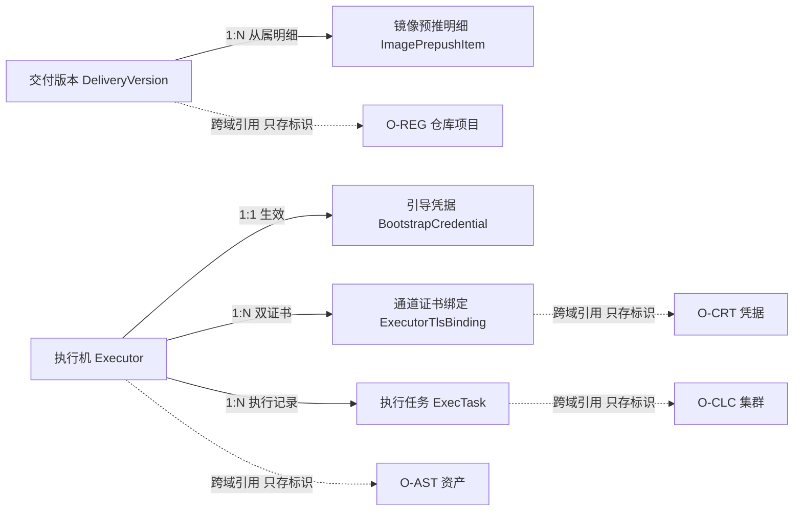
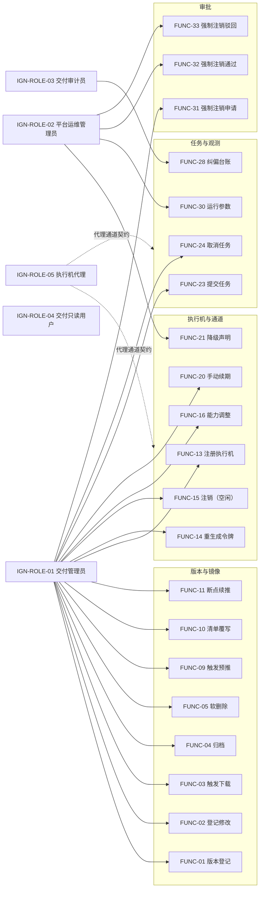
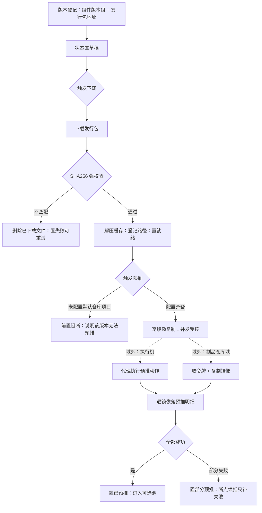
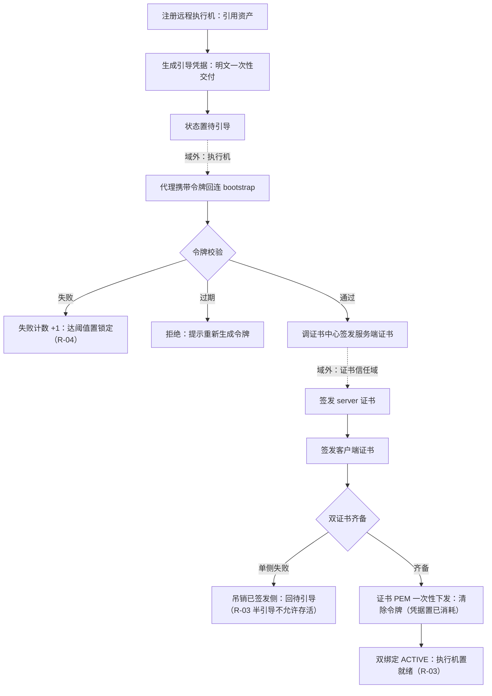
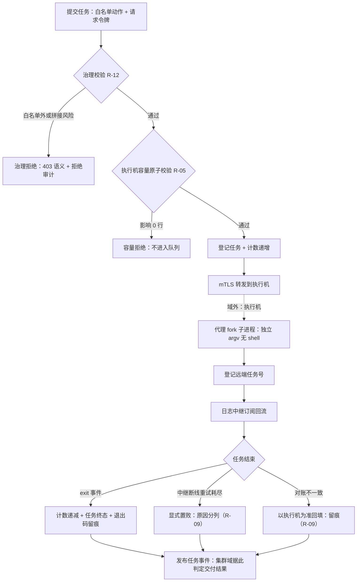
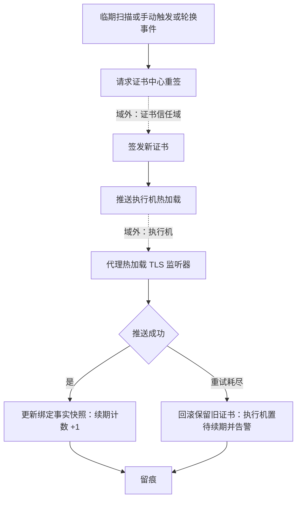
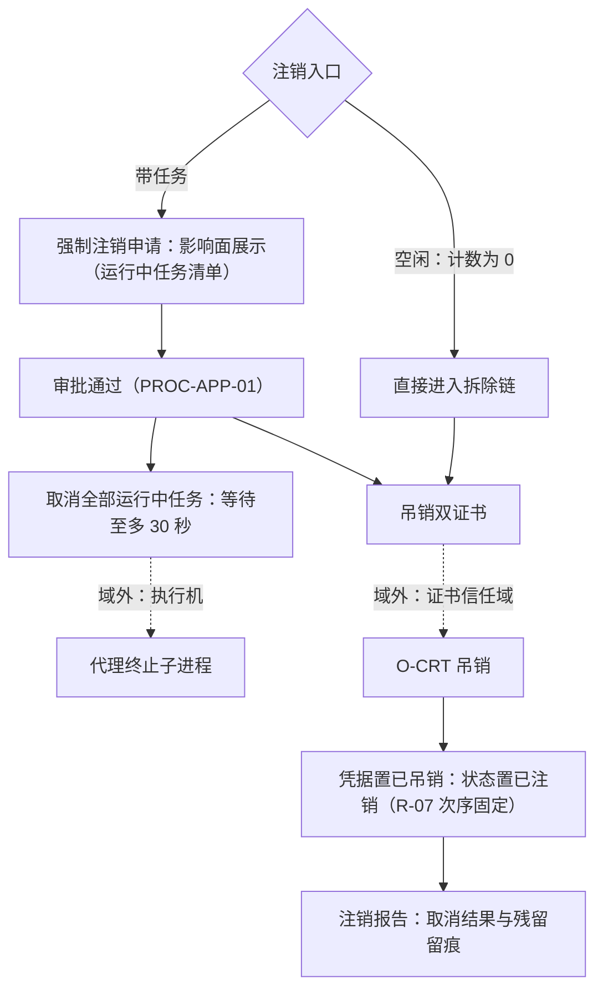
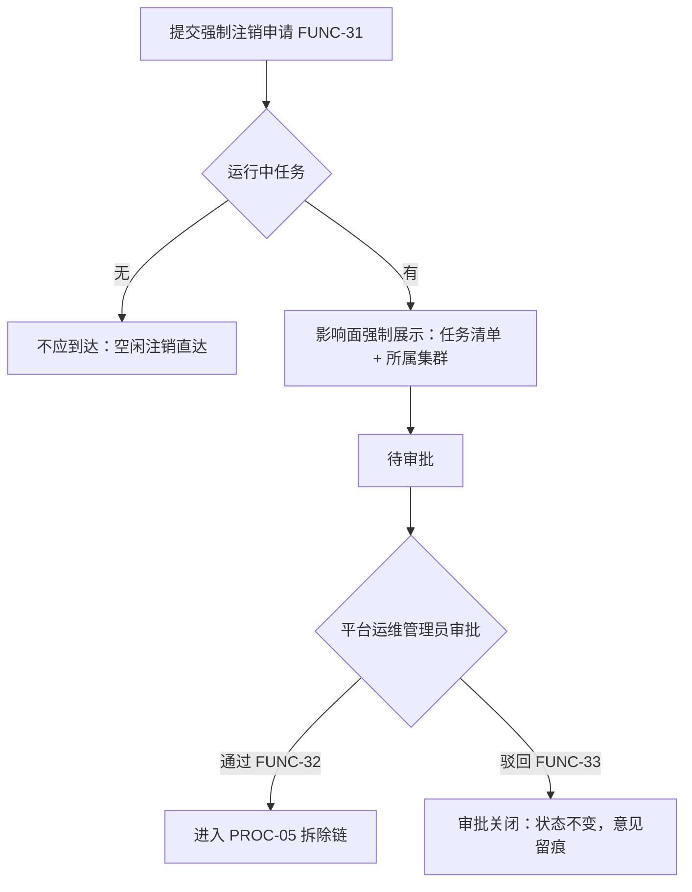

# OPIC-交付执行域 需求规格说明书

| 项目 | 内容 |
|---|---|
| 文档名称 | OPIC-交付执行域需求规格说明书 |
| 规范版本 | 软件需求编写规范 V10.0 |
| 编制日期 | 2026-09-24 |
| 文档状态 | **v1.0 完整（可进入本体建模阶段）**｜九部分 + 附录 A 全部完成、Q-1~Q-62 **全部确认**（待确认项 0）｜**阶段三（跨对象联动识别）为《编制说明》§D.5 的独立强制阶段**｜E.2 自检 **54 / 54**、第九部分 13 项自检全过、独立审核无 FAIL｜两份交付件已转**单文件自包含 HTML**（可离线渲染全部 Mermaid 图） |

> 状态标记口径：`[AI自动补全]` 系统按行业通用做法补全、用户未修改；`[已确认]` 经用户确认或修改；`[待确认]` 尚未得到用户回复，已登记入《编制说明》待澄清清单。
> 本文档按 V10.0 固定结构（九部分 + 附录 A）组织：**没有适用内容的章节不得删除**，写明「不适用」及经确认的理由，不编内容填空。
> **八阶段的问题（Q-1~Q-62，含定稿确认 Q-62）已全部按 AI 建议确认**，故全部九部分与附录 A 的状态标记统一为 `[已确认]`，本文**无待确认项**。

---

# 第一部分 项目概述与范围

> 本部分对应《AI 需求探索与确认提示词 V10.0》**阶段零：原始需求接收与总体理解确认**。
> **八阶段的问题（Q-1~Q-62，含定稿确认 Q-62）已全部按 AI 建议确认**，故全部九部分与附录 A 的状态标记统一为 `[已确认]`，本文**无待确认项**。

## 1.1 系统定位

本域（交付执行域，`O-IGN`；原能力中心 `ignition-center`，前缀 `IGN`）是 23 个本体论域中的**交付版本目录的编目者、执行机的登记者与调度者、以及执行动作的桥接者**：它把「把一套集群装到一组机器上」这件事拆成三个可治理的问题 —— **用哪个版本装**（kubeasz 版本目录与组件版本组，反向闭合 `O-REG` 的「托管 ≠ 编目」）、**在哪台机器执行**（执行机登记与选择）、**怎么把动作安全地送过去并拿回结果**（任务桥接：白名单动作、防重放、日志中继、状态对账），使集群域只需「选版本、选执行机、提交动作」，而不必知道执行细节。（v3.2 更正，109 号 F-70） [已确认]

本域管理的是**版本元数据与发行包缓存、镜像清单与预推、执行机台账与引导握手、执行机的信任凭据与通道安全、执行任务的分发与取消、任务日志与状态对账**；它**不实现交付内容**（kubeasz 与各脚本的可执行逻辑归第 3 层发行包）、**不判定交付结果**（退出码是事实，集群是否装好由集群域判断）、**不替代目标机器的主人**（执行机上的动作全部经由其常驻代理执行）。一句话：本域回答的是「**用哪个版本、在哪台机器、把动作安全地送过去**」，而不是「**装得好不好、对不对**」。 [已确认]

本域与其余 18 个域的耦合形态有四点特殊之处：① 它是**唯一「运行第三方交付二进制」的域** —— 动作白名单、参数无 shell 解释、防重放令牌是**安全边界**而非功能列表（见定性四）；② 它是**第二次出现「被治理对象自身在运行期与本域交互」的域** —— 执行机上的常驻代理主动回连本域（引导、心跳、日志流），与 `O-VPN` 的节点侧身份同类而通道不同（`O-VPN` 是覆盖网、本域是 mTLS 双向通道）；③ 它与 `O-AST` 构成**两种远程执行范式的对照** —— `O-AST` 是**拉起式**（平台拿凭据主动 SSH 登录、机器上无代理），本域是**常驻式**（机器上有代理、代理回连平台），两者判据都是「执行者需要什么通道」；④ 它的版本目录**一旦被集群引用就成为「别人配置里的事实」** —— 组件版本组创建后不可修改（见定性二）。 [已确认]

### 1.1.1 四条域级定性

> 以下四条是本域在阶段零确立的定性，后续所有阶段不得违背；若确需变更，须作为需求变更显式提出（与已完成八域的定性同级）。

**定性一：本域是「交付的编目者与调度者」，不是「交付内容的实现者」，也不是「执行结果的裁判」。** 版本目录回答「**用哪个版本装**」（每个版本一行、组件版本组齐备、被选进集群配置后不可改）；执行机台账回答「**在哪台机器执行**」（登记、引导、健康、并发额度）；任务桥接回答「**怎么送过去、怎么拿回日志与退出码**」。三条硬性含义：① **本域不实现交付内容** —— kubeasz 的能力归第 3 层发行包，本域只做下载、校验、缓存与编目；**镜像预推**调用的也是制品仓库域的取用通道，制品内容与存储归 `O-REG`（「通道 ≠ 内容」在本域的复述）；② **本域不判定交付结果** —— 任务结束的产物是**退出码与日志**这两个事实，「集群是否可用」的判定归集群域；③ **本域不解释业务失败** —— `ezctl.setup` 失败的集群侧原因归集群域分析，本域只保证「执行了什么、何时、在哪、结果码几、日志在哪」**可追溯**。**后果与补偿**：本域只能观测进程级事实 ⇒ 补偿手段是**全量留痕 + 日志中继 + 状态对账**，让「看不到的」显式变成「任务丢失」而不是静默。 [已确认]

**定性二：版本目录是一阶资源 —— 每个版本一行、状态单向推进、失败不分裂对象；且它是「会被别人选进配置的契约」。** 一个版本的组件版本组（K8s / 运行时 / etcd / CNI / CoreDNS）一旦被集群引用，就成了那个集群的**出生事实** —— 这与 `O-REG` 的「地址创建后不可修改」同一判据（**产出物会进入别人的配置 ⇒ 创建后不可改**）。四条硬性含义：① **组件版本组创建后不可修改** —— 改口径 = 新建版本 + 归档旧版本，让引用关系自己决定何时迁移；② **状态单向推进**（草稿 → 下载中 → 就绪 → 预推中 → 已预推 / 部分预推 → 已归档），失败态可从任意阶段进入且**可重试不分裂对象**；③ **删除判据 = 引用** —— 被任何集群引用的版本不可删除（与 `O-ARC` 草稿态、`O-REG` 引用判据同源：**判据是有没有引用，不是重不重要**）；④ **归档不是删除** —— 归档后不再出现在新建集群的选项里，但发行包缓存与已推送镜像**保留**给存量集群运维使用。 [已确认]

**定性三：执行机凭据「明文一次交付、验证后销毁」；通道安全是双向 mTLS、两把钥匙各归其主。** 三个涉及凭据与通道的域构成**对照谱系**：`O-AST` 凭据**可还原密文**（平台要主动登录）、`O-REG` **什么都不存**（验证方在引擎）、**本域的引导令牌明文只在创建响应出现一次、库内存密文、引导成功即清除** —— 判据仍是「使用方在谁手上」：令牌只服务于**引导这一瞬间**，此后通道身份由证书承担。四条硬性含义：① **双向 mTLS、两把钥匙** —— 执行机持服务端 + 客户端证书（本域签发时一次性下发），平台持**自己的**平台客户端证书（不复用执行机的），谁是调用方、谁出示哪把，分得清清楚楚；② **双证书原子性** —— 服务端证书签发成功而客户端失败时，**吊销已签发的服务端证书**、执行机回到待引导态（不允许「半引导」状态存活）；③ **实验环境可显式降级为明文通道** —— 但必须显式声明 + 留痕 + 界面红色标识（降级是**登记在案的决定**，不是悄悄的默认）；④ **执行机的可用性分两个正交维度** —— 治理状态（就绪 / 锁定 / 已注销 / 已降级，谁决定）与心跳健康（可达与否，何时观测），与 `O-AST` 定性四同源，不得互相推导。 [已确认]

**定性四：本域是唯一在执行机侧运行第三方二进制的域 —— 白名单、防重放、无 shell 是安全边界，不是功能列表。** 执行机代理只执行**固定枚举内**的动作（部署 / 启停 / 加减节点 / 升级 / 备份恢复 / 证书续期 / 脚本类），参数以**独立 argv** 传递（无 shell 解释、拼接即拒绝），每次提交带**一次性请求令牌**（执行机侧 24 小时防重放窗口）。四条硬性含义：① **白名单外一律 403 并审计** —— 「能不能执行」是本域的治理结论，「执行得对不对」不是；② **无 shell 解释** —— 杜绝借参数实现命令拼接这一整类注入；③ **任务可取消、会超时** —— 取消转执行机（SIGTERM → 30 秒后 SIGKILL），超时由执行机强制；**取消运行中任务影响的是上游域的工作，故强制注销带任务的执行机须经审批**；④ **执行机重启会丢失内存态** —— 平台侧的**状态对账**（本地与执行机状态不一致时**以执行机为准**）与**崩溃恢复**（重启后重建日志中继、对不上的任务显式置败）是本域对「分布式执行必然有裂缝」的正面回答。**与 `O-AST` 的范式对照**：`O-AST` 是**拉起式**（无代理、平台拿凭据主动登录）、本域是**常驻式**（有代理、代理回连）—— 范式不同，但「对目标机器的真实写入必须幂等可重入」的纪律相同（发行包缓存可重下、预推可断点续推、任务令牌可幂等重放）。 [已确认]

> **层位说明**：本域位于三层架构的**第 2 层（平台能力层）**，属 **Tier 1**（原能力中心清单为平台层第 7 顺位；本体论域登记为第 9 号，见 `O-SEC.SEC_DOMAIN_CODES`）。MVP 最短依赖路径为 `O-SEC → O-ARC → O-SYS → O-DBS → O-CRT → O-VPN → O-REG → O-AST → O-IGN …`。 [已确认]
> **本域为什么排在资产域之后**：本域的执行机**登记时引用资产域的资产标识**（执行机必须是一台已收编进台账的机器）；版本预推**消费制品仓库域的取用通道**；执行机与平台的双向通道**消费证书信任域的签发能力**（server / client 两个 profile）与网络连通域的可达性。四条供给线齐备后，本域才能把「版本、机器、动作」接成一条交付线。 [已确认]
> **本域落地的紧迫性**：本域是**集群域（`O-CLC`）的硬前置** —— 集群创建要选版本、选执行机、提交 `ezctl` 动作，全部走本域；同时它反向闭合了 `O-REG` 挂起的「托管 ≠ 编目」接口（版本编目归本域）。 [已确认]
>
> **域边界一句话（九域对照）**：`O-SEC` 管「**能不能过**」｜`O-ARC` 管「**错是什么**」｜`O-SYS` 管「**平台怎么运转**」｜`O-DBS` 管「**数据放在哪、谁能连、丢了怎么回来**」｜`O-CRT` 管「**谁可以被信任**」｜`O-VPN` 管「**节点之间能不能连上**」｜`O-REG` 管「**制品放在哪、谁能拉、怎么取到**」｜`O-AST` 管「**机器是谁、它准备好了吗**」｜`O-IGN` 管「**用哪个版本、在哪台机器、把动作安全送过去**」。 [已确认]

## 1.2 业务范围

### 1.2.1 范围内

- **版本目录（kubeasz 版本编目）**：创建版本元数据（组件版本组：K8s / 运行时 / etcd / CNI / CoreDNS；发行包地址与摘要）；**组件版本组创建后不可修改**；版本状态机（草稿 → 下载中 → 就绪 → 预推中 → 已预推 / 部分预推 → 已归档；失败可从任意阶段进入并可重试）；**归档与删除保护**（被集群引用不可删；归档保留发行包与镜像供存量运维）；**默认版本**快捷入口（平台配置指定）。 [已确认]
- **发行包与镜像预推**：从发行包地址下载 kubeasz 发行包（**SHA256 校验失败即删除重来**）；解压缓存并登记缓存路径；**镜像清单管理**（从发行包的下载清单自动解析、支持人工覆写）；**镜像预推**（通过制品仓库域取用通道逐镜像复制到默认仓库项目；并发受控；**断点续推** —— 跳过已成功镜像、只重试失败镜像）；仓库不可达时**不污染本地缓存**并允许稍后重试。 [已确认]
- **执行机登记与引导**：本地执行机**由系统自动注册**（全平台唯一、不可手工创建）；远程执行机注册（**必须引用资产域的资产标识**；生成引导令牌并**一次性返回明文**）；**引导握手**（令牌校验 → 调证书中心签发服务端与客户端双证书 → 证书内容一次性下发 → 清除令牌）；**令牌过期与重新生成**；**连续失败锁定**（连续五次引导失败置锁定态、须管理员重置）。 [已确认]
- **执行机的信任凭据与通道安全**：证书来源固定为证书信任域（server / client 两个 profile）；**双证书原子性**（半引导不允许存活）；**自动续期**（订阅轮换事件、推送执行机热加载、失败回滚保留旧证书并标记待续期）；**吊销响应**（服务端证书被吊销 ⇒ 执行机置降级态：拒新任务、运行中任务保护）；**平台客户端证书**独立管理（被吊销时立即重新申请并热替换）；**显式 TLS 降级**仅限实验环境（声明 + 留痕 + 红色标识）。 [已确认]
- **任务桥接（执行动作分发）**：向执行机提交动作（**动作白名单固定枚举**；参数独立 argv 无 shell 解释）；**请求令牌幂等与防重放**（24 小时窗口）；**并发额度原子控制**（分发递增 / 结束递减、不超上限不下溢）；**取消与超时**（转发执行机、SIGTERM → SIGKILL）；**执行机心跳载荷与本地计数偏差超限时以执行机为准强制纠正**（留痕）。 [已确认]
- **日志中继与状态对账**：订阅执行机的日志流并中继到平台统一任务日志通道（前端无感）；**断线重连**（重试耗尽显式置败）；**状态对账**（本地与执行机不一致时以执行机为准、留痕）；**崩溃恢复**（平台重启后重建运行中任务的中继、执行机侧任务丢失则显式置败不静默）。 [已确认]
- **运行观测与跨中心暴露**：执行机心跳健康（超时置不可达、恢复自动回归）；**跨中心精简查询**（按用途筛选可用版本与执行机、过滤不健康与超载、默认项快捷入口）；**统计总览**（版本分布、预推状态、执行机健康、任务成败）；事件发布（版本、执行机、任务、证书全生命周期事件）。 [已确认]
- **与平台底座的对接**：能力登记、调用审计（任务桥接与凭据操作全留痕）、运行参数登记与下发（并发、超时、心跳阈值、令牌有效期、TLS 降级开关等）、事件总线。 [已确认]

### 1.2.2 范围外

| 范围外内容 | 排除理由 |
|---|---|
| **交付内容的实现**（kubeasz 能力、部署脚本逻辑、playbook 编写） | 交付能力在第 3 层发行包内；本域只做下载校验缓存编目与执行（定性一）。 [已确认] |
| **交付结果的业务判定**（集群是否健康、组件是否可用） | 本域产物是退出码与日志；「装好了没」由集群域订阅任务结束事件后自行判定（定性一 ②）。 [已确认] |
| **制品的存储与分发通道实现**（镜像仓库引擎、存储后端） | 归制品仓库域；本域预推是其**消费方**（通道 ≠ 内容）。 [已确认] |
| **执行机作为机器的台账与巡检** | 执行机**必须引用**资产域的资产标识；机器本体的事实（规格、健康、巡检）归 `O-AST`（本域只管「执行能力」这一层）。 [已确认] |
| **执行机证书的签发、信任链与吊销裁决** | 归证书信任域；本域是消费方（签发请求、续期推送、吊销响应），不建 CA（定性三）。 [已确认] |
| **集群的创建、编排与节点管理** | 归集群域（B3 后续探索）；集群域是本域任务桥接的**上游调用方**与**版本 / 执行机的引用方**。 [已确认] |
| **任意 shell 命令执行** | 白名单外一律拒绝（定性四）；「能执行任意命令」会让执行机变成平台最大的攻击面。 [已确认] |
| **任务的财务计量与成本分摊** | 归运营成本域（`O-OPR`）；本域的任务台账只含执行事实。 [已确认] |

### 1.2.3 外部边界

| 边界对象 | 交互方向 | 交互内容 | 边界口径 |
|---|---|---|---|
| 制品仓库域（`O-REG`） | 本域 → 调用 | 预推时取机器人令牌、逐镜像复制到默认仓库项目 | **通道 ≠ 内容**：本域是 `O-REG` 的消费方；**⭐ 反向闭合 `O-REG` 挂起的「托管 ≠ 编目」接口** —— 版本编目（「有哪几个版本、该用哪个」）归本域，制品托管与分发通道归 `O-REG`。仓库不可达时本域**不污染本地缓存**并允许重试。 [已确认] |
| 资产域（`O-AST`） | 本域 → 引用 | 远程执行机注册时**必须引用**已登记的资产标识 | **机器事实归 `O-AST`、执行能力归本域**：同一台机器在本域是一行「执行机」、在 `O-AST` 是一台「资产」，两域以引用相接；`O-AST` 的免密通道与本域的常驻代理是**两种执行范式**，互不替代。 [已确认] |
| 证书信任域（`O-CRT`） | 双向 | bootstrap 时签发 server / client 双证书；订阅轮换与吊销事件；平台侧客户端证书独立申请 | 本域不建 CA、不判断信任链；**半引导不允许存活**（双证书原子性）；平台客户端证书是**本域的对外身份**、被吊销时立即替换。 [已确认] |
| 集群域（`O-CLC`，B3 第 3 域） | `O-CLC` → 调用本域；本域 → 引用声明 | 创建集群时查可用版本与执行机、提交执行动作；版本与执行机的「被引用」由集群域声明 | **⭐ 集群域是本域的上游调用方**：本域不持有集群概念；「交付结果」的判定归集群域；被引用版本与执行机的删除保护依赖集群域的**引用声明**（不直查他域表）。 [已确认] |
| 执行机代理（机器身份） | 代理 → 回连本域 | 引导握手、心跳上报、日志流推送、证书热加载接收 | **第二次出现「被治理对象自身在运行期与本域交互」**（继 `O-VPN` 节点侧身份之后）：通道是 mTLS 双向、身份是本域签发的证书对。 [已确认] |
| 平台底座域（`O-SYS`） | 双向 | 能力登记、审计、配置项、事件总线、任务日志通道复用 | 本域不自建用户权限、不自建事件通道；**主密钥属部署期约定**（与 `O-AST` 同口径：从平台密钥设施加载）。 [已确认] |
| 零信任安全域（`O-SEC`） | 本域 → 遵从 | 管理面与跨中心调用的统一认证授权；任务桥接调用方须同时持有上游域权限与本域执行权限 | 双重鉴权（上游业务权限 + 本域执行权限）都在 `O-SEC` 口径内表达。 [已确认] |
| 网络连通域（`O-VPN`） | 本域 → 依赖 | 平台与执行机之间、执行机与仓库之间的网络可达 | 可达性是 `O-VPN` 的产出与本域的运行前置；本域不建覆盖网。 [已确认] |
| 数据服务域（`O-DBS`） | 本域 → 依赖 | 业务库供给（`ign` schema） | 禁 AutoMigrate、跨中心不建外键（全局规则）。 [已确认] |

## 1.3 业务域划分

本域划分为 **7 个子域**（与第八部分菜单一一对应）：

| 子域编号 | 子域名称 | 职责概述 | 对应菜单 |
|---|---|---|---|
| 1 | 版本目录 | kubeasz 版本编目、组件版本组、状态机、归档与删除保护 | 版本目录 |
| 2 | 发行包与镜像 | 发行包下载校验缓存、镜像清单、预推与断点续推 | 发行包与镜像 |
| 3 | 执行机登记 | 本地 / 远程执行机、引导握手、凭据、并发额度 | 执行机 |
| 4 | 通道安全 | 双证书、自动续期、吊销响应、平台侧身份、显式降级 | 通道安全 |
| 5 | 任务桥接 | 动作白名单、任务分发、幂等防重放、取消与超时 | 任务桥接 |
| 6 | 日志与对账 | 日志中继、状态对账、崩溃恢复 | 日志与对账 |
| 7 | 运行观测 | 心跳健康、统计总览、跨中心暴露、运行参数 | 运行观测 |

> **子域划分的判据**：按「**交付线的四段 + 两层保障 + 一个出口**」划分 —— 版本（子域 1 / 2 是「用什么」的前后两步）、机器（子域 3 / 4 是「在哪执行」与其安全保障）、动作（子域 5 / 6 是「怎么执行」与其可靠性保障）、观测出口（子域 7）。**通道安全独立成子域**因为它有自己的对象（证书绑定）与独立失败模式（半引导、续期失败、吊销）；**日志与对账独立成子域**因为「执行」与「确认执行结果被完整记录」是两类可靠性承诺。 [已确认]

## 1.4 核心清单索引

> 编号在各部分内独立；跨域引用冠域码。清单数字为阶段零预判，以实际产出为准（偏差登记入《编制说明》C.2）。

| 清单 | 数量（预判） | 所在部分 | 说明 |
|---|---|---|---|
| 业务对象 | 6 | 第二部分 | 版本 / 执行机 / 引导凭据 / 证书绑定 / 任务 / 发行包缓存? —— 以阶段一为准 |
| 功能点 | 待阶段二定 | 第三部分 | 预判人工约 20、查询约 12、审批 2 |
| 系统自动行为 | 待阶段二定 | 第三部分 | 预判 8~10（下载、预推调度、心跳检测、对账、崩溃恢复、续期扫描等） |
| 业务规则 | 待阶段一、二定 | 第二、三部分 | 预判 INV 约 35、R 约 10 |
| 协同流程 | 5 | 第四部分 | 版本上架（含预推）、执行机引导、任务分发、证书续期、执行机注销 |
| 审批流程 | 1 | 第四部分 | 执行机强制注销（取消他人运行中任务） |
| 报表 | 待阶段五定 | 第五部分 | 与查询功能点一一对应 |
| 数据字典 | 待阶段六定 | 第七部分 | 状态类为主（版本状态、执行机状态、任务状态、引导状态） |

## 1.5 角色总览

> 角色为局部编号（`IGN-ROLE-xx`），全局映射在 `O-SYS` 登记。

| 局部角色 | 角色名称 | 类型 | 职责概述 |
|---|---|---|---|
| `IGN-ROLE-01` | 交付管理员 | 人工 | 版本编目与上架、预推、执行机登记与引导、任务提交与取消、日志排查 |
| `IGN-ROLE-02` | 平台运维管理员 | 人工 | 运行参数、TLS 降级决策、执行机锁定重置与注销审批、默认项配置 |
| `IGN-ROLE-03` | 交付审计员 | 人工 | 只读 + 审计台账（任务留痕、凭据操作留痕、白名单拒绝记录）；**零写动作** |
| `IGN-ROLE-04` | 交付只读用户 | 人工 | 版本列表、任务台账、统计总览查询 |
| `IGN-ROLE-05` | 执行机代理 | 机器身份 | 常驻在执行机上的代理：引导回连、心跳上报、日志流推送、证书热加载接收；**只经 mTLS 通道、无管理界面** |

> **角色设计的两点说明**：① `IGN-ROLE-05` 是**第二次出现「被治理对象自身在运行期与本域交互」**（继 `O-VPN.VPN-ROLE-05` 之后）—— 执行机代理是本域治理的机器上的常驻身份，主动回连；② `O-REG.REG-ROLE-05` 是**下游消费方**、本域的第五身份是**被治理对象自身**，两者性质不同，登记时须区分（服务身份 vs 机器身份）。 [已确认]

## 1.6 技术底座与运行前置

### 1.6.1 情形一：技术底座已就绪

- **运行载体**：MCC 独立中心，`/api/v1/ignition/...`；跨中心调用走平台网关并透传审计头。 [已确认]
- **数据落点**：业务表落 `opicdb` 的 `ign` schema 前缀；禁 AutoMigrate、走 `migrations/`；跨中心不建外键。 [已确认]
- **认证与授权**：管理面接入统一认证；**跨中心双重鉴权** —— 调用方须同时持有上游业务权限（如集群写）与本域执行权限；执行机代理通道走 **mTLS**（机器身份）。 [已确认]
- **事件与日志通道**：事件发布走平台事件总线；任务日志**复用平台统一任务日志通道**（中继写入后前端无感）。 [已确认]
- **加密设施**：引导令牌 AES-256-GCM 加密；主密钥从平台密钥设施加载（部署期约定）；主密钥不可用时**按能力降级**（只读可用、创建远程执行机与引导前置阻断）。 [已确认]
- **发行包缓存**：本域自持**本地文件缓存区**（发行包解压目录），它是本域的**内部技术组件**；缓存可重下重建、不是需要备份的数据（判据：可由源头重建的不算要保护的事实）。 [已确认]

### 1.6.2 情形二：未指定技术底座时的降级实现

> 平台底座已确定，本节**不适用**。保留本节并记录本域自身兜底口径：事件总线短时不可用时本地暂存重放；`O-CRT` / `O-REG` 短时不可用时**不阻塞版本目录与任务台账**，只前置阻断需要签发或取令牌的动作（与全部已完成域的按能力降级同一手法）。 [已确认]

### 1.6.3 与本文其余部分的关系

本节确立的四条定性、7 个子域、5 类角色与范围边界是后续所有阶段的上位约束：第二部分**不建集群对象、不建 kubeasz 能力对象、不建财务字段**；第三部分的规则不得违背白名单与防重放口径；第四部分的流程必须体现「引导 → 可用 → 注销」的执行机生命周期与「上架 → 可选」的版本生命周期；第五部分的报表**不得出现令牌明文与证书内容**；第六部分以「**版本与执行机的治理属性归本域、机器事实归 `O-AST`、集群归 `O-CLC`**」为准；第八、九部分以 1.5 角色表为依据。突破须走需求变更并回改本节。 [已确认]

### 1.6.4 与第 3 层开源实现的对应关系（本域特有）

> 按 C1 铁律，本节是正文中唯一允许出现具体开源产品名的位置；产品名同时登记入《编制说明》C 区。本域与第 3 层的耦合形态是「**消费一个发行包 + 编排一个自研代理**」—— 发行包是**被缓存的制品**，代理是**本域自己的边缘组件**。

| 本域能力 | 对应的开源实现 / 协议 | 耦合形态 |
|---|---|---|
| 集群交付能力 | **kubeasz** 发行包（`ezctl` 命令族 + playbooks） | **发行包级耦合**：本域缓存并调用其命令族，动作白名单按其命令面固定；发行包可整体替换为其他交付工具（版本目录的元数据结构不变）。 [已确认] |
| 镜像预推 | **skopeo**（镜像复制） | **工具级耦合**：预推动作经执行机代理调用，属白名单内的 `scripts.*` 类动作。 [已确认] |
| 双向通道 | **mTLS**（HTTP + WebSocket over TLS） | **协议级耦合**：证书由 `O-CRT` 签发，本域不自带 PKI。 [已确认] |
| 引导令牌加密 | **AES-256-GCM**（平台密钥设施） | **算法级耦合**，与 `O-DBS` / `O-CRT` / `O-AST` 口径一致。 [已确认] |
| 执行机代理 | **自研常驻代理**（平台边缘组件） | **自持组件**：代理是本域的实现对端（引导 / 心跳 / 日志 / 热加载四个接口），其版本随心跳上报。 [已确认] |
| SHA256 校验 | 标准摘要算法 | **算法级耦合**。 [已确认] |

> **与 `O-REG` 的对照**：`O-REG` 编排一个**可部署引擎的实例**；本域**没有引擎实例** —— 发行包是**缓存的制品**（可重下）、执行机代理是**分布在对端机器上的自持组件**。与 `O-AST` 的对照：`O-AST` 的观测命令集在**每次执行时拼接**（无对端组件）、本域的代理是**常驻的**（有心跳、有版本）。 [已确认]

---

**第一部分（阶段零）小结**：四条域级定性（编目与调度者而非实现者与裁判、版本目录是一阶资源且是被选进配置的契约、凭据明文一次交付验证后销毁与双向 mTLS 两把钥匙、白名单防重放无 shell 是安全边界）、7 个子域、5 类角色（**第二次出现被治理对象自身回连**）、8 条范围外边界、9 条外部边界（含 **⭐ 反向闭合 `O-REG`「托管 ≠ 编目」**）；登记上游八域既有约束 12 条与原 SPEC 口径矛盾 10 处（见《编制说明》C.1.1 / C.1.2）。唯一审批流预判 = **执行机强制注销**（判据：取消他人运行中任务 —— 中断的是上游域的工作）。 [已确认]

---

# 第二部分 业务对象

> 本部分对应**阶段一：业务对象识别与数据建模确认**。全部条目已按 AI 建议确认，状态标记统一为 `[已确认]`。
> **本域 6 个对象**：交付版本 `DeliveryVersion` / 镜像预推明细 `ImagePrepushItem`（从属明细） / 执行机 `Executor` / 引导凭据 `BootstrapCredential` / 通道证书绑定 `ExecutorTlsBinding` / 执行任务 `ExecTask`。
> **阶段零预判 6 对象，实际产出 6 对象**（差异仅在把「镜像预推结果」从版本对象的 JSON 字段升格为**从属明细对象** —— 逐镜像结果是断点续推的判定依据，必须可独立查询与统计，塞进 JSON 会让「预推了 200 个、失败 3 个」无处安放；已在《编制说明》C.2 登记）。

## 2.1 交付版本（DeliveryVersion）

**业务定义。** 一套交付工具发行包的**编目记录**：组件版本组（会被集群选进配置的契约，`Q-1` 收口「托管 ≠ 编目」）、发行包地址与摘要、镜像清单、默认仓库项目引用与生命周期状态。它是集群域创建集群时的**版本信源**。 [已确认]

**对象分类。** 主数据（本域权威源）。业务编号 `VER` 前缀 + 4 位流水。

| 属性 | 属性英文名 | 类型 | 必填 | 唯一 | 说明 / 约束 |
|---|---|---|---|---|---|
| 版本编号 | versionNo | 字符串 | 是 | 是 | 业务编号，创建时生成、不可修改 |
| 版本名 | name | 字符串 | 是 | 是 | **未归档范围内唯一**（归档后同名可复用，`INV-01`） |
| 显示名 | displayName | 字符串 | 否 | 否 | 下拉展示用 |
| 交付工具版本 | toolVersion | 字符串 | 是 | 否 | 语义化版本格式（`INV-02`）；**组件版本组成员** |
| 编排引擎版本 | orchestratorVersion | 字符串 | 是 | 否 | `v1.x.y` 格式；**组件版本组成员** |
| 容器运行时版本 | runtimeVersion | 字符串 | 是 | 否 | **组件版本组成员** |
| etcd 版本 | etcdVersion | 字符串 | 是 | 否 | **组件版本组成员** |
| CNI 插件 | cniPlugin | 数据字典 | 是 | 否 | `IGN_CNI_PLUGIN`：CALICO / CILIUM / FLANNEL |
| CNI 版本 | cniVersion | 字符串 | 是 | 否 | **组件版本组成员** |
| CoreDNS 版本 | corednsVersion | 字符串 | 是 | 否 | **组件版本组成员** |
| 发行包地址 | tarballUrl | 字符串 | 是 | 否 | 合法 URL |
| 发行包摘要 | tarballSha256 | 字符串 | 否 | 否 | 提供时下载后强校验（`R-02` 同源） |
| 缓存解压路径 | cachePath | 字符串 | 条件 | 否 | 状态进入「就绪」及之后非空（`INV-06`） |
| 镜像清单 | imageManifest | JSON | 是 | 否 | 数组 `[{repo, tag, digest?, size?}]`；**逐镜像预推结果在预推明细对象**（2.2） |
| 默认仓库项目 | defaultRegistryRef | 引用 | 否 | 否 | **跨域引用** `O-REG` 仓库项目（只存标识）；为空时该版本不可预推（`REF-04` 前置） |
| 版本状态 | status | 数据字典 | 是 | 否 | `IGN_VERSION_STATUS`：DRAFT / DOWNLOADING / READY / PREPUSHING / PREPUSHED / PARTIALLY_PREPUSHED / ARCHIVED / FAILED |
| 归档时间 | archivedAt | 日期时间 | 条件 | 否 | 进入「已归档」时必填 |
| 登记时间 | createdAt | 日期时间 | 是 | 否 | |

**刻意不建的属性（三条）。** ① **逐镜像预推结果不落本对象**（升格为从属明细 2.2）；② **引用集群清单不落本对象** —— 引用关系由集群域声明（`R-01`），本域不复制（引用要在对方域收口）；③ **下载进度百分比不落字段** —— 过程性读数由任务通道承载，落字段必然过时。 [已确认]

**对象级不变量**

| 不变量编号 | 业务条件 |
|---|---|
| INV-01 | 版本名在**未归档范围内**唯一（保存即校验） |
| INV-02 | 交付工具版本为语义化版本、编排引擎版本为 `v1.x.y` 格式、发行包地址为合法 URL（保存即校验） |
| INV-03 | CNI 插件取值必须命中 `IGN_CNI_PLUGIN` 字典（保存即校验） |
| INV-04 | **组件版本组（交付工具 / 编排引擎 / 运行时 / etcd / CNI 插件与版本 / CoreDNS 六项）创建后不可修改**（定性二：会被选进集群配置的契约；仅提交时强制校验） |
| INV-05 | 已归档版本的登记字段冻结（终态冻结；仅提交时强制校验） |
| INV-06 | 缓存解压路径仅当状态处于「就绪 / 预推中 / 已预推 / 部分预推」时非空；离开这些状态（失败重置）时允许清空待重建（保存即校验） |
| INV-07 | 版本状态迁移路径固定单向；FAILED 可从任意非终态进入且重试后回归对应阶段（仅提交时强制校验） |

**跨对象约束预分流（2 条，归属 R）**：① 「被集群引用的版本不可删除」—— 读集群域引用声明，归属 R；② 「预推前置 = 默认仓库项目已引用且 `O-REG` 通道可用」—— 读引用对象与外部通道，归属 R。 [已确认]

## 2.2 镜像预推明细（ImagePrepushItem）

**业务定义。** 一个版本的一次预推动作中**每个镜像的执行结果**（从属明细，属版本聚合）：镜像坐标、摘要、体积、预推状态、失败原因与时间。它是**断点续推的判定依据**（跳过已成功、只重试失败）。 [已确认]

**对象分类。** 从属明细（属版本聚合，不可独立存在；不单独编号，采用「所属版本编号 + 镜像坐标」定位）。

| 属性 | 属性英文名 | 类型 | 必填 | 唯一 | 说明 / 约束 |
|---|---|---|---|---|---|
| 所属版本 | versionRef | 引用 | 是 | 是 | 引用本域版本；与镜像坐标联合唯一 |
| 镜像仓库 | repo | 字符串 | 是 | 是 | 非空 |
| 镜像标签 | tag | 字符串 | 是 | 是 | 非空 |
| 内容摘要 | digest | 字符串 | 否 | 否 | 预推成功后由仓库侧回填 |
| 体积（字节） | sizeBytes | 整数 | 否 | 否 | |
| 预推状态 | prepushStatus | 数据字典 | 是 | 否 | `IGN_PREPUSH_STATUS`：PENDING / SUCCESS / FAILED / SKIPPED |
| 失败原因 | failReason | 字符串 | 条件 | 否 | FAILED 时必填（`INV-09`） |
| 最近预推时间 | prepushedAt | 日期时间 | 条件 | 否 | SUCCESS / SKIPPED 时必填 |
| 登记时间 | createdAt | 日期时间 | 是 | 否 | |

**对象级不变量**

| 不变量编号 | 业务条件 |
|---|---|
| INV-08 | 同一版本内「仓库 + 标签」联合唯一；预推明细由镜像清单派生生成、清单覆写时同步对齐（保存即校验） |
| INV-09 | 预推状态为 FAILED 时失败原因必填；SUCCESS 时摘要必填（仅提交时强制校验） |
| INV-10 | SKIPPED 必须携带跳过依据（仓库侧摘要已存在）；PENDING 不得出现在预推动作结束之后（终态收口核对，仅提交时强制校验） |

**跨对象约束预分流（1 条，归属 R）**：③ 「断点续推跳过 SUCCESS / SKIPPED 行、只重试 FAILED 行」—— 由预推动作驱动的对本聚合的批量写入，归属 R（与 2.1 预分流 ② 同一动作的两侧）。 [已确认]

## 2.3 执行机（Executor）

**业务定义。** 一台承载交付执行能力的机器在本域的**能力登记**：类型（本地 / 远程）、资产引用、服务地址、能力标签、并发额度、治理状态与最近心跳。**治理状态（谁决定）与心跳健康（何时观测）正交**（定性三 ④）——「不可达」是最近心跳超时的**派生结论 + 事件**，不落治理状态。 [已确认]

**对象分类。** 主数据（本域权威源 —— 执行能力层；机器事实层归 `O-AST`）。业务编号 `EXE` 前缀 + 4 位流水。

| 属性 | 属性英文名 | 类型 | 必填 | 唯一 | 说明 / 约束 |
|---|---|---|---|---|---|
| 执行机编号 | executorNo | 字符串 | 是 | 是 | 业务编号，创建时生成、不可修改 |
| 名称 | name | 字符串 | 是 | 是 | 全平台唯一（未注销范围内） |
| 显示名 | displayName | 字符串 | 否 | 否 | |
| 类型 | executorType | 数据字典 | 是 | 否 | `IGN_EXECUTOR_TYPE`：LOCAL / REMOTE；**LOCAL 由系统自动注册、全平台至多一行**（`INV-12`） |
| 资产标识 | assetRef | 引用 | 条件 | 否 | **跨域引用** `O-AST` 资产；REMOTE 必填（`INV-13`） |
| 服务地址 | host | 字符串 | 是 | 否 | 合法 IP / FQDN；LOCAL 固定为本机回环 |
| 服务端口 | port | 整数 | 是 | 否 | 1024~65535（`INV-14`） |
| 能力标签 | capabilityFlags | JSON | 是 | 否 | 数组；取值命中 `IGN_CAPABILITY` 字典 |
| 治理状态 | status | 数据字典 | 是 | 否 | `IGN_EXECUTOR_STATUS`：ENROLLING / READY / LOCKED / DEGRADED / RENEWAL_PENDING / REMOVED（**「不可达」不在其中** —— 派生结论，见刻意不建） |
| 并发上限 | concurrentTasksMax | 整数 | 是 | 否 | REMOTE 登记时声明；LOCAL 由系统固定（`INV-16`） |
| 当前任务数 | currentTasksCount | 整数 | 是 | 否 | 原子增减（`R-05`）；**不下溢、不超上限**（`INV-15`） |
| 最近心跳时间 | lastHeartbeatAt | 日期时间 | 条件 | 否 | REMOTE 引导成功后由心跳更新；**不可达 = 它超时的派生结论** |
| 最近心跳载荷 | lastHeartbeatPayload | JSON | 条件 | 否 | 覆写式（最新值）；含负载、磁盘、代理版本 |
| 引导完成时间 | bootstrappedAt | 日期时间 | 条件 | 否 | 进入「就绪」时必填（`R-03` 判定的事实落点） |
| 登记时间 | createdAt | 日期时间 | 是 | 否 | |

**刻意不建的属性（三条）。** ① **「不可达」不落治理状态**（派生结论 + 事件；正交口径，定性三 ④）—— 与 `O-AST`「健康结论不落字段」同判据；② **集群引用清单不落本对象**（引用由集群域声明）；③ **心跳历史不落本对象**（心跳是时序数据、只保留最新载荷；历史归运行观测台账）。 [已确认]

**对象级不变量**

| 不变量编号 | 业务条件 |
|---|---|
| INV-11 | 名称在未注销范围内唯一；服务地址 + 端口组合在未注销范围内唯一（保存即校验） |
| INV-12 | LOCAL 类型全平台至多一行、由系统自动注册；人工创建 LOCAL 一律拒绝（仅提交时强制校验） |
| INV-13 | REMOTE 必须引用 `O-AST` 资产标识；LOCAL 不得有引导凭据与证书绑定（保存即校验） |
| INV-14 | 服务端口为 1024~65535 的整数（保存即校验） |
| INV-15 | 当前任务数不得为负、不得超过并发上限（原子口径；**对账纠偏是唯一例外路径且必须留痕**，`R-06`；仅提交时强制校验） |
| INV-16 | LOCAL 的并发上限由系统固定（缺省 4），不提供修改（保存即校验） |
| INV-17 | 已注销（REMOVED）为终态：不再分发任务、登记字段冻结（仅提交时强制校验） |
| INV-18 | 能力标签每个取值必须命中 `IGN_CAPABILITY` 字典（保存即校验） |

**跨对象约束预分流（3 条，归属 R）**：④ 「注销触发双证书吊销」—— 由治理动作驱动的对证书绑定的写入（并联动 `O-CRT`），归属 R；⑤ 「任务分发与结束驱动执行机计数原子增减」—— 由任务生命周期驱动的写入，归属 R；⑥ 「心跳计数偏差超限时以执行机上报强制纠正」—— 由观测结论驱动的写入（例外路径、留痕），归属 R。 [已确认]

## 2.4 引导凭据（BootstrapCredential）

**业务定义。** 远程执行机的一次引导授权：一次性明文交付的引导令牌（库内 AES-256-GCM 密文）、有效期、失败计数与消耗状态。**行保留供审计**（消耗后不物理删除 —— 与 `O-AST` 凭据行保留同判据），但**消耗 / 过期后不可再用于引导**。 [已确认]

**对象分类。** 主数据（本域权威源），与远程执行机 1:1（同一时刻至多一条生效引导凭据）。业务编号 4 位流水。

| 属性 | 属性英文名 | 类型 | 必填 | 唯一 | 说明 / 约束 |
|---|---|---|---|---|---|
| 凭据编号 | credentialNo | 字符串 | 是 | 是 | 业务编号 |
| 所属执行机 | executorRef | 引用 | 是 | 是 | 引用本域执行机（REMOTE） |
| 令牌密文 | tokenEnc | 字符串 | 条件 | 否 | AES-256-GCM；**消耗后置空**（行保留） |
| 令牌 nonce | tokenNonce | 字符串 | 条件 | 否 | 与密文成对（`INV-20`） |
| 生成时间 | issuedAt | 日期时间 | 是 | 否 | |
| 过期时间 | expiresAt | 日期时间 | 是 | 否 | 生成时间 + 平台 TTL（`REF-01`） |
| 失败计数 | failCount | 整数 | 是 | 否 | 引导失败累计；**达到阈值触发锁定是跨对象规则**（`R-04`） |
| 凭据状态 | credStatus | 数据字典 | 是 | 否 | `IGN_CRED_STATUS`：ACTIVE / CONSUMED / EXPIRED / REVOKED |
| 登记时间 | createdAt | 日期时间 | 是 | 否 | |

**对象级不变量**

| 不变量编号 | 业务条件 |
|---|---|
| INV-19 | 同一执行机至多一条 ACTIVE 引导凭据；重新生成使旧凭据置 REVOKED（保存即校验） |
| INV-20 | 令牌密文与 nonce 成对出现或同时为空（消耗后两者同时置空；保存即校验） |
| INV-21 | 仅 ACTIVE 且未过期的凭据可用于引导；CONSUMED / EXPIRED / REVOKED 一律拒绝（仅提交时强制校验） |
| INV-22 | 令牌密文、nonce 与令牌本体不得出现在任何查询响应、事件载荷、报表、导出与审计记录中（输出面约束；`Q-2` 两处明文路径之外的全面禁止） |

**跨对象约束预分流（1 条，归属 R）**：⑦ 「引导失败计数达到阈值 ⇒ 执行机置锁定」—— 由本对象字段驱动的对执行机的写入，归属 R。 [已确认]

## 2.5 通道证书绑定（ExecutorTlsBinding）

**业务定义。** 一台远程执行机与其通道证书之间的**绑定事实**（服务端 / 客户端两个用途）：证书标识（跨域引用 `O-CRT` 凭据）、通用名称、生效区间与续期计数。**双证书原子性**由规则承载（`R-03`）—— 半引导状态不允许存活。 [已确认]

**对象分类。** 主数据（绑定事实权威源在本域；凭据本体权威源在 `O-CRT` —— 与 `O-AST` 绑定对象同构的「双权威」划法）。业务编号 4 位流水。

| 属性 | 属性英文名 | 类型 | 必填 | 唯一 | 说明 / 约束 |
|---|---|---|---|---|---|
| 绑定编号 | bindingNo | 字符串 | 是 | 是 | 业务编号 |
| 所属执行机 | executorRef | 引用 | 是 | 否 | 引用本域执行机（REMOTE） |
| 证书用途 | certRole | 数据字典 | 是 | 否 | `IGN_CERT_ROLE`：SERVER / CLIENT |
| 凭据标识 | certRef | 引用 | 是 | 否 | **跨域引用** `O-CRT` 凭据（只存标识）；续期时更新 |
| 通用名称 | commonName | 字符串 | 是 | 是 | 由固定规则生成、不人工指定（`REF-05`） |
| 生效起 | notBefore | 日期时间 | 是 | 否 | 签发结果**事实快照**、不可改 |
| 生效止 | notAfter | 日期时间 | 是 | 否 | 同上；剩余天数派生不落库（`REF-06`） |
| 续期次数 | renewalCount | 整数 | 是 | 否 | 只增不减 |
| 最近续期时间 | lastRenewedAt | 日期时间 | 否 | 否 | |
| 绑定状态 | bindStatus | 数据字典 | 是 | 否 | `IGN_TLS_BIND_STATUS`：PENDING / ACTIVE / RENEWING / REVOKED / FAILED |
| 登记时间 | createdAt | 日期时间 | 是 | 否 | |

**对象级不变量**

| 不变量编号 | 业务条件 |
|---|---|
| INV-23 | 同一执行机的同一用途至多一条生效绑定（PENDING / ACTIVE / RENEWING）；重复签发走续期路径（仅提交时强制校验） |
| INV-24 | 生效止必须晚于生效起（保存即校验） |
| INV-25 | REVOKED 为终态；重新启用 = 新建绑定（仅提交时强制校验） |
| INV-26 | 续期次数只增不减；凭据标识更新仅发生在续期路径且伴随续期计数递增与留痕（仅提交时强制校验） |
| INV-27 | 显式降级（TLS 跳过）的执行机不得存在任何绑定；存在绑定的执行机不得声明降级（互斥口径，`Q-5`；保存即校验） |

**跨对象约束预分流（1 条，归属 R）**：⑧ 「引导完成判定 = 双证书 ACTIVE + 引导凭据 CONSUMED」—— 跨三个对象的状态聚合判定（绑定 ×2 与凭据分属不同记录），归属 R。 [已确认]

## 2.6 执行任务（ExecTask）

**业务定义。** 一次经白名单动作分发的**执行记录**：动作、参数、目标执行机、关联集群、请求令牌摘要（防重放）、远端任务标识、状态与退出码。**执行事实的真相在执行机侧** —— 本地记录是登记与中转，状态对账以执行机为准（`Q-3`）。任务记录**只增不改**（对账修正是事实快照回填、不是业务改写）。 [已确认]

**对象分类。** 记录型数据（只增不改；对账修正除外且必须留痕）。业务编号 `TSK` 前缀 + 4 位流水。

| 属性 | 属性英文名 | 类型 | 必填 | 唯一 | 说明 / 约束 |
|---|---|---|---|---|---|
| 任务编号 | taskNo | 字符串 | 是 | 是 | 业务编号 |
| 所属执行机 | executorRef | 引用 | 是 | 否 | 引用本域执行机 |
| 执行动作 | action | 数据字典 | 是 | 否 | `IGN_ACTION`（**白名单固定枚举**：`ezctl.*` 部署族 + `scripts.*` 脚本族） |
| 动作参数 | args | JSON | 是 | 否 | 字符串数组；**独立 argv、无 shell 解释**（设计约束） |
| 环境变量 | env | JSON | 否 | 否 | 键值对 |
| 工作目录 | workingDir | 字符串 | 否 | 否 | 缺省取发行包缓存路径 |
| 关联集群 | clusterRef | 引用 | 是 | 否 | **跨域引用** `O-CLC` 集群（只存标识）；任务必须归属一个集群上下文 |
| 请求令牌摘要 | requestTokenDigest | 字符串 | 是 | 是 | 令牌**摘要**（原文不经本域存储）；防重放窗口内（执行机 + 摘要）唯一（`INV-31`） |
| 远端任务标识 | remoteTaskId | 字符串 | 条件 | 否 | 执行机返回的任务号；中继与对账的对接键 |
| 任务状态 | taskStatus | 数据字典 | 是 | 否 | `IGN_TASK_STATUS`：RUNNING / CANCELLING / COMPLETED / FAILED / CANCELLED |
| 退出码 | exitCode | 整数 | 条件 | 否 | 终态时执行机回报 |
| 失败原因 | failReason | 数据字典 | 条件 | 否 | `IGN_TASK_FAIL_REASON`：TIMEOUT / RELAY_LOST / EXECUTOR_RESTARTED / ACTION_DENIED / EXECUTOR_ERROR 等（**恢复路径分列**） |
| 超时秒数 | timeoutSeconds | 整数 | 是 | 否 | 缺省取平台配置（`REF-02`） |
| 开始时间 | startedAt | 日期时间 | 条件 | 否 | 进入 RUNNING 时必填 |
| 结束时间 | endedAt | 日期时间 | 条件 | 否 | 终态时必填 |
| 耗时（毫秒） | durationMs | 整数 | 条件 | 否 | 由起止时间派生（展示列即时计算亦可，存档为事实快照） |
| 提交人 | submittedBy | 字符串 | 是 | 否 | 人工提交时为用户、上游中心提交时为服务身份 |
| 创建时间 | createdAt | 日期时间 | 是 | 否 | |

**对象级不变量**

| 不变量编号 | 业务条件 |
|---|---|
| INV-28 | 执行动作必须命中 `IGN_ACTION` 白名单（保存即校验；白名单外不是校验失败而是治理拒绝，见 3.4） |
| INV-29 | RUNNING / CANCELLING 必须有开始时间且无结束时间；三个终态必须有结束时间与退出码或失败原因之一（仅提交时强制校验） |
| INV-30 | FAILED 与 CANCELLED 分列 —— 失败（执行机判定或平台判定异常）与取消（人为中止）恢复路径不同（仅提交时强制校验） |
| INV-31 | 同一执行机上、防重放窗口内的请求令牌摘要至多对应一个任务（重复提交返回原任务；窗口由执行机侧维护 24 小时，本域以摘要唯一性兜底；仅提交时强制校验） |
| INV-32 | 任务记录创建后不可改写（状态对账与崩溃恢复的回填除外、必须留痕）；重试 = 新任务（仅提交时强制校验） |
| INV-33 | 任务必须归属一个关联集群（跨域引用只存标识；不直查集群域表，仅提交时强制校验） |

**跨对象约束预分流（1 条，归属 R）**：⑨ 「任务结束（含异常）驱动执行机计数递减、状态对账以执行机为准回填任务」—— 由执行事实驱动的双向修正，归属 R。 [已确认]

## 2.7 对象关系总览



<p class="fig-cap">图 2-1　交付执行域对象关系总览（实线 = 域内归属；虚线 = 跨域引用，只存标识）</p>

- **两条治理主线**：版本线（版本 → 预推明细）与执行线（执行机 → 凭据 / 绑定 / 任务）；两线在「任务引用版本缓存路径」处交汇但**不建外键**（任务的工作目录是登记值，不引用版本对象 —— 版本归档重建不影响历史任务的可追溯）。 [已确认]
- **跨域引用四条**（全部只存标识、不复制内容）：版本 → `O-REG` 仓库项目、执行机 → `O-AST` 资产、任务 → `O-CLC` 集群、绑定 → `O-CRT` 凭据。**集群域当时未定稿**，`clusterRef` 暂以标识占位（范围外声明，待其探索时收口，`Q-1` 家族同源）。 [已确认]
- **刻意不入图：平台客户端证书** —— 它是**本域的对外身份**（部署期 + 平台配置承载），不是「执行机的绑定」；建对象就要回答「谁轮换它」（答案：平台自身 + `O-CRT` 事件），落在配置与自动行为里而非对象模型。 [已确认]

**第二部分（阶段一）小结**：**6 个对象 / 80 个属性 / 33 条对象级不变量**（版本 18+7 / 预推明细 9+3 / 执行机 15+8 / 引导凭据 9+4 / 证书绑定 11+5 / 任务 18+6）；跨对象约束**预分流 9 条**（全部归 R）；**七处刻意不建**（逐镜像结果不落版本 / 引用清单不落 / 下载进度不落 / 不可达不落治理状态 / 心跳历史不落 / 平台客户端证书不建对象）；**四条跨域引用**（全部只存标识）。与阶段零预判一致（6 对象）。 [已确认]

---

# 第三部分 业务功能与规则

> 本部分对应**阶段二：功能与规则识别**。全部条目已按 AI 建议确认，状态标记统一为 `[已确认]`。

## 3.1 功能点清单

### 3.1.1 功能点清单

| 编号 | 功能点名称 | 类别 | 所属菜单 | 角色摘要 | 触发联动 |
|---|---|---|---|---|---|
| FUNC-01 | 版本登记 | 人工维护 | 版本目录 | 交付管理员 | 无 |
| FUNC-02 | 版本登记信息修改 | 人工维护 | 版本目录 | 交付管理员 | 无 |
| FUNC-03 | 触发发行包下载 | 人工维护 | 版本目录 | 交付管理员 | 无 |
| FUNC-04 | 版本归档 | 人工维护 | 版本目录 | 交付管理员 | 无 |
| FUNC-05 | 版本软删除 | 人工维护 | 版本目录 | 交付管理员 | 无 |
| FUNC-06 | 版本列表查询 | 查询 | 版本目录 | 全部角色（按权限） | 无 |
| FUNC-07 | 版本详情查询（含镜像清单与预推状态） | 查询 | 版本目录 | 全部角色（按权限） | 无 |
| FUNC-08 | 跨中心版本查询（集群创建视图） | 查询 | —（服务接口） | 下游能力中心 | 无 |
| FUNC-09 | 触发镜像预推 | 人工维护 | 发行包与镜像 | 交付管理员 | 无 |
| FUNC-10 | 镜像清单人工覆写 | 人工维护 | 发行包与镜像 | 交付管理员 | 无 |
| FUNC-11 | 预推失败重试（断点续推） | 人工维护 | 发行包与镜像 | 交付管理员 | 无 |
| FUNC-12 | 预推明细查询 | 查询 | 发行包与镜像 | 全部角色（按权限） | 无 |
| FUNC-13 | 注册远程执行机 | 人工维护 | 执行机 | 交付管理员 | 无 |
| FUNC-14 | 重新生成引导令牌（含锁定解锁） | 人工维护 | 执行机 | 交付管理员 | 无 |
| FUNC-15 | 执行机注销（空闲） | 人工维护 | 执行机 | 交付管理员 | 无 |
| FUNC-16 | 执行机能力标签调整 | 人工维护 | 执行机 | 交付管理员 | 无 |
| FUNC-17 | 执行机列表查询（含健康视图） | 查询 | 执行机 | 全部角色（按权限） | 无 |
| FUNC-18 | 执行机详情查询 | 查询 | 执行机 | 全部角色（按权限） | 无 |
| FUNC-19 | 跨中心执行机查询（集群创建视图） | 查询 | —（服务接口） | 下游能力中心 | 无 |
| FUNC-20 | 手动触发证书续期 | 人工维护 | 通道安全 | 交付管理员 | 无 |
| FUNC-21 | TLS 显式降级声明（实验环境） | 人工维护 | 通道安全 | 平台运维管理员 | 无 |
| FUNC-22 | 证书绑定清单查询（含临期视图） | 查询 | 通道安全 | 全部角色（按权限） | 无 |
| FUNC-23 | 提交执行任务 | 人工维护 | 任务桥接 | 交付管理员 / 下游中心 | 无 |
| FUNC-24 | 取消执行任务 | 人工维护 | 任务桥接 | 交付管理员 | 无 |
| FUNC-25 | 任务台账查询 | 查询 | 日志与对账 | 全部角色（按权限） | 无 |
| FUNC-26 | 任务详情查询 | 查询 | 日志与对账 | 全部角色（按权限） | 无 |
| FUNC-27 | 任务日志查询（中继回流视图） | 查询 | 日志与对账 | 全部角色（按权限） | 无 |
| FUNC-28 | 对账与纠偏台账查询 | 查询 | 日志与对账 | 审计员 / 平台运维管理员 | 无 |
| FUNC-29 | 统计总览查询 | 查询 | 运行观测 | 全部角色（按权限） | 无 |
| FUNC-30 | 运行参数维护 | 人工维护 | 运行观测 | 平台运维管理员 | 无 |
| FUNC-31 | 强制注销 · 提交申请 | 审批 | 执行机 | 交付管理员 | 无 |
| FUNC-32 | 强制注销 · 通过 | 审批 | 执行机 | 平台运维管理员 | 无 |
| FUNC-33 | 强制注销 · 驳回 | 审批 | 执行机 | 平台运维管理员 | 无 |

**功能点结构**：**33 个功能点 = 人工维护 17 + 审批 3（唯一审批流的三个环节）+ 查询 13**。**「触发联动」列全为「无」** —— 跨对象写入全部由规则承载（`R-01`~`R-12`：删除保护、引导判定、计数增减、注销吊销、对账回填等），**不存在「A 的变更直接驱动写 B」的因果链**（阶段三逐条核对，见 §D.5）。 [已确认]

### 3.1.2 功能点编号口径

- 功能点编号 `FUNC-nn` 在本部分内连续；三类混排按子域次序编号。**跨中心精简查询（`FUNC-08` / `FUNC-19`）无菜单归属** —— 服务接口纳入权限矩阵与审计口径。 [已确认]
- **执行机代理的四个对端接口**（引导 / 心跳 / 日志流 / 证书热加载）**不登记为功能点** —— 它们是 `IGN-ROLE-05` 机器身份的通道契约，不是管理界面功能；其鉴权与留痕口径在 3.3.3 `R-09` 与第八部分矩阵中表达。 [已确认]
- **系统自动行为不是功能点**，单列 `B-AUTO-nn`（见 3.2.2(4)）。 [已确认]

### 3.1.3 角色-功能业务用例图



<p class="fig-cap">图 3-1　角色-功能业务用例图（查询类为公共交集不逐一连线；执行机代理以虚线标注其通道契约、不占功能点）</p>

### 3.1.4 用例图覆盖说明

- **用例图覆盖 33 / 33**：显式连线 21 条 + 查询公共交集 12 个（以 3.1.1 表与第八部分矩阵二为准）。 [已确认]
- **角色差异化**：`IGN-ROLE-02` 只出现在降级声明、运行参数与审批；`IGN-ROLE-03` 只出现在纠偏台账（零写动作）；`IGN-ROLE-05` 不占功能点（通道契约以虚线标注）。 [已确认]

## 3.2 功能点详述

### 3.2.1 业务单据类功能点（一个功能点一张表）

**FUNC-01　版本登记**

| 界面字段 | 控件 | 必填 | 校验 / 规则 |
|---|---|---|---|
| 版本名 / 显示名 | 文本框 | 名称是 | `INV-01`（未归档范围内唯一） |
| 组件版本组（六项） | 文本 / 下拉 | 是 | `INV-02` / `INV-03`；**创建后不可修改**（`INV-04`） |
| 发行包地址 / 摘要 | 文本框 | 地址是 | 合法 URL；摘要选填、提供即强校验（`R-02`） |
| 镜像清单 | 结构化编辑 | 是 | 逐行仓库 + 标签；也可留空由下载后自动解析 |
| 默认仓库项目 | 跳选框 | 否 | 跨域引用 `O-REG` 项目；为空则该版本不可预推 |

> 登记后状态置「草稿」并发布事件；**登记不触发下载** —— 下载是显式动作（`FUNC-03`）。 [已确认]

**FUNC-03 / FUNC-09　触发发行包下载 / 触发镜像预推**

| 规则 | 说明 |
|---|---|
| 下载前置 | 状态为「草稿」或「失败」；发行包地址合法 |
| 下载执行 | `B-AUTO-01`：下载 → SHA256 强校验（提供即校验、失败删文件重来）→ 解压缓存 → 登记缓存路径 → 置「就绪」 |
| 预推前置 | 状态「就绪」+ 默认仓库项目非空 + `O-REG` 通道可用（`R-01` 家族前置校验）；不满足直接不渲染并给出原因 |
| 预推执行 | `B-AUTO-02`：逐镜像复制（并发受控 `REF-04`）；结束置「已预推 / 部分预推」并逐镜像落预推明细 |
| 断点续推 | `FUNC-11`：跳过 SUCCESS / SKIPPED 行、只重试 FAILED 行（`R-01` 家族同动作） |
| 失败容错 | 仓库不可达 ⇒ 置失败、**不污染本地缓存**、允许稍后重试 |

**FUNC-13　注册远程执行机**

| 界面字段 | 控件 | 必填 | 校验 / 规则 |
|---|---|---|---|
| 名称 / 显示名 | 文本框 | 名称是 | `INV-11`（未注销范围唯一） |
| 类型 | 下拉框 | 是 | 仅可选 REMOTE；**LOCAL 由系统自动注册**（`INV-12`，界面直接不提供该选项） |
| 资产标识 | 跳选框 | 是 | **跨域引用 `O-AST` 资产**（`INV-13`）；只可选已登记资产 |
| 服务地址 / 端口 | 文本 / 数字 | 是 | `INV-14`（端口 1024~65535） |
| 能力标签 | 多选框 | 是 | 字典 `IGN_CAPABILITY`（`INV-18`） |
| 并发上限 | 数字输入 | 是 | 正整数 |
| TLS 声明 | 单选 | 是 | 默认「证书中心签发」；「显式降级」仅平台配置允许时可见（`R-11` / `Q-5`） |

> 注册成功后生成引导凭据并**一次性返回明文**（`Q-2` 两处明文路径之一）；此后任何接口只出布尔；状态置「待引导」。 [已确认]

**FUNC-15 / FUNC-31~33　执行机注销（空闲）/ 强制注销（审批）**

| 规则 | 说明 |
|---|---|
| 空闲注销 | 当前任务数为 0：直接注销（`R-07`：吊销双证书 → 凭据置已吊销 → 状态置已注销；次序固定） |
| 带任务注销 | 当前任务数 > 0：**空闲注销入口不渲染**、仅提供「强制注销申请」（`FUNC-31`） |
| 强制注销申请 | 影响面强制展示：运行中任务清单（含所属集群）；**取消他人运行中任务 = 中断上游域的工作**（审批判据） |
| 审批通过 | 创建强制注销动作：取消全部运行中任务（转发执行机、等待至多 30 秒）→ `R-07` 拆除链；**取消结果入拆除报告** |
| 驳回 | 审批关闭、状态不变、意见留痕 |
| 提交与审批互斥 | 提交 = 交付管理员（`01`）；裁决 = 平台运维管理员（`02`） |

**FUNC-23　提交执行任务**

| 界面字段 | 控件 | 必填 | 校验 / 规则 |
|---|---|---|---|
| 执行机 | 跳选框 | 是 | 仅「就绪」且未超载的执行机可选（容量拒绝由 `R-05` 原子保证）；超载 / 不健康的行不渲染 |
| 执行动作 | 下拉框 | 是 | **白名单固定枚举**（字典 `IGN_ACTION`）；白名单外是治理拒绝（`R-12`），不是校验错误 |
| 动作参数 | 结构化编辑 | 是 | 字符串数组；**独立 argv、无 shell 解释**（设计约束） |
| 关联集群 | 跳选框 | 是 | 跨域引用 `O-CLC`（`INV-33`） |
| 超时秒数 | 数字输入 | 是 | 缺省取平台配置（`REF-02`） |

> 提交带一次性请求令牌（本域只存摘要，`Q-13`）；转发执行机后登记远端任务号；**提交幂等** —— 同令牌重发返回原任务（`INV-31`）。 [已确认]

**FUNC-24　取消执行任务**

| 规则 | 说明 |
|---|---|
| 可取消范围 | RUNNING / CANCELLING；终态任务入口不渲染（`INV-30` 同源） |
| 执行方式 | 转发执行机（SIGTERM → 30 秒后 SIGKILL）；本地状态置「取消中」；**最终状态由执行机回报决定**（`R-09`） |
| 留痕 | 取消人、时间、转发结果全留痕 |

### 3.2.2 主数据 · 字典 · 查询 · 审批 · 自动行为（矩阵化详述）

**(1) 查询类功能点（13 个）**

| 编号 | 名称 | 核心过滤 / 展示 | 关键口径 |
|---|---|---|---|
| FUNC-06 | 版本列表查询 | 状态 / 编排引擎版本 / CNI / 关键字 | **已归档默认可见（可筛除）**；组件版本组整组展示 |
| FUNC-07 | 版本详情查询 | 登记信息 + 缓存状态 + 镜像清单 + 预推汇总 | 引用集群清单**跳集群域**、不复制 |
| FUNC-08 | 跨中心版本查询 | 按用途筛选可用版本（未归档 + 就绪及之后） | 服务接口；默认版本快捷入口；编排引擎版本倒序 |
| FUNC-12 | 预推明细查询 | 版本 / 预推状态 | 逐镜像结果 + 失败原因；断点续推入口 |
| FUNC-17 | 执行机列表查询 | 治理状态 / 类型 / 能力标签 / 健康视图 | **健康列 = 派生结论 + 观测时间**（口径 7 同源） |
| FUNC-18 | 执行机详情查询 | 登记 + 引导 + 证书绑定摘要 + 并发额度 | 令牌只出布尔；证书摘要跳转 `O-CRT` |
| FUNC-19 | 跨中心执行机查询 | 按用途 + 能力筛选（就绪、未超载、健康） | 服务接口；本地执行机排首位 |
| FUNC-22 | 证书绑定清单查询 | 执行机 / 用途 / 状态 / 临期 | 剩余天数即时计算；降级执行机红标 |
| FUNC-25 | 任务台账查询 | 执行机 / 动作 / 集群 / 状态 / 时间 | 失败与取消分列；重试 = 新任务 |
| FUNC-26 | 任务详情查询 | 动作参数（脱敏）+ 状态 + 退出码 + 对账注记 | 环境变量值**一律脱敏**（可能含密钥引用） |
| FUNC-27 | 任务日志查询 | 按任务回流日志流 | 中继断线的任务显示「日志不完整」及原因 |
| FUNC-28 | 对账与纠偏台账查询 | 类型 / 时间 / 对象 | **计数纠偏与状态修正逐条可见**（例外路径必须可审计） |
| FUNC-29 | 统计总览查询 | 版本分布 / 预推状态 / 执行机健康 / 任务成败 | 计数类与观测类视觉可分 |

**(2) 审批类（已详述，见 3.2.1）**

`FUNC-31` / `FUNC-32` / `FUNC-33` 构成本域唯一审批流（单级）—— **执行机强制注销**。 [已确认]

**(3) 跨对象规则承载（12 条 `R-01`~`R-12`）**

见 3.3.3。 [已确认]

**(4) 系统自动行为（10 条）**

| 编号 | 名称 | 触发 | 说明 |
|---|---|---|---|
| B-AUTO-01 | 发行包下载执行 | 动作触发 | 下载 → 强校验 → 解压缓存 → 置就绪；失败删文件重来（`R-02`） |
| B-AUTO-02 | 预推调度与执行 | 动作触发 | 逐镜像复制（并发 `REF-04`）、逐镜像落明细、断点续推（`R-01` 家族） |
| B-AUTO-03 | 本地执行机自动注册 | 平台启动 | 幂等 upsert 唯一 LOCAL 行；重启只刷新心跳、不发事件 |
| B-AUTO-04 | 心跳超时检测 | 定时扫描 | 超过阈值（`REF-03`）⇒ 发布「不可达」结论事件（**不改治理状态**，`Q-10`） |
| B-AUTO-05 | 证书临期自动续期 | 定时扫描 | 剩余天数 ≤ 提前天数（`REF-07`）触发轮换；失败保留旧证书并标记待续期 |
| B-AUTO-06 | 订阅轮换事件推送 | 事件（`O-CRT`） | 新证书推送执行机热加载；失败重试后回滚保留旧证书 |
| B-AUTO-07 | 订阅吊销事件处置 | 事件（`O-CRT`） | 服务端证书被吊销 ⇒ 执行机置降级态（`R-10`）；平台客户端证书被吊销 ⇒ 立即重新申请热替换 |
| B-AUTO-08 | 日志中继与断线重连 | 任务分发后 | 订阅执行机日志流写入平台统一通道；重试耗尽显式置败（`R-09` 家族） |
| B-AUTO-09 | 状态对账 | 定时（`REF-12`） | 本地与执行机状态不一致时**以执行机为准**回填并留痕（`R-09`） |
| B-AUTO-10 | 崩溃恢复 | 平台启动 | 重建运行中任务的中继、先对账再续拉；执行机侧任务丢失显式置败（`R-09`） |

## 3.3 业务规则

### 3.3.1 属性级规则（REF）

| 编号 | 规则内容 | 关联属性 |
|---|---|---|
| REF-01 | 引导令牌有效期取平台配置（缺省 24 小时） | `BootstrapCredential.expiresAt` |
| REF-02 | 任务默认超时取平台配置（缺省 7200 秒） | `ExecTask.timeoutSeconds` |
| REF-03 | 心跳超时阈值取平台配置（缺省 120 秒） | `Executor.lastHeartbeatAt` 比对基准 |
| REF-04 | 预推并发上限取平台配置（缺省 4，热生效） | `B-AUTO-02` 调度基准 |
| REF-05 | 证书通用名称由固定模板生成（服务端 `<名>.exec.local` / 客户端 `executor-<id>-client`），不人工指定 | `ExecutorTlsBinding.commonName` |
| REF-06 | 证书剩余天数由生效止即时计算、不落库（派生口径） | `ExecutorTlsBinding.notAfter` |
| REF-07 | 证书续期提前天数取平台配置（缺省 14 天） | `B-AUTO-05` 触发基准 |
| REF-08 | 版本软删除须已归档且超过平台配置天数（缺省 30 天） | `DeliveryVersion.archivedAt` |
| REF-09 | 请求令牌防重放窗口取平台配置（缺省 24 小时） | `ExecTask.requestTokenDigest` 兜底口径 |
| REF-10 | LOCAL 执行机并发上限为系统常量（缺省 4），不提供修改 | `Executor.concurrentTasksMax` |
| REF-11 | 下载与预推的重试次数与间隔取平台配置 | `B-AUTO-01` / `B-AUTO-02` |
| REF-12 | 状态对账周期取平台配置（缺省 60 秒） | `B-AUTO-09` 调度基准 |

### 3.3.2 对象级不变量（INV）

第二部分已逐对象登记 **33 条（`INV-01`~`INV-33`）**，此处不重复；**校验时机分组**见 3.4。 [已确认]

### 3.3.3 跨对象规则（R）

| 编号 | 规则内容 | 读 / 写对象 | 校验时机 |
|---|---|---|---|
| R-01 | 版本与执行机的删除保护：引用存在性由集群域声明、本域不直查他域表；被引用版本不可删、被引用执行机注销走强制审批；删除提示仓库侧镜像清理清单 | 读集群域引用声明 | 仅提交时强制 |
| R-02 | 发行包下载完成判定：摘要提供即强校验、不匹配删除已下载文件重下；校验通过才写缓存路径并置就绪 | 写 `DeliveryVersion.cachePath` / `status` | 仅提交时强制 |
| R-03 | 引导完成判定 = 服务端与客户端两条绑定同时 ACTIVE + 引导凭据 CONSUMED ⇒ 执行机置就绪；**单侧签发失败即吊销已签发侧**（半引导不允许存活） | 写 `Executor.status` / `BootstrapCredential` / `ExecutorTlsBinding` | 仅提交时强制 |
| R-04 | 引导失败计数达到阈值 ⇒ 执行机置锁定（解锁 = 重新生成令牌，一个动作） | 读凭据 `failCount`；写 `Executor.status` | 仅提交时强制 |
| R-05 | 任务分发与结束驱动执行机计数**原子增减**：超上限影响 0 行 = 容量拒绝（503 语义）；任务异常结束也保证不下溢 | 写 `Executor.currentTasksCount` | 仅提交时强制 |
| R-06 | 心跳计数偏差超过 1 且持续 3 个心跳周期 ⇒ 以执行机上报值强制覆写本地计数（**例外路径、必须留痕**；纠偏记录入台账） | 写 `Executor.currentTasksCount` | 例外触发 |
| R-07 | 注销拆除链次序固定：吊销双证书（调 `O-CRT`）→ 凭据置已吊销 → 状态置已注销；步骤失败告警不阻塞（残留入注销报告） | 写 `ExecutorTlsBinding` / `BootstrapCredential` / `Executor.status` | 仅提交时强制 |
| R-08 | 强制注销的前置 = 审批通过结论（取消他人运行中任务 = 中断上游域工作）；取消结果与等待超时入注销报告 | 读审批对象；写 `ExecTask` / `Executor` | 仅提交时强制 |
| R-09 | 状态对账与崩溃恢复**以执行机为准**回填任务状态（事实快照修正、必须留痕）；执行机侧任务丢失显式置败（原因分列），**不静默** | 写 `ExecTask.taskStatus` / `failReason` | 例外触发 |
| R-10 | 服务端证书被吊销 ⇒ 执行机置降级态：**拒绝新任务分发、运行中任务保护**（不强制中断） | 写 `Executor.status` | 事件触发 |
| R-11 | TLS 显式降级互斥：降级声明 ⇔ 无任何证书绑定（双写禁止）；降级必须登记在案（声明 + 审计 + 界面红标） | 写 `Executor` / `ExecutorTlsBinding` | 仅提交时强制 |
| R-12 | 白名单与无 shell 治理拒绝：白名单外动作、含拼接风险的提交一律**治理拒绝并审计**（不是表单校验错误；拒绝记录可查） | 治理结论（不写业务对象） | 提交即强制 |

### 3.3.4 规则归属口径

- **归属判据**（与上游八域一致）：读另一个对象 → `R`；单属性（含配置单值）→ `REF`；同对象内部 → `INV`。**同一判断不跨层重复建模**。 [已确认]
- **预分流对账**：阶段一预分流 9 条 → `R-01`（①+删除保护合并）、`R-03`（⑧）、`R-04`（⑦）、`R-05`（⑤）、`R-06`（⑥）、`R-07`（④）、`R-08`（⑨ 前置）+ `R-09`（⑨ 对账侧）、`R-10`（新增 —— 吊销事件驱动的治理写入，上游 `O-CRT` 边界要求）；**合并 1 组**（⑨ 拆为 `R-08` 前置与 `R-09` 回填两侧），无遗漏无重复。 [已确认]
- **「治理拒绝」与「校验失败」的分界**（本域特有声明）：白名单外动作（`R-12`）与格式错误（`INV-28`）表面相近 —— 前者是**安全边界的治理结论**（403 语义、进拒绝审计），后者是**数据质量问题**（400 语义、进表单提示）；两者不混用、不互相替代。 [已确认]

## 3.4 校验时机：保存松、提交严

- **保存即校验**：格式与字典类（`INV-02` / `03` / `06` / `11` / `13` / `14` / `16` / `18` / `19` / `20` / `24` / `27` / `28`）与唯一性（`INV-01` / `23`）。 [已确认]
- **仅提交时强制**：终态冻结与迁移（`INV-05` / `07` / `12` / `17` / `25` / `30` / `32`）、聚合判定（`INV-04` / `08` / `09` / `10` / `15` / `21` / `22` / `26` / `29` / `31` / `33`）与全部 `R-01`~`R-11`。 [已确认]
- **设计约束（非校验）**：参数独立 argv 无 shell（执行机代理强制）、防重放窗口（执行机侧维护）。 [已确认]
- **两处刻意放宽**：① 引导凭据登记允许「待引导」长存（引导是显式动作、令牌过期可重新生成）；② 版本允许「草稿」长期存在（编目先行、下载后行 —— 上架节奏由交付管理员掌握）。 [已确认]
- **两类刻意不校验**：① 「集群是否真的在用这个版本 / 执行机」—— 使用强度不可观测（义务边界：引用声明由集群域负责）；② 「交付结果对不对」—— 退出码之外的业务判定归集群域（定性一 ②）。 [已确认]

## 3.5 统一编号生成规则

### 3.5.1 规则明细

| 对象 | 属性（英文名） | 对象英文名 | 三位缩写 | 编号格式 | 示例 |
|---|---|---|---|---|---|
| 交付版本 | `DeliveryVersion.versionNo` | DeliveryVersion | `VER` | `VER-YYYYMMDD-NNNN` | `VER-20260924-0001` |
| 执行机 | `Executor.executorNo` | Executor | `EXE` | `EXE-YYYYMMDD-NNNN` | `EXE-20260924-0001` |
| 引导凭据 | `BootstrapCredential.credentialNo` | BootstrapCredential | `BCT` | `BCT-YYYYMMDD-NNNN` | `BCT-20260924-0001` |
| 通道证书绑定 | `ExecutorTlsBinding.bindingNo` | ExecutorTlsBinding | `TLB` | `TLB-YYYYMMDD-NNNN` | `TLB-20260924-0001` |
| 执行任务 | `ExecTask.taskNo` | ExecTask | `TSK` | `TSK-YYYYMMDD-NNNN` | `TSK-20260924-0001` |

1. **流水号按日重置**；**保存时分配、生成后只读**；统一取号不并发冲突。 [已确认]
2. **五类统一 4 位流水**（数量由治理结构决定：几个版本、几台执行机、任务量最大但 4 位 / 日足够）。 [已确认]
3. **镜像预推明细不独立编号**（从属明细，以「版本 + 仓库 + 标签」定位）。 [已确认]
4. 跨域引用冠域码（`O-IGN.VER-20260924-0001`）。 [已确认]

**第三部分（阶段二）小结**：**33 个功能点**（人工 17 + 审批 3 + 查询 13）+ **10 条系统自动行为** + **12 条 REF** + **33 条 INV** + **12 条 R**（预分流 9 条 → 合并 1 组、新增 1 条吊销处置规则）；**「触发联动」列 33 行全为「无」**；菜单骨架 **2 一级 / 7 二级**（版本目录 / 发行包与镜像 / 执行机 / 通道安全 / 任务桥接 / 日志与对账 / 运行观测 —— 任务台账归日志与对账、统计与参数归运行观测）；**「治理拒绝」与「校验失败」的分界**为本域特有声明；执行机代理的四个对端接口**不占功能点**（通道契约）。 [已确认]

---

# 第四部分 流程定义

> 本部分对应**阶段四：流程与审批识别**。全部条目已按 AI 建议确认，状态标记统一为 `[已确认]`。
> **流程清单**：5 条协同流程（`PROC-01` 版本上架 / `PROC-02` 执行机注册与引导 / `PROC-03` 任务分发与结果回流 / `PROC-04` 通道证书续期 / `PROC-05` 执行机注销与拆除）+ 1 条审批流程（`PROC-APP-01` 执行机强制注销，单级）。**域外环节以虚线标注** —— 5 条协同流程**全部含域外环节**（执行机侧、证书信任域、制品仓库域）。

## 4.1 端到端协同流程定义

### 4.1.1 PROC-01 版本上架

| 项 | 内容 |
|---|---|
| 流程目标 | 把一套交付工具版本从编目推到「可被集群选择」 |
| 触发 | 交付管理员（登记 → 下载 → 预推） |
| 涉及对象 | `DeliveryVersion` / `ImagePrepushItem` |
| 参与角色 | `IGN-ROLE-01`；域外 = 执行机（预推动作）、制品仓库域（通道） |



<p class="fig-cap">图 4-1　PROC-01 版本上架（虚线 = 域外环节）</p>

> **结束触发规则：`[]`** —— 版本状态与预推明细的写入由 `R-02` 与 `B-AUTO-02` 承载；「进入可选池」是下游读时聚合的筛选结果（C-14）。 [已确认]

### 4.1.2 PROC-02 执行机注册与引导

| 项 | 内容 |
|---|---|
| 流程目标 | 把一台远程机器变成可分派任务的执行机 |
| 触发 | 交付管理员注册；执行机代理发起引导 |
| 涉及对象 | `Executor` / `BootstrapCredential` / `ExecutorTlsBinding` |
| 参与角色 | `IGN-ROLE-01`；`IGN-ROLE-05`（代理）；域外 = 证书信任域、执行机 |



<p class="fig-cap">图 4-2　PROC-02 执行机注册与引导（虚线 = 域外环节）</p>

> **结束触发规则：`[]`** —— 三连写入由 `R-03` 承载（半引导原子性）；引导令牌明文只流经两处（`Q-2`）。 [已确认]

### 4.1.3 PROC-03 任务分发与结果回流

| 项 | 内容 |
|---|---|
| 流程目标 | 把一个白名单动作安全送到执行机并拿回完整结果 |
| 触发 | 交付管理员或上游中心提交 |
| 涉及对象 | `ExecTask` / `Executor` |
| 参与角色 | `IGN-ROLE-01` / 下游中心；域外 = 执行机 |



<p class="fig-cap">图 4-3　PROC-03 任务分发与结果回流（虚线 = 域外环节；执行事实真相在执行机侧）</p>

> **结束触发规则：`[]`** —— 计数与状态由 `R-05` / `R-09` 承载；**本域不判定交付结果**（定性一 ②），任务事件供集群域消费。 [已确认]

### 4.1.4 PROC-04 通道证书续期

| 项 | 内容 |
|---|---|
| 流程目标 | 执行机通道证书在临期或轮换时无感续期 |
| 触发 | 临期扫描（`B-AUTO-05`）/ 手动（`FUNC-20`）/ `O-CRT` 轮换事件 |
| 涉及对象 | `ExecutorTlsBinding` / `Executor` |
| 参与角色 | `IGN-ROLE-01`；域外 = 证书信任域、执行机（热加载） |



<p class="fig-cap">图 4-4　PROC-04 通道证书续期（虚线 = 域外环节；失败保留旧证书继续可用）</p>

> **结束触发规则：`[]`** —— 绑定更新由 `B-AUTO-06` 承载；**平台客户端证书**的续期在内存热替换、不经此流程（C.1.1 第 5 条）。 [已确认]

### 4.1.5 PROC-05 执行机注销与拆除

| 项 | 内容 |
|---|---|
| 流程目标 | 把一台执行机退出可用池并清理其通道身份 |
| 触发 | 空闲注销（直接）或强制注销审批通过（`R-08`） |
| 涉及对象 | `Executor` / `ExecutorTlsBinding` / `BootstrapCredential` / `ExecTask` |
| 参与角色 | `IGN-ROLE-01` / `02`；域外 = 证书信任域、执行机（取消任务） |



<p class="fig-cap">图 4-5　PROC-05 执行机注销与拆除（虚线 = 域外环节）</p>

> **结束触发规则：`[]`** —— 拆除链由 `R-07` / `R-08` 承载；已注销为终态（`INV-17`），机器重新参与 = 重新注册。 [已确认]

## 4.2 审批流程定义

### 4.2.1 PROC-APP-01 执行机强制注销审批（单级）

| 项 | 内容 |
|---|---|
| 审批对象 | 带运行中任务的执行机强制注销（`FUNC-31` 提交） |
| 审批角色 | 平台运维管理员（`IGN-ROLE-02`），与提交角色互斥 |
| 判据 | **取消他人运行中任务 = 中断上游域的工作** —— 修复（重跑任务）必须由他人完成 |
| 情形 | ① 计数为 0：不进入审批（空闲注销直达）；② 有运行中任务：进入审批，影响面（任务清单与所属集群）强制展示 |



<p class="fig-cap">图 4-6　PROC-APP-01 执行机强制注销审批（单级）</p>

> **结束触发规则：`[]`** —— 拆除链由 `R-08` 承载。 [已确认]

## 4.3 流程一致性核对（十二项）

1. **五条流程覆盖全部写类动作**：版本线（`PROC-01`）、执行线（`PROC-02` / `03` / `05`）、通道线（`PROC-04`）；查询与审批环节不独立成流程。 [已确认]
2. **状态机与流程一致**：版本八态与执行机七态的全部迁移都能在流程中找到承载动作（`R-02` / `R-03` / `R-07`）。 [已确认]
3. **`R-03` 半引导原子性在 `PROC-02` 落点**：单侧签发失败即吊销已签发侧 —— 流程分支 K 显式呈现。 [已确认]
4. **`R-05` 原子计数在 `PROC-03` 落点**：容量校验与登记在同一事务（影响 0 行即拒绝）；结束（含异常）必递减。 [已确认]
5. **审批与 `R-08`**：强制注销拆除链的唯一入口是审批通过结论；空闲注销不经审批。 [已确认]
6. **域外环节标注完整**：5 条流程共 9 处域外环节（执行机 5 + 证书信任域 3 + 制品仓库域 1），全部虚线标注。 [已确认]
7. **结束触发规则全为 `[]`**：5 条协同 + 审批共 6 处；后果由 `R-01`~`R-11`、`B-AUTO` 与事件通告承载。 [已确认]
8. **幂等与重入落点**：下载可重下（失败删文件重来）、预推可断点续推、引导令牌可重新生成、任务令牌可幂等重放 —— 与 `R-12` / `REF-09` 一致。 [已确认]
9. **对账与丢失的显式化**：`PROC-03` 分支 K / L 显式呈现「显式置败」与「以对端为准回填」—— 不静默是流程层的硬分支（`R-09`）。 [已确认]
10. **两处明文路径核对**：引导令牌明文只出现在 `PROC-02` 的创建响应与校验瞬间；证书 PEM 只出现在 bootstrap 一次性下发与续期推送 —— **不进任何响应、事件、报表、导出与审计**。 [已确认]
11. **审批判据一致性**：强制注销 =「取消他人运行中任务」—— 与 `O-REG` 实例卸载、`O-AST` 资产下架同一判据家族（修复必须由他人完成）。 [已确认]
12. **对后续阶段规模预判**：报表预判 **13 张、与查询功能点一一对应**；主数据预判 **3~4 权威源**（版本 / 执行机 / 凭据 / 绑定）+ 记录型 1（任务）；字典预判 **10~13 类**。 [已确认]

**第四部分（阶段四）小结**：5 条协同流程 + 1 条审批流程（单级），**6 张 Mermaid 图**；**5 条协同流程全部含域外环节**（9 处：执行机 5 + 证书信任域 3 + 制品仓库域 1）；`PROC-03` 属**后果型**（执行事实真相在执行机侧 ⇒ 对账 + 显式置败 + 义务边界）；结束触发规则全为 `[]`；4.3 核对十二项全一致；**两处明文路径收敛核对通过**。 [已确认]

---

# 第五部分 查询统计与报表

> 本部分对应**阶段五：查询统计与报表**。全部条目已按 AI 建议确认，状态标记统一为 `[已确认]`。

## 5.1 总览

| 报表 | 名称 | 类型 | 绑定查询功能点 |
|---|---|---|---|
| REP-01 | 版本列表 | 列表 | `FUNC-06` |
| REP-02 | 版本详情 | 明细 | `FUNC-07` |
| REP-03 | 跨中心版本视图 | 精简列表（服务接口） | `FUNC-08` |
| REP-04 | 预推明细 | 列表 | `FUNC-12` |
| REP-05 | 执行机列表（含健康视图） | 列表 | `FUNC-17` |
| REP-06 | 执行机详情 | 明细 | `FUNC-18` |
| REP-07 | 跨中心执行机视图 | 精简列表（服务接口） | `FUNC-19` |
| REP-08 | 证书绑定清单（含临期视图） | 列表 | `FUNC-22` |
| REP-09 | 任务台账 | 列表 | `FUNC-25` |
| REP-10 | 任务详情 | 明细 | `FUNC-26` |
| REP-11 | 任务日志视图 | 流式明细 | `FUNC-27` |
| REP-12 | 对账与纠偏台账 | 列表 | `FUNC-28` |
| REP-13 | 统计总览 | 固定统计 | `FUNC-29` |

**13 张报表与 13 个查询功能点一一对应、无共用**。**七条报表级口径**（第七条本域特有）：

1. **任何报表与导出不含令牌明文、证书 PEM、密文与 nonce** —— 接口只出布尔与摘要；环境变量**值**一律脱敏（可能含密钥引用，掩码片段也不出）；版本 / 预推明细从对象层就无凭据字段，属**结构性豁免**。 [已确认]
2. **观测失败显示「不可用」并给原因** —— 心跳缺失、对账未达、中继断线都显式，不以旧值或 `0` 代替。 [已确认]
3. **默认不排除终态对象** —— 已归档版本、已注销执行机、终态任务默认可见（可筛除）。 [已确认]
4. **临期与剩余天数即时计算，不落状态**（`REF-06`）。 [已确认]
5. **导出 = 查询权限子集**、按角色分权、不设条数上限、一律留痕；**任务日志不提供导出**（流式动态数据，台账类才可导出）。 [已确认]
6. **不设趋势类报表**（趋势须先落库；执行明细归可观测域）。 [已确认]
7. **（本域特有）凡展示任务状态的列，必须同时展示「该状态的可信来源」** —— 执行机回报 / 对账修正 / 本地推断三选一显式标注（对账域的报表层落点：**状态与它的可信度不可分**；与 `O-AST`「观测结论同现观测时间」同判据家族）。 [已确认]

## 5.2 REP-01 版本列表（绑定 `FUNC-06`）

| 项 | 内容 |
|---|---|
| 类型 / 角色 | 列表；全部角色按权限 |
| 过滤 | 状态 / 编排引擎版本 / CNI / 关键字 |
| 列结构 | 版本编号、版本名、组件版本组（六项）、状态、预推汇总、归档时间 |
| 口径注记 | 已归档默认可见（口径 3）；组件版本组整组展示（契约完整性） |

## 5.3 REP-02 版本详情（绑定 `FUNC-07`）

| 项 | 内容 |
|---|---|
| 类型 / 角色 | 明细；全部角色按权限 |
| 分区结构 | 登记信息 ｜ 缓存状态（路径 + 摘要核对结论）｜ 镜像清单与预推汇总 ｜ 引用集群（跳集群域） |
| 口径注记 | 引用清单**跳转不复制**；缓存可重建属性在界面标注 |

## 5.4 REP-03 跨中心版本视图（绑定 `FUNC-08`）

| 项 | 内容 |
|---|---|
| 类型 / 角色 | 精简列表；下游能力中心服务身份 |
| 列结构 | 版本标识、显示名、编排引擎版本、运行时版本、CNI、默认仓库项目、预推状态 |
| 口径注记 | 只返回「可用池」（未归档 + 就绪及之后）；编排引擎版本倒序；默认版本快捷入口 |

## 5.5 REP-04 预推明细（绑定 `FUNC-12`）

| 项 | 内容 |
|---|---|
| 类型 / 角色 | 列表；全部角色按权限 |
| 过滤 | 版本 / 预推状态 |
| 列结构 | 镜像坐标、摘要、体积、预推状态、失败原因、最近预推时间 |
| 口径注记 | 断点续推入口在失败行渲染；SKIPPED 必须显示跳过依据（`INV-10`） |

## 5.6 REP-05 执行机列表（绑定 `FUNC-17`）

| 项 | 内容 |
|---|---|
| 类型 / 角色 | 列表；全部角色按权限 |
| 过滤 | 治理状态 / 类型 / 能力标签 / 健康视图 |
| 列结构 | 执行机编号、名称、类型、资产引用（跳 `O-AST`）、治理状态、健康结论（含观测时间）、当前任务数 / 上限 |
| 口径注记 | **健康列 = 派生结论 + 观测时间**（口径 2 / 7 同源）；TLS 降级红标 |

## 5.7 REP-06 执行机详情（绑定 `FUNC-18`）

| 项 | 内容 |
|---|---|
| 类型 / 角色 | 明细；全部角色按权限 |
| 分区结构 | 登记信息 ｜ 引导信息（令牌只出布尔）｜ 证书绑定摘要（跳 `O-CRT`）｜ 并发额度 ｜ 最近心跳载荷 |
| 口径注记 | 降级 / 锁定 / 待续期各有原因注记；`IGN-ROLE-05` 通道契约在此可见（代理版本） |

## 5.8 REP-07 跨中心执行机视图（绑定 `FUNC-19`）

| 项 | 内容 |
|---|---|
| 类型 / 角色 | 精简列表；下游能力中心服务身份 |
| 列结构 | 执行机标识、名称、类型、地址、当前任务数 / 上限、负载、能力标签 |
| 口径注记 | 只返回「就绪 + 未超载 + 健康」；本地执行机排首位；**不返回令牌与证书任何形态** |

## 5.9 REP-08 证书绑定清单（绑定 `FUNC-22`）

| 项 | 内容 |
|---|---|
| 类型 / 角色 | 列表；全部角色按权限 |
| 过滤 | 执行机 / 用途 / 状态 / 临期 |
| 列结构 | 绑定编号、执行机、用途、凭据标识（跳 `O-CRT`）、生效起止、剩余天数（即时计算）、续期次数、状态 |
| 口径注记 | 临期视图按剩余天数升序单一排序（排序即语义） |

## 5.10 REP-09 任务台账（绑定 `FUNC-25`）

| 项 | 内容 |
|---|---|
| 类型 / 角色 | 列表；全部角色按权限 |
| 过滤 | 执行机 / 动作 / 集群 / 状态 / 时间 |
| 列结构 | 任务编号、动作、执行机、关联集群、状态 + **可信来源标注**、退出码 / 失败原因、起止时间 |
| 口径注记 | FAILED 与 CANCELLED 分列；**状态可信来源三选一显式**（口径 7） |

## 5.11 REP-10 任务详情（绑定 `FUNC-26`）

| 项 | 内容 |
|---|---|
| 类型 / 角色 | 明细；全部角色按权限 |
| 分区结构 | 提交信息 ｜ 动作与参数（环境变量**值脱敏**）｜ 执行结果（退出码 + 来源标注）｜ 对账注记（是否被修正过） |
| 口径注记 | 被对账修正过的任务**必须显示修正痕迹**（例外路径可审计） |

## 5.12 REP-11 任务日志视图（绑定 `FUNC-27`）

| 项 | 内容 |
|---|---|
| 类型 / 角色 | 流式明细；全部角色按权限 |
| 结构 | 按任务回流的日志行（时间 / 流向 / 内容）+ 结束事件 |
| 口径注记 | 中继断线的任务显示「日志不完整」及原因（口径 2）；**不提供导出**（口径 5） |

## 5.13 REP-12 对账与纠偏台账（绑定 `FUNC-28`）

| 项 | 内容 |
|---|---|
| 类型 / 角色 | 列表；审计员 / 平台运维管理员 |
| 过滤 | 类型（计数纠偏 / 状态修正 / 任务丢失）/ 时间 / 对象 |
| 列结构 | 事件类型、对象、本地值 → 对端值、触发原因、留痕（谁 / 何时） |
| 口径注记 | **例外路径逐条可见**（`R-06` / `R-09` 的报表层落点）；「记录不可改」与「对账修正」的边界在此台账上自证 |

## 5.14 REP-13 统计总览（绑定 `FUNC-29`）

| 项 | 内容 |
|---|---|
| 类型 / 角色 | 固定统计报表；全部角色按权限 |
| 统计块 | 版本状态分布 ｜ 预推完成度 ｜ 执行机治理分布 ｜ 健康快照（观测类）｜ 任务成败计数 ｜ 拒绝审计计数 ｜ 纠偏计数 |
| 口径注记 | **计数类与观测类视觉可分**；观测卡带扫描时间（口径 7） |

## 5.15 查询行为绑定总览

| 查询功能点 | 报表 | 绑定关系 |
|---|---|---|
| `FUNC-06` / `07` / `08` / `12` | `REP-01` / `02` / `03` / `04` | 一一对应 |
| `FUNC-17` / `18` / `19` / `22` | `REP-05` / `06` / `07` / `08` | 一一对应 |
| `FUNC-25` / `26` / `27` / `28` / `29` | `REP-09` / `10` / `11` / `12` / `13` | 一一对应 |

**5.15 绑定核对（十三项全一致）**：① 13 ↔ 13 一一对应无共用；② 无游离查询与游离报表；③ 数据来源全部可在第二部分对象中定位；④ 口径 1~7 逐报表可追溯；⑤ 两张服务接口视图登记在案（`FUNC-08` / `19` 无菜单归属）；⑥ 临期视图单一排序；⑦ 状态可信来源标注全覆盖任务类报表；⑧ 纠偏台账独立成表；⑨ 日志不导出；⑩ 环境变量脱敏；⑪ 计数与观测视觉可分；⑫ 终态默认可见；⑬ 导出分权与角色表一致。 [已确认]

**第五部分（阶段五）小结**：**13 张报表与 13 个查询功能点一一对应、无共用**；**七条报表级口径**（第七条本域特有：**凡展示任务状态的列必须同时展示「该状态的可信来源」** —— 对账域的报表层落点）；5.15 绑定核对十三项全一致；**回填 D.6**。 [已确认]

---

# 第六部分 主数据维护

> 本部分对应**阶段六（上）：主数据维护**。全部条目已按 AI 建议确认，状态标记统一为 `[已确认]`。

## 6.1 主数据清单与统一维护规则

### 6.1.1 统一维护规则

| 主数据 | 对象 | 权威源 | 维护入口 | 维护规则要点 |
|---|---|---|---|---|
| 交付版本 | `DeliveryVersion` | 本域 | `FUNC-01` / `02` / `04` / `05` / `10` | **组件版本组创建后不可修改**（`INV-04`）；状态只随流程推进（`R-02`）；终态冻结 |
| 执行机 | `Executor` | 本域 | `FUNC-13` / `16` / `15` / `31~33` | 治理状态由动作与规则驱动（`R-03` / `R-04` / `R-07` / `R-10`）；LOCAL 由系统自动注册 |
| 引导凭据 | `BootstrapCredential` | 本域 | `FUNC-13` / `14`（重新生成） | 1:1 生效；**行保留、消耗后密文置空**（`Q-11`） |
| 通道证书绑定 | `ExecutorTlsBinding` | 本域 | `R-03`（引导）/ `B-AUTO-06`（续期）/ `FUNC-20` | 绑定事实权威源在本域、凭据本体在 `O-CRT`（双权威同构）；续期整组替换 |

> **记录型数据（只增不改，非主数据）**：执行任务 `ExecTask`（对账修正为例外且留痕）；**从属明细**：镜像预推明细 `ImagePrepushItem`（属版本聚合）。 [已确认]

**八个「不建」清单（各有上位归属）**：① **集群** → `O-CLC`（任务只存集群标识）；② **kubeasz 能力对象**（命令语义、playbook 结构）→ 第 3 层发行包（本域只做白名单编目）；③ **镜像对象** → `O-REG`（预推明细是「预推事实」不是「镜像目录」）；④ **机器事实**（规格 / 巡检 / 健康）→ `O-AST`（执行机只登记能力层）；⑤ **CA 与证书本体** → `O-CRT`（绑定只存引用）；⑥ **平台客户端证书** → 部署期 + 平台配置承载（`Q-15`：建对象无法回答「谁轮换它」）；⑦ **心跳历史** → 运行观测台账（对象只留最新载荷）；⑧ **财务与成本字段** → `O-OPR`。 [已确认]

## 6.2 各主数据的权威定义位置

| 概念 | 权威源 | 说明 |
|---|---|---|
| 版本编目（用哪个版本） | **本域** | ⭐ 反向闭合 `O-REG`「托管 ≠ 编目」；集群选版的信源 |
| 执行能力（在哪执行、可不可派） | **本域** | 治理状态与并发额度；LOCAL 由系统自持 |
| 机器事实 | `O-AST` | 执行机必须引用资产标识（`INV-13`） |
| 引导凭据 | **本域**（生命周期）/ 使用方一次性（代理） | 明文路径两处（`Q-2`） |
| 通道证书 | `O-CRT`（本体）/ **本域**（绑定事实） | 双权威同构于 `O-AST` 绑定对象 |
| 任务执行事实 | **执行机侧**（真相）/ 本域（登记与中转） | 对账以对端为准、修正留痕（`Q-3` / `D.5.3`） |
| 交付结果判定 | `O-CLC` | 本域产物是退出码与日志（定性一 ②） |

## 6.3 引用失效与删除策略总表

| 被引用对象 | 引用方 | 引用失效 / 删除策略 |
|---|---|---|
| 交付版本 | 集群域（声明式引用） | **被引用不可删**（`R-01`）；归档保留缓存与镜像供存量运维；软删除只清本地缓存、仓库镜像清理提示归 `O-REG`（`Q-7`） |
| 执行机 | 集群域（选机引用）、本域任务 | 注销为终态、行保留（`INV-17`）；强制注销须审批（`R-08`）；**资产引用不随注销删除**（`O-AST` 事实独立） |
| 引导凭据 | 引导流程 | 行保留、密文置空、状态置已消耗 / 已吊销（`Q-11`） |
| 证书绑定 | 通道安全 | 吊销为终态、行保留；凭据本体生命周期归 `O-CRT` |
| 执行任务 | 日志与对账 | 只增不改、永不删除（对账修正留痕）；日志随平台统一通道保留策略 |

# 第七部分 数据字典定义

> 本部分对应**阶段六（下）：数据字典**。全部条目已按 AI 建议确认，状态标记统一为 `[已确认]`。

## 7.1 字典清单

| 序号 | 字典编码 | 字典名称 | 取值数 | 引用字段 |
|---|---|---|---|---|
| 1 | `IGN_VERSION_STATUS` | 版本状态 | 8 | `DeliveryVersion.status` |
| 2 | `IGN_EXECUTOR_STATUS` | 执行机治理状态 | 6 | `Executor.status` |
| 3 | `IGN_CRED_STATUS` | 引导凭据状态 | 4 | `BootstrapCredential.credStatus` |
| 4 | `IGN_TLS_BIND_STATUS` | 证书绑定状态 | 5 | `ExecutorTlsBinding.bindStatus` |
| 5 | `IGN_TASK_STATUS` | 任务状态 | 5 | `ExecTask.taskStatus` |
| 6 | `IGN_PREPUSH_STATUS` | 镜像预推状态 | 4 | `ImagePrepushItem.prepushStatus` |
| 7 | `IGN_TASK_FAIL_REASON` | 任务失败原因 | 5 | `ExecTask.failReason` |
| 8 | `IGN_EXECUTOR_TYPE` | 执行机类型 | 2 | `Executor.executorType` |
| 9 | `IGN_CERT_ROLE` | 证书用途 | 2 | `ExecutorTlsBinding.certRole` |
| 10 | `IGN_CNI_PLUGIN` | CNI 插件 | 3 | `DeliveryVersion.cniPlugin` |
| 11 | `IGN_CAPABILITY` | 执行机能力标签 | 5（预置） | `Executor.capabilityFlags` |
| 12 | `IGN_ACTION` | 白名单动作 | 15 | `ExecTask.action` |

**12 类 / 64 项**（状态类 7 类 37 取值、枚举类 5 类 27 取值）；与阶段四预判（10~13 类）一致。 [已确认]

## 7.2 字典类别明细

| 字典编码 | 取值（编码 → 显示文本） |
|---|---|
| `IGN_VERSION_STATUS` | DRAFT → 草稿｜DOWNLOADING → 下载中｜READY → 就绪｜PREPUSHING → 预推中｜PREPUSHED → 已预推｜PARTIALLY_PREPUSHED → 部分预推｜ARCHIVED → 已归档（终态）｜FAILED → 失败 |
| `IGN_EXECUTOR_STATUS` | ENROLLING → 待引导｜READY → 就绪｜LOCKED → 已锁定｜DEGRADED → 已降级｜RENEWAL_PENDING → 待续期｜REMOVED → 已注销（终态） |
| `IGN_CRED_STATUS` | ACTIVE → 生效｜CONSUMED → 已消耗｜EXPIRED → 已过期｜REVOKED → 已吊销 |
| `IGN_TLS_BIND_STATUS` | PENDING → 待生效｜ACTIVE → 已生效｜RENEWING → 续期中｜REVOKED → 已吊销（终态）｜FAILED → 失败 |
| `IGN_TASK_STATUS` | RUNNING → 执行中｜CANCELLING → 取消中｜COMPLETED → 完成｜FAILED → 失败｜CANCELLED → 已取消 |
| `IGN_PREPUSH_STATUS` | PENDING → 待预推｜SUCCESS → 成功｜FAILED → 失败｜SKIPPED → 已跳过（仓库侧已存在） |
| `IGN_TASK_FAIL_REASON` | TIMEOUT → 超时｜RELAY_LOST → 日志中继中断｜EXECUTOR_RESTARTED → 执行机重启丢失｜ACTION_DENIED → 动作被拒绝｜EXECUTOR_ERROR → 执行机执行错误 |
| `IGN_EXECUTOR_TYPE` | LOCAL → 本地｜REMOTE → 远程 |
| `IGN_CERT_ROLE` | SERVER → 服务端｜CLIENT → 客户端 |
| `IGN_CNI_PLUGIN` | CALICO → Calico｜CILIUM → Cilium｜FLANNEL → Flannel |
| `IGN_CAPABILITY` | DEPLOY → 集群部署｜SKOPEO → 镜像复制｜BACKUP → 备份恢复｜PREFLIGHT → 预检｜OFFLINE → 离线环境 |
| `IGN_ACTION` | `ezctl.new` / `ezctl.setup` / `ezctl.start` / `ezctl.stop` / `ezctl.add-node` / `ezctl.del-node` / `ezctl.upgrade` / `ezctl.backup` / `ezctl.restore` / `ezctl.destroy` / `ezctl.ca-renew` / `ezctl.kcfg-adm` / `scripts.image_prepush` / `scripts.health_check` / `scripts.tls_renew`（**白名单固定枚举，扩白名单须需求变更**） |

## 7.3 字典使用与引用约束

- **状态字典的职责是「让下一个人知道该做什么」**：`FAILED` 与 `CANCELLED` 分列（恢复路径不同：排查重试 vs 人为中止后重下决策）；`PARTIALLY_PREPUSHED` 独立于 `FAILED`（**部分成功是稳定成果态、恢复路径是断点续推** —— `Q-8`）；`LOCKED` 与 `DEGRADED` 分列（锁定 = 引导失败防护、恢复 = 重新生成令牌；降级 = 通道信任受损、恢复 = 证书重新签发）。 [已确认]
- **`IGN_ACTION` 是安全边界字典**：白名单固定枚举、**扩白名单须需求变更**（不是运行期操作）；它与 `IGN_CAPABILITY` 联动构成「这台执行机**能**做什么」的判定（能力标签缺失时动作前置阻断）。 [已确认]
- **`IGN_CAPABILITY` 为预置枚举**：取值集先于能力判定逻辑固定；扩取值须平台评估（与 `O-AST.AST_CAPABILITY` 同判据家族）。 [已确认]
- **一处刻意不建字典**：版本组件版本组（六项）—— 它们是**契约字段**（逐项自由文本 + 两项格式校验），不是「可筛选可分组的取值域」；字典化会把「版本事实」伪装成「分类学」。 [已确认]
- **字典不可变约束**：只停用不删除、编码不可修改；状态取值与 3.2.2 状态机逐行对应。 [已确认]

**第六 / 七部分（阶段六）小结**：主数据 **4 对象全权威源**（版本 / 执行机 / 凭据 / 绑定）+ 记录型 1（任务）+ 从属明细 1（预推明细）；**八个「不建」**；**任务执行事实「真相在执行机侧、本域登记与中转」**（对账域的主数据层落点）；字典 **12 类 / 64 项**（状态类 7 类 37 值）；**`IGN_ACTION` 是安全边界字典**（扩白名单须需求变更）；一处刻意不建字典（组件版本组是契约字段不是分类学）。 [已确认]

---

# 第八部分 UI 菜单规划与权限

> 本部分对应**阶段七（上）：菜单规划与权限矩阵**。全部条目已按 AI 建议确认，状态标记统一为 `[已确认]`。

## 8.1 菜单规划

### 8.1.1 菜单树

```
交付管理（一级）
├── 版本目录（menu-ign-version）        ── 子域 1
├── 发行包与镜像（menu-ign-image）      ── 子域 2
├── 执行机（menu-ign-executor）         ── 子域 3（含强制注销审批弹窗）
├── 通道安全（menu-ign-tls）            ── 子域 4
├── 任务桥接（menu-ign-task）           ── 子域 5
└── 日志与对账（menu-ign-log）          ── 子域 6
运行观测（一级）
└── 运行观测（menu-ign-ops）            ── 子域 7（统计总览 + 运行参数）
```

**2 个一级菜单 / 7 个二级菜单**，与 1.3 的 7 个子域一一对应（任务台账归「日志与对账」、统计与参数归「运行观测」）。 [已确认]

### 8.1.2 菜单-屏幕定义表

| 二级菜单 | 屏幕 | 屏幕代码 | 形态 | 主对象 |
|---|---|---|---|---|
| 版本目录 | 版本列表维护 | `frmIgnVersion` | 列表维护形态 | `DeliveryVersion` |
| 发行包与镜像 | 发行包与预推台 | `frmIgnImage` | 列表维护形态 | `DeliveryVersion` + `ImagePrepushItem` |
| 执行机 | 执行机操作台 | `frmIgnExecutor` | 审核界面形态（含强制注销审批弹窗） | `Executor` |
| 通道安全 | 通道安全台 | `frmIgnTls` | 列表维护形态 | `ExecutorTlsBinding` |
| 任务桥接 | 任务提交与台账 | `frmIgnTask` | 主从表维护形态 | `ExecTask` |
| 日志与对账 | 日志与对账台 | `frmIgnLog` | 查询列表形态 | `ExecTask`（日志 / 纠偏） |
| 运行观测 | 统计与参数 | `frmIgnOps` | 查询列表形态 | 聚合视图 + 配置项 |

## 8.2 菜单-屏幕-对象依赖与 CUD 操作总览

| 屏幕 | 对象 | C（创建） | U（更新） | D（删除 / 终局） |
|---|---|---|---|---|
| `frmIgnVersion` | `DeliveryVersion` | `FUNC-01` | `FUNC-02` / `03` / `04` | `FUNC-05`（软删除） |
| `frmIgnImage` | `ImagePrepushItem` | 预推写入（系统） | `FUNC-10` / `11` | 无 |
| `frmIgnExecutor` | `Executor` | `FUNC-13` | `FUNC-14` / `16` | `FUNC-15` / `31~33`（注销终局） |
| `frmIgnTls` | `ExecutorTlsBinding` | 引导写入（系统） | `FUNC-20` / `21` | 无（吊销由规则驱动） |
| `frmIgnTask` | `ExecTask` | `FUNC-23` | `FUNC-24`（取消中） | 无（只增不改） |
| `frmIgnLog` | 只读 | — | — | — |
| `frmIgnOps` | 聚合 + 配置项 | — | `FUNC-30`（参数） | — |

> **本域没有「界面物理删除」** —— 唯一的删除是版本软删除（前置引用校验 + 归档期约束）；执行机注销与证书吊销都是治理终局而非删除。 [已确认]

## 8.3 菜单可见性权限矩阵（矩阵一）

| 二级菜单 | `IGN-ROLE-01` 交付管理员 | `IGN-ROLE-02` 平台运维管理员 | `IGN-ROLE-03` 交付审计员 | `IGN-ROLE-04` 交付只读用户 | `IGN-ROLE-05` 执行机代理 |
|---|---|---|---|---|---|
| 版本目录 | ✓ | ✓ | ✓ | ✓ | — |
| 发行包与镜像 | ✓ | ✓ | ✓ | ✓ | — |
| 执行机 | ✓ | ✓ | ✓ | ✓ | — |
| 通道安全 | ✓ | ✓ | ✓ | — | — |
| 任务桥接 | ✓ | ✓ | ✓ | — | — |
| 日志与对账 | ✓ | ✓ | ✓ | ✓ | — |
| 运行观测 | ✓ | ✓ | ✓ | ✓ | — |

> **最小可见两处**：「通道安全」与「任务桥接」对只读用户关闭（通道身份与任务提交上下文属高敏；任务台账在「日志与对账」仍可查）。 [已确认]

## 8.4 菜单-业务功能点对应表

| 二级菜单 | 功能点 |
|---|---|
| 版本目录 | `FUNC-01` ~ `FUNC-07` |
| 发行包与镜像 | `FUNC-09` ~ `FUNC-12` |
| 执行机 | `FUNC-13` ~ `FUNC-19` / `FUNC-31` ~ `33` |
| 通道安全 | `FUNC-20` ~ `FUNC-22` |
| 任务桥接 | `FUNC-23` / `FUNC-24` |
| 日志与对账 | `FUNC-25` ~ `FUNC-28` |
| 运行观测 | `FUNC-29` / `FUNC-30` |
| —（服务接口，无菜单） | `FUNC-08` / `FUNC-19` |

## 8.5 功能点可操作性权限矩阵（矩阵二）

> 43 行 = 33 功能点 + 10 系统自动行为；**无权限真空**（33 / 33 功能点至少一个可用角色）。

| 编号 | 名称 | 类别 | 01 | 02 | 03 | 04 | 05 | 备注 |
|---|---|---|---|---|---|---|---|---|
| FUNC-01 | 版本登记 | 人工维护 | ✓ | — | — | — | — | |
| FUNC-02 | 登记信息修改 | 人工维护 | ✓ | — | — | — | — | 组件版本组冻结（`INV-04`） |
| FUNC-03 | 触发发行包下载 | 人工维护 | ✓ | — | — | — | — | |
| FUNC-04 | 版本归档 | 人工维护 | ✓ | — | — | — | — | |
| FUNC-05 | 版本软删除 | 人工维护 | ✓ | — | — | — | — | 前置引用校验（`R-01`） |
| FUNC-06 | 版本列表查询 | 查询 | ✓ | ✓ | ✓ | ✓ | — | 公共交集 |
| FUNC-07 | 版本详情查询 | 查询 | ✓ | ✓ | ✓ | ✓ | — | |
| FUNC-08 | 跨中心版本查询 | 查询 | — | — | — | — | ✓ | 服务身份 |
| FUNC-09 | 触发镜像预推 | 人工维护 | ✓ | — | — | — | — | |
| FUNC-10 | 镜像清单覆写 | 人工维护 | ✓ | — | — | — | — | |
| FUNC-11 | 断点续推 | 人工维护 | ✓ | — | — | — | — | |
| FUNC-12 | 预推明细查询 | 查询 | ✓ | ✓ | ✓ | ✓ | — | |
| FUNC-13 | 注册远程执行机 | 人工维护 | ✓ | — | — | — | — | 令牌一次性交付 |
| FUNC-14 | 重新生成引导令牌 | 人工维护 | ✓ | — | — | — | — | 含锁定解锁 |
| FUNC-15 | 执行机注销（空闲） | 人工维护 | ✓ | — | — | — | — | |
| FUNC-16 | 能力标签调整 | 人工维护 | ✓ | — | — | — | — | |
| FUNC-17 | 执行机列表查询 | 查询 | ✓ | ✓ | ✓ | ✓ | — | 健康列带观测时间 |
| FUNC-18 | 执行机详情查询 | 查询 | ✓ | ✓ | ✓ | ✓ | — | 令牌只出布尔 |
| FUNC-19 | 跨中心执行机查询 | 查询 | — | — | — | — | ✓ | 服务身份 |
| FUNC-20 | 手动触发证书续期 | 人工维护 | ✓ | — | — | — | — | |
| FUNC-21 | TLS 显式降级声明 | 人工维护 | — | ✓ | — | — | — | 仅实验配置可见 |
| FUNC-22 | 证书绑定清单查询 | 查询 | ✓ | ✓ | ✓ | ✓ | — | |
| FUNC-23 | 提交执行任务 | 人工维护 | ✓ | — | — | — | ✓ | **下游中心经双重鉴权提交** |
| FUNC-24 | 取消执行任务 | 人工维护 | ✓ | — | — | — | — | 终态不渲染 |
| FUNC-25 | 任务台账查询 | 查询 | ✓ | ✓ | ✓ | ✓ | — | |
| FUNC-26 | 任务详情查询 | 查询 | ✓ | ✓ | ✓ | ✓ | — | 环境变量脱敏 |
| FUNC-27 | 任务日志查询 | 查询 | ✓ | ✓ | ✓ | ✓ | — | 不提供导出 |
| FUNC-28 | 对账与纠偏台账 | 查询 | — | ✓ | ✓ | — | — | 例外路径审计 |
| FUNC-29 | 统计总览查询 | 查询 | ✓ | ✓ | ✓ | ✓ | — | |
| FUNC-30 | 运行参数维护 | 人工维护 | — | ✓ | — | — | — | 配置项治理 |
| FUNC-31 | 强制注销 · 提交申请 | 审批 | ✓ | — | — | — | — | 提交角色 |
| FUNC-32 | 强制注销 · 通过 | 审批 | — | ✓ | — | — | — | 与提交互斥 |
| FUNC-33 | 强制注销 · 驳回 | 审批 | — | ✓ | — | — | — | 与提交互斥 |
| B-AUTO-01 | 发行包下载执行 | 自动 | — | — | — | — | — | 系统行为，无人工入口 |
| B-AUTO-02 | 预推调度与执行 | 自动 | — | — | — | — | — | |
| B-AUTO-03 | 本地执行机自动注册 | 自动 | — | — | — | — | — | |
| B-AUTO-04 | 心跳超时检测 | 自动 | — | — | — | — | — | |
| B-AUTO-05 | 证书临期自动续期 | 自动 | — | — | — | — | — | |
| B-AUTO-06 | 轮换事件推送 | 自动 | — | — | — | — | — | |
| B-AUTO-07 | 吊销事件处置 | 自动 | — | — | — | — | — | |
| B-AUTO-08 | 日志中继与重连 | 自动 | — | — | — | — | — | |
| B-AUTO-09 | 状态对账 | 自动 | — | — | — | — | — | |
| B-AUTO-10 | 崩溃恢复 | 自动 | — | — | — | — | — | |

## 8.6 权限一致性核对与范围外声明（十六项）

1. **矩阵二 43 行** = 33 功能点 + 10 自动行为；**无权限真空（33 / 33）**。 [已确认]
2. **审批提交与审批角色互斥**（`FUNC-31` vs `32` / `33`）。 [已确认]
3. **破坏性动作集中**：注销 / 强制注销提交仅 `01`；裁决仅 `02`。 [已确认]
4. **审计员零写动作**（可用项全为查询 + 纠偏台账）。 [已确认]
5. **只读用户全查询、不可导出**；「通道安全」「任务桥接」对其关闭（矩阵一最小可见）。 [已确认]
6. **执行机代理不占矩阵二功能点** —— 它是机器身份（`IGN-ROLE-05`），其通道契约（引导 / 心跳 / 日志 / 热加载）以接口授权登记、不占功能点；`FUNC-08` / `19` 是下游中心的查询入口，**机器身份与服务身份分列登记、不是同一身份**。 [已确认]
7. **下游中心可提交任务（`FUNC-23` 的 `05` 列）** —— 本域唯一一个机器 / 服务身份的写入口，受**双重鉴权**（上游业务权限 + 本域执行权限）与白名单治理（`R-12`）双重约束。 [已确认]
8. **令牌与证书任何形态不出现在任何角色的界面**（`FUNC-13` / `18` 只出布尔与摘要）。 [已确认]
9. **TLS 降级声明仅 `02` 且仅实验配置可见**（`Q-5`）。 [已确认]
10. **终态不渲染**：已注销执行机、终态任务、已吊销绑定的操作位整体冻结并给出原因。 [已确认]
11. **菜单与子域一一对应**（7 ↔ 7）。 [已确认]
12. **矩阵一与矩阵二口径一致**（菜单可见 ⇒ 至少一个功能点可用；逐行核对通过）。 [已确认]
13. **查询公共交集显式标注**、不依赖用例图省略线。 [已确认]
14. **强制注销不免审批在权限层成立**（无旁路）。 [已确认]
15. **运行参数仅 `02`**（配置项治理归平台运维管理员）。 [已确认]
16. **范围外声明**：本域界面不含集群视图（跳 `O-CLC`）、镜像仓库视图（跳 `O-REG`）、资产台账（跳 `O-AST`）、证书详情（跳 `O-CRT`）—— 跨域内容一律跳转。 [已确认]

**第八部分（阶段七上）小结**：**2 一级 / 7 二级菜单、7 屏幕**（列表维护 3 + 审核界面 1 + 主从表维护 1 + 查询列表 2）；**矩阵二 43 行**（33 功能点 + 10 自动行为）—— **无权限真空（33 / 33）**、审批互斥、审计员零写动作、**下游中心经双重鉴权提交任务（唯一机器 / 服务身份写入口）**、执行机代理通道契约不占功能点；**无界面物理删除**（唯一删除 = 版本软删除且前置引用校验）；8.6.1 核对十六项全一致。 [已确认]

---

# 第九部分 UI 原型

## 9.0 UI 原型交付说明与联动边界

- 本部分原型为**低保真结构原型**；badge 五色语义遵循《UI-UE 界面设计规范》。 [已确认]
- **联动边界**：跨域内容（集群、镜像仓库、资产、证书详情）一律以「跳转」表达，不复制进本域界面；执行机代理的通道契约不在界面上（以详情页「代理版本」只读呈现）。 [已确认]
- 形态分布：列表维护 3、审核界面 1、主从表维护 1、查询列表 2（如实反映 7 个屏幕，不凑数）。 [已确认]

## 9.1 版本目录（菜单 `menu-ign-version` ｜ 屏幕 `frmIgnVersion`）

### 9.1.1 UI 界面说明

界面原型（列表维护形态）以交付版本清单为主体，支持按编排引擎版本与状态筛选并从工具栏发起版本登记（FUNC-01 / 02 / 06）；组件版本组整组展示且已上架版本的版本组列整体冻结并注明契约口径；已归档行默认展示且操作位冻结；设计意图是把「组件版本组是被选进集群配置的契约」变成界面上的第一眼事实。 [已确认]

```html
<div class="mock">
  <div class="mock-head">版本目录 ｜ 屏幕 frmIgnVersion</div>
  <div class="mock-toolbar">
    <label class="field-label">编排引擎版本</label><input class="mock-input" placeholder="v1.28">
    <label class="field-label">版本状态</label><select class="mock-select"><option>全部（含已归档）</option></select>
    <button class="mock-btn">查询</button>
    <button class="mock-btn mock-primary">版本登记</button>
  </div>
  <table class="mock-grid">
    <thead><tr><th>版本编号</th><th>版本名</th><th>组件版本组（契约，上架后冻结）</th><th>状态</th><th>预推汇总</th><th>操作</th></tr></thead>
    <tbody>
      <tr><td>VER-20260924-0001</td><td>k8s-v128-lts</td><td>v1.28.9 / containerd 1.7 / etcd 3.5 / Calico 3.26 / CoreDNS 1.10</td><td><span class="badge b-succ">已预推</span></td><td>86/86 成功</td><td>查看详情</td></tr>
      <tr><td>VER-20260924-0002</td><td>k8s-v129-rc</td><td>v1.29.4 / containerd 1.7 / etcd 3.5 / Cilium 1.15 / CoreDNS 1.11</td><td><span class="badge b-warn">部分预推</span></td><td>84/92 成功（可断点续推）</td><td>断点续推 ｜ 查看详情</td></tr>
      <tr><td>VER-20260801-0009</td><td>k8s-v127-old</td><td>v1.27.3 / containerd 1.6 / etcd 3.5 / Flannel 0.22 / CoreDNS 1.10</td><td><span class="badge b-neutral">已归档</span></td><td>—</td><td>终态：操作已冻结（存量集群仍可引用）</td></tr>
    </tbody>
  </table>
</div>
<p class="fig-cap">图 9-1　版本目录列表维护原型（组件版本组整组冻结展示；已归档默认可见并指明存量引用语义）</p>
```

### 9.1.2 界面元素表

| 字段项 | 控件 | 必填 | 校验 / 规则 | 数据来源 |
|---|---|---|---|---|
| 编排引擎版本 | 筛选输入框 | — | 前缀匹配 | `DeliveryVersion.orchestratorVersion` |
| 版本状态 | 下拉框 | — | 字典 `IGN_VERSION_STATUS`；默认含终态 | 同左 |
| 版本登记（按钮） | 按钮 | — | 打开登记表单（`FUNC-01`） | — |
| 版本编号 / 版本名 | 只读列 | — | — | `DeliveryVersion` |
| 组件版本组（契约，上架后冻结） | 只读列 | — | 整组展示；冻结口径（`INV-04`） | 组件版本组六项 |
| 预推汇总 | 只读列 | — | 成功 / 总数；失败行入口断点续推 | `ImagePrepushItem` 聚合 |
| 断点续推（按钮） | 行内按钮 | — | `FUNC-11`；仅部分预推行渲染 | — |

### 9.1.3 依赖对象与 CUD 操作

`DeliveryVersion`（C / U / 归档 / 软删除）；`ImagePrepushItem`（C：预推写入，系统；U：续推回填）。 [已确认]

### 9.1.4 授权角色

`IGN-ROLE-01` / `02` / `03` / `04`；写动作仅 `01`。 [已确认]

### 9.1.5 流程说明

登记与上架属 `PROC-01`；删除前置引用校验属 `R-01`。 [已确认]

### 9.1.6 界面初始化说明

默认全部状态（含已归档）、登记时间倒序；组件版本组列不做列内筛选（整组契约不可拆分看待）。 [已确认]

### 9.1.7 界面事件联动规则

下载与预推进度事件实时刷新状态与预推汇总；归档事件冻结操作位；删除仅在通过引用校验后可提交。 [已确认]

## 9.2 发行包与镜像（菜单 `menu-ign-image` ｜ 屏幕 `frmIgnImage`）

### 9.2.1 UI 界面说明

界面原型（列表维护形态）以发行包缓存与镜像预推为主体，选中版本后呈现缓存状态与逐镜像预推明细（FUNC-03 / 09 / 10 / 11 / 12）；失败行必须显示失败原因且断点续推入口只对部分预推版本渲染；仓库不可达时的失败标注「缓存未受影响」；设计意图是让预推的每一步结果都可见、可续推、不牵连缓存。 [已确认]

```html
<div class="mock">
  <div class="mock-head">发行包与镜像 ｜ 屏幕 frmIgnImage</div>
  <div class="mock-toolbar">
    <label class="field-label">版本</label><input class="mock-input" placeholder="版本名 / 编号">
    <label class="field-label">预推状态</label><select class="mock-select"><option>全部</option></select>
    <button class="mock-btn">查询</button>
    <button class="mock-btn">触发下载</button>
    <button class="mock-btn mock-primary">触发预推</button>
  </div>
  <table class="mock-grid">
    <thead><tr><th>镜像坐标</th><th>预推状态</th><th>摘要</th><th>失败原因</th><th>最近预推时间</th></tr></thead>
    <tbody>
      <tr><td>registry.local:5000/pause:3.9</td><td><span class="badge b-succ">成功</span></td><td>sha256:8d3a…</td><td>—</td><td>09-24 07:10</td></tr>
      <tr><td>registry.local:5000/coredns:v1.11.1</td><td><span class="badge b-danger">失败</span></td><td>—</td><td>仓库连接超时（已重试 3 次；本地缓存未受影响）</td><td>—</td></tr>
      <tr><td>registry.local:5000/calico-node:v3.26</td><td><span class="badge b-neutral">已跳过</span></td><td>sha256:1f0c…（仓库侧已存在）</td><td>—</td><td>09-24 07:12</td></tr>
    </tbody>
  </table>
</div>
<p class="fig-cap">图 9-2　发行包与镜像列表维护原型（逐镜像结果可见；失败标注缓存未受影响；跳过显示依据）</p>
```

### 9.2.2 界面元素表

| 字段项 | 控件 | 必填 | 校验 / 规则 | 数据来源 |
|---|---|---|---|---|
| 版本 | 筛选输入框 | — | 模糊匹配 | `DeliveryVersion` |
| 预推状态 | 下拉框 | — | 字典 `IGN_PREPUSH_STATUS` | `ImagePrepushItem.prepushStatus` |
| 触发下载（按钮） | 按钮 | — | `FUNC-03`；草稿 / 失败态可渲染 | — |
| 触发预推（按钮） | 按钮 | — | `FUNC-09`；前置校验不满足不渲染并给原因（`R-01` 家族） | — |
| 镜像坐标 / 摘要 / 失败原因 / 最近预推时间 | 只读列 | — | 失败必填原因（`INV-09`）；跳过显依据（`INV-10`） | `ImagePrepushItem` |
| 镜像清单覆写（按钮） | 工具按钮 | — | `FUNC-10`；覆写同步对齐明细（`INV-08`） | — |

### 9.2.3 依赖对象与 CUD 操作

`ImagePrepushItem`（C：预推与清单对齐；U：续推回填）；`DeliveryVersion`（U：状态推进）。 [已确认]

### 9.2.4 授权角色

`IGN-ROLE-01` / `02` / `03` / `04`；写动作仅 `01`。 [已确认]

### 9.2.5 流程说明

属 `PROC-01`；预推执行在执行机侧（白名单 `scripts.image_prepush`，C.1.2 第 9 条）。 [已确认]

### 9.2.6 界面初始化说明

默认加载全部预推状态；失败行置顶；缓存路径区默认折叠（可重建属性已标注）。 [已确认]

### 9.2.7 界面事件联动规则

预推进度事件逐行刷新；仓库不可达事件置全局提示条（不影响缓存区展示）；续推完成后失败行转成功徽章。 [已确认]

## 9.3 执行机（菜单 `menu-ign-executor` ｜ 屏幕 `frmIgnExecutor`）

### 9.3.1 UI 界面说明

界面原型（审核界面形态）以执行机操作台为主体，按注册、引导、锁定与注销组织动作，强制注销申请弹窗强制展示运行中任务影响面且提交与审批角色互斥（FUNC-13 / 14 / 15 / 31 / 32 / 33）；带任务的执行机其空闲注销入口不渲染、只渲染强制申请；锁定态的解锁入口即重新生成令牌；设计意图是把「注销不可逆且可能中断他人工作」的补偿链全部压进这个屏幕。 [已确认]

```html
<div class="mock">
  <div class="mock-head">执行机 ｜ 屏幕 frmIgnExecutor</div>
  <div class="mock-toolbar">
    <label class="field-label">治理状态</label><select class="mock-select"><option>全部</option></select>
    <label class="field-label">类型</label><select class="mock-select"><option>全部</option></select>
    <button class="mock-btn">查询</button>
    <button class="mock-btn mock-primary">注册远程执行机</button>
  </div>
  <table class="mock-grid">
    <thead><tr><th>执行机编号</th><th>名称</th><th>类型 ｜ 资产引用</th><th>治理状态</th><th>健康（含观测时间）</th><th>并发</th><th>操作</th></tr></thead>
    <tbody>
      <tr><td>EXE-20260924-0001</td><td>local</td><td>本地 ｜ —</td><td><span class="badge b-succ">就绪</span></td><td>在线 ｜ 09-24 08:00</td><td>2/4</td><td>查看详情</td></tr>
      <tr><td>EXE-20260924-0003</td><td>exec-bj-01</td><td>远程 ｜ O-AST 资产跳转</td><td><span class="badge b-succ">就绪</span></td><td>在线 ｜ 09-24 08:00</td><td>1/8</td><td>注销（空闲）</td></tr>
      <tr><td>EXE-20260923-0007</td><td>exec-sh-02</td><td>远程 ｜ O-AST 资产跳转</td><td><span class="badge b-danger">已锁定</span></td><td>不可达 ｜ 09-23 22:40 起无心跳</td><td>0/8</td><td>重新生成令牌（解锁）</td></tr>
      <tr><td>EXE-20260923-0011</td><td>exec-bj-05</td><td>远程 ｜ O-AST 资产跳转</td><td><span class="badge b-succ">就绪</span></td><td>在线 ｜ 09-24 08:00</td><td>3/8（有运行中任务）</td><td>强制注销申请</td></tr>
    </tbody>
  </table>
  <div class="mock-modal">
    <div class="mock-modal-title">强制注销申请 ｜ 影响面清单（提交前必读）</div>
    <label class="field-label">执行机</label><span class="mock-text">exec-bj-05（EXE-20260923-0011）</span>
    <label class="field-label">运行中任务清单</label><span class="mock-text">TSK-20260924-0007（集群 cluster-a）等 3 项</span>
    <label class="field-label">强制原因</label><input class="mock-input" placeholder="显式声明取消他人运行中任务的影响">
    <button class="mock-btn mock-primary">提交申请</button><button class="mock-btn">取消</button>
  </div>
</div>
<p class="fig-cap">图 9-3　执行机审核界面原型（带任务时空闲注销不渲染；锁定解锁即重新生成令牌；影响面强制展示）</p>
```

### 9.3.2 界面元素表

| 字段项 | 控件 | 必填 | 校验 / 规则 | 数据来源 |
|---|---|---|---|---|
| 治理状态 | 下拉框 | — | 字典 `IGN_EXECUTOR_STATUS` | `Executor.status` |
| 类型 | 下拉框 | — | 字典 `IGN_EXECUTOR_TYPE` | 同左 |
| 注册远程执行机（按钮） | 按钮 | — | `FUNC-13`；打开注册表单 | — |
| 执行机编号 / 名称 | 只读列 | — | — | `Executor` |
| 类型 ｜ 资产引用 | 只读列 | — | 资产跳转 `O-AST`（不复制） | `Executor.assetRef` |
| 健康（含观测时间） | 只读列 | — | 派生结论 + 观测时间（口径 2 / 7） | `lastHeartbeatAt` 派生 |
| 并发 | 只读列 | — | 当前 / 上限（`INV-15`） | `currentTasksCount` |
| 注销（空闲）（按钮） | 行内按钮 | — | `FUNC-15`；计数 > 0 时不渲染（`Q-23`） | — |
| 强制注销申请（按钮） | 行内按钮 | — | `FUNC-31`；仅带任务行渲染 | — |
| 运行中任务清单 | 只读文本 | — | 影响面强制展示（含所属集群） | `ExecTask` |
| 强制原因 | 输入框 | 条件 | 申请时必填、入审计 | — |
| 重新生成令牌（按钮） | 行内按钮 | — | `FUNC-14`；锁定态唯一解锁路径（`Q-6`） | — |

### 9.3.3 依赖对象与 CUD 操作

`Executor`（C / U；终局 = 注销）；`BootstrapCredential`（C：注册 / 重新生成；U：消耗与吊销）；`ExecTask`（U：取消，经审批链）。 [已确认]

### 9.3.4 授权角色

`IGN-ROLE-01`（注册 / 重新生成 / 空闲注销 / 提交申请）/ `IGN-ROLE-02`（审批裁决）/ 其余只读。 [已确认]

### 9.3.5 流程说明

注册与引导属 `PROC-02`；注销属 `PROC-05`；强制注销属 `PROC-APP-01`。 [已确认]

### 9.3.6 界面初始化说明

待审申请区置顶；健康列在心跳缺失时显示「不可达 + 起始时间」（不以旧状态代替）。 [已确认]

### 9.3.7 界面事件联动规则

心跳事件刷新健康列；引导事件刷新治理状态徽章；审批结论事件驱动强制注销链并在完成后冻结该行操作位。 [已确认]

## 9.4 通道安全（菜单 `menu-ign-tls` ｜ 屏幕 `frmIgnTls`）

### 9.4.1 UI 界面说明

界面原型（列表维护形态）以证书绑定清单为主体，含临期视图与降级执行机红标（FUNC-20 / 21 / 22）；凭据标识列跳转证书信任域、本域不复制证书内容；降级声明入口仅平台配置允许时渲染且必须二次确认留痕；设计意图是让「通道信任状态」一眼可判、降级是登记在案的决定。 [已确认]

```html
<div class="mock">
  <div class="mock-head">通道安全 ｜ 屏幕 frmIgnTls</div>
  <div class="mock-toolbar">
    <label class="field-label">执行机</label><input class="mock-input" placeholder="名称 / 编号">
    <label class="field-label">证书用途</label><select class="mock-select"><option>全部</option></select>
    <button class="mock-btn">查询</button>
    <button class="mock-btn">临期视图</button>
  </div>
  <table class="mock-grid">
    <thead><tr><th>绑定编号</th><th>执行机</th><th>证书用途</th><th>凭据标识（跳转证书域）</th><th>生效止</th><th>剩余天数（即时计算）</th><th>状态</th></tr></thead>
    <tbody>
      <tr><td>TLB-20260923-0004</td><td>exec-bj-01</td><td>服务端</td><td>CTF-…（跳转）</td><td>2026-10-18</td><td>24 天</td><td><span class="badge b-succ">已生效</span></td></tr>
      <tr><td>TLB-20260923-0005</td><td>exec-bj-01</td><td>客户端</td><td>CTF-…（跳转）</td><td>2026-10-01</td><td>7 天</td><td><span class="badge b-warn">临期（自动续期已排程）</span></td></tr>
      <tr><td>—（无绑定）</td><td>exec-lab-01</td><td>—</td><td>—</td><td>—</td><td>—</td><td><span class="badge b-danger">TLS 已禁用（登记在案的降级）</span></td></tr>
    </tbody>
  </table>
</div>
<p class="fig-cap">图 9-4　通道安全列表维护原型（剩余天数即时计算；降级红标显式呈现）</p>
```

### 9.4.2 界面元素表

| 字段项 | 控件 | 必填 | 校验 / 规则 | 数据来源 |
|---|---|---|---|---|
| 执行机 | 筛选输入框 | — | 模糊匹配 | `ExecutorTlsBinding.executorRef` |
| 证书用途 | 下拉框 | — | 字典 `IGN_CERT_ROLE` | 同左 |
| 临期视图（按钮） | 按钮 | — | 剩余天数升序单一排序（排序即语义） | — |
| 绑定编号 / 生效止 / 状态 | 只读列 | — | 事实快照不可改（`INV-26` 同源） | `ExecutorTlsBinding` |
| 凭据标识（跳转证书域） | 跳转链接文本 | — | 只存引用不复制（C.1.1 第 5 条） | `ExecutorTlsBinding.certRef` |
| 剩余天数（即时计算） | 只读列 | — | `REF-06` | `notAfter` 派生 |
| TLS 已禁用（红标） | 徽章 | — | 登记在案的降级（`R-11` / `Q-5`） | `Executor` 降级声明 |
| 手动触发续期（按钮） | 行内按钮 | — | `FUNC-20`；终态绑定不渲染 | — |

### 9.4.3 依赖对象与 CUD 操作

`ExecutorTlsBinding`（C：引导写入系统；U：续期推进；无 D —— 吊销由规则驱动）。 [已确认]

### 9.4.4 授权角色

`IGN-ROLE-01` / `02` / `03`（`04` 关闭，矩阵一）；写动作 `01`（续期）与 `02`（降级声明）。 [已确认]

### 9.4.5 流程说明

续期属 `PROC-04`；降级与绑定互斥属 `R-11`。 [已确认]

### 9.4.6 界面初始化说明

默认全状态、生效止升序；降级执行机行置危险徽章并显示降级登记时间。 [已确认]

### 9.4.7 界面事件联动规则

轮换事件刷新生效止与续期计数；吊销事件置吊销徽章并联动执行机屏幕显示降级态。 [已确认]

## 9.5 任务桥接（菜单 `menu-ign-task` ｜ 屏幕 `frmIgnTask`）

### 9.5.1 UI 界面说明

界面原型（主从表维护形态）以任务台账为主表、提交表单为从表，动作下拉只含白名单枚举、目标执行机只列可用项（FUNC-23 / 24）；环境变量值在详情中一律脱敏；取消入口只对运行中任务渲染且最终状态以执行机回报为准；设计意图是把「白名单与容量是治理边界」呈现在提交路径的第一步。 [已确认]

```html
<div class="mock">
  <div class="mock-head">任务桥接 ｜ 屏幕 frmIgnTask</div>
  <div class="mock-master">
    <div class="mock-master-item mock-active">TSK-20260924-0007 ｜ <span class="badge b-info">执行中（来源：执行机回报）</span></div>
    <div class="mock-master-item">TSK-20260924-0005 ｜ <span class="badge b-succ">完成（来源：执行机回报）</span></div>
    <div class="mock-master-item">TSK-20260923-0031 ｜ <span class="badge b-warn">失败（来源：对账修正）</span></div>
  </div>
  <div class="mock-detail">
    <div class="mock-modal">
      <div class="mock-modal-title">提交执行任务</div>
      <label class="field-label">执行机</label><select class="mock-select"><option>exec-bj-01（就绪，1/8）</option></select>
      <label class="field-label">执行动作</label><select class="mock-select"><option>ezctl.setup（白名单）</option></select>
      <label class="field-label">动作参数</label><input class="mock-input" placeholder="独立 argv，逐项输入">
      <label class="field-label">关联集群</label><input class="mock-input" placeholder="集群标识（跳转集群域）">
      <label class="field-label">超时秒数</label><input class="mock-input" value="7200">
      <button class="mock-btn mock-primary">提交（生成一次性请求令牌）</button>
    </div>
    <button class="mock-btn">取消执行任务</button>
    <label class="field-label">环境变量</label><span class="mock-text">已脱敏（值不出现在任何界面）</span>
  </div>
</div>
<p class="fig-cap">图 9-5　任务桥接主从表维护原型（状态带可信来源标注；提交即生成一次性请求令牌）</p>
```

### 9.5.2 界面元素表

| 字段项 | 控件 | 必填 | 校验 / 规则 | 数据来源 |
|---|---|---|---|---|
| 执行机 | 下拉框 | 是 | 只列「就绪 + 未超载 + 健康」项；不可用项不渲染 | `Executor` 筛选 |
| 执行动作 | 下拉框 | 是 | 字典 `IGN_ACTION`（白名单，`INV-28` / `R-12`） | — |
| 动作参数 | 结构化输入 | 是 | 独立 argv、无 shell 解释（设计约束） | — |
| 关联集群 | 输入 / 跳选 | 是 | 跨域引用 `O-CLC`（`INV-33`） | — |
| 超时秒数 | 数字输入 | 是 | 缺省取平台配置（`REF-02`） | — |
| 提交（按钮） | 按钮 | — | `FUNC-23`；生成一次性请求令牌（`Q-13`） | — |
| 取消执行任务（按钮） | 按钮 | — | `FUNC-24`；终态任务不渲染（`INV-30`） | — |
| 环境变量 | 脱敏只读 | — | 值一律不出现在界面（`Q-22`） | `ExecTask.env` |
| 状态（含来源） | 徽章 | — | 可信来源三选一（口径 7） | `ExecTask` |

### 9.5.3 依赖对象与 CUD 操作

`ExecTask`（C：提交；U：取消中与对账回填〔留痕〕）；`Executor`（U：计数，经 `R-05`）。 [已确认]

### 9.5.4 授权角色

`IGN-ROLE-01` 人工提交；下游中心经服务身份 + 双重鉴权提交（`05` 列）；取消仅 `01`。 [已确认]

### 9.5.5 流程说明

属 `PROC-03`；治理拒绝与容量拒绝的分支在 3.2.1 详述。 [已确认]

### 9.5.6 界面初始化说明

主表默认最近 7 天、运行中置顶；提交表单的执行机下拉在打开时实时取数。 [已确认]

### 9.5.7 界面事件联动规则

任务状态事件刷新主表与来源标注；取消结果以执行机回报为准（取消中 ≠ 已取消）；容量拒绝提示直接给出原因与替代执行机建议。 [已确认]

## 9.6 日志与对账（菜单 `menu-ign-log` ｜ 屏幕 `frmIgnLog`）

### 9.6.1 UI 界面说明

界面原型（查询列表形态）以任务日志流与对账纠偏台账双页签为主体（FUNC-25 / 26 / 27 / 28）；日志断线的任务显式标注「日志不完整」；被对账修正过的任务必须显示修正痕迹（本地值 → 对端值）；设计意图是「例外路径逐条可见」，让对账域的可信度口径在界面上自证。 [已确认]

```html
<div class="mock">
  <div class="mock-head">日志与对账 ｜ 屏幕 frmIgnLog</div>
  <div class="mock-tabs"><span class="mock-tab mock-active">任务日志</span><span class="mock-tab">对账与纠偏</span></div>
  <div class="mock-toolbar">
    <label class="field-label">任务</label><input class="mock-input" placeholder="任务编号">
    <button class="mock-btn">查询</button>
  </div>
  <table class="mock-grid">
    <thead><tr><th>时间</th><th>流向</th><th>日志行</th></tr></thead>
    <tbody>
      <tr><td>09-24 07:31:02</td><td>stdout</td><td>[ezctl] setup cluster-a step 01/12 done</td></tr>
      <tr><td>09-24 07:32:44</td><td>stderr</td><td>[warn] node-3 ssh timeout, retrying (2/3)</td></tr>
      <tr><td>09-24 07:40:11</td><td>event</td><td><span class="badge b-succ">exit code=0</span>（日志完整 ｜ 来源：执行机回报）</td></tr>
    </tbody>
  </table>
</div>
<p class="fig-cap">图 9-6　日志与对账查询列表原型（日志完整性显式标注；对账页签逐条呈现修正痕迹）</p>
```

### 9.6.2 界面元素表

| 字段项 | 控件 | 必填 | 校验 / 规则 | 数据来源 |
|---|---|---|---|---|
| 任务 | 筛选输入框 | — | 任务编号精确匹配 | `ExecTask.taskNo` |
| 时间 / 流向 / 日志行 | 只读列 | — | 中继断线显示「日志不完整」及原因（口径 2） | 日志通道 |
| 对账与纠偏（页签） | 页签 | — | 纠偏台账（事件类型 / 本地值 → 对端值 / 留痕） | 纠偏记录 |
| 状态来源标注 | 徽章 | — | 执行机回报 / 对账修正 / 本地推断（口径 7） | `ExecTask` |

### 9.6.3 依赖对象与 CUD 操作

只读（日志与纠偏记录由系统写入）。 [已确认]

### 9.6.4 授权角色

`IGN-ROLE-01` / `02` / `03` / `04`；纠偏页签仅 `02` / `03`。 [已确认]

### 9.6.5 流程说明

中继属 `B-AUTO-08`；对账与崩溃恢复属 `B-AUTO-09` / `10`（`R-09`）。 [已确认]

### 9.6.6 界面初始化说明

日志页签按任务加载最近 500 行并持续追加；对账页签默认最近 7 天。 [已确认]

### 9.6.7 界面事件联动规则

日志行实时追加；exit 事件落定状态徽章；纠偏事件在页签内即时插入新行。 [已确认]

## 9.7 运行观测（菜单 `menu-ign-ops` ｜ 屏幕 `frmIgnOps`）

### 9.7.1 UI 界面说明

界面原型（查询列表形态）以统计总览与运行参数为主体（FUNC-29 / 30）；计数卡与观测卡视觉可分并各带口径与时间；运行参数维护仅平台运维管理员可见；设计意图是让「执行域此刻是否健康」由不同可信度的数字各自声明，而不是一屏笼统的绿。 [已确认]

```html
<div class="mock">
  <div class="mock-head">运行观测 ｜ 屏幕 frmIgnOps</div>
  <div class="mock-cards">
    <div class="mock-card"><div class="mock-card-title">版本数（台账事实）</div><div class="mock-card-num">12</div></div>
    <div class="mock-card"><div class="mock-card-title">可用版本（台账事实）</div><div class="mock-card-num">7</div></div>
    <div class="mock-card"><div class="mock-card-title">执行机就绪（台账事实）</div><div class="mock-card-num">6</div></div>
    <div class="mock-card"><div class="mock-card-title">不可达（观测 ｜ 09-24 08:00 扫描）</div><div class="mock-card-num">1</div></div>
    <div class="mock-card"><div class="mock-card-title">任务 7 日成功（台账事实）</div><div class="mock-card-num">143</div></div>
    <div class="mock-card"><div class="mock-card-title">纠偏次数（审计事实）</div><div class="mock-card-num">2</div></div>
  </div>
  <div class="mock-toolbar">
    <label class="field-label">任务默认超时（秒）</label><input class="mock-input" value="7200">
    <label class="field-label">心跳超时阈值（秒）</label><input class="mock-input" value="120">
    <label class="field-label">引导令牌有效期（秒）</label><input class="mock-input" value="86400">
    <button class="mock-btn mock-primary">保存运行参数</button>
  </div>
</div>
<p class="fig-cap">图 9-7　运行观测查询列表原型（台账 / 观测 / 审计三类数字视觉可分；参数维护仅平台运维管理员）</p>
```

### 9.7.2 界面元素表

| 字段项 | 控件 | 必填 | 校验 / 规则 | 数据来源 |
|---|---|---|---|---|
| 版本数 / 可用版本 | 计数卡 | — | 台账事实块 | `DeliveryVersion` 聚合 |
| 执行机就绪 / 不可达 | 计数 / 观测卡 | — | 观测卡带扫描时间（口径 7） | `Executor` 聚合 |
| 任务 7 日成功 | 计数卡 | — | 台账事实块 | `ExecTask` 聚合 |
| 纠偏次数 | 审计卡 | — | 例外路径计数（`R-06` / `R-09`） | 纠偏记录 |
| 任务默认超时（秒） | 参数输入 | — | `REF-02` | `O-SYS` 配置 |
| 心跳超时阈值（秒） | 参数输入 | — | `REF-03` | 同左 |
| 引导令牌有效期（秒） | 参数输入 | — | `REF-01` | 同左 |
| 保存运行参数（按钮） | 按钮 | — | `FUNC-30`；仅 `IGN-ROLE-02` 渲染 | — |

### 9.7.3 依赖对象与 CUD 操作

聚合视图（无对象写入）；`O-SYS` 配置项（U：`FUNC-30`）。 [已确认]

### 9.7.4 授权角色

全部人工角色可见；参数维护仅 `IGN-ROLE-02`。 [已确认]

### 9.7.5 流程说明

统计为读时聚合，不属任何写流程。 [已确认]

### 9.7.6 界面初始化说明

观测卡在数据不可用时显示「不可用」与原因（口径 2）；参数区加载当前生效值。 [已确认]

### 9.7.7 界面事件联动规则

心跳、任务、纠偏事件到达即刷新对应卡片；参数保存后提示热生效范围。 [已确认]

---

# 附录 A 术语表

> 术语表收录本域特有的概念与口径（32 条）；**同形不同义**条目显式标注。域级定性 7 条 + 本域特有 20 条 + 同形不同义 3 条 + 全局 2 条。

| 序号 | 术语 | 释义 |
|---|---|---|
| 1 | 编目者与调度者 | 定性一：版本编目、执行机调度、动作桥接是本域三件事；不实现内容、不判定结果。 |
| 2 | 产物是事实不是判定 | 定性一：任务结束的产物是退出码与日志；「装好了没」归集群域判定。 |
| 3 | 版本目录是一阶资源 | 定性二：每个版本一行、状态单向推进、失败不分裂对象。 |
| 4 | 组件版本组契约 | 定性二：版本被集群引用后组件版本组成为其出生事实，创建后不可修改（`INV-04`）。 |
| 5 | 删除判据 = 引用 | 定性二：被引用版本不可删（与 `O-ARC` / `O-REG` 引用判据同源）。 |
| 6 | 归档不是删除 | 定性二：归档退出可选池但保留缓存与镜像供存量集群运维。 |
| 7 | 明文一次交付、验证后销毁 | 定性三：引导令牌明文只在创建响应出现一次，库内存密文、引导成功即消耗（路径收敛两处）。 |
| 8 | 双向 mTLS 两把钥匙 | 定性三：执行机持 server / client 证书，平台持自己的客户端证书，谁调用谁出示分得清。 |
| 9 | 双证书原子性 | 定性三：单侧签发失败即吊销已签发侧，半引导不允许存活（`R-03`）。 |
| 10 | 治理状态与心跳健康正交 | 定性三：「不可达」是派生结论 + 事件，不落治理状态（与 `O-AST` 同判据）。 |
| 11 | 白名单是安全边界 | 定性四：固定枚举动作、白名单外治理拒绝并审计；扩白名单须需求变更。 |
| 12 | 无 shell 解释 | 定性四：参数独立 argv 传递，拼接即拒绝（杜绝参数注入一整类风险）。 |
| 13 | 防重放窗口 | 定性四：一次性请求令牌，执行机侧 24 小时窗口内重复提交返回原任务。 |
| 14 | 拉起式 vs 常驻式 | 定性四：与 `O-AST` 的两种远程执行范式对照（SSH 登录 vs 代理回连）。 |
| 15 | 状态对账 | 本地任务状态与执行机不一致时**以执行机为准**回填（事实快照修正、必须留痕）。 |
| 16 | 执行事实真相在执行机侧 | 进程由执行机运行 —— 本地表是登记与中转（判据「谁的行动改变它」）。 |
| 17 | 显式置败 | 中继断线重试耗尽、执行机重启丢任务 ⇒ 任务显式置失败并给原因，**不静默**。 |
| 18 | 崩溃恢复 | 平台重启后重建运行中任务的中继、先对账再续拉日志。 |
| 19 | 断点续推 | 预推部分失败后只重试失败镜像（跳过已成功 / 已存在），不重建版本对象。 |
| 20 | 部分预推是成果态 | `PARTIALLY_PREPUSHED` 是稳定中间成果（恢复路径 = 断点续推），不是失败。 |
| 21 | 治理拒绝与校验失败分界 | 白名单外 = 403 治理结论进拒绝审计；格式错误 = 400 数据质量进表单提示；不混用。 |
| 22 | 容量原子拒绝 | 执行机并发校验与登记同事务，影响 0 行即容量拒绝（不排队、不超发）。 |
| 23 | 计数纠偏例外路径 | 心跳偏差超限以执行机为准强制覆写计数 —— 唯一绕过原子口径的路径、必须留痕。 |
| 24 | 状态可信来源 | 报表口径 7：任务状态列必须同现「执行机回报 / 对账修正 / 本地推断」。 |
| 25 | 注销拆除链 | 吊销双证书 → 凭据置吊销 → 状态置注销；次序固定、失败告警不阻塞、残留入报告。 |
| 26 | 锁定与解锁 | 连续五次引导失败置锁定；解锁 = 重新生成令牌（一个动作，不设独立解锁）。 |
| 27 | 降级是登记在案的决定 | TLS 显式降级须声明 + 审计 + 界面红标，仅实验配置允许（`Q-5`）。 |
| 28 | 发行包缓存可重建 | 本地缓存由源头重建，不是需要保护的事实（判据：可重建的不算事实）。 |
| 29 | 义务边界 | 执行结果的对端真相、拆除残留、下游使用强度本域无法完全观测 —— 显式声明而非假装达成。 |
| 30 | 双重鉴权 | 上游中心提交任务须同时持上游业务权限与本域执行权限（`O-SEC` 口径）。 |
| 31 | **同形不同义：版本** | 本域的「版本」指**交付工具版本的编目记录**（含组件版本组）；不是单个软件的版本号，也不含集群实际使用的解析结果（那在集群域）。 |
| 32 | **同形不同义：执行机** | 本域的「执行机」指**能力登记**（可派任务的机器）；`O-AST` 的「资产」指**机器事实**；同一台机器两侧各一行、以引用相接。 |
| 33 | **同形不同义：任务** | 本域的「任务」指**一次经白名单动作的桥接执行**；集群域的「集群任务」是交付编排上下文、流水线域的「任务」是 CI 执行 —— 引用须冠域码。 |
| 34 | 全局：审计头透传 | `X-Trace-Id` / `X-User-Id` 全链路透传（平台全局规则）。 |
| 35 | 全局：禁共享表 | 中心间不共享数据库表，跨中心只走 API 与事件（平台全局规则）。 |

**第九部分与附录 A（阶段七下）小结**：**7 个定义域 × 7 子条 / 7 张原型** —— 第九部分 13 项自检全过（`check_section9.py` 实测）；形态分布如实（列表维护 3 / 审核界面 1 / 主从表维护 1 / 查询列表 2）；**附录 A 术语表 32 条**（域级定性 7 + 本域特有 22 + 同形不同义 3 + 全局 2 —— 以实际行数为准）；**界面口径六条**落地（终态不渲染 / 状态同现可信来源 / 无界面物理删除 / 影响面强制展示 / 令牌证书只出布尔与摘要 / 跨域内容一律跳转）。 [已确认]
